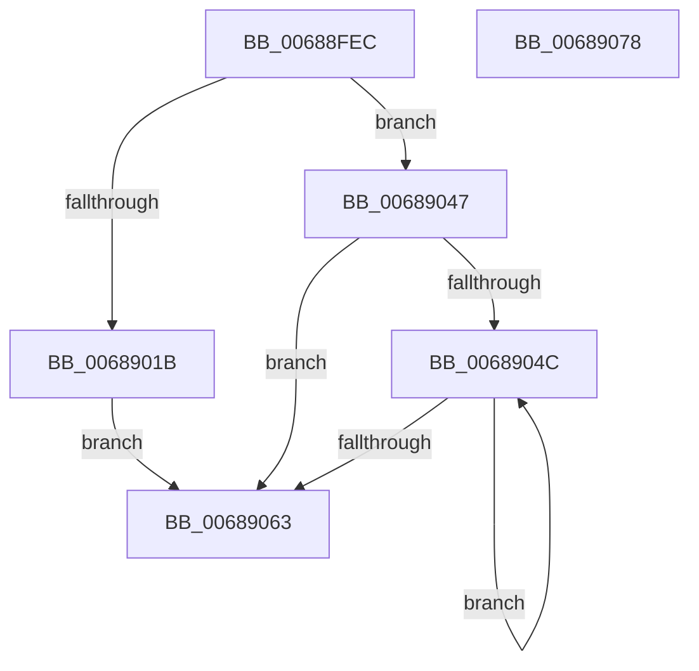

# MiInsertAweFlushList

- RVA: `0x00688FEC`–`0x00689079` (길이 `141` bytes)
- VA: `0x0000000140688FEC`
- 실행 섹션: `.text`
- PDB 이름 있음: `예`; PDB Function 태그: `아니요`
- unwind 정보 RVA: `0x0005C954`
- 디코드: `39`개 명령, `141/141` bytes 표시
- 미해석 바이트: `0` (있으면 어셈블리에 `.byte`로 보존)

> 이 문서는 커널 이미지의 기계어와 PDB 기호를 분석해 생성했습니다. 4번과 5번은 함수 원형과 자료형을 바이너리 사용 방식에서 추정한 C 해석이며 원본 소스 복구 결과는 아닙니다.

## 1. Dependencies

- 직접 호출 지점: **2**; 고유 호출 대상: **2**
- 직접 호출자로 확인된 함수: **2**
- RIP 상대 이미지 참조: **0**

### Outgoing calls
- `0x00689040` → [MiInsertTbFlushEntry](../29/MiInsertTbFlushEntry_function_00293670.md) (function, `0x00293670`)
- `0x00689054` → [MiInsertLargeTbFlushEntry](../37/MiInsertLargeTbFlushEntry_function_0037827C.md) (function, `0x0037827C`)

### Direct callers
- [MiWriteAwePtes](../4C/MiWriteAwePtes_function_004C51E0.md) at `0x004C595F`
- [MiZeroAndFlushAweLazyPtes](MiZeroAndFlushAweLazyPtes_function_00689B1C.md) at `0x00689C28`

### Static image references
- 디코드된 RIP-relative 메모리 참조가 없습니다.

## 2. Other-region calls and transfers

- 다른 실행 섹션으로 향하는 call: **0**
- 별도 외부 분기/꼬리 이동을 확인하지 못했습니다.

## 3. Assembly (complete function range)

```asm
00688FEC  48 89 5C 24 08                  mov qword ptr [rsp + 8], rbx
00688FF1  48 89 6C 24 10                  mov qword ptr [rsp + 0x10], rbp
00688FF6  48 89 74 24 18                  mov qword ptr [rsp + 0x18], rsi
00688FFB  57                              push rdi
00688FFC  48 83 EC 20                     sub rsp, 0x20
00689000  48 8B B9 A0 00 00 00            mov rdi, qword ptr [rcx + 0xa0]
00689007  49 8B D8                        mov rbx, r8
0068900A  44 09 4A 14                     or dword ptr [rdx + 0x14], r9d
0068900E  48 8B F2                        mov rsi, rdx
00689011  8B A9 9C 00 00 00               mov ebp, dword ptr [rcx + 0x9c]
00689017  85 ED                           test ebp, ebp
00689019  75 2C                           jne 0x140689047
0068901B  48 C1 E3 19                     shl rbx, 0x19
0068901F  48 B8 00 00 00 00 80 F6 FF FF   movabs rax, 0xfffff68000000000
00689029  48 C1 E0 19                     shl rax, 0x19
0068902D  45 33 C9                        xor r9d, r9d
00689030  48 2B D8                        sub rbx, rax
00689033  4C 8B C7                        mov r8, rdi
00689036  48 C1 FB 10                     sar rbx, 0x10
0068903A  48 8B CE                        mov rcx, rsi
0068903D  48 8B D3                        mov rdx, rbx
00689040  E8 2B A6 C0 FF                  call 0x140293670
00689045  EB 1C                           jmp 0x140689063
00689047  48 85 FF                        test rdi, rdi
0068904A  74 17                           je 0x140689063
0068904C  4C 8B C3                        mov r8, rbx
0068904F  8B D5                           mov edx, ebp
00689051  48 8B CE                        mov rcx, rsi
00689054  E8 23 F2 CE FF                  call 0x14037827c
00689059  48 83 C3 08                     add rbx, 8
0068905D  48 83 EF 01                     sub rdi, 1
00689061  75 E9                           jne 0x14068904c
00689063  48 8B 5C 24 30                  mov rbx, qword ptr [rsp + 0x30]
00689068  48 8B 6C 24 38                  mov rbp, qword ptr [rsp + 0x38]
0068906D  48 8B 74 24 40                  mov rsi, qword ptr [rsp + 0x40]
00689072  48 83 C4 20                     add rsp, 0x20
00689076  5F                              pop rdi
00689077  C3                              ret
00689078  CC                              int3
```

## 4. C-style interpretation (structured pseudocode)

```c
__int64 __fastcall MiInsertAweFlushList(__int64 a1, __int64 a2, __int64 a3, int a4)
{
    __int64 result;
    __int64 v_rbx;
    __int64 v_rdi;
    __int64 v_rsp;
    unsigned __int64 v_stack_p10;
    unsigned __int64 v_stack_p18;
    unsigned __int64 v_stack_p8;

    v_stack_p8 = v_rbx;
    v_stack_p10 = v_rbp;
    v_stack_p18 = v_rsi;
    v_rsp = (v_rsp) - (32);
    if ((unsigned int)((unsigned int)(*(unsigned int *)(a1 + 156))) != 0) goto loc_00689047;
    v_rbx = (a3) << (25);
    result = (result) << (25);
    a4 = 0;
    v_rbx = (v_rbx) - (result);
    v_rbx = (v_rbx) >> (16);
    result = MiInsertTbFlushEntry(a2, v_rbx, *(unsigned __int64 *)(a1 + 160), a4);
    goto loc_00689063;
loc_00689047:
    if (*(unsigned __int64 *)(a1 + 160) == 0) goto loc_00689063;
loc_0068904C:
    result = MiInsertLargeTbFlushEntry(a2, (unsigned int)((unsigned int)((unsigned int)(*(unsigned int *)(a1 + 156)))), v_rbx, a4);
    v_rbx = (v_rbx) + (8);
    v_rdi = (*(unsigned __int64 *)(a1 + 160)) - (1);
    if (condition_is_not_equal) goto loc_0068904C;
loc_00689063:
    v_rsp = (v_rsp) + (32);
    return result;
}
```

## 5. (Beta) C Style

```c
int64_t MiInsertAweFlushList(void *Arg1, void *Arg2, int64_t Arg3, int32_t Arg4)
{
    uint8_t *arg1 = (uint8_t *)Arg1;
    uint8_t *arg2 = (uint8_t *)Arg2;

    int64_t result;
    int64_t local_rbx;
    int64_t local_rdi;
    int64_t local_rsp;
    uint64_t v_stack_p10;
    uint64_t v_stack_p18;
    uint64_t v_stack_p8;

    v_stack_p8 = local_rbx;
    v_stack_p10 = local_rbp;
    v_stack_p18 = local_rsi;
    local_rsp = (local_rsp) - (32);
    if ((uint32_t)((uint32_t)(*(uint32_t *)(arg1 + 0x9C))) != 0) goto loc_00689047;
    local_rbx = (Arg3) << (25);
    result = (result) << (25);
    Arg4 = 0;
    local_rbx = (local_rbx) - (result);
    local_rbx = (local_rbx) >> (16);
    result = MiInsertTbFlushEntry(Arg2, local_rbx, *(uint64_t *)(arg1 + 0xA0), Arg4);
    goto loc_00689063;
loc_00689047:
    if (*(uint64_t *)(arg1 + 0xA0) == 0) goto loc_00689063;
loc_0068904C:
    result = MiInsertLargeTbFlushEntry(Arg2, (uint32_t)((uint32_t)((uint32_t)(*(uint32_t *)(arg1 + 0x9C)))), local_rbx, Arg4);
    local_rbx = (local_rbx) + (8);
    local_rdi = (*(uint64_t *)(arg1 + 0xA0)) - (1);
    if (condition_is_not_equal) goto loc_0068904C;
loc_00689063:
    local_rsp = (local_rsp) + (32);
    return result;
}
```

### 관측된 메모리 오프셋

구조체 형식이 확인되지 않은 접근은 인자 기준의 오프셋으로만 기록했습니다.

| 기준 인자 | 오프셋 표현 | 폭 (bit) | 접근 |
|---|---:|---:|---|
| `Arg1` | `+ 0x9C` | `32` | `R` |
| `Arg1` | `+ 0xA0` | `64` | `R` |
| `Arg2` | `+ 0x14` | `32` | `R/W` |

## 6. Execution-region graph

[열기: 2D/3D 그래프와 함수 탐색 컨트롤 패널](../../../control-panel.html?section=text&rva=0x00688FEC&view=graph)

- 2D 그래프는 위에서 아래로 흐르고, 3D 그래프는 빈 공간을 드래그해 회전합니다. Shift+드래그는 이동, 휠은 확대·축소, 함수 노드 선택은 대상 보고서 이동입니다.

### Static fallback


