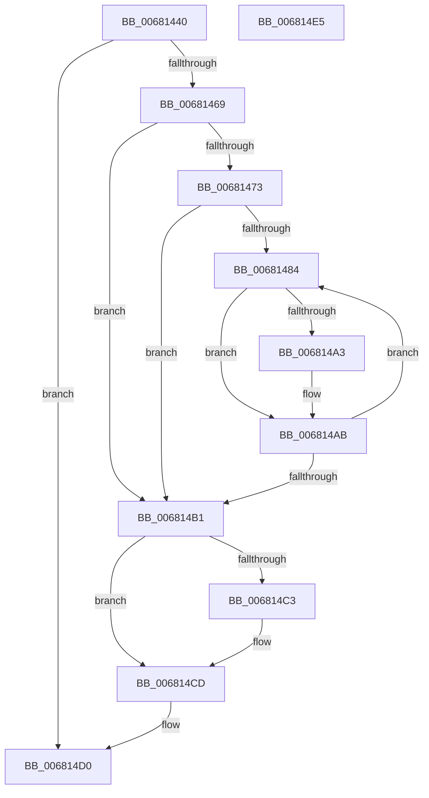

# MiInsertCopyExtents

- RVA: `0x00681440`–`0x006814E6` (길이 `166` bytes)
- VA: `0x0000000140681440`
- 실행 섹션: `.text`
- PDB 이름 있음: `예`; PDB Function 태그: `아니요`
- unwind 정보 RVA: `0x0005C954`
- 디코드: `48`개 명령, `166/166` bytes 표시
- 미해석 바이트: `0` (있으면 어셈블리에 `.byte`로 보존)

> 이 문서는 커널 이미지의 기계어와 PDB 기호를 분석해 생성했습니다. 4번과 5번은 함수 원형과 자료형을 바이너리 사용 방식에서 추정한 C 해석이며 원본 소스 복구 결과는 아닙니다.

## 1. Dependencies

- 직접 호출 지점: **6**; 고유 호출 대상: **6**
- 직접 호출자로 확인된 함수: **2**
- RIP 상대 이미지 참조: **1**

### Outgoing calls
- `0x0068145C` → [MiFormCopyExtents](MiFormCopyExtents_function_006811A4.md) (function, `0x006811A4`)
- `0x00681469` → [MiLockFileExtentsExclusive](../../page/80/MiLockFileExtentsExclusive_function_00801298.md) (function, `0x00801298`)
- `0x006814A6` → [RtlAvlRemoveNode](../29/RtlAvlRemoveNode_function_00296650.md) (function, `0x00296650`)
- `0x006814B4` → [MiInsertExtentList](MiInsertExtentList_function_006814EC.md) (function, `0x006814EC`)
- `0x006814B9` → [MiUnlockFileExtentsExclusive](../../page/80/MiUnlockFileExtentsExclusive_function_00801318.md) (function, `0x00801318`)
- `0x006814C8` → [ExFreePoolWithTag](../../poolcode/B8/ExFreePoolWithTag_function_00B82870.md) (function, `0x00B82870`)

### Direct callers
- [MiAllocateEntireImageFileExtents](../../page/80/MiAllocateEntireImageFileExtents_function_008008DC.md) at `0x008009D6`
- [MiAllocateFileExtents](../../page/AB/MiAllocateFileExtents_function_00ABDF54.md) at `0x00ABE323`

### Static image references
- `0x00681473` → RVA `0x00E2D888` (`.data`; read)

## 2. Other-region calls and transfers

- 다른 실행 섹션으로 향하는 call: **3**
  - `0x00681469` → [MiLockFileExtentsExclusive](../../page/80/MiLockFileExtentsExclusive_function_00801298.md) (`.text` → `PAGE`)
  - `0x006814B9` → [MiUnlockFileExtentsExclusive](../../page/80/MiUnlockFileExtentsExclusive_function_00801318.md) (`.text` → `PAGE`)
  - `0x006814C8` → [ExFreePoolWithTag](../../poolcode/B8/ExFreePoolWithTag_function_00B82870.md) (`.text` → `POOLCODE`)
- 별도 외부 분기/꼬리 이동을 확인하지 못했습니다.

## 3. Assembly (complete function range)

```asm
00681440  48 89 5C 24 08                  mov qword ptr [rsp + 8], rbx
00681445  48 89 6C 24 10                  mov qword ptr [rsp + 0x10], rbp
0068144A  48 89 74 24 18                  mov qword ptr [rsp + 0x18], rsi
0068144F  57                              push rdi
00681450  48 83 EC 20                     sub rsp, 0x20
00681454  49 63 F8                        movsxd rdi, r8d
00681457  48 8B DA                        mov rbx, rdx
0068145A  8B D7                           mov edx, edi
0068145C  E8 43 FD FF FF                  call 0x1406811a4
00681461  48 8B F0                        mov rsi, rax
00681464  48 85 C0                        test rax, rax
00681467  74 67                           je 0x1406814d0
00681469  E8 2A FE 17 00                  call 0x140801298
0068146E  48 85 DB                        test rbx, rbx
00681471  74 3E                           je 0x1406814b1
00681473  48 8D 0D 0E C4 7A 00            lea rcx, [rip + 0x7ac40e]
0068147A  48 8D 2C F9                     lea rbp, [rcx + rdi*8]
0068147E  33 FF                           xor edi, edi
00681480  39 3B                           cmp dword ptr [rbx], edi
00681482  76 2D                           jbe 0x1406814b1
00681484  48 8D 14 7F                     lea rdx, [rdi + rdi*2]
00681488  48 B8 00 00 00 00 00 00 00 80   movabs rax, 0x8000000000000000
00681492  48 C1 E2 04                     shl rdx, 4
00681496  48 83 C2 08                     add rdx, 8
0068149A  48 03 D3                        add rdx, rbx
0068149D  48 39 42 20                     cmp qword ptr [rdx + 0x20], rax
006814A1  74 08                           je 0x1406814ab
006814A3  48 8B CD                        mov rcx, rbp
006814A6  E8 A5 51 C1 FF                  call 0x140296650
006814AB  FF C7                           inc edi
006814AD  3B 3B                           cmp edi, dword ptr [rbx]
006814AF  72 D3                           jb 0x140681484
006814B1  48 8B CE                        mov rcx, rsi
006814B4  E8 33 00 00 00                  call 0x1406814ec
006814B9  E8 5A FE 17 00                  call 0x140801318
006814BE  48 85 DB                        test rbx, rbx
006814C1  74 0A                           je 0x1406814cd
006814C3  33 D2                           xor edx, edx
006814C5  48 8B CB                        mov rcx, rbx
006814C8  E8 A3 13 50 00                  call 0x140b82870
006814CD  48 8B C6                        mov rax, rsi
006814D0  48 8B 5C 24 30                  mov rbx, qword ptr [rsp + 0x30]
006814D5  48 8B 6C 24 38                  mov rbp, qword ptr [rsp + 0x38]
006814DA  48 8B 74 24 40                  mov rsi, qword ptr [rsp + 0x40]
006814DF  48 83 C4 20                     add rsp, 0x20
006814E3  5F                              pop rdi
006814E4  C3                              ret
006814E5  CC                              int3
```

## 4. C-style interpretation (structured pseudocode)

```c
__int64 __fastcall MiInsertCopyExtents(__int64 a1, __int64 a2, int a3)
{
    __int64 result;
    __int64 v_rdi;
    __int64 v_rsp;
    unsigned __int64 v_stack_p10;
    unsigned __int64 v_stack_p18;
    unsigned __int64 v_stack_p8;

    v_stack_p8 = v_rbx;
    v_stack_p10 = v_rbp;
    v_stack_p18 = v_rsi;
    v_rsp = (v_rsp) - (32);
    result = MiFormCopyExtents(a1, (unsigned int)((unsigned int)((int)(a3))), a3, a4);
    if (result == 0) goto loc_006814D0;
    result = MiLockFileExtentsExclusive(a1, (unsigned int)((unsigned int)((int)(a3))), a3, a4);
    if (a2 == 0) goto loc_006814B1;
    v_rdi = 0;
    if ((*(unsigned int *)(a2)) <= 0) goto loc_006814B1;
loc_00681484:
    a2 = (v_rdi + v_rdi * 2) << (4);
    a2 = (a2) + (8);
    a2 = (a2) + (a2);
    if ((*(unsigned __int64 *)(a2 + 32)) != result) {
        a1 = v_rip + 8045582 + (int)(a3) * 8;
        result = RtlAvlRemoveNode(a1, a2, a3, a4);
    }
    v_rdi = (unsigned int)((v_rdi) + 1);
    if (((unsigned int)(v_rdi)) < (*(unsigned int *)(a2))) goto loc_00681484;
loc_006814B1:
    result = MiInsertExtentList(result, a2, a3, a4);
    result = MiUnlockFileExtentsExclusive(result, a2, a3, a4);
    if (a2 != 0) {
        a2 = 0;
        a1 = 0;
        result = ExFreePoolWithTag(a1, a2, a3, a4);
    }
loc_006814D0:
    v_rsp = (v_rsp) + (32);
    return result;
}
```

## 5. (Beta) C Style

```c
int64_t MiInsertCopyExtents(int64_t Arg1, int64_t Arg2, int32_t Arg3)
{
    int64_t result;
    int64_t local_rdi;
    int64_t local_rsp;
    uint64_t v_stack_p10;
    uint64_t v_stack_p18;
    uint64_t v_stack_p8;

    v_stack_p8 = local_rbx;
    v_stack_p10 = local_rbp;
    v_stack_p18 = local_rsi;
    local_rsp = (local_rsp) - (32);
    result = MiFormCopyExtents(Arg1, (uint32_t)((uint32_t)((int32_t)(Arg3))), Arg3, a4);
    if (result == 0) goto loc_006814D0;
    result = MiLockFileExtentsExclusive(Arg1, (uint32_t)((uint32_t)((int32_t)(Arg3))), Arg3, a4);
    if (Arg2 == 0) goto loc_006814B1;
    local_rdi = 0;
    if ((*(uint32_t *)(Arg2)) <= 0) goto loc_006814B1;
loc_00681484:
    Arg2 = (local_rdi + local_rdi * 2) << (4);
    Arg2 = (Arg2) + (8);
    Arg2 = (Arg2) + (Arg2);
    if ((*(uint64_t *)(Arg2 + 0x20)) != result) {
        Arg1 = v_rip + 8045582 + (int32_t)(Arg3) * 8;
        result = RtlAvlRemoveNode(Arg1, Arg2, Arg3, a4);
    }
    local_rdi = (uint32_t)((local_rdi) + 1);
    if (((uint32_t)(local_rdi)) < (*(uint32_t *)(Arg2))) goto loc_00681484;
loc_006814B1:
    result = MiInsertExtentList(result, Arg2, Arg3, a4);
    result = MiUnlockFileExtentsExclusive(result, Arg2, Arg3, a4);
    if (Arg2 != 0) {
        Arg2 = 0;
        Arg1 = 0;
        result = ExFreePoolWithTag(Arg1, Arg2, Arg3, a4);
    }
loc_006814D0:
    local_rsp = (local_rsp) + (32);
    return result;
}
```

## 6. Execution-region graph

[열기: 2D/3D 그래프와 함수 탐색 컨트롤 패널](../../../control-panel.html?section=text&rva=0x00681440&view=graph)

- 2D 그래프는 위에서 아래로 흐르고, 3D 그래프는 빈 공간을 드래그해 회전합니다. Shift+드래그는 이동, 휠은 확대·축소, 함수 노드 선택은 대상 보고서 이동입니다.

### Static fallback


