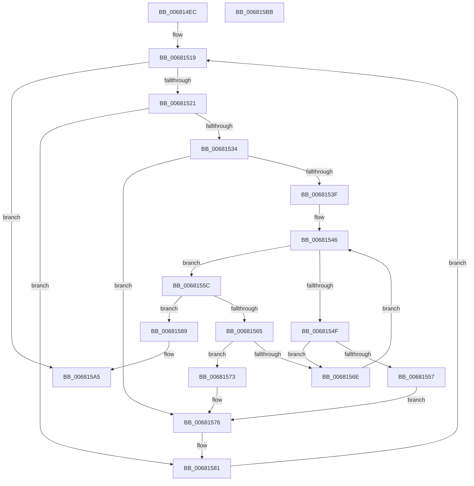

# MiInsertExtentList

- RVA: `0x006814EC`–`0x006815BC` (길이 `208` bytes)
- VA: `0x00000001406814EC`
- 실행 섹션: `.text`
- PDB 이름 있음: `예`; PDB Function 태그: `아니요`
- unwind 정보 RVA: `0x0009B270`
- 디코드: `60`개 명령, `208/208` bytes 표시
- 미해석 바이트: `0` (있으면 어셈블리에 `.byte`로 보존)

> 이 문서는 커널 이미지의 기계어와 PDB 기호를 분석해 생성했습니다. 4번과 5번은 함수 원형과 자료형을 바이너리 사용 방식에서 추정한 C 해석이며 원본 소스 복구 결과는 아닙니다.

## 1. Dependencies

- 직접 호출 지점: **2**; 고유 호출 대상: **2**
- 직접 호출자로 확인된 함수: **2**
- RIP 상대 이미지 참조: **1**

### Outgoing calls
- `0x0068157C` → [RtlAvlInsertNodeEx](../26/RtlAvlInsertNodeEx_function_00265790.md) (function, `0x00265790`)
- `0x0068159F` → [KeBugCheckEx](../4F/KeBugCheckEx_function_004FD660.md) (function, `0x004FD660`)

### Direct callers
- [MiInsertCopyExtents](MiInsertCopyExtents_function_00681440.md) at `0x006814B4`
- [MiMergeCopyExtents](MiMergeCopyExtents_function_00681844.md) at `0x00681A00`

### Static image references
- `0x00681508` → RVA `0x00E2D888` (`.data`; read)

## 2. Other-region calls and transfers

- 다른 실행 섹션으로 향하는 call: **0**
- 별도 외부 분기/꼬리 이동을 확인하지 못했습니다.

## 3. Assembly (complete function range)

```asm
006814EC  48 89 5C 24 08                  mov qword ptr [rsp + 8], rbx
006814F1  48 89 74 24 10                  mov qword ptr [rsp + 0x10], rsi
006814F6  48 89 7C 24 18                  mov qword ptr [rsp + 0x18], rdi
006814FB  41 56                           push r14
006814FD  48 83 EC 30                     sub rsp, 0x30
00681501  48 63 41 04                     movsxd rax, dword ptr [rcx + 4]
00681505  48 8B F1                        mov rsi, rcx
00681508  48 8D 0D 79 C3 7A 00            lea rcx, [rip + 0x7ac379]
0068150F  33 FF                           xor edi, edi
00681511  4C 8D 34 C1                     lea r14, [rcx + rax*8]
00681515  48 8D 5E 08                     lea rbx, [rsi + 8]
00681519  3B 3E                           cmp edi, dword ptr [rsi]
0068151B  0F 83 84 00 00 00               jae 0x1406815a5
00681521  4C 8B 53 20                     mov r10, qword ptr [rbx + 0x20]
00681525  48 B8 00 00 00 00 00 00 00 80   movabs rax, 0x8000000000000000
0068152F  4C 3B D0                        cmp r10, rax
00681532  74 4D                           je 0x140681581
00681534  49 8B 16                        mov rdx, qword ptr [r14]
00681537  45 32 C0                        xor r8b, r8b
0068153A  48 85 D2                        test rdx, rdx
0068153D  74 37                           je 0x140681576
0068153F  4C 8B 43 28                     mov r8, qword ptr [rbx + 0x28]
00681543  4D 03 C2                        add r8, r10
00681546  48 8B 4A 20                     mov rcx, qword ptr [rdx + 0x20]
0068154A  4C 3B C1                        cmp r8, rcx
0068154D  77 0D                           ja 0x14068155c
0068154F  48 8B 02                        mov rax, qword ptr [rdx]
00681552  48 85 C0                        test rax, rax
00681555  75 17                           jne 0x14068156e
00681557  45 32 C0                        xor r8b, r8b
0068155A  EB 1A                           jmp 0x140681576
0068155C  48 03 4A 28                     add rcx, qword ptr [rdx + 0x28]
00681560  4C 3B D1                        cmp r10, rcx
00681563  72 24                           jb 0x140681589
00681565  48 8B 42 08                     mov rax, qword ptr [rdx + 8]
00681569  48 85 C0                        test rax, rax
0068156C  74 05                           je 0x140681573
0068156E  48 8B D0                        mov rdx, rax
00681571  EB D3                           jmp 0x140681546
00681573  41 B0 01                        mov r8b, 1
00681576  4C 8B CB                        mov r9, rbx
00681579  49 8B CE                        mov rcx, r14
0068157C  E8 0F 42 BE FF                  call 0x140265790
00681581  FF C7                           inc edi
00681583  48 83 C3 30                     add rbx, 0x30
00681587  EB 90                           jmp 0x140681519
00681589  4C 8B 4B 28                     mov r9, qword ptr [rbx + 0x28]
0068158D  4D 8B C2                        mov r8, r10
00681590  48 89 54 24 20                  mov qword ptr [rsp + 0x20], rdx
00681595  B9 1A 00 00 00                  mov ecx, 0x1a
0068159A  BA 83 14 00 00                  mov edx, 0x1483
0068159F  E8 BC C0 E7 FF                  call 0x1404fd660
006815A4  CC                              int3
006815A5  48 8B 5C 24 40                  mov rbx, qword ptr [rsp + 0x40]
006815AA  48 8B 74 24 48                  mov rsi, qword ptr [rsp + 0x48]
006815AF  48 8B 7C 24 50                  mov rdi, qword ptr [rsp + 0x50]
006815B4  48 83 C4 30                     add rsp, 0x30
006815B8  41 5E                           pop r14
006815BA  C3                              ret
006815BB  CC                              int3
```

## 4. C-style interpretation (structured pseudocode)

```c
__int64 __fastcall MiInsertExtentList(__int64 a1, __int64 a2, unsigned __int8 a3)
{
    __int64 result;
    __int64 v_rbx;
    __int64 v_rdi;
    __int64 v_rsp;
    unsigned __int64 v_stack_m18;
    unsigned __int64 v_stack_p10;
    unsigned __int64 v_stack_p18;
    unsigned __int64 v_stack_p8;

    v_stack_p8 = v_rbx;
    v_stack_p10 = v_rsi;
    v_stack_p18 = v_rdi;
    v_rsp = (v_rsp) - (48);
    v_rdi = 0;
loc_00681519:
    if (0 >= (*(unsigned int *)(a1))) goto loc_006815A5;
    if ((*(unsigned __int64 *)(a1 + 8 + 32)) == ((int)(*(unsigned int *)(a1 + 4)))) goto loc_00681581;
    a3 = 0;
    if (*(unsigned __int64 *)(v_rip + 8045433 + (int)(*(unsigned int *)(a1 + 4)) * 8) == 0) goto loc_00681576;
    a3 = (*(unsigned __int64 *)(a1 + 8 + 40)) + (*(unsigned __int64 *)(a1 + 8 + 32));
loc_00681546:
    if (a3 > (*(unsigned __int64 *)(*(unsigned __int64 *)(v_rip + 8045433 + (int)(*(unsigned int *)(a1 + 4)) * 8) + 32))) goto loc_0068155C;
    if (*(unsigned __int64 *)(*(unsigned __int64 *)(v_rip + 8045433 + (int)(*(unsigned int *)(a1 + 4)) * 8)) != 0) goto loc_0068156E;
    a3 = 0;
    goto loc_00681576;
loc_0068155C:
    a1 = (*(unsigned __int64 *)(*(unsigned __int64 *)(v_rip + 8045433 + (int)(*(unsigned int *)(a1 + 4)) * 8) + 32)) + (*(unsigned __int64 *)(*(unsigned __int64 *)(v_rip + 8045433 + (int)(*(unsigned int *)(a1 + 4)) * 8) + 40));
    if ((*(unsigned __int64 *)(a1 + 8 + 32)) < a1) goto loc_00681589;
    if (*(unsigned __int64 *)(*(unsigned __int64 *)(v_rip + 8045433 + (int)(*(unsigned int *)(a1 + 4)) * 8) + 8) == 0) goto loc_00681573;
loc_0068156E:
    goto loc_00681546;
loc_00681573:
loc_00681576:
    result = RtlAvlInsertNodeEx(v_rip + 8045433 + (int)(*(unsigned int *)(a1 + 4)) * 8, *(unsigned __int64 *)(*(unsigned __int64 *)(v_rip + 8045433 + (int)(*(unsigned int *)(a1 + 4)) * 8) + 8), 1, a1 + 8);
loc_00681581:
    v_rdi = (unsigned int)((v_rdi) + 1);
    v_rbx = (a1 + 8) + (48);
    goto loc_00681519;
loc_00681589:
    v_stack_m18 = *(unsigned __int64 *)(*(unsigned __int64 *)(v_rip + 8045433 + (int)(*(unsigned int *)(a1 + 4)) * 8) + 8);
    result = KeBugCheckEx(26, (unsigned int)(0x1483ULL), *(unsigned __int64 *)(a1 + 8 + 32), *(unsigned __int64 *)(v_rbx + 40));
loc_006815A5:
    v_rsp = (v_rsp) + (48);
    return result;
}
```

## 5. (Beta) C Style

```c
int64_t MiInsertExtentList(void *Arg1, int64_t Arg2, uint8_t Arg3)
{
    uint8_t *arg1 = (uint8_t *)Arg1;

    int64_t result;
    int64_t local_rbx;
    int64_t local_rdi;
    int64_t local_rsp;
    uint64_t v_stack_m18;
    uint64_t v_stack_p10;
    uint64_t v_stack_p18;
    uint64_t v_stack_p8;

    v_stack_p8 = local_rbx;
    v_stack_p10 = local_rsi;
    v_stack_p18 = local_rdi;
    local_rsp = (local_rsp) - (48);
    local_rdi = 0;
loc_00681519:
    if (0 >= (*(uint32_t *)(arg1))) goto loc_006815A5;
    if ((*(uint64_t *)(arg1 + 0x8 + 0x20)) == ((int32_t)(*(uint32_t *)(arg1 + 0x4)))) goto loc_00681581;
    Arg3 = 0;
    if (*(uint64_t *)(v_rip + 0x7AC379 + (int32_t)(*(uint32_t *)(arg1 + 0x4)) * 8) == 0) goto loc_00681576;
    Arg3 = (*(uint64_t *)(arg1 + 0x8 + 0x28)) + (*(uint64_t *)(arg1 + 0x8 + 0x20));
loc_00681546:
    if (Arg3 > (*(uint64_t *)(*(uint64_t *)(v_rip + 0x7AC379 + (int32_t)(*(uint32_t *)(arg1 + 0x4)) * 8) + 0x20))) goto loc_0068155C;
    if (*(uint64_t *)(*(uint64_t *)(v_rip + 0x7AC379 + (int32_t)(*(uint32_t *)(arg1 + 0x4)) * 8)) != 0) goto loc_0068156E;
    Arg3 = 0;
    goto loc_00681576;
loc_0068155C:
    Arg1 = (*(uint64_t *)(*(uint64_t *)(v_rip + 0x7AC379 + (int32_t)(*(uint32_t *)(arg1 + 0x4)) * 8) + 0x20)) + (*(uint64_t *)(*(uint64_t *)(v_rip + 0x7AC379 + (int32_t)(*(uint32_t *)(arg1 + 0x4)) * 8) + 0x28));
    if ((*(uint64_t *)(arg1 + 0x8 + 0x20)) < Arg1) goto loc_00681589;
    if (*(uint64_t *)(*(uint64_t *)(v_rip + 0x7AC379 + (int32_t)(*(uint32_t *)(arg1 + 0x4)) * 8) + 0x8) == 0) goto loc_00681573;
loc_0068156E:
    goto loc_00681546;
loc_00681573:
loc_00681576:
    result = RtlAvlInsertNodeEx(v_rip + 8045433 + (int32_t)(*(uint32_t *)(arg1 + 0x4)) * 8, *(uint64_t *)(*(uint64_t *)(v_rip + 0x7AC379 + (int32_t)(*(uint32_t *)(arg1 + 0x4)) * 8) + 0x8), 1, Arg1 + 8);
loc_00681581:
    local_rdi = (uint32_t)((local_rdi) + 1);
    local_rbx = (Arg1 + 8) + (48);
    goto loc_00681519;
loc_00681589:
    v_stack_m18 = *(uint64_t *)(*(uint64_t *)(v_rip + 0x7AC379 + (int32_t)(*(uint32_t *)(arg1 + 0x4)) * 8) + 0x8);
    result = KeBugCheckEx(26, (uint32_t)(0x1483ULL), *(uint64_t *)(arg1 + 0x8 + 0x20), *(uint64_t *)(local_rbx + 0x28));
loc_006815A5:
    local_rsp = (local_rsp) + (48);
    return result;
}
```

### 관측된 메모리 오프셋

구조체 형식이 확인되지 않은 접근은 인자 기준의 오프셋으로만 기록했습니다.

| 기준 인자 | 오프셋 표현 | 폭 (bit) | 접근 |
|---|---:|---:|---|
| `Arg1` | `+ 0x0` | `32` | `R` |
| `Arg1` | `+ 0x4` | `32` | `R` |
| `Arg1` | `+ 0x8` | `64` | `R` |
| `Arg1` | `+ 0x20` | `64` | `R` |
| `Arg1` | `+ 0x28` | `64` | `R` |

## 6. Execution-region graph

[열기: 2D/3D 그래프와 함수 탐색 컨트롤 패널](../../../control-panel.html?section=text&rva=0x006814EC&view=graph)

- 2D 그래프는 위에서 아래로 흐르고, 3D 그래프는 빈 공간을 드래그해 회전합니다. Shift+드래그는 이동, 휠은 확대·축소, 함수 노드 선택은 대상 보고서 이동입니다.

### Static fallback


