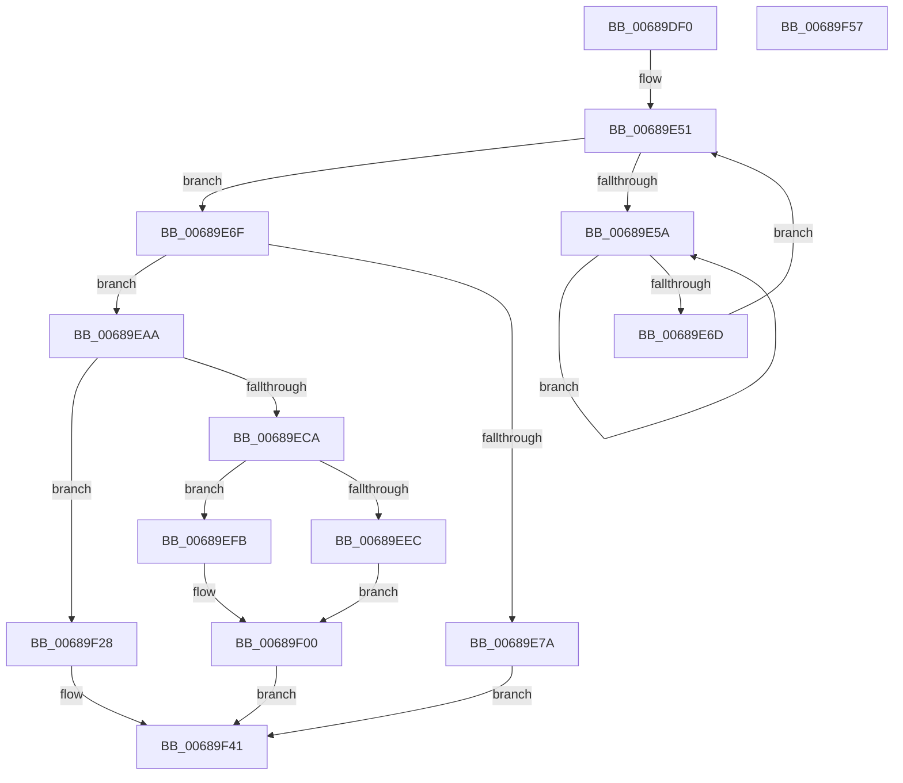

# MiInsertPossiblyBadPage

- RVA: `0x00689DF0`–`0x00689F58` (길이 `360` bytes)
- VA: `0x0000000140689DF0`
- 실행 섹션: `.text`
- PDB 이름 있음: `예`; PDB Function 태그: `아니요`
- unwind 정보 RVA: `0x000D8D14`
- 디코드: `93`개 명령, `360/360` bytes 표시
- 미해석 바이트: `0` (있으면 어셈블리에 `.byte`로 보존)

> 이 문서는 커널 이미지의 기계어와 PDB 기호를 분석해 생성했습니다. 4번과 5번은 함수 원형과 자료형을 바이너리 사용 방식에서 추정한 C 해석이며 원본 소스 복구 결과는 아닙니다.

## 1. Dependencies

- 직접 호출 지점: **7**; 고유 호출 대상: **6**
- 직접 호출자로 확인된 함수: **8**
- RIP 상대 이미지 참조: **2**

### Outgoing calls
- `0x00689E07` → [MI_PAGE_TO_FULL_COLOR](../33/MI_PAGE_TO_FULL_COLOR_function_00337820.md) (function, `0x00337820`)
- `0x00689E5F` → [KeYieldProcessorEx](../3F/KeYieldProcessorEx_function_003FBD00.md) (function, `0x003FBD00`)
- `0x00689E8D` → [MiInsertPageInFreeOrZeroedList](../33/MiInsertPageInFreeOrZeroedList_function_00334D20.md) (function, `0x00334D20`)
- `0x00689EAD` → [MiGetPfnPageSizeIndex](../31/MiGetPfnPageSizeIndex_function_0031C710.md) (function, `0x0031C710`)
- `0x00689EFB` → [MiSetOriginalPtePfnFromFreeList](../28/MiSetOriginalPtePfnFromFreeList_function_0028A99C.md) (function, `0x0028A99C`)
- `0x00689F1E` → [MiInsertDemotedPages](../43/MiInsertDemotedPages_function_004354B8.md) (function, `0x004354B8`)
- `0x00689F2D` → [MiInsertPageInFreeOrZeroedList](../33/MiInsertPageInFreeOrZeroedList_function_00334D20.md) (function, `0x00334D20`)

### Direct callers
- [MiFinishLargePageFree](../37/MiFinishLargePageFree_function_00377B94.md) at `0x00377D65`
- [MiRebuildLargePage](../3B/MiRebuildLargePage_function_003BBAEC.md) at `0x003BBF2E`
- [MiEnableNewPfns](../67/MiEnableNewPfns_function_00671DD0.md) at `0x00671F03`
- [MiTransferPartitionPageRun](../69/MiTransferPartitionPageRun_function_00691DCC.md) at `0x0069212E`
- [sub_006E7436](../6E/Unknown_function_006E7436.md) at `0x006E74F5`
- [sub_006E798E](../6E/Unknown_function_006E798E.md) at `0x006E7A00`
- [sub_006EED9E](../6E/Unknown_function_006EED9E.md) at `0x006EEDFD`
- [sub_006FA666](../6F/Unknown_function_006FA666.md) at `0x006FA714`

### Static image references
- `0x00689E33` → RVA `0x00E30088` (`.data`; read)
- `0x00689EB4` → RVA `0x00011C60` (`.rdata`; read)

## 2. Other-region calls and transfers

- 다른 실행 섹션으로 향하는 call: **0**
- 별도 외부 분기/꼬리 이동을 확인하지 못했습니다.

## 3. Assembly (complete function range)

```asm
00689DF0  48 89 5C 24 10                  mov qword ptr [rsp + 0x10], rbx
00689DF5  48 89 6C 24 20                  mov qword ptr [rsp + 0x20], rbp
00689DFA  56                              push rsi
00689DFB  57                              push rdi
00689DFC  41 56                           push r14
00689DFE  48 83 EC 20                     sub rsp, 0x20
00689E02  8B F2                           mov esi, edx
00689E04  4C 8B F1                        mov r14, rcx
00689E07  E8 14 DA CA FF                  call 0x140337820
00689E0C  4B 8D 1C 76                     lea rbx, [r14 + r14*2]
00689E10  48 C1 E3 04                     shl rbx, 4
00689E14  48 B9 00 00 00 00 00 DE FF FF   movabs rcx, 0xffffde0000000000
00689E1E  48 03 D9                        add rbx, rcx
00689E21  48 C1 E8 09                     shr rax, 9
00689E25  83 E0 3F                        and eax, 0x3f
00689E28  48 69 E8 80 DF 00 00            imul rbp, rax, 0xdf80
00689E2F  48 8B 4B 28                     mov rcx, qword ptr [rbx + 0x28]
00689E33  48 8B 15 4E 62 7A 00            mov rdx, qword ptr [rip + 0x7a624e]
00689E3A  48 C1 E9 2B                     shr rcx, 0x2b
00689E3E  81 E1 FF 03 00 00               and ecx, 0x3ff
00689E44  4C 8B 04 CA                     mov r8, qword ptr [rdx + rcx*8]
00689E48  49 03 68 10                     add rbp, qword ptr [r8 + 0x10]
00689E4C  83 64 24 50 00                  and dword ptr [rsp + 0x50], 0
00689E51  F0 48 0F BA 6B 18 3F            lock bts qword ptr [rbx + 0x18], 0x3f
00689E58  73 15                           jae 0x140689e6f
00689E5A  48 8D 4C 24 50                  lea rcx, [rsp + 0x50]
00689E5F  E8 9C 1E D7 FF                  call 0x1403fbd00
00689E64  48 8B 43 18                     mov rax, qword ptr [rbx + 0x18]
00689E68  48 85 C0                        test rax, rax
00689E6B  78 ED                           js 0x140689e5a
00689E6D  EB E2                           jmp 0x140689e51
00689E6F  48 8B 43 28                     mov rax, qword ptr [rbx + 0x28]
00689E73  48 0F BA E0 28                  bt rax, 0x28
00689E78  72 30                           jb 0x140689eaa
00689E7A  8B 43 20                        mov eax, dword ptr [rbx + 0x20]
00689E7D  8B D6                           mov edx, esi
00689E7F  C1 E8 18                        shr eax, 0x18
00689E82  49 8B CE                        mov rcx, r14
00689E85  C0 E8 06                        shr al, 6
00689E88  24 01                           and al, 1
00689E8A  0F B6 F8                        movzx edi, al
00689E8D  E8 8E AE CA FF                  call 0x140334d20
00689E92  48 B8 FF FF FF FF FF FF FF 7F   movabs rax, 0x7fffffffffffffff
00689E9C  F0 48 21 43 18                  lock and qword ptr [rbx + 0x18], rax
00689EA1  48 83 F7 01                     xor rdi, 1
00689EA5  E9 97 00 00 00                  jmp 0x140689f41
00689EAA  48 8B CB                        mov rcx, rbx
00689EAD  E8 5E 28 C9 FF                  call 0x14031c710
00689EB2  8B C8                           mov ecx, eax
00689EB4  48 8D 3D A5 7D 98 FF            lea rdi, [rip - 0x67825b]
00689EBB  48 8B 43 28                     mov rax, qword ptr [rbx + 0x28]
00689EBF  48 0F BA E0 29                  bt rax, 0x29
00689EC4  48 8B 3C CF                     mov rdi, qword ptr [rdi + rcx*8]
00689EC8  73 5E                           jae 0x140689f28
00689ECA  8B 43 20                        mov eax, dword ptr [rbx + 0x20]
00689ECD  48 8D 4B 10                     lea rcx, [rbx + 0x10]
00689ED1  89 44 24 40                     mov dword ptr [rsp + 0x40], eax
00689ED5  C1 E8 10                        shr eax, 0x10
00689ED8  24 FD                           and al, 0xfd
00689EDA  0C 05                           or al, 5
00689EDC  88 44 24 42                     mov byte ptr [rsp + 0x42], al
00689EE0  8B 44 24 40                     mov eax, dword ptr [rsp + 0x40]
00689EE4  89 43 20                        mov dword ptr [rbx + 0x20], eax
00689EE7  83 FE 01                        cmp esi, 1
00689EEA  75 0F                           jne 0x140689efb
00689EEC  48 8B 01                        mov rax, qword ptr [rcx]
00689EEF  48 25 1F FC FF FF               and rax, 0xfffffffffffffc1f
00689EF5  48 89 43 10                     mov qword ptr [rbx + 0x10], rax
00689EF9  EB 05                           jmp 0x140689f00
00689EFB  E8 9C 0A C0 FF                  call 0x14028a99c
00689F00  48 B8 FF FF FF FF FF FF FF 7F   movabs rax, 0x7fffffffffffffff
00689F0A  F0 48 21 43 18                  lock and qword ptr [rbx + 0x18], rax
00689F0F  41 B9 03 00 00 00               mov r9d, 3
00689F15  45 33 C0                        xor r8d, r8d
00689F18  48 8B D3                        mov rdx, rbx
00689F1B  48 8B CD                        mov rcx, rbp
00689F1E  E8 95 B5 DA FF                  call 0x1404354b8
00689F23  48 8B F8                        mov rdi, rax
00689F26  EB 19                           jmp 0x140689f41
00689F28  8B D6                           mov edx, esi
00689F2A  49 8B CE                        mov rcx, r14
00689F2D  E8 EE AD CA FF                  call 0x140334d20
00689F32  48 B8 FF FF FF FF FF FF FF 7F   movabs rax, 0x7fffffffffffffff
00689F3C  F0 48 21 43 18                  lock and qword ptr [rbx + 0x18], rax
00689F41  48 8B 5C 24 48                  mov rbx, qword ptr [rsp + 0x48]
00689F46  48 8B C7                        mov rax, rdi
00689F49  48 8B 6C 24 58                  mov rbp, qword ptr [rsp + 0x58]
00689F4E  48 83 C4 20                     add rsp, 0x20
00689F52  41 5E                           pop r14
00689F54  5F                              pop rdi
00689F55  5E                              pop rsi
00689F56  C3                              ret
00689F57  CC                              int3
```

## 4. C-style interpretation (structured pseudocode)

```c
__int64 __fastcall MiInsertPossiblyBadPage(__int64 a1, int a2)
{
    __int64 result;
    __int64 v_rbp;
    __int64 v_rbx;
    __int64 v_rdi;
    __int64 v_rsp;
    unsigned __int64 v_stack_p10;
    unsigned int v_stack_p18;
    unsigned __int64 v_stack_p20;
    unsigned int v_stack_p8;
    unsigned __int8 v_stack_pA;

    v_stack_p10 = v_rbx;
    v_stack_p20 = v_rbp;
    v_rsp = (v_rsp) - (32);
    result = MI_PAGE_TO_FULL_COLOR(a1, a2, a3, a4);
    v_rbx = (a1 + a1 * 2) << (4);
    v_rbx = (v_rbx) + (a1);
    result = (result) >> (9);
    result = (unsigned int)((result) & (63));
    v_rbp = (v_rbp) * (result);
    a1 = (*(unsigned __int64 *)(v_rbx + 40)) >> (43);
    a1 = (unsigned int)((a1) & (0x3FFULL));
    v_rbp = (v_rbp) + (*(unsigned __int64 *)(*(unsigned __int64 *)(*(unsigned __int64 *)(v_rip + 8020558) + a1 * 8) + 16));
loc_00689E51:
    if (condition_is_above_or_equal) goto loc_00689E6F;
loc_00689E5A:
    result = KeYieldProcessorEx(v_stack_p18, *(unsigned __int64 *)(v_rip + 8020558), *(unsigned __int64 *)(*(unsigned __int64 *)(v_rip + 8020558) + a1 * 8), a4);
    if (sign_flag) goto loc_00689E5A;
    goto loc_00689E51;
loc_00689E6F:
    if (condition_is_below) goto loc_00689EAA;
    result = (unsigned int)(((unsigned int)(*(unsigned int *)(v_rbx + 32))) >> (24));
    result = (unsigned __int8)((result) >> (6));
    result = (unsigned __int8)((result) & (1));
    result = MiInsertPageInFreeOrZeroedList(a1, (unsigned int)((unsigned int)((unsigned int)(a2))), *(unsigned __int64 *)(*(unsigned __int64 *)(v_rip + 8020558) + a1 * 8), a4);
    v_rdi = ((unsigned __int8)(result)) ^ (1);
    goto loc_00689F41;
loc_00689EAA:
    result = MiGetPfnPageSizeIndex(v_rbx, (unsigned int)((unsigned int)((unsigned int)(a2))), *(unsigned __int64 *)(*(unsigned __int64 *)(v_rip + 8020558) + a1 * 8), a4);
    if (condition_is_above_or_equal) goto loc_00689F28;
    v_stack_p8 = (unsigned int)((unsigned int)(*(unsigned int *)(v_rbx + 32)));
    result = (unsigned int)(((unsigned int)(*(unsigned int *)(v_rbx + 32))) >> (16));
    result = (unsigned __int8)((result) & (253));
    result = (unsigned __int8)((result) | (5));
    v_stack_pA = (unsigned __int8)(result);
    *(unsigned int *)(v_rbx + 32) = (unsigned int)((unsigned int)(v_stack_p8));
    if (((unsigned int)((unsigned int)(a2))) != 1) goto loc_00689EFB;
    result = (*(unsigned __int64 *)(v_rbx + 16)) & (-993);
    *(unsigned __int64 *)(v_rbx + 16) = result;
    goto loc_00689F00;
loc_00689EFB:
    result = MiSetOriginalPtePfnFromFreeList(v_rbx + 16, (unsigned int)((unsigned int)((unsigned int)(a2))), *(unsigned __int64 *)(*(unsigned __int64 *)(v_rip + 8020558) + a1 * 8), a4);
loc_00689F00:
    a3 = 0;
    result = MiInsertDemotedPages(v_rbp, v_rbx, a3, 3);
    goto loc_00689F41;
loc_00689F28:
    result = MiInsertPageInFreeOrZeroedList(a1, (unsigned int)((unsigned int)((unsigned int)(a2))), a3, 3);
loc_00689F41:
    v_rsp = (v_rsp) + (32);
    return result;
}
```

## 5. (Beta) C Style

```c
int64_t MiInsertPossiblyBadPage(void *Arg1, int32_t Arg2)
{
    uint8_t *arg1 = (uint8_t *)Arg1;

    int64_t result;
    int64_t local_rbp;
    int64_t local_rbx;
    int64_t local_rdi;
    int64_t local_rsp;
    uint64_t v_stack_p10;
    uint32_t v_stack_p18;
    uint64_t v_stack_p20;
    uint32_t v_stack_p8;
    uint8_t v_stack_pA;

    v_stack_p10 = local_rbx;
    v_stack_p20 = local_rbp;
    local_rsp = (local_rsp) - (32);
    result = MI_PAGE_TO_FULL_COLOR(Arg1, Arg2, a3, a4);
    local_rbx = (Arg1 + Arg1 * 2) << (4);
    local_rbx = (local_rbx) + (Arg1);
    result = (result) >> (9);
    result = (uint32_t)((result) & (63));
    local_rbp = (local_rbp) * (result);
    Arg1 = (*(uint64_t *)(local_rbx + 0x28)) >> (43);
    Arg1 = (uint32_t)((Arg1) & (0x3FFULL));
    local_rbp = (local_rbp) + (*(uint64_t *)(*(uint64_t *)(*(uint64_t *)(v_rip + 0x7A624E) + arg1 * 8) + 0x10));
loc_00689E51:
    if (condition_is_above_or_equal) goto loc_00689E6F;
loc_00689E5A:
    result = KeYieldProcessorEx(v_stack_p18, *(uint64_t *)(v_rip + 0x7A624E), *(uint64_t *)(*(uint64_t *)(v_rip + 0x7A624E) + arg1 * 8), a4);
    if (sign_flag) goto loc_00689E5A;
    goto loc_00689E51;
loc_00689E6F:
    if (condition_is_below) goto loc_00689EAA;
    result = (uint32_t)(((uint32_t)(*(uint32_t *)(local_rbx + 0x20))) >> (24));
    result = (uint8_t)((result) >> (6));
    result = (uint8_t)((result) & (1));
    result = MiInsertPageInFreeOrZeroedList(Arg1, (uint32_t)((uint32_t)((uint32_t)(Arg2))), *(uint64_t *)(*(uint64_t *)(v_rip + 0x7A624E) + arg1 * 8), a4);
    local_rdi = ((uint8_t)(result)) ^ (1);
    goto loc_00689F41;
loc_00689EAA:
    result = MiGetPfnPageSizeIndex(local_rbx, (uint32_t)((uint32_t)((uint32_t)(Arg2))), *(uint64_t *)(*(uint64_t *)(v_rip + 0x7A624E) + arg1 * 8), a4);
    if (condition_is_above_or_equal) goto loc_00689F28;
    v_stack_p8 = (uint32_t)((uint32_t)(*(uint32_t *)(local_rbx + 0x20)));
    result = (uint32_t)(((uint32_t)(*(uint32_t *)(local_rbx + 0x20))) >> (16));
    result = (uint8_t)((result) & (253));
    result = (uint8_t)((result) | (5));
    v_stack_pA = (uint8_t)(result);
    *(uint32_t *)(local_rbx + 0x20) = (uint32_t)((uint32_t)(v_stack_p8));
    if (((uint32_t)((uint32_t)(Arg2))) != 1) goto loc_00689EFB;
    result = (*(uint64_t *)(local_rbx + 0x10)) & (-993);
    *(uint64_t *)(local_rbx + 0x10) = result;
    goto loc_00689F00;
loc_00689EFB:
    result = MiSetOriginalPtePfnFromFreeList(local_rbx + 16, (uint32_t)((uint32_t)((uint32_t)(Arg2))), *(uint64_t *)(*(uint64_t *)(v_rip + 0x7A624E) + arg1 * 8), a4);
loc_00689F00:
    a3 = 0;
    result = MiInsertDemotedPages(local_rbp, local_rbx, a3, 3);
    goto loc_00689F41;
loc_00689F28:
    result = MiInsertPageInFreeOrZeroedList(Arg1, (uint32_t)((uint32_t)((uint32_t)(Arg2))), a3, 3);
loc_00689F41:
    local_rsp = (local_rsp) + (32);
    return result;
}
```

### 관측된 메모리 오프셋

구조체 형식이 확인되지 않은 접근은 인자 기준의 오프셋으로만 기록했습니다.

| 기준 인자 | 오프셋 표현 | 폭 (bit) | 접근 |
|---|---:|---:|---|
| `Arg1` | `+ 0x0 + r14*2` | `64` | `R` |

## 6. Execution-region graph

[열기: 2D/3D 그래프와 함수 탐색 컨트롤 패널](../../../control-panel.html?section=text&rva=0x00689DF0&view=graph)

- 2D 그래프는 위에서 아래로 흐르고, 3D 그래프는 빈 공간을 드래그해 회전합니다. Shift+드래그는 이동, 휠은 확대·축소, 함수 노드 선택은 대상 보고서 이동입니다.

### Static fallback


