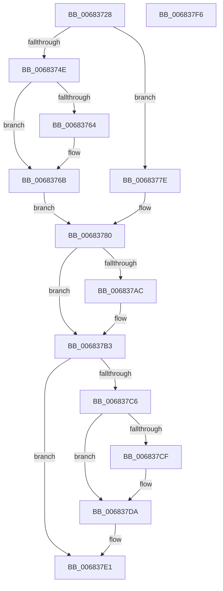

# MiLinkHotPatchToBase

- RVA: `0x00683728`–`0x006837F7` (길이 `207` bytes)
- VA: `0x0000000140683728`
- 실행 섹션: `.text`
- PDB 이름 있음: `예`; PDB Function 태그: `아니요`
- unwind 정보 RVA: `0x0005C954`
- 디코드: `53`개 명령, `207/207` bytes 표시
- 미해석 바이트: `0` (있으면 어셈블리에 `.byte`로 보존)

> 이 문서는 커널 이미지의 기계어와 PDB 기호를 분석해 생성했습니다. 4번과 5번은 함수 원형과 자료형을 바이너리 사용 방식에서 추정한 C 해석이며 원본 소스 복구 결과는 아닙니다.

## 1. Dependencies

- 직접 호출 지점: **3**; 고유 호출 대상: **3**
- 직접 호출자로 확인된 함수: **2**
- RIP 상대 이미지 참조: **2**

### Outgoing calls
- `0x00683766` → [KiRaiseIrqlProcessIrqlFlags](../4F/KiRaiseIrqlProcessIrqlFlags_function_004F56FC.md) (function, `0x004F56FC`)
- `0x00683777` → [MiUpdatePatchInProgress](MiUpdatePatchInProgress_function_00683E04.md) (function, `0x00683E04`)
- `0x006837D5` → [KiLowerIrqlProcessIrqlFlags](../4F/KiLowerIrqlProcessIrqlFlags_function_004F5698.md) (function, `0x004F5698`)

### Direct callers
- [MiApplyDriverHotPatch](../../page/80/MiApplyDriverHotPatch_function_008018EC.md) at `0x00801DC1`
- [MiCreateBootDriverHotPatchLinkage](../../init/C6/MiCreateBootDriverHotPatchLinkage_function_00C67358.md) at `0x00C673B7`

### Static image references
- `0x0068373C` → RVA `0x00FC6A88` (`ALMOSTRO`; read)
- `0x0068375B` → RVA `0x00FC6D20` (`ALMOSTRO`; read)

## 2. Other-region calls and transfers

- 다른 실행 섹션으로 향하는 call: **0**
- 별도 외부 분기/꼬리 이동을 확인하지 못했습니다.

## 3. Assembly (complete function range)

```asm
00683728  48 89 5C 24 08                  mov qword ptr [rsp + 8], rbx
0068372D  48 89 6C 24 10                  mov qword ptr [rsp + 0x10], rbp
00683732  48 89 74 24 18                  mov qword ptr [rsp + 0x18], rsi
00683737  57                              push rdi
00683738  48 83 EC 20                     sub rsp, 0x20
0068373C  F6 05 45 33 94 00 30            test byte ptr [rip + 0x943345], 0x30
00683743  41 8B E8                        mov ebp, r8d
00683746  48 8B FA                        mov rdi, rdx
00683749  48 8B F1                        mov rsi, rcx
0068374C  74 30                           je 0x14068377e
0068374E  44 0F 20 C3                     mov rbx, cr8
00683752  BA 02 00 00 00                  mov edx, 2
00683757  44 0F 22 C2                     mov cr8, rdx
0068375B  83 3D BE 35 94 00 00            cmp dword ptr [rip + 0x9435be], 0
00683762  74 07                           je 0x14068376b
00683764  8A CB                           mov cl, bl
00683766  E8 91 1F E7 FF                  call 0x1404f56fc
0068376B  41 B8 03 00 00 00               mov r8d, 3
00683771  48 8B D7                        mov rdx, rdi
00683774  48 8B CE                        mov rcx, rsi
00683777  E8 88 06 00 00                  call 0x140683e04
0068377C  EB 02                           jmp 0x140683780
0068377E  B3 11                           mov bl, 0x11
00683780  0F BA AF B8 00 00 00 07         bts dword ptr [rdi + 0xb8], 7
00683788  48 8D 96 00 01 00 00            lea rdx, [rsi + 0x100]
0068378F  48 89 B7 F8 00 00 00            mov qword ptr [rdi + 0xf8], rsi
00683796  48 8D 87 00 01 00 00            lea rax, [rdi + 0x100]
0068379D  89 AF 10 01 00 00               mov dword ptr [rdi + 0x110], ebp
006837A3  4C 8B 42 08                     mov r8, qword ptr [rdx + 8]
006837A7  49 39 10                        cmp qword ptr [r8], rdx
006837AA  74 07                           je 0x1406837b3
006837AC  B9 03 00 00 00                  mov ecx, 3
006837B1  CD 29                           int 0x29
006837B3  48 89 10                        mov qword ptr [rax], rdx
006837B6  4C 89 40 08                     mov qword ptr [rax + 8], r8
006837BA  49 89 00                        mov qword ptr [r8], rax
006837BD  48 89 42 08                     mov qword ptr [rdx + 8], rax
006837C1  80 FB 11                        cmp bl, 0x11
006837C4  74 1B                           je 0x1406837e1
006837C6  83 3D 53 35 94 00 00            cmp dword ptr [rip + 0x943553], 0
006837CD  74 0B                           je 0x1406837da
006837CF  44 0F 20 C1                     mov rcx, cr8
006837D3  8A D3                           mov dl, bl
006837D5  E8 BE 1E E7 FF                  call 0x1404f5698
006837DA  0F B6 C3                        movzx eax, bl
006837DD  44 0F 22 C0                     mov cr8, rax
006837E1  48 8B 5C 24 30                  mov rbx, qword ptr [rsp + 0x30]
006837E6  48 8B 6C 24 38                  mov rbp, qword ptr [rsp + 0x38]
006837EB  48 8B 74 24 40                  mov rsi, qword ptr [rsp + 0x40]
006837F0  48 83 C4 20                     add rsp, 0x20
006837F4  5F                              pop rdi
006837F5  C3                              ret
006837F6  CC                              int3
```

## 4. C-style interpretation (structured pseudocode)

```c
__int64 __fastcall MiLinkHotPatchToBase(__int64 a1, __int64 a2, int a3)
{
    __int64 result;
    __int64 v_rsp;
    unsigned __int64 v_stack_p10;
    unsigned __int64 v_stack_p18;
    unsigned __int64 v_stack_p8;

    v_stack_p8 = v_rbx;
    v_stack_p10 = v_rbp;
    v_stack_p18 = v_rsi;
    v_rsp = (v_rsp) - (32);
    if (((*(unsigned __int8 *)(v_rip + 9712453)) & (48)) == 0) goto loc_0068377E;
    if ((*(unsigned int *)(v_rip + 9713086)) != 0) {
        a1 = (unsigned __int8)(v_cr8);
        result = KiRaiseIrqlProcessIrqlFlags(a1, 2, a3, a4);
    }
    result = MiUpdatePatchInProgress(a1, a2, 3, a4);
    goto loc_00683780;
loc_0068377E:
loc_00683780:
    *(unsigned __int64 *)(a2 + 248) = a1;
    *(unsigned int *)(a2 + 272) = (unsigned int)((unsigned int)(a3));
    if ((*(unsigned __int64 *)(*(unsigned __int64 *)(a1 + 256 + 8))) != (a1 + 256)) {
        a1 = 3;
    }
    *(unsigned __int64 *)(a2 + 256) = a1 + 256;
    *(unsigned __int64 *)(a2 + 256 + 8) = *(unsigned __int64 *)(a1 + 256 + 8);
    *(unsigned __int64 *)(*(unsigned __int64 *)(a1 + 256 + 8)) = a2 + 256;
    *(unsigned __int64 *)(a1 + 256 + 8) = a2 + 256;
    if (17 == 17) goto loc_006837E1;
    result = a2 + 256;
    if ((*(unsigned int *)(v_rip + 9712979)) != 0) {
        a1 = 2;
        a2 = 17;
        result = KiLowerIrqlProcessIrqlFlags(a1, a2, *(unsigned __int64 *)(a1 + 256 + 8), a4);
    }
loc_006837E1:
    v_rsp = (v_rsp) + (32);
    return 17;
}
```

## 5. (Beta) C Style

```c
int64_t MiLinkHotPatchToBase(void *Arg1, void *Arg2, int32_t Arg3)
{
    uint8_t *arg1 = (uint8_t *)Arg1;
    uint8_t *arg2 = (uint8_t *)Arg2;

    int64_t result;
    int64_t local_rsp;
    uint64_t v_stack_p10;
    uint64_t v_stack_p18;
    uint64_t v_stack_p8;

    v_stack_p8 = local_rbx;
    v_stack_p10 = local_rbp;
    v_stack_p18 = local_rsi;
    local_rsp = (local_rsp) - (32);
    if (((*(uint8_t *)(v_rip + 0x943345)) & (48)) == 0) goto loc_0068377E;
    if ((*(uint32_t *)(v_rip + 0x9435BE)) != 0) {
        Arg1 = (uint8_t)(v_cr8);
        result = KiRaiseIrqlProcessIrqlFlags(Arg1, 2, Arg3, a4);
    }
    result = MiUpdatePatchInProgress(Arg1, Arg2, 3, a4);
    goto loc_00683780;
loc_0068377E:
loc_00683780:
    *(void **)(arg2 + 0xF8) = Arg1;
    *(uint32_t *)(arg2 + 0x110) = (uint32_t)((uint32_t)(Arg3));
    if ((*(uint64_t *)(*(uint64_t *)(arg1 + 0x100 + 0x8))) != (Arg1 + 256)) {
        Arg1 = 3;
    }
    *(void **)(arg2 + 0x100) = Arg1 + 256;
    *(uint64_t *)(arg2 + 0x100 + 0x8) = *(uint64_t *)(arg1 + 0x100 + 0x8);
    *(void **)(*(uint64_t *)(arg1 + 0x100 + 0x8)) = Arg2 + 256;
    *(void **)(arg1 + 0x100 + 0x8) = Arg2 + 256;
    if (17 == 17) goto loc_006837E1;
    result = Arg2 + 256;
    if ((*(uint32_t *)(v_rip + 0x943553)) != 0) {
        Arg1 = 2;
        Arg2 = 17;
        result = KiLowerIrqlProcessIrqlFlags(Arg1, Arg2, *(uint64_t *)(arg1 + 0x100 + 0x8), a4);
    }
loc_006837E1:
    local_rsp = (local_rsp) + (32);
    return 17;
}
```

### 관측된 메모리 오프셋

구조체 형식이 확인되지 않은 접근은 인자 기준의 오프셋으로만 기록했습니다.

| 기준 인자 | 오프셋 표현 | 폭 (bit) | 접근 |
|---|---:|---:|---|
| `Arg1` | `+ 0x8` | `64` | `R` |
| `Arg1` | `+ 0x8` | `64` | `W` |
| `Arg1` | `+ 0x100` | `64` | `R` |
| `Arg2` | `+ 0x0` | `64` | `W` |
| `Arg2` | `+ 0x8` | `64` | `W` |
| `Arg2` | `+ 0xB8` | `32` | `R/W` |
| `Arg2` | `+ 0xF8` | `64` | `W` |
| `Arg2` | `+ 0x100` | `64` | `R` |
| `Arg2` | `+ 0x110` | `32` | `W` |

## 6. Execution-region graph

[열기: 2D/3D 그래프와 함수 탐색 컨트롤 패널](../../../control-panel.html?section=text&rva=0x00683728&view=graph)

- 2D 그래프는 위에서 아래로 흐르고, 3D 그래프는 빈 공간을 드래그해 회전합니다. Shift+드래그는 이동, 휠은 확대·축소, 함수 노드 선택은 대상 보고서 이동입니다.

### Static fallback


