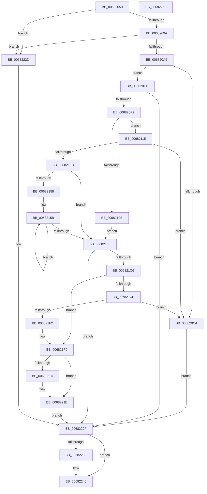

# MiLockPatchIatForDV

- RVA: `0x00682050`–`0x00682260` (길이 `528` bytes)
- VA: `0x0000000140682050`
- 실행 섹션: `.text`
- PDB 이름 있음: `예`; PDB Function 태그: `아니요`
- unwind 정보 RVA: `0x00060284`
- 디코드: `151`개 명령, `528/528` bytes 표시
- 미해석 바이트: `0` (있으면 어셈블리에 `.byte`로 보존)

> 이 문서는 커널 이미지의 기계어와 PDB 기호를 분석해 생성했습니다. 4번과 5번은 함수 원형과 자료형을 바이너리 사용 방식에서 추정한 C 해석이며 원본 소스 복구 결과는 아닙니다.

## 1. Dependencies

- 직접 호출 지점: **9**; 고유 호출 대상: **9**
- 직접 호출자로 확인된 함수: **0**
- RIP 상대 이미지 참조: **2**

### Outgoing calls
- `0x00682089` → [RtlImageDirectoryEntryToData](../43/RtlImageDirectoryEntryToData_function_004328D0.md) (function, `0x004328D0`)
- `0x006820B7` → [ExAllocatePool2](../../poolcode/B8/ExAllocatePool2_function_00B820F0.md) (function, `0x00B820F0`)
- `0x006820D8` → [MiInitializeDriverPatchState](../../page/AB/MiInitializeDriverPatchState_function_00AB07A4.md) (function, `0x00AB07A4`)
- `0x006820DF` → [MiGetAnyMultiplexedVm](../44/MiGetAnyMultiplexedVm_function_00448BD0.md) (function, `0x00448BD0`)
- `0x006820EA` → [MiPrepareDriverPatchState](../../page/7F/MiPrepareDriverPatchState_function_007F8C8C.md) (function, `0x007F8C8C`)
- `0x00682129` → [IoAllocateMdl](../29/IoAllocateMdl_function_0029EBF0.md) (function, `0x0029EBF0`)
- `0x006821BB` → [MiLockDriverPageRange](../67/MiLockDriverPageRange_function_00670160.md) (function, `0x00670160`)
- `0x006821E4` → [MmMapLockedPagesSpecifyCache](../31/MmMapLockedPagesSpecifyCache_function_00318800.md) (function, `0x00318800`)
- `0x0068223B` → [MiUnlockAndFreeDvPatchImage](MiUnlockAndFreeDvPatchImage_function_00682A78.md) (function, `0x00682A78`)

### Direct callers
- 이 함수 시작 RVA로 연결되는 직접 call은 확인되지 않았습니다. 간접 호출은 완전히 역산할 수 없습니다.

### Static image references
- `0x006820F9` → RVA `0x00FC6A88` (`ALMOSTRO`; read)
- `0x0068215B` → RVA `0x00E37438` (`.data`; read)

## 2. Other-region calls and transfers

- 다른 실행 섹션으로 향하는 call: **3**
  - `0x006820B7` → [ExAllocatePool2](../../poolcode/B8/ExAllocatePool2_function_00B820F0.md) (`.text` → `POOLCODE`)
  - `0x006820D8` → [MiInitializeDriverPatchState](../../page/AB/MiInitializeDriverPatchState_function_00AB07A4.md) (`.text` → `PAGE`)
  - `0x006820EA` → [MiPrepareDriverPatchState](../../page/7F/MiPrepareDriverPatchState_function_007F8C8C.md) (`.text` → `PAGE`)
- 별도 외부 분기/꼬리 이동을 확인하지 못했습니다.

## 3. Assembly (complete function range)

```asm
00682050  48 89 5C 24 18                  mov qword ptr [rsp + 0x18], rbx
00682055  55                              push rbp
00682056  56                              push rsi
00682057  57                              push rdi
00682058  41 54                           push r12
0068205A  41 55                           push r13
0068205C  41 56                           push r14
0068205E  41 57                           push r15
00682060  48 83 EC 30                     sub rsp, 0x30
00682064  83 64 24 70 00                  and dword ptr [rsp + 0x70], 0
00682069  4C 8D 4C 24 70                  lea r9, [rsp + 0x70]
0068206E  83 64 24 78 00                  and dword ptr [rsp + 0x78], 0
00682073  33 FF                           xor edi, edi
00682075  4C 8B EA                        mov r13, rdx
00682078  4C 8B F1                        mov r14, rcx
0068207B  48 8B 49 30                     mov rcx, qword ptr [rcx + 0x30]
0068207F  8D 77 01                        lea esi, [rdi + 1]
00682082  40 8A D6                        mov dl, sil
00682085  44 8D 47 0C                     lea r8d, [rdi + 0xc]
00682089  E8 42 08 DB FF                  call 0x1404328d0
0068208E  48 8B E8                        mov rbp, rax
00682091  48 85 C0                        test rax, rax
00682094  0F 84 93 01 00 00               je 0x14068222d
0068209A  44 8B 7C 24 70                  mov r15d, dword ptr [rsp + 0x70]
0068209F  41 83 FF 08                     cmp r15d, 8
006820A3  0F 82 84 01 00 00               jb 0x14068222d
006820A9  BA 90 00 00 00                  mov edx, 0x90
006820AE  8D 4F 40                        lea ecx, [rdi + 0x40]
006820B1  41 B8 48 6F 74 50               mov r8d, 0x50746f48
006820B7  E8 34 00 50 00                  call 0x140b820f0
006820BC  48 8B F8                        mov rdi, rax
006820BF  48 85 C0                        test rax, rax
006820C2  75 0A                           jne 0x1406820ce
006820C4  BB 9A 00 00 C0                  mov ebx, 0xc000009a
006820C9  E9 61 01 00 00                  jmp 0x14068222f
006820CE  4C 8D 60 10                     lea r12, [rax + 0x10]
006820D2  49 8B CE                        mov rcx, r14
006820D5  49 8B D4                        mov rdx, r12
006820D8  E8 C7 E6 42 00                  call 0x140ab07a4
006820DD  8B CE                           mov ecx, esi
006820DF  E8 EC 6A DC FF                  call 0x140448bd0
006820E4  48 8B D0                        mov rdx, rax
006820E7  49 8B CC                        mov rcx, r12
006820EA  E8 9D 6B 17 00                  call 0x1407f8c8c
006820EF  8B D8                           mov ebx, eax
006820F1  85 C0                           test eax, eax
006820F3  0F 88 36 01 00 00               js 0x14068222f
006820F9  48 F7 05 84 49 94 00 00 80 00 00  test qword ptr [rip + 0x944984], 0x8000
00682104  BB FF 0F 00 00                  mov ebx, 0xfff
00682109  74 0A                           je 0x140682115
0068210B  89 74 24 78                     mov dword ptr [rsp + 0x78], esi
0068210F  48 8D 77 78                     lea rsi, [rdi + 0x78]
00682113  EB 73                           jmp 0x140682188
00682115  41 8B 56 40                     mov edx, dword ptr [r14 + 0x40]
00682119  45 33 C9                        xor r9d, r9d
0068211C  49 8B 4E 30                     mov rcx, qword ptr [r14 + 0x30]
00682120  45 33 C0                        xor r8d, r8d
00682123  48 83 64 24 20 00               and qword ptr [rsp + 0x20], 0
00682129  E8 C2 CA C1 FF                  call 0x14029ebf0
0068212E  48 8D 77 78                     lea rsi, [rdi + 0x78]
00682132  48 8B D0                        mov rdx, rax
00682135  48 89 06                        mov qword ptr [rsi], rax
00682138  48 85 C0                        test rax, rax
0068213B  74 87                           je 0x1406820c4
0068213D  8B 48 20                        mov ecx, dword ptr [rax + 0x20]
00682140  45 33 C9                        xor r9d, r9d
00682143  8B 40 28                        mov eax, dword ptr [rax + 0x28]
00682146  48 23 CB                        and rcx, rbx
00682149  48 03 CB                        add rcx, rbx
0068214C  48 03 C8                        add rcx, rax
0068214F  48 F7 C1 00 F0 FF FF            test rcx, -0x1000
00682156  76 30                           jbe 0x140682188
00682158  45 33 C0                        xor r8d, r8d
0068215B  48 8B 05 D6 52 7B 00            mov rax, qword ptr [rip + 0x7b52d6]
00682162  41 FF C1                        inc r9d
00682165  4A 89 44 C2 30                  mov qword ptr [rdx + r8*8 + 0x30], rax
0068216A  48 8B 06                        mov rax, qword ptr [rsi]
0068216D  45 8B C1                        mov r8d, r9d
00682170  8B 48 20                        mov ecx, dword ptr [rax + 0x20]
00682173  8B 40 28                        mov eax, dword ptr [rax + 0x28]
00682176  48 23 CB                        and rcx, rbx
00682179  48 03 CB                        add rcx, rbx
0068217C  48 03 C8                        add rcx, rax
0068217F  48 C1 E9 0C                     shr rcx, 0xc
00682183  4C 3B C1                        cmp r8, rcx
00682186  72 D3                           jb 0x14068215b
00682188  44 8B 4C 24 78                  mov r9d, dword ptr [rsp + 0x78]
0068218D  49 8D 87 FF 0F 00 00            lea rax, [r15 + 0xfff]
00682194  8B D5                           mov edx, ebp
00682196  44 8B C5                        mov r8d, ebp
00682199  41 2B 56 30                     sub edx, dword ptr [r14 + 0x30]
0068219D  4C 23 C3                        and r8, rbx
006821A0  4C 03 C0                        add r8, rax
006821A3  C1 EA 0C                        shr edx, 0xc
006821A6  48 8B 06                        mov rax, qword ptr [rsi]
006821A9  49 8B CC                        mov rcx, r12
006821AC  49 C1 E8 0C                     shr r8, 0xc
006821B0  41 FF C8                        dec r8d
006821B3  48 89 44 24 20                  mov qword ptr [rsp + 0x20], rax
006821B8  44 03 C2                        add r8d, edx
006821BB  E8 A0 DF FE FF                  call 0x140670160
006821C0  8B D8                           mov ebx, eax
006821C2  85 C0                           test eax, eax
006821C4  78 69                           js 0x14068222f
006821C6  48 8B 0E                        mov rcx, qword ptr [rsi]
006821C9  48 85 C9                        test rcx, rcx
006821CC  74 2B                           je 0x1406821f9
006821CE  45 33 C9                        xor r9d, r9d
006821D1  C7 44 24 28 10 00 00 40         mov dword ptr [rsp + 0x28], 0x40000010
006821D9  83 64 24 20 00                  and dword ptr [rsp + 0x20], 0
006821DE  33 D2                           xor edx, edx
006821E0  45 8D 41 01                     lea r8d, [r9 + 1]
006821E4  E8 17 66 C9 FF                  call 0x140318800
006821E9  48 85 C0                        test rax, rax
006821EC  0F 84 D2 FE FF FF               je 0x1406820c4
006821F2  49 2B 46 30                     sub rax, qword ptr [r14 + 0x30]
006821F6  48 03 E8                        add rbp, rax
006821F9  49 8D 45 38                     lea rax, [r13 + 0x38]
006821FD  48 89 AF 80 00 00 00            mov qword ptr [rdi + 0x80], rbp
00682204  44 89 BF 88 00 00 00            mov dword ptr [rdi + 0x88], r15d
0068220B  48 8B 48 08                     mov rcx, qword ptr [rax + 8]
0068220F  48 39 01                        cmp qword ptr [rcx], rax
00682212  74 07                           je 0x14068221b
00682214  B9 03 00 00 00                  mov ecx, 3
00682219  CD 29                           int 0x29
0068221B  48 89 07                        mov qword ptr [rdi], rax
0068221E  48 89 4F 08                     mov qword ptr [rdi + 8], rcx
00682222  48 89 39                        mov qword ptr [rcx], rdi
00682225  48 89 78 08                     mov qword ptr [rax + 8], rdi
00682229  33 FF                           xor edi, edi
0068222B  EB 02                           jmp 0x14068222f
0068222D  33 DB                           xor ebx, ebx
0068222F  41 89 5D 48                     mov dword ptr [r13 + 0x48], ebx
00682233  48 85 FF                        test rdi, rdi
00682236  74 08                           je 0x140682240
00682238  48 8B CF                        mov rcx, rdi
0068223B  E8 38 08 00 00                  call 0x140682a78
00682240  F7 D3                           not ebx
00682242  C1 EB 1F                        shr ebx, 0x1f
00682245  8B C3                           mov eax, ebx
00682247  48 8B 9C 24 80 00 00 00         mov rbx, qword ptr [rsp + 0x80]
0068224F  48 83 C4 30                     add rsp, 0x30
00682253  41 5F                           pop r15
00682255  41 5E                           pop r14
00682257  41 5D                           pop r13
00682259  41 5C                           pop r12
0068225B  5F                              pop rdi
0068225C  5E                              pop rsi
0068225D  5D                              pop rbp
0068225E  C3                              ret
0068225F  CC                              int3
```

## 4. C-style interpretation (structured pseudocode)

```c
__int64 __fastcall MiLockPatchIatForDV(__int64 a1, __int64 a2)
{
    __int64 result;
    __int64 v_rbp;
    __int64 v_rbx;
    __int64 v_rdi;
    __int64 v_rsp;
    unsigned int v_stack_m40;
    unsigned __int64 v_stack_m48;
    unsigned int v_stack_p10;
    unsigned __int64 v_stack_p18;
    unsigned int v_stack_p8;

    v_stack_p18 = v_rbx;
    v_rsp = (v_rsp) - (48);
    v_rdi = 0;
    result = RtlImageDirectoryEntryToData(*(unsigned __int64 *)(a1 + 48), (unsigned __int8)(v_rdi + 1), v_rdi + 12, v_stack_p8);
    if (result == 0) goto loc_0068222D;
    if (((unsigned int)((unsigned int)(v_stack_p8))) < 8) goto loc_0068222D;
    result = ExAllocatePool2(v_rdi + 64, 144, (unsigned int)(0x50746F48ULL), v_stack_p8);
    if (result != 0) goto loc_006820CE;
loc_006820C4:
    goto loc_0068222F;
loc_006820CE:
    result = MiInitializeDriverPatchState(a1, result + 16, (unsigned int)(0x50746F48ULL), v_stack_p8);
    result = MiGetAnyMultiplexedVm((unsigned int)((unsigned int)(v_rdi + 1)), result + 16, (unsigned int)(0x50746F48ULL), v_stack_p8);
    result = MiPrepareDriverPatchState(result + 16, result, (unsigned int)(0x50746F48ULL), v_stack_p8);
    if (sign_flag) goto loc_0068222F;
    if (((*(unsigned __int64 *)(v_rip + 9718148)) & (0x8000ULL)) == 0) goto loc_00682115;
    v_stack_p10 = (unsigned int)(v_rdi + 1);
    goto loc_00682188;
loc_00682115:
    a4 = 0;
    a3 = 0;
    result = IoAllocateMdl(*(unsigned __int64 *)(a1 + 48), (unsigned int)(*(unsigned int *)(a1 + 64)), a3, a4);
    *(unsigned __int64 *)(result + 120) = result;
    if (result == 0) goto loc_006820C4;
    a4 = 0;
    a1 = ((unsigned int)(*(unsigned int *)(result + 32))) & ((unsigned int)(0xFFFULL));
    a1 = (a1) + ((unsigned int)(0xFFFULL));
    a1 = (a1) + ((unsigned int)(*(unsigned int *)(result + 40)));
    if (condition_is_below_or_equal) goto loc_00682188;
    a3 = 0;
loc_0068215B:
    a4 = (unsigned int)((a4) + 1);
    *(unsigned __int64 *)(result + a3 * 8 + 48) = *(unsigned __int64 *)(v_rip + 8082134);
    a1 = ((unsigned int)(*(unsigned int *)(*(unsigned __int64 *)(result + 120) + 32))) & ((unsigned int)(0xFFFULL));
    a1 = (a1) + ((unsigned int)(0xFFFULL));
    a1 = (a1) + ((unsigned int)(*(unsigned int *)(*(unsigned __int64 *)(result + 120) + 40)));
    a1 = (a1) >> (12);
    if (((unsigned int)((unsigned int)(a4))) < a1) goto loc_0068215B;
loc_00682188:
    a2 = (unsigned int)(((unsigned int)((unsigned int)(result))) - (*(unsigned int *)(a1 + 48)));
    a3 = ((unsigned int)((unsigned int)(result))) & ((unsigned int)(0xFFFULL));
    a3 = (a3) + ((unsigned int)(v_stack_p8) + 4095);
    a2 = (unsigned int)((a2) >> (12));
    a3 = (a3) >> (12);
    a3 = (unsigned int)((a3) - 1);
    v_stack_m48 = *(unsigned __int64 *)(result + 120);
    a3 = (unsigned int)((a3) + ((unsigned int)(a2)));
    result = MiLockDriverPageRange(result + 16, a2, a3, (unsigned int)(v_stack_p10));
    if (sign_flag) goto loc_0068222F;
    if (*(unsigned __int64 *)(result + 120) == 0) goto loc_006821F9;
    a4 = 0;
    v_stack_m40 = 0x40000010ULL;
    a2 = 0;
    result = MmMapLockedPagesSpecifyCache(*(unsigned __int64 *)(result + 120), a2, a4 + 1, a4);
    if (result == 0) goto loc_006820C4;
    result = (result) - (*(unsigned __int64 *)(a1 + 48));
    v_rbp = (result) + (result);
loc_006821F9:
    *(unsigned __int64 *)(result + 128) = v_rbp;
    *(unsigned int *)(result + 136) = (unsigned int)((unsigned int)(v_stack_p8));
    if ((*(unsigned __int64 *)(*(unsigned __int64 *)(a2 + 56 + 8))) != (a2 + 56)) {
        a1 = 3;
    }
    *(unsigned __int64 *)(result) = a2 + 56;
    *(unsigned __int64 *)(result + 8) = a1;
    *(unsigned __int64 *)(a1) = result;
    *(unsigned __int64 *)(a2 + 56 + 8) = result;
    v_rdi = 0;
    goto loc_0068222F;
loc_0068222D:
    v_rbx = 0;
loc_0068222F:
    *(unsigned int *)(a2 + 72) = 0;
    result = a2 + 56;
    if (0 != 0) {
        a1 = 0;
        result = MiUnlockAndFreeDvPatchImage(a1, a2, a4 + 1, a4);
    }
    v_rbx = (unsigned int)(~(v_rbx));
    v_rbx = (unsigned int)((v_rbx) >> (31));
    v_rsp = (v_rsp) + (48);
    return (unsigned int)((unsigned int)(v_rbx));
}
```

## 5. (Beta) C Style

```c
int64_t MiLockPatchIatForDV(void *Arg1, void *Arg2)
{
    uint8_t *arg1 = (uint8_t *)Arg1;
    uint8_t *arg2 = (uint8_t *)Arg2;

    int64_t result;
    int64_t local_rbp;
    int64_t local_rbx;
    int64_t local_rdi;
    int64_t local_rsp;
    uint32_t v_stack_m40;
    uint64_t v_stack_m48;
    uint32_t v_stack_p10;
    uint64_t v_stack_p18;
    uint32_t v_stack_p8;

    v_stack_p18 = local_rbx;
    local_rsp = (local_rsp) - (48);
    local_rdi = 0;
    result = RtlImageDirectoryEntryToData(*(uint64_t *)(arg1 + 0x30), (uint8_t)(local_rdi + 1), local_rdi + 12, v_stack_p8);
    if (result == 0) goto loc_0068222D;
    if (((uint32_t)((uint32_t)(v_stack_p8))) < 8) goto loc_0068222D;
    result = ExAllocatePool2(local_rdi + 64, 144, (uint32_t)(0x50746F48ULL), v_stack_p8);
    if (result != 0) goto loc_006820CE;
loc_006820C4:
    goto loc_0068222F;
loc_006820CE:
    result = MiInitializeDriverPatchState(Arg1, result + 16, (uint32_t)(0x50746F48ULL), v_stack_p8);
    result = MiGetAnyMultiplexedVm((uint32_t)((uint32_t)(local_rdi + 1)), result + 16, (uint32_t)(0x50746F48ULL), v_stack_p8);
    result = MiPrepareDriverPatchState(result + 16, result, (uint32_t)(0x50746F48ULL), v_stack_p8);
    if (sign_flag) goto loc_0068222F;
    if (((*(uint64_t *)(v_rip + 0x944984)) & (0x8000ULL)) == 0) goto loc_00682115;
    v_stack_p10 = (uint32_t)(local_rdi + 1);
    goto loc_00682188;
loc_00682115:
    a4 = 0;
    a3 = 0;
    result = IoAllocateMdl(*(uint64_t *)(arg1 + 0x30), (uint32_t)(*(uint32_t *)(arg1 + 0x40)), a3, a4);
    *(uint64_t *)(result + 0x78) = result;
    if (result == 0) goto loc_006820C4;
    a4 = 0;
    Arg1 = ((uint32_t)(*(uint32_t *)(result + 0x20))) & ((uint32_t)(0xFFFULL));
    Arg1 = (Arg1) + ((uint32_t)(0xFFFULL));
    Arg1 = (Arg1) + ((uint32_t)(*(uint32_t *)(result + 0x28)));
    if (condition_is_below_or_equal) goto loc_00682188;
    a3 = 0;
loc_0068215B:
    a4 = (uint32_t)((a4) + 1);
    *(uint64_t *)(result + a3 * 8 + 0x30) = *(uint64_t *)(v_rip + 0x7B52D6);
    Arg1 = ((uint32_t)(*(uint32_t *)(*(uint64_t *)(result + 0x78) + 0x20))) & ((uint32_t)(0xFFFULL));
    Arg1 = (Arg1) + ((uint32_t)(0xFFFULL));
    Arg1 = (Arg1) + ((uint32_t)(*(uint32_t *)(*(uint64_t *)(result + 0x78) + 0x28)));
    Arg1 = (Arg1) >> (12);
    if (((uint32_t)((uint32_t)(a4))) < Arg1) goto loc_0068215B;
loc_00682188:
    Arg2 = (uint32_t)(((uint32_t)((uint32_t)(result))) - (*(uint32_t *)(arg1 + 0x30)));
    a3 = ((uint32_t)((uint32_t)(result))) & ((uint32_t)(0xFFFULL));
    a3 = (a3) + ((uint32_t)(v_stack_p8) + 4095);
    Arg2 = (uint32_t)((Arg2) >> (12));
    a3 = (a3) >> (12);
    a3 = (uint32_t)((a3) - 1);
    v_stack_m48 = *(uint64_t *)(result + 0x78);
    a3 = (uint32_t)((a3) + ((uint32_t)(Arg2)));
    result = MiLockDriverPageRange(result + 16, Arg2, a3, (uint32_t)(v_stack_p10));
    if (sign_flag) goto loc_0068222F;
    if (*(uint64_t *)(result + 0x78) == 0) goto loc_006821F9;
    a4 = 0;
    v_stack_m40 = 0x40000010ULL;
    Arg2 = 0;
    result = MmMapLockedPagesSpecifyCache(*(uint64_t *)(result + 0x78), Arg2, a4 + 1, a4);
    if (result == 0) goto loc_006820C4;
    result = (result) - (*(uint64_t *)(arg1 + 0x30));
    local_rbp = (result) + (result);
loc_006821F9:
    *(uint64_t *)(result + 0x80) = local_rbp;
    *(uint32_t *)(result + 0x88) = (uint32_t)((uint32_t)(v_stack_p8));
    if ((*(uint64_t *)(*(uint64_t *)(arg2 + 0x38 + 0x8))) != (Arg2 + 56)) {
        Arg1 = 3;
    }
    *(void **)(result) = Arg2 + 56;
    *(void **)(result + 0x8) = Arg1;
    *(uint64_t *)(arg1) = result;
    *(uint64_t *)(arg2 + 0x38 + 0x8) = result;
    local_rdi = 0;
    goto loc_0068222F;
loc_0068222D:
    local_rbx = 0;
loc_0068222F:
    *(uint32_t *)(arg2 + 0x48) = 0;
    result = Arg2 + 56;
    if (0 != 0) {
        Arg1 = 0;
        result = MiUnlockAndFreeDvPatchImage(Arg1, Arg2, a4 + 1, a4);
    }
    local_rbx = (uint32_t)(~(local_rbx));
    local_rbx = (uint32_t)((local_rbx) >> (31));
    local_rsp = (local_rsp) + (48);
    return (uint32_t)((uint32_t)(local_rbx));
}
```

### 관측된 메모리 오프셋

구조체 형식이 확인되지 않은 접근은 인자 기준의 오프셋으로만 기록했습니다.

| 기준 인자 | 오프셋 표현 | 폭 (bit) | 접근 |
|---|---:|---:|---|
| `Arg1` | `+ 0x30` | `32` | `R` |
| `Arg1` | `+ 0x30` | `64` | `R` |
| `Arg1` | `+ 0x40` | `32` | `R` |
| `Arg2` | `+ 0x8` | `64` | `R` |
| `Arg2` | `+ 0x8` | `64` | `W` |
| `Arg2` | `+ 0x38` | `64` | `R` |
| `Arg2` | `+ 0x48` | `32` | `W` |

## 6. Execution-region graph

[열기: 2D/3D 그래프와 함수 탐색 컨트롤 패널](../../../control-panel.html?section=text&rva=0x00682050&view=graph)

- 2D 그래프는 위에서 아래로 흐르고, 3D 그래프는 빈 공간을 드래그해 회전합니다. Shift+드래그는 이동, 휠은 확대·축소, 함수 노드 선택은 대상 보고서 이동입니다.

### Static fallback


