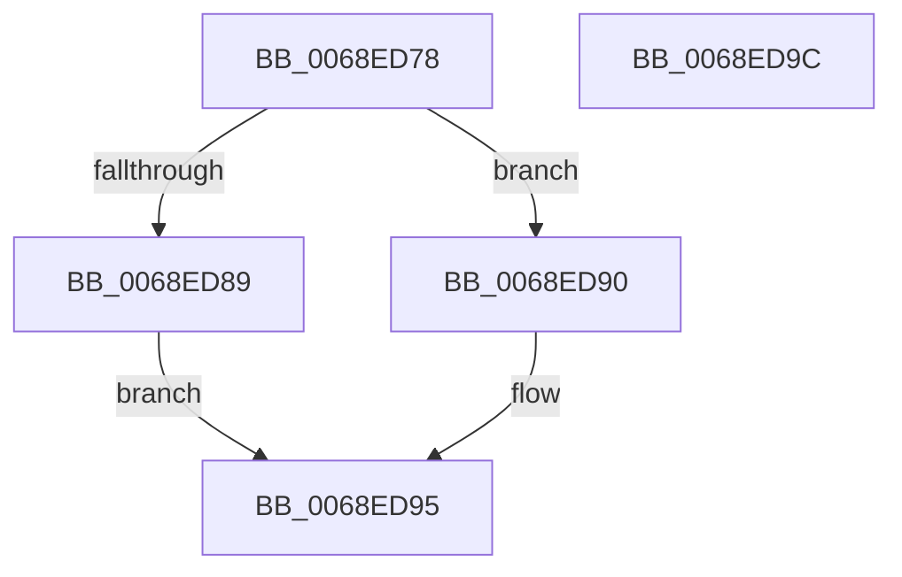

# MiLockSlabRepurposedStandbyList

- RVA: `0x0068ED78`–`0x0068ED9D` (길이 `37` bytes)
- VA: `0x000000014068ED78`
- 실행 섹션: `.text`
- PDB 이름 있음: `예`; PDB Function 태그: `아니요`
- unwind 정보 RVA: `0x0005C788`
- 디코드: `12`개 명령, `37/37` bytes 표시
- 미해석 바이트: `0` (있으면 어셈블리에 `.byte`로 보존)

> 이 문서는 커널 이미지의 기계어와 PDB 기호를 분석해 생성했습니다. 4번과 5번은 함수 원형과 자료형을 바이너리 사용 방식에서 추정한 C 해석이며 원본 소스 복구 결과는 아닙니다.

## 1. Dependencies

- 직접 호출 지점: **2**; 고유 호출 대상: **2**
- 직접 호출자로 확인된 함수: **1**
- RIP 상대 이미지 참조: **0**

### Outgoing calls
- `0x0068ED89` → [ExAcquireSpinLockExclusiveAtDpcLevel](../24/ExAcquireSpinLockExclusiveAtDpcLevel_function_00248E80.md) (function, `0x00248E80`)
- `0x0068ED90` → [ExReleaseSpinLockExclusiveFromDpcLevel](../24/ExReleaseSpinLockExclusiveFromDpcLevel_function_002497E0.md) (function, `0x002497E0`)

### Direct callers
- [MiLockMemoryLists](../4B/MiLockMemoryLists_function_004BB470.md) at `0x004BB5F9`

### Static image references
- 디코드된 RIP-relative 메모리 참조가 없습니다.

## 2. Other-region calls and transfers

- 다른 실행 섹션으로 향하는 call: **0**
- 별도 외부 분기/꼬리 이동을 확인하지 못했습니다.

## 3. Assembly (complete function range)

```asm
0068ED78  48 83 EC 28                     sub rsp, 0x28
0068ED7C  48 8B 4A 50                     mov rcx, qword ptr [rdx + 0x50]
0068ED80  48 83 C1 20                     add rcx, 0x20
0068ED84  45 85 C0                        test r8d, r8d
0068ED87  74 07                           je 0x14068ed90
0068ED89  E8 F2 A0 BB FF                  call 0x140248e80
0068ED8E  EB 05                           jmp 0x14068ed95
0068ED90  E8 4B AA BB FF                  call 0x1402497e0
0068ED95  33 C0                           xor eax, eax
0068ED97  48 83 C4 28                     add rsp, 0x28
0068ED9B  C3                              ret
0068ED9C  CC                              int3
```

## 4. C-style interpretation (structured pseudocode)

```c
__int64 __fastcall MiLockSlabRepurposedStandbyList(__int64 a1, __int64 a2, int a3)
{
    __int64 result;
    __int64 v_rsp;

    v_rsp = (v_rsp) - (40);
    a1 = (*(unsigned __int64 *)(a2 + 80)) + (32);
    if (a3 == 0) goto loc_0068ED90;
    result = ExAcquireSpinLockExclusiveAtDpcLevel(a1, a2, a3, a4);
    goto loc_0068ED95;
loc_0068ED90:
    result = ExReleaseSpinLockExclusiveFromDpcLevel(a1, a2, a3, a4);
loc_0068ED95:
    result = 0;
    v_rsp = (v_rsp) + (40);
    return result;
}
```

## 5. (Beta) C Style

```c
int64_t MiLockSlabRepurposedStandbyList(int64_t Arg1, void *Arg2, int32_t Arg3)
{
    uint8_t *arg2 = (uint8_t *)Arg2;

    int64_t result;
    int64_t local_rsp;

    local_rsp = (local_rsp) - (40);
    Arg1 = (*(uint64_t *)(arg2 + 0x50)) + (32);
    if (Arg3 == 0) goto loc_0068ED90;
    result = ExAcquireSpinLockExclusiveAtDpcLevel(Arg1, Arg2, Arg3, a4);
    goto loc_0068ED95;
loc_0068ED90:
    result = ExReleaseSpinLockExclusiveFromDpcLevel(Arg1, Arg2, Arg3, a4);
loc_0068ED95:
    result = 0;
    local_rsp = (local_rsp) + (40);
    return result;
}
```

### 관측된 메모리 오프셋

구조체 형식이 확인되지 않은 접근은 인자 기준의 오프셋으로만 기록했습니다.

| 기준 인자 | 오프셋 표현 | 폭 (bit) | 접근 |
|---|---:|---:|---|
| `Arg2` | `+ 0x50` | `64` | `R` |

## 6. Execution-region graph

[열기: 2D/3D 그래프와 함수 탐색 컨트롤 패널](../../../control-panel.html?section=text&rva=0x0068ED78&view=graph)

- 2D 그래프는 위에서 아래로 흐르고, 3D 그래프는 빈 공간을 드래그해 회전합니다. Shift+드래그는 이동, 휠은 확대·축소, 함수 노드 선택은 대상 보고서 이동입니다.

### Static fallback


