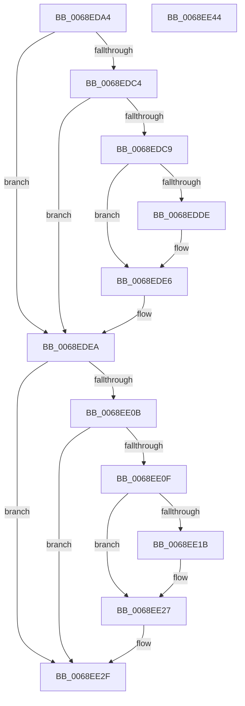

# MiLockUnlockSlabContextsForDefrag

- RVA: `0x0068EDA4`–`0x0068EE45` (길이 `161` bytes)
- VA: `0x000000014068EDA4`
- 실행 섹션: `.text`
- PDB 이름 있음: `예`; PDB Function 태그: `아니요`
- unwind 정보 RVA: `0x00066400`
- 디코드: `46`개 명령, `161/161` bytes 표시
- 미해석 바이트: `0` (있으면 어셈블리에 `.byte`로 보존)

> 이 문서는 커널 이미지의 기계어와 PDB 기호를 분석해 생성했습니다. 4번과 5번은 함수 원형과 자료형을 바이너리 사용 방식에서 추정한 C 해석이며 원본 소스 복구 결과는 아닙니다.

## 1. Dependencies

- 직접 호출 지점: **3**; 고유 호출 대상: **3**
- 직접 호출자로 확인된 함수: **2**
- RIP 상대 이미지 참조: **2**

### Outgoing calls
- `0x0068EDE1` → [KiRaiseIrqlProcessIrqlFlags](../4F/KiRaiseIrqlProcessIrqlFlags_function_004F56FC.md) (function, `0x004F56FC`)
- `0x0068EE02` → [MiEnumerateSlabAllocatorsEx](../47/MiEnumerateSlabAllocatorsEx_function_004746F8.md) (function, `0x004746F8`)
- `0x0068EE22` → [KiLowerIrqlProcessIrqlFlags](../4F/KiLowerIrqlProcessIrqlFlags_function_004F5698.md) (function, `0x004F5698`)

### Direct callers
- [MiDefragmentSlabWorker](MiDefragmentSlabWorker_function_0068D730.md) at `0x0068D8BB`
- [MiDefragmentSlabWorker](MiDefragmentSlabWorker_function_0068D730.md) at `0x0068D9FA`
- [MiEstablishDefragSlabEntries](MiEstablishDefragSlabEntries_function_0068E0EC.md) at `0x0068E113`
- [MiEstablishDefragSlabEntries](MiEstablishDefragSlabEntries_function_0068E0EC.md) at `0x0068E35B`
- [MiEstablishDefragSlabEntries](MiEstablishDefragSlabEntries_function_0068E0EC.md) at `0x0068E3DC`

### Static image references
- `0x0068EDD5` → RVA `0x00FC6D20` (`ALMOSTRO`; read)
- `0x0068EDED` → RVA `0x004BB6A0` (`MiLockSlabAllocator`; read)

## 2. Other-region calls and transfers

- 다른 실행 섹션으로 향하는 call: **0**
- 별도 외부 분기/꼬리 이동을 확인하지 못했습니다.

## 3. Assembly (complete function range)

```asm
0068EDA4  48 89 5C 24 08                  mov qword ptr [rsp + 8], rbx
0068EDA9  48 89 6C 24 10                  mov qword ptr [rsp + 0x10], rbp
0068EDAE  48 89 74 24 18                  mov qword ptr [rsp + 0x18], rsi
0068EDB3  57                              push rdi
0068EDB4  48 83 EC 30                     sub rsp, 0x30
0068EDB8  8B EA                           mov ebp, edx
0068EDBA  41 8B F8                        mov edi, r8d
0068EDBD  48 8B D9                        mov rbx, rcx
0068EDC0  85 D2                           test edx, edx
0068EDC2  74 26                           je 0x14068edea
0068EDC4  45 85 C0                        test r8d, r8d
0068EDC7  75 21                           jne 0x14068edea
0068EDC9  44 0F 20 C6                     mov rsi, cr8
0068EDCD  41 8D 50 02                     lea edx, [r8 + 2]
0068EDD1  44 0F 22 C2                     mov cr8, rdx
0068EDD5  44 39 05 44 7F 93 00            cmp dword ptr [rip + 0x937f44], r8d
0068EDDC  74 08                           je 0x14068ede6
0068EDDE  40 8A CE                        mov cl, sil
0068EDE1  E8 16 69 E6 FF                  call 0x1404f56fc
0068EDE6  40 88 73 50                     mov byte ptr [rbx + 0x50], sil
0068EDEA  8B 43 48                        mov eax, dword ptr [rbx + 0x48]
0068EDED  48 8D 15 AC C8 E2 FF            lea rdx, [rip - 0x1d3754]
0068EDF4  44 8B 4B 44                     mov r9d, dword ptr [rbx + 0x44]
0068EDF8  4C 8B C5                        mov r8, rbp
0068EDFB  48 8B 0B                        mov rcx, qword ptr [rbx]
0068EDFE  89 44 24 20                     mov dword ptr [rsp + 0x20], eax
0068EE02  E8 F1 58 DE FF                  call 0x1404746f8
0068EE07  85 ED                           test ebp, ebp
0068EE09  75 24                           jne 0x14068ee2f
0068EE0B  85 FF                           test edi, edi
0068EE0D  75 20                           jne 0x14068ee2f
0068EE0F  39 2D 0B 7F 93 00               cmp dword ptr [rip + 0x937f0b], ebp
0068EE15  0F B6 7B 50                     movzx edi, byte ptr [rbx + 0x50]
0068EE19  74 0C                           je 0x14068ee27
0068EE1B  44 0F 20 C1                     mov rcx, cr8
0068EE1F  40 8A D7                        mov dl, dil
0068EE22  E8 71 68 E6 FF                  call 0x1404f5698
0068EE27  44 0F 22 C7                     mov cr8, rdi
0068EE2B  C6 43 50 11                     mov byte ptr [rbx + 0x50], 0x11
0068EE2F  48 8B 5C 24 40                  mov rbx, qword ptr [rsp + 0x40]
0068EE34  48 8B 6C 24 48                  mov rbp, qword ptr [rsp + 0x48]
0068EE39  48 8B 74 24 50                  mov rsi, qword ptr [rsp + 0x50]
0068EE3E  48 83 C4 30                     add rsp, 0x30
0068EE42  5F                              pop rdi
0068EE43  C3                              ret
0068EE44  CC                              int3
```

## 4. C-style interpretation (structured pseudocode)

```c
__int64 __fastcall MiLockUnlockSlabContextsForDefrag(__int64 a1, int a2, __int64 a3)
{
    __int64 result;
    __int64 v_rsp;
    unsigned int v_stack_m18;
    unsigned __int64 v_stack_p10;
    unsigned __int64 v_stack_p18;
    unsigned __int64 v_stack_p8;

    v_stack_p8 = v_rbx;
    v_stack_p10 = v_rbp;
    v_stack_p18 = v_rsi;
    v_rsp = (v_rsp) - (48);
    if (a2 == 0) goto loc_0068EDEA;
    if ((unsigned int)(a3) != 0) goto loc_0068EDEA;
    if ((*(unsigned int *)(v_rip + 9666372)) != ((unsigned int)(a3))) {
        a1 = (unsigned __int8)(v_cr8);
        result = KiRaiseIrqlProcessIrqlFlags(a1, a3 + 2, a3, a4);
    }
    *(unsigned __int8 *)(a1 + 80) = (unsigned __int8)(v_cr8);
loc_0068EDEA:
    v_stack_m18 = (unsigned int)((unsigned int)(*(unsigned int *)(a1 + 72)));
    result = MiEnumerateSlabAllocatorsEx(*(unsigned __int64 *)(a1), v_rip - 1914708, (unsigned int)(a2), (unsigned int)(*(unsigned int *)(a1 + 68)));
    if ((unsigned int)((unsigned int)(a2)) != 0) goto loc_0068EE2F;
    if ((unsigned int)((unsigned int)((unsigned int)(a3))) != 0) goto loc_0068EE2F;
    if ((*(unsigned int *)(v_rip + 9666315)) != ((unsigned int)((unsigned int)(a2)))) {
        a1 = a3 + 2;
        a2 = (unsigned __int8)(*(unsigned __int8 *)(a1 + 80));
        result = KiLowerIrqlProcessIrqlFlags(a1, a2, (unsigned int)(a2), (unsigned int)(*(unsigned int *)(a1 + 68)));
    }
    *(unsigned __int8 *)(a1 + 80) = 17;
loc_0068EE2F:
    v_rsp = (v_rsp) + (48);
    return result;
}
```

## 5. (Beta) C Style

```c
int64_t MiLockUnlockSlabContextsForDefrag(void *Arg1, int32_t Arg2, int64_t Arg3)
{
    uint8_t *arg1 = (uint8_t *)Arg1;

    int64_t result;
    int64_t local_rsp;
    uint32_t v_stack_m18;
    uint64_t v_stack_p10;
    uint64_t v_stack_p18;
    uint64_t v_stack_p8;

    v_stack_p8 = local_rbx;
    v_stack_p10 = local_rbp;
    v_stack_p18 = local_rsi;
    local_rsp = (local_rsp) - (48);
    if (Arg2 == 0) goto loc_0068EDEA;
    if ((uint32_t)(Arg3) != 0) goto loc_0068EDEA;
    if ((*(uint32_t *)(v_rip + 0x937F44)) != ((uint32_t)(Arg3))) {
        Arg1 = (uint8_t)(v_cr8);
        result = KiRaiseIrqlProcessIrqlFlags(Arg1, Arg3 + 2, Arg3, a4);
    }
    *(uint8_t *)(arg1 + 0x50) = (uint8_t)(v_cr8);
loc_0068EDEA:
    v_stack_m18 = (uint32_t)((uint32_t)(*(uint32_t *)(arg1 + 0x48)));
    result = MiEnumerateSlabAllocatorsEx(*(uint64_t *)(arg1), v_rip - 1914708, (uint32_t)(Arg2), (uint32_t)(*(uint32_t *)(arg1 + 0x44)));
    if ((uint32_t)((uint32_t)(Arg2)) != 0) goto loc_0068EE2F;
    if ((uint32_t)((uint32_t)((uint32_t)(Arg3))) != 0) goto loc_0068EE2F;
    if ((*(uint32_t *)(v_rip + 0x937F0B)) != ((uint32_t)((uint32_t)(Arg2)))) {
        Arg1 = Arg3 + 2;
        Arg2 = (uint8_t)(*(uint8_t *)(arg1 + 0x50));
        result = KiLowerIrqlProcessIrqlFlags(Arg1, Arg2, (uint32_t)(Arg2), (uint32_t)(*(uint32_t *)(arg1 + 0x44)));
    }
    *(uint8_t *)(arg1 + 0x50) = 17;
loc_0068EE2F:
    local_rsp = (local_rsp) + (48);
    return result;
}
```

### 관측된 메모리 오프셋

구조체 형식이 확인되지 않은 접근은 인자 기준의 오프셋으로만 기록했습니다.

| 기준 인자 | 오프셋 표현 | 폭 (bit) | 접근 |
|---|---:|---:|---|
| `Arg1` | `+ 0x0` | `64` | `R` |
| `Arg1` | `+ 0x44` | `32` | `R` |
| `Arg1` | `+ 0x48` | `32` | `R` |
| `Arg1` | `+ 0x50` | `8` | `R` |
| `Arg1` | `+ 0x50` | `8` | `W` |

## 6. Execution-region graph

[열기: 2D/3D 그래프와 함수 탐색 컨트롤 패널](../../../control-panel.html?section=text&rva=0x0068EDA4&view=graph)

- 2D 그래프는 위에서 아래로 흐르고, 3D 그래프는 빈 공간을 드래그해 회전합니다. Shift+드래그는 이동, 휠은 확대·축소, 함수 노드 선택은 대상 보고서 이동입니다.

### Static fallback


