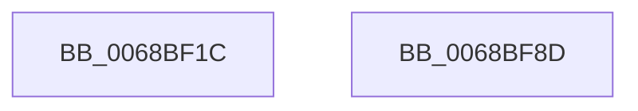

# MiLogCombinedPteDelete

- RVA: `0x0068BF1C`–`0x0068BF8E` (길이 `114` bytes)
- VA: `0x000000014068BF1C`
- 실행 섹션: `.text`
- PDB 이름 있음: `예`; PDB Function 태그: `아니요`
- unwind 정보 RVA: `0x000BE484`
- 디코드: `25`개 명령, `114/114` bytes 표시
- 미해석 바이트: `0` (있으면 어셈블리에 `.byte`로 보존)

> 이 문서는 커널 이미지의 기계어와 PDB 기호를 분석해 생성했습니다. 4번과 5번은 함수 원형과 자료형을 바이너리 사용 방식에서 추정한 C 해석이며 원본 소스 복구 결과는 아닙니다.

## 1. Dependencies

- 직접 호출 지점: **2**; 고유 호출 대상: **2**
- 직접 호출자로 확인된 함수: **3**
- RIP 상대 이미지 참조: **1**

### Outgoing calls
- `0x0068BF76` → [EtwTraceKernelEvent](../23/EtwTraceKernelEvent_function_00235350.md) (function, `0x00235350`)
- `0x0068BF83` → [_security_check_cookie](../6A/_security_check_cookie_function_006AC640.md) (function, `0x006AC640`)

### Direct callers
- [MiDemoteCombinedPte](../22/MiDemoteCombinedPte_function_0022ABAC.md) at `0x0022AFED`
- [MiDecrementCombinedPteEx](../22/MiDecrementCombinedPteEx_function_0022B940.md) at `0x0022B9C3`
- [MiDecommitSharedPageTail](../37/MiDecommitSharedPageTail_function_00370240.md) at `0x00370844`

### Static image references
- `0x0068BF23` → RVA `0x00E0A740` (`.data`; read)

## 2. Other-region calls and transfers

- 다른 실행 섹션으로 향하는 call: **0**
- 별도 외부 분기/꼬리 이동을 확인하지 못했습니다.

## 3. Assembly (complete function range)

```asm
0068BF1C  4C 8B DC                        mov r11, rsp
0068BF1F  48 83 EC 68                     sub rsp, 0x68
0068BF23  48 8B 05 16 E8 77 00            mov rax, qword ptr [rip + 0x77e816]
0068BF2A  48 33 C4                        xor rax, rsp
0068BF2D  48 89 44 24 58                  mov qword ptr [rsp + 0x58], rax
0068BF32  83 64 24 44 00                  and dword ptr [rsp + 0x44], 0
0068BF37  49 8D 43 C8                     lea rax, [r11 - 0x38]
0068BF3B  49 89 43 E0                     mov qword ptr [r11 - 0x20], rax
0068BF3F  41 B9 4F 02 00 00               mov r9d, 0x24f
0068BF45  83 64 24 54 00                  and dword ptr [rsp + 0x54], 0
0068BF4A  BA 01 00 00 00                  mov edx, 1
0068BF4F  49 89 4B C8                     mov qword ptr [r11 - 0x38], rcx
0068BF53  41 B8 01 00 00 28               mov r8d, 0x28000001
0068BF59  49 89 4B D0                     mov qword ptr [r11 - 0x30], rcx
0068BF5D  49 8D 4B E0                     lea rcx, [r11 - 0x20]
0068BF61  83 4C 24 40 FF                  or dword ptr [rsp + 0x40], 0xffffffff
0068BF66  C7 44 24 50 18 00 00 00         mov dword ptr [rsp + 0x50], 0x18
0068BF6E  C7 44 24 20 02 1B 50 11         mov dword ptr [rsp + 0x20], 0x11501b02
0068BF76  E8 D5 93 BA FF                  call 0x140235350
0068BF7B  48 8B 4C 24 58                  mov rcx, qword ptr [rsp + 0x58]
0068BF80  48 33 CC                        xor rcx, rsp
0068BF83  E8 B8 06 02 00                  call 0x1406ac640
0068BF88  48 83 C4 68                     add rsp, 0x68
0068BF8C  C3                              ret
0068BF8D  CC                              int3
```

## 4. C-style interpretation (structured pseudocode)

```c
__int64 __fastcall MiLogCombinedPteDelete(__int64 a1)
{
    __int64 result;
    __int64 v_rsp;
    unsigned __int64 v_stack_m10;
    unsigned int v_stack_m14;
    unsigned int v_stack_m18;
    unsigned int v_stack_m24;
    unsigned int v_stack_m28;
    unsigned int v_stack_m48;

    v_rsp = (v_rsp) - (104);
    result = (*(unsigned __int64 *)(v_rip + 7858198)) ^ (v_rsp);
    v_stack_m10 = result;
    *(unsigned __int64 *)(v_rsp - 32) = v_rsp - 56;
    *(unsigned __int64 *)(v_rsp - 56) = a1;
    *(unsigned __int64 *)(v_rsp - 48) = a1;
    v_stack_m18 = 24;
    v_stack_m48 = 0x11501B02ULL;
    result = EtwTraceKernelEvent(v_rsp - 32, 1, (unsigned int)(0x28000001ULL), 591);
    a1 = (v_stack_m10) ^ (v_rsp);
    result = _security_check_cookie(a1, 1, (unsigned int)(0x28000001ULL), 591);
    v_rsp = (v_rsp) + (104);
    return result;
}
```

## 5. (Beta) C Style

```c
int64_t MiLogCombinedPteDelete(int64_t Arg1)
{
    int64_t result;
    int64_t local_rsp;
    uint64_t v_stack_m10;
    uint32_t v_stack_m14;
    uint32_t v_stack_m18;
    uint32_t v_stack_m24;
    uint32_t v_stack_m28;
    uint32_t v_stack_m48;

    local_rsp = (local_rsp) - (104);
    result = (*(uint64_t *)(v_rip + 0x77E816)) ^ (local_rsp);
    v_stack_m10 = result;
    *(uint64_t *)(local_rsp - 0x20) = local_rsp - 56;
    *(uint64_t *)(local_rsp - 0x38) = Arg1;
    *(uint64_t *)(local_rsp - 0x30) = Arg1;
    v_stack_m18 = 24;
    v_stack_m48 = 0x11501B02ULL;
    result = EtwTraceKernelEvent(local_rsp - 32, 1, (uint32_t)(0x28000001ULL), 591);
    Arg1 = (v_stack_m10) ^ (local_rsp);
    result = _security_check_cookie(Arg1, 1, (uint32_t)(0x28000001ULL), 591);
    local_rsp = (local_rsp) + (104);
    return result;
}
```

## 6. Execution-region graph

[열기: 2D/3D 그래프와 함수 탐색 컨트롤 패널](../../../control-panel.html?section=text&rva=0x0068BF1C&view=graph)

- 2D 그래프는 위에서 아래로 흐르고, 3D 그래프는 빈 공간을 드래그해 회전합니다. Shift+드래그는 이동, 휠은 확대·축소, 함수 노드 선택은 대상 보고서 이동입니다.

### Static fallback


