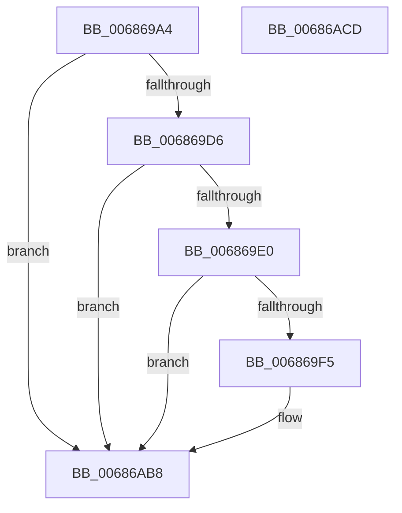

# MiLogDelayFaultingThread

- RVA: `0x006869A4`–`0x00686ACE` (길이 `298` bytes)
- VA: `0x00000001406869A4`
- 실행 섹션: `.text`
- PDB 이름 있음: `예`; PDB Function 태그: `아니요`
- unwind 정보 RVA: `0x000BCC84`
- 디코드: `73`개 명령, `298/298` bytes 표시
- 미해석 바이트: `0` (있으면 어셈블리에 `.byte`로 보존)

> 이 문서는 커널 이미지의 기계어와 PDB 기호를 분석해 생성했습니다. 4번과 5번은 함수 원형과 자료형을 바이너리 사용 방식에서 추정한 C 해석이며 원본 소스 복구 결과는 아닙니다.

## 1. Dependencies

- 직접 호출 지점: **3**; 고유 호출 대상: **3**
- 직접 호출자로 확인된 함수: **1**
- RIP 상대 이미지 참조: **3**

### Outgoing calls
- `0x006869E8` → [tlgKeywordOn](../42/tlgKeywordOn_function_0042EAA0.md) (function, `0x0042EAA0`)
- `0x00686AB3` → [tlgWriteEx_EtwWriteEx](../4A/tlgWriteEx_EtwWriteEx_function_004AA348.md) (function, `0x004AA348`)
- `0x00686ABF` → [_security_check_cookie](../6A/_security_check_cookie_function_006AC640.md) (function, `0x006AC640`)

### Direct callers
- [MiDelayFaultingThread](../2A/MiDelayFaultingThread_function_002A3054.md) at `0x002A3129`

### Static image references
- `0x006869B2` → RVA `0x00E0A740` (`.data`; read)
- `0x006869C0` → RVA `0x00E37618` (`.data`; read)
- `0x00686AA4` → RVA `0x000593FC` (`.rdata`; read)

## 2. Other-region calls and transfers

- 다른 실행 섹션으로 향하는 call: **0**
- 별도 외부 분기/꼬리 이동을 확인하지 못했습니다.

## 3. Assembly (complete function range)

```asm
006869A4  40 55                           push rbp
006869A6  48 8D 6C 24 A9                  lea rbp, [rsp - 0x57]
006869AB  48 81 EC F0 00 00 00            sub rsp, 0xf0
006869B2  48 8B 05 87 3D 78 00            mov rax, qword ptr [rip + 0x783d87]
006869B9  48 33 C4                        xor rax, rsp
006869BC  48 89 45 47                     mov qword ptr [rbp + 0x47], rax
006869C0  4C 8B 15 51 0C 7B 00            mov r10, qword ptr [rip + 0x7b0c51]
006869C7  4C 8B DA                        mov r11, rdx
006869CA  44 8B C9                        mov r9d, ecx
006869CD  4D 85 D2                        test r10, r10
006869D0  0F 84 E2 00 00 00               je 0x140686ab8
006869D6  41 83 3A 05                     cmp dword ptr [r10], 5
006869DA  0F 86 D8 00 00 00               jbe 0x140686ab8
006869E0  BA 01 00 00 00                  mov edx, 1
006869E5  49 8B CA                        mov rcx, r10
006869E8  E8 B3 80 DA FF                  call 0x14042eaa0
006869ED  84 C0                           test al, al
006869EF  0F 84 C3 00 00 00               je 0x140686ab8
006869F5  83 65 F3 00                     and dword ptr [rbp - 0xd], 0
006869F9  BA 04 00 00 00                  mov edx, 4
006869FE  83 65 03 00                     and dword ptr [rbp + 3], 0
00686A02  83 65 13 00                     and dword ptr [rbp + 0x13], 0
00686A06  41 0F B7 C1                     movzx eax, r9w
00686A0A  89 45 A7                        mov dword ptr [rbp - 0x59], eax
00686A0D  48 8D 45 A7                     lea rax, [rbp - 0x59]
00686A11  48 89 45 E7                     mov qword ptr [rbp - 0x19], rax
00686A15  41 8B C1                        mov eax, r9d
00686A18  C1 E8 10                        shr eax, 0x10
00686A1B  83 E0 01                        and eax, 1
00686A1E  89 55 EF                        mov dword ptr [rbp - 0x11], edx
00686A21  89 45 AB                        mov dword ptr [rbp - 0x55], eax
00686A24  48 8D 45 AB                     lea rax, [rbp - 0x55]
00686A28  48 89 45 F7                     mov qword ptr [rbp - 9], rax
00686A2C  48 8D 45 AF                     lea rax, [rbp - 0x51]
00686A30  48 89 45 07                     mov qword ptr [rbp + 7], rax
00686A34  89 55 FF                        mov dword ptr [rbp - 1], edx
00686A37  89 55 0F                        mov dword ptr [rbp + 0xf], edx
00686A3A  41 C1 E9 11                     shr r9d, 0x11
00686A3E  41 83 E1 01                     and r9d, 1
00686A42  44 89 4D AF                     mov dword ptr [rbp - 0x51], r9d
00686A46  44 8D 4A FD                     lea r9d, [rdx - 3]
00686A4A  65 48 8B 04 25 88 01 00 00      mov rax, qword ptr gs:[0x188]
00686A53  48 8B 88 B8 00 00 00            mov rcx, qword ptr [rax + 0xb8]
00686A5A  0F B7 81 AE 04 00 00            movzx eax, word ptr [rcx + 0x4ae]
00686A61  8D 4A 04                        lea ecx, [rdx + 4]
00686A64  83 65 23 00                     and dword ptr [rbp + 0x23], 0
00686A68  83 65 33 00                     and dword ptr [rbp + 0x33], 0
00686A6C  83 65 43 00                     and dword ptr [rbp + 0x43], 0
00686A70  89 45 B3                        mov dword ptr [rbp - 0x4d], eax
00686A73  48 8D 45 B3                     lea rax, [rbp - 0x4d]
00686A77  48 89 45 17                     mov qword ptr [rbp + 0x17], rax
00686A7B  48 8D 45 BF                     lea rax, [rbp - 0x41]
00686A7F  48 89 45 27                     mov qword ptr [rbp + 0x27], rax
00686A83  48 8D 45 B7                     lea rax, [rbp - 0x49]
00686A87  48 89 45 37                     mov qword ptr [rbp + 0x37], rax
00686A8B  48 8D 45 C7                     lea rax, [rbp - 0x39]
00686A8F  48 89 44 24 38                  mov qword ptr [rsp + 0x38], rax
00686A94  89 4C 24 30                     mov dword ptr [rsp + 0x30], ecx
00686A98  89 55 1F                        mov dword ptr [rbp + 0x1f], edx
00686A9B  89 4D 2F                        mov dword ptr [rbp + 0x2f], ecx
00686A9E  49 8B CA                        mov rcx, r10
00686AA1  89 55 3F                        mov dword ptr [rbp + 0x3f], edx
00686AA4  48 8D 15 51 29 9D FF            lea rdx, [rip - 0x62d6af]
00686AAB  4C 89 5D BF                     mov qword ptr [rbp - 0x41], r11
00686AAF  44 89 45 B7                     mov dword ptr [rbp - 0x49], r8d
00686AB3  E8 90 38 E2 FF                  call 0x1404aa348
00686AB8  48 8B 4D 47                     mov rcx, qword ptr [rbp + 0x47]
00686ABC  48 33 CC                        xor rcx, rsp
00686ABF  E8 7C 5B 02 00                  call 0x1406ac640
00686AC4  48 81 C4 F0 00 00 00            add rsp, 0xf0
00686ACB  5D                              pop rbp
00686ACC  C3                              ret
00686ACD  CC                              int3
```

## 4. C-style interpretation (structured pseudocode)

```c
__int64 __fastcall MiLogDelayFaultingThread(int a1, __int64 a2, int a3)
{
    __int64 result;
    __int64 v_rsp;
    unsigned __int64 v_stack_m18;
    unsigned int v_stack_m1C;
    unsigned int v_stack_m20;
    unsigned __int64 v_stack_m28;
    unsigned int v_stack_m2C;
    unsigned int v_stack_m30;
    unsigned __int64 v_stack_m38;
    unsigned int v_stack_m3C;
    unsigned int v_stack_m40;
    unsigned __int64 v_stack_m48;
    unsigned int v_stack_m4C;
    unsigned int v_stack_m50;
    unsigned __int64 v_stack_m58;
    unsigned int v_stack_m5C;
    unsigned __int64 v_stack_m5F;
    unsigned int v_stack_m60;
    unsigned __int64 v_stack_m68;
    unsigned int v_stack_m6C;
    unsigned int v_stack_m70;
    unsigned __int64 v_stack_m78;
    unsigned __int64 v_stack_m98;
    unsigned __int64 v_stack_mA0;
    unsigned __int64 v_stack_mA8;
    unsigned int v_stack_mAC;
    unsigned __int64 v_stack_mB0;
    unsigned int v_stack_mB4;
    unsigned int v_stack_mB8;
    unsigned __int64 v_stack_mC0;
    unsigned int v_stack_mC8;

    v_rsp = (v_rsp) - (240);
    result = (*(unsigned __int64 *)(v_rip + 7880071)) ^ (v_rsp);
    v_stack_m18 = result;
    if (*(unsigned __int64 *)(v_rip + 8064081) == 0) goto loc_00686AB8;
    if ((*(unsigned int *)(*(unsigned __int64 *)(v_rip + 8064081))) <= 5) goto loc_00686AB8;
    result = tlgKeywordOn(*(unsigned __int64 *)(v_rip + 8064081), 1, a3, (unsigned int)(a1));
    if ((unsigned __int8)(result) != 0) {
        a2 = 4;
        result = (unsigned __int16)((unsigned int)(a1));
        v_stack_mB8 = (unsigned int)(result);
        result = v_stack_mB8;
        v_stack_m78 = result;
        result = (unsigned int)((unsigned int)(a1));
        result = (unsigned int)((result) >> (16));
        result = (unsigned int)((result) & (1));
        v_stack_m70 = (unsigned int)(a2);
        v_stack_mB4 = (unsigned int)(result);
        result = v_stack_mB4;
        v_stack_m68 = result;
        result = v_stack_mB0;
        v_stack_m58 = result;
        v_stack_m60 = (unsigned int)(a2);
        v_stack_m50 = (unsigned int)(a2);
        a4 = (unsigned int)(((unsigned int)(a1)) >> (17));
        a4 = (unsigned int)((a4) & (1));
        v_stack_mB0 = (unsigned int)(a4);
        a4 = a2 - 3;
        result = *(unsigned __int64 *)(gs_base + (0 + 392));
        a1 = *(unsigned __int64 *)(result + 184);
        result = *(unsigned __int16 *)(a1 + 1198);
        a1 = a2 + 4;
        v_stack_mAC = (unsigned int)(result);
        result = v_stack_mAC;
        v_stack_m48 = result;
        result = v_stack_mA0;
        v_stack_m38 = result;
        result = v_stack_mA8;
        v_stack_m28 = result;
        result = v_stack_m98;
        v_stack_mC0 = result;
        v_stack_mC8 = a1;
        v_stack_m40 = (unsigned int)(a2);
        v_stack_m30 = a1;
        a1 = *(unsigned __int64 *)(v_rip + 8064081);
        v_stack_m20 = (unsigned int)(a2);
        a2 = v_rip - 6477487;
        v_stack_mA0 = a2;
        v_stack_mA8 = a3;
        result = tlgWriteEx_EtwWriteEx(a1, a2, a3, a4);
    }
    a1 = (v_stack_m18) ^ (v_rsp);
    result = _security_check_cookie(a1, a2, a3, a4);
    v_rsp = (v_rsp) + (240);
    return result;
}
```

## 5. (Beta) C Style

```c
int64_t MiLogDelayFaultingThread(int32_t Arg1, int64_t Arg2, int32_t Arg3)
{
    int64_t result;
    int64_t local_rsp;
    uint64_t v_stack_m18;
    uint32_t v_stack_m1C;
    uint32_t v_stack_m20;
    uint64_t v_stack_m28;
    uint32_t v_stack_m2C;
    uint32_t v_stack_m30;
    uint64_t v_stack_m38;
    uint32_t v_stack_m3C;
    uint32_t v_stack_m40;
    uint64_t v_stack_m48;
    uint32_t v_stack_m4C;
    uint32_t v_stack_m50;
    uint64_t v_stack_m58;
    uint32_t v_stack_m5C;
    uint64_t v_stack_m5F;
    uint32_t v_stack_m60;
    uint64_t v_stack_m68;
    uint32_t v_stack_m6C;
    uint32_t v_stack_m70;
    uint64_t v_stack_m78;
    uint64_t v_stack_m98;
    uint64_t v_stack_mA0;
    uint64_t v_stack_mA8;
    uint32_t v_stack_mAC;
    uint64_t v_stack_mB0;
    uint32_t v_stack_mB4;
    uint32_t v_stack_mB8;
    uint64_t v_stack_mC0;
    uint32_t v_stack_mC8;

    local_rsp = (local_rsp) - (240);
    result = (*(uint64_t *)(v_rip + 0x783D87)) ^ (local_rsp);
    v_stack_m18 = result;
    if (*(uint64_t *)(v_rip + 0x7B0C51) == 0) goto loc_00686AB8;
    if ((*(uint32_t *)(*(uint64_t *)(v_rip + 0x7B0C51))) <= 5) goto loc_00686AB8;
    result = tlgKeywordOn(*(uint64_t *)(v_rip + 0x7B0C51), 1, Arg3, (uint32_t)(Arg1));
    if ((uint8_t)(result) != 0) {
        Arg2 = 4;
        result = (uint16_t)((uint32_t)(Arg1));
        v_stack_mB8 = (uint32_t)(result);
        result = v_stack_mB8;
        v_stack_m78 = result;
        result = (uint32_t)((uint32_t)(Arg1));
        result = (uint32_t)((result) >> (16));
        result = (uint32_t)((result) & (1));
        v_stack_m70 = (uint32_t)(Arg2);
        v_stack_mB4 = (uint32_t)(result);
        result = v_stack_mB4;
        v_stack_m68 = result;
        result = v_stack_mB0;
        v_stack_m58 = result;
        v_stack_m60 = (uint32_t)(Arg2);
        v_stack_m50 = (uint32_t)(Arg2);
        a4 = (uint32_t)(((uint32_t)(Arg1)) >> (17));
        a4 = (uint32_t)((a4) & (1));
        v_stack_mB0 = (uint32_t)(a4);
        a4 = Arg2 - 3;
        result = *(uint64_t *)(gs_base + (0 + 0x188));
        Arg1 = *(uint64_t *)(result + 0xB8);
        result = *(uint16_t *)(Arg1 + 0x4AE);
        Arg1 = Arg2 + 4;
        v_stack_mAC = (uint32_t)(result);
        result = v_stack_mAC;
        v_stack_m48 = result;
        result = v_stack_mA0;
        v_stack_m38 = result;
        result = v_stack_mA8;
        v_stack_m28 = result;
        result = v_stack_m98;
        v_stack_mC0 = result;
        v_stack_mC8 = Arg1;
        v_stack_m40 = (uint32_t)(Arg2);
        v_stack_m30 = Arg1;
        Arg1 = *(uint64_t *)(v_rip + 0x7B0C51);
        v_stack_m20 = (uint32_t)(Arg2);
        Arg2 = v_rip - 6477487;
        v_stack_mA0 = Arg2;
        v_stack_mA8 = Arg3;
        result = tlgWriteEx_EtwWriteEx(Arg1, Arg2, Arg3, a4);
    }
    Arg1 = (v_stack_m18) ^ (local_rsp);
    result = _security_check_cookie(Arg1, Arg2, Arg3, a4);
    local_rsp = (local_rsp) + (240);
    return result;
}
```

## 6. Execution-region graph

[열기: 2D/3D 그래프와 함수 탐색 컨트롤 패널](../../../control-panel.html?section=text&rva=0x006869A4&view=graph)

- 2D 그래프는 위에서 아래로 흐르고, 3D 그래프는 빈 공간을 드래그해 회전합니다. Shift+드래그는 이동, 휠은 확대·축소, 함수 노드 선택은 대상 보고서 이동입니다.

### Static fallback


