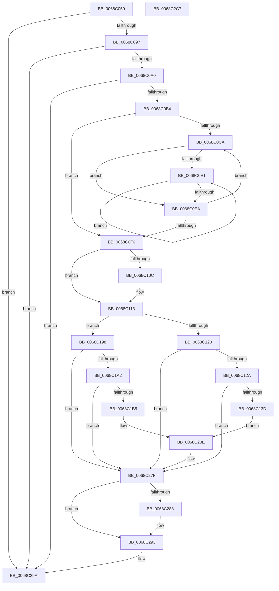

# MiLogNotifyPageHeat

- RVA: `0x0068C050`–`0x0068C2C8` (길이 `632` bytes)
- VA: `0x000000014068C050`
- 실행 섹션: `.text`
- PDB 이름 있음: `예`; PDB Function 태그: `아니요`
- unwind 정보 RVA: `0x000D8E04`
- 디코드: `162`개 명령, `632/632` bytes 표시
- 미해석 바이트: `0` (있으면 어셈블리에 `.byte`로 보존)

> 이 문서는 커널 이미지의 기계어와 PDB 기호를 분석해 생성했습니다. 4번과 5번은 함수 원형과 자료형을 바이너리 사용 방식에서 추정한 C 해석이며 원본 소스 복구 결과는 아닙니다.

## 1. Dependencies

- 직접 호출 지점: **7**; 고유 호출 대상: **5**
- 직접 호출자로 확인된 함수: **1**
- RIP 상대 이미지 참조: **5**

### Outgoing calls
- `0x0068C0A7` → [tlgKeywordOn](../42/tlgKeywordOn_function_0042EAA0.md) (function, `0x0042EAA0`)
- `0x0068C10E` → [KiRaiseIrqlProcessIrqlFlags](../4F/KiRaiseIrqlProcessIrqlFlags_function_004F56FC.md) (function, `0x004F56FC`)
- `0x0068C130` → [tlgKeywordOn](../42/tlgKeywordOn_function_0042EAA0.md) (function, `0x0042EAA0`)
- `0x0068C1A8` → [tlgKeywordOn](../42/tlgKeywordOn_function_0042EAA0.md) (function, `0x0042EAA0`)
- `0x0068C27A` → [tlgWriteEx_EtwWriteEx](../4A/tlgWriteEx_EtwWriteEx_function_004AA348.md) (function, `0x004AA348`)
- `0x0068C28E` → [KiLowerIrqlProcessIrqlFlags](../4F/KiLowerIrqlProcessIrqlFlags_function_004F5698.md) (function, `0x004F5698`)
- `0x0068C2A1` → [_security_check_cookie](../6A/_security_check_cookie_function_006AC640.md) (function, `0x006AC640`)

### Direct callers
- [MiIssuePageHeatList](../44/MiIssuePageHeatList_function_0044615C.md) at `0x00446285`

### Static image references
- `0x0068C073` → RVA `0x00E0A740` (`.data`; read)
- `0x0068C087` → RVA `0x00E37618` (`.data`; read)
- `0x0068C103` → RVA `0x00FC6D20` (`ALMOSTRO`; read)
- `0x0068C140` → RVA `0x000595D8` (`.rdata`; read)
- `0x0068C1B8` → RVA `0x00059552` (`.rdata`; read)

## 2. Other-region calls and transfers

- 다른 실행 섹션으로 향하는 call: **0**
- 별도 외부 분기/꼬리 이동을 확인하지 못했습니다.

## 3. Assembly (complete function range)

```asm
0068C050  48 8B C4                        mov rax, rsp
0068C053  48 89 58 08                     mov qword ptr [rax + 8], rbx
0068C057  48 89 70 10                     mov qword ptr [rax + 0x10], rsi
0068C05B  48 89 78 18                     mov qword ptr [rax + 0x18], rdi
0068C05F  4C 89 60 20                     mov qword ptr [rax + 0x20], r12
0068C063  55                              push rbp
0068C064  41 56                           push r14
0068C066  41 57                           push r15
0068C068  48 8D 68 A1                     lea rbp, [rax - 0x5f]
0068C06C  48 81 EC 00 01 00 00            sub rsp, 0x100
0068C073  48 8B 05 C6 E6 77 00            mov rax, qword ptr [rip + 0x77e6c6]
0068C07A  48 33 C4                        xor rax, rsp
0068C07D  48 89 45 37                     mov qword ptr [rbp + 0x37], rax
0068C081  48 8B F9                        mov rdi, rcx
0068C084  45 33 FF                        xor r15d, r15d
0068C087  48 8B 0D 8A B5 7A 00            mov rcx, qword ptr [rip + 0x7ab58a]
0068C08E  48 85 C9                        test rcx, rcx
0068C091  0F 84 03 02 00 00               je 0x14068c29a
0068C097  44 39 39                        cmp dword ptr [rcx], r15d
0068C09A  0F 86 FA 01 00 00               jbe 0x14068c29a
0068C0A0  45 8D 67 40                     lea r12d, [r15 + 0x40]
0068C0A4  41 8B D4                        mov edx, r12d
0068C0A7  E8 F4 29 DA FF                  call 0x14042eaa0
0068C0AC  84 C0                           test al, al
0068C0AE  0F 84 E6 01 00 00               je 0x14068c29a
0068C0B4  8B 47 04                        mov eax, dword ptr [rdi + 4]
0068C0B7  4C 8D 77 10                     lea r14, [rdi + 0x10]
0068C0BB  41 8B F7                        mov esi, r15d
0068C0BE  49 8B CE                        mov rcx, r14
0068C0C1  4D 8D 04 C6                     lea r8, [r14 + rax*8]
0068C0C5  4D 3B F0                        cmp r14, r8
0068C0C8  73 2C                           jae 0x14068c0f6
0068C0CA  48 8B 11                        mov rdx, qword ptr [rcx]
0068C0CD  48 8B C2                        mov rax, rdx
0068C0D0  48 C1 EA 0A                     shr rdx, 0xa
0068C0D4  25 FF 03 00 00                  and eax, 0x3ff
0068C0D9  48 FF C0                        inc rax
0068C0DC  83 E2 03                        and edx, 3
0068C0DF  74 09                           je 0x14068c0ea
0068C0E1  48 C1 E0 09                     shl rax, 9
0068C0E5  83 C2 FF                        add edx, -1
0068C0E8  75 F7                           jne 0x14068c0e1
0068C0EA  48 03 F0                        add rsi, rax
0068C0ED  48 83 C1 08                     add rcx, 8
0068C0F1  49 3B C8                        cmp rcx, r8
0068C0F4  72 D4                           jb 0x14068c0ca
0068C0F6  44 0F 20 C3                     mov rbx, cr8
0068C0FA  BA 0F 00 00 00                  mov edx, 0xf
0068C0FF  44 0F 22 C2                     mov cr8, rdx
0068C103  44 39 3D 16 AC 93 00            cmp dword ptr [rip + 0x93ac16], r15d
0068C10A  74 07                           je 0x14068c113
0068C10C  8A CB                           mov cl, bl
0068C10E  E8 E9 95 E6 FF                  call 0x1404f56fc
0068C113  8B 07                           mov eax, dword ptr [rdi]
0068C115  4C 8B 05 FC B4 7A 00            mov r8, qword ptr [rip + 0x7ab4fc]
0068C11C  A8 01                           test al, 1
0068C11E  75 78                           jne 0x14068c198
0068C120  41 83 38 05                     cmp dword ptr [r8], 5
0068C124  0F 86 55 01 00 00               jbe 0x14068c27f
0068C12A  49 8B D4                        mov rdx, r12
0068C12D  49 8B C8                        mov rcx, r8
0068C130  E8 6B 29 DA FF                  call 0x14042eaa0
0068C135  84 C0                           test al, al
0068C137  0F 84 42 01 00 00               je 0x14068c27f
0068C13D  49 8B 0E                        mov rcx, qword ptr [r14]
0068C140  48 8D 15 91 D4 9C FF            lea rdx, [rip - 0x632b6f]
0068C147  8B 47 04                        mov eax, dword ptr [rdi + 4]
0068C14A  89 45 8B                        mov dword ptr [rbp - 0x75], eax
0068C14D  48 8D 45 8B                     lea rax, [rbp - 0x75]
0068C151  48 89 45 C7                     mov qword ptr [rbp - 0x39], rax
0068C155  48 8D 45 97                     lea rax, [rbp - 0x69]
0068C159  48 89 45 D7                     mov qword ptr [rbp - 0x29], rax
0068C15D  48 8B C1                        mov rax, rcx
0068C160  48 C1 E8 0C                     shr rax, 0xc
0068C164  48 89 45 9F                     mov qword ptr [rbp - 0x61], rax
0068C168  48 8D 45 9F                     lea rax, [rbp - 0x61]
0068C16C  48 89 45 E7                     mov qword ptr [rbp - 0x19], rax
0068C170  8B C1                           mov eax, ecx
0068C172  25 FF 03 00 00                  and eax, 0x3ff
0068C177  48 C1 E9 0A                     shr rcx, 0xa
0068C17B  FF C0                           inc eax
0068C17D  48 89 75 97                     mov qword ptr [rbp - 0x69], rsi
0068C181  89 45 8F                        mov dword ptr [rbp - 0x71], eax
0068C184  83 E1 03                        and ecx, 3
0068C187  48 8D 45 8F                     lea rax, [rbp - 0x71]
0068C18B  89 4D 93                        mov dword ptr [rbp - 0x6d], ecx
0068C18E  48 89 45 F7                     mov qword ptr [rbp - 9], rax
0068C192  48 8D 45 93                     lea rax, [rbp - 0x6d]
0068C196  EB 76                           jmp 0x14068c20e
0068C198  41 83 38 05                     cmp dword ptr [r8], 5
0068C19C  0F 86 DD 00 00 00               jbe 0x14068c27f
0068C1A2  49 8B D4                        mov rdx, r12
0068C1A5  49 8B C8                        mov rcx, r8
0068C1A8  E8 F3 28 DA FF                  call 0x14042eaa0
0068C1AD  84 C0                           test al, al
0068C1AF  0F 84 CA 00 00 00               je 0x14068c27f
0068C1B5  49 8B 0E                        mov rcx, qword ptr [r14]
0068C1B8  48 8D 15 93 D3 9C FF            lea rdx, [rip - 0x632c6d]
0068C1BF  8B 47 04                        mov eax, dword ptr [rdi + 4]
0068C1C2  89 45 93                        mov dword ptr [rbp - 0x6d], eax
0068C1C5  48 8D 45 93                     lea rax, [rbp - 0x6d]
0068C1C9  48 89 45 C7                     mov qword ptr [rbp - 0x39], rax
0068C1CD  48 8D 45 9F                     lea rax, [rbp - 0x61]
0068C1D1  48 89 45 D7                     mov qword ptr [rbp - 0x29], rax
0068C1D5  48 8B C1                        mov rax, rcx
0068C1D8  48 C1 E8 0C                     shr rax, 0xc
0068C1DC  48 89 45 97                     mov qword ptr [rbp - 0x69], rax
0068C1E0  48 8D 45 97                     lea rax, [rbp - 0x69]
0068C1E4  48 89 45 E7                     mov qword ptr [rbp - 0x19], rax
0068C1E8  8B C1                           mov eax, ecx
0068C1EA  25 FF 03 00 00                  and eax, 0x3ff
0068C1EF  48 C1 E9 0A                     shr rcx, 0xa
0068C1F3  FF C0                           inc eax
0068C1F5  48 89 75 9F                     mov qword ptr [rbp - 0x61], rsi
0068C1F9  89 45 8F                        mov dword ptr [rbp - 0x71], eax
0068C1FC  83 E1 03                        and ecx, 3
0068C1FF  48 8D 45 8F                     lea rax, [rbp - 0x71]
0068C203  89 4D 8B                        mov dword ptr [rbp - 0x75], ecx
0068C206  48 89 45 F7                     mov qword ptr [rbp - 9], rax
0068C20A  48 8D 45 8B                     lea rax, [rbp - 0x75]
0068C20E  48 89 45 07                     mov qword ptr [rbp + 7], rax
0068C212  48 8D 4D 87                     lea rcx, [rbp - 0x79]
0068C216  0F B7 47 04                     movzx eax, word ptr [rdi + 4]
0068C21A  41 B9 01 00 00 00               mov r9d, 1
0068C220  66 89 45 87                     mov word ptr [rbp - 0x79], ax
0068C224  C1 E0 03                        shl eax, 3
0068C227  89 45 2F                        mov dword ptr [rbp + 0x2f], eax
0068C22A  48 8D 45 A7                     lea rax, [rbp - 0x59]
0068C22E  48 89 4D 17                     mov qword ptr [rbp + 0x17], rcx
0068C232  49 8B C8                        mov rcx, r8
0068C235  48 89 44 24 38                  mov qword ptr [rsp + 0x38], rax
0068C23A  C7 44 24 30 09 00 00 00         mov dword ptr [rsp + 0x30], 9
0068C242  48 C7 45 DF 08 00 00 00         mov qword ptr [rbp - 0x21], 8
0068C24A  48 C7 45 CF 04 00 00 00         mov qword ptr [rbp - 0x31], 4
0068C252  48 C7 45 EF 08 00 00 00         mov qword ptr [rbp - 0x11], 8
0068C25A  48 C7 45 FF 04 00 00 00         mov qword ptr [rbp - 1], 4
0068C262  48 C7 45 0F 04 00 00 00         mov qword ptr [rbp + 0xf], 4
0068C26A  48 C7 45 1F 02 00 00 00         mov qword ptr [rbp + 0x1f], 2
0068C272  4C 89 75 27                     mov qword ptr [rbp + 0x27], r14
0068C276  44 89 7D 33                     mov dword ptr [rbp + 0x33], r15d
0068C27A  E8 C9 E0 E1 FF                  call 0x1404aa348
0068C27F  44 39 3D 9A AA 93 00            cmp dword ptr [rip + 0x93aa9a], r15d
0068C286  74 0B                           je 0x14068c293
0068C288  44 0F 20 C1                     mov rcx, cr8
0068C28C  8A D3                           mov dl, bl
0068C28E  E8 05 94 E6 FF                  call 0x1404f5698
0068C293  0F B6 C3                        movzx eax, bl
0068C296  44 0F 22 C0                     mov cr8, rax
0068C29A  48 8B 4D 37                     mov rcx, qword ptr [rbp + 0x37]
0068C29E  48 33 CC                        xor rcx, rsp
0068C2A1  E8 9A 03 02 00                  call 0x1406ac640
0068C2A6  4C 8D 9C 24 00 01 00 00         lea r11, [rsp + 0x100]
0068C2AE  49 8B 5B 20                     mov rbx, qword ptr [r11 + 0x20]
0068C2B2  49 8B 73 28                     mov rsi, qword ptr [r11 + 0x28]
0068C2B6  49 8B 7B 30                     mov rdi, qword ptr [r11 + 0x30]
0068C2BA  4D 8B 63 38                     mov r12, qword ptr [r11 + 0x38]
0068C2BE  49 8B E3                        mov rsp, r11
0068C2C1  41 5F                           pop r15
0068C2C3  41 5E                           pop r14
0068C2C5  5D                              pop rbp
0068C2C6  C3                              ret
0068C2C7  CC                              int3
```

## 4. C-style interpretation (structured pseudocode)

```c
__int64 __fastcall MiLogNotifyPageHeat(__int64 a1)
{
    __int64 result;
    __int64 v_r15;
    __int64 v_rsi;
    __int64 v_rsp;
    unsigned __int64 v_stack_m18;
    unsigned __int64 v_stack_mE0;
    unsigned int v_stack_mE8;

    *(unsigned __int64 *)(v_rsp + 8) = v_rbx;
    *(unsigned __int64 *)(v_rsp + 16) = v_rsi;
    *(unsigned __int64 *)(v_rsp + 24) = v_rdi;
    *(unsigned __int64 *)(v_rsp + 32) = v_r12;
    v_rsp = (v_rsp) - (256);
    result = (*(unsigned __int64 *)(v_rip + 7857862)) ^ (v_rsp);
    *(unsigned __int64 *)(v_rsp - 95 + 55) = result;
    v_r15 = 0;
    if (*(unsigned __int64 *)(v_rip + 8041866) == 0) goto loc_0068C29A;
    if ((*(unsigned int *)(*(unsigned __int64 *)(v_rip + 8041866))) <= 0) goto loc_0068C29A;
    result = tlgKeywordOn(*(unsigned __int64 *)(v_rip + 8041866), (unsigned int)((unsigned int)(v_r15 + 64)), a3, a4);
    if ((unsigned __int8)(result) == 0) goto loc_0068C29A;
    if ((a1 + 16) >= (a1 + 16 + (unsigned int)(*(unsigned int *)(a1 + 4)) * 8)) goto loc_0068C0F6;
loc_0068C0CA:
    a2 = (*(unsigned __int64 *)(a1 + 16)) >> (10);
    result = (unsigned int)((*(unsigned __int64 *)(a1 + 16)) & (0x3FFULL));
    result = (result) + 1;
    a2 = (unsigned int)((a2) & (3));
    if (condition_is_equal) goto loc_0068C0EA;
loc_0068C0E1:
    result = (result) << (9);
    a2 = (unsigned int)((a2) + (-1));
    if (condition_is_not_equal) goto loc_0068C0E1;
loc_0068C0EA:
    v_rsi = (0) + (result);
    a1 = (a1 + 16) + (8);
    if (a1 < (a1 + 16 + (unsigned int)(*(unsigned int *)(a1 + 4)) * 8)) goto loc_0068C0CA;
loc_0068C0F6:
    if ((*(unsigned int *)(v_rip + 9677846)) != 0) {
        a1 = (unsigned __int8)(v_cr8);
        result = KiRaiseIrqlProcessIrqlFlags(a1, 15, a1 + 16 + (unsigned int)(*(unsigned int *)(a1 + 4)) * 8, a4);
    }
    if ((((unsigned __int8)((unsigned int)(*(unsigned int *)(a1)))) & (1)) != 0) goto loc_0068C198;
    if ((*(unsigned int *)(*(unsigned __int64 *)(v_rip + 8041724))) <= 5) goto loc_0068C27F;
    result = tlgKeywordOn(*(unsigned __int64 *)(v_rip + 8041724), v_r15 + 64, *(unsigned __int64 *)(v_rip + 8041724), a4);
    if ((unsigned __int8)(result) == 0) goto loc_0068C27F;
    *(unsigned int *)(v_rsp - 95 - 117) = (unsigned int)((unsigned int)(*(unsigned int *)(a1 + 4)));
    *(unsigned __int64 *)(v_rsp - 95 - 57) = v_rsp - 95 - 117;
    *(unsigned __int64 *)(v_rsp - 95 - 41) = v_rsp - 95 - 105;
    result = (*(unsigned __int64 *)(a1 + 16)) >> (12);
    *(unsigned __int64 *)(v_rsp - 95 - 97) = result;
    *(unsigned __int64 *)(v_rsp - 95 - 25) = v_rsp - 95 - 97;
    result = (unsigned int)(((unsigned int)((unsigned int)(*(unsigned __int64 *)(a1 + 16)))) & (0x3FFULL));
    a1 = (*(unsigned __int64 *)(a1 + 16)) >> (10);
    result = (unsigned int)((result) + 1);
    *(unsigned __int64 *)(v_rsp - 95 - 105) = v_rsi;
    *(unsigned int *)(v_rsp - 95 - 113) = (unsigned int)(result);
    a1 = (unsigned int)((a1) & (3));
    *(unsigned int *)(v_rsp - 95 - 109) = (unsigned int)(a1);
    *(unsigned __int64 *)(v_rsp - 95 - 9) = v_rsp - 95 - 113;
    goto loc_0068C20E;
loc_0068C198:
    if ((*(unsigned int *)(*(unsigned __int64 *)(v_rip + 8041724))) <= 5) goto loc_0068C27F;
    result = tlgKeywordOn(*(unsigned __int64 *)(v_rip + 8041724), v_r15 + 64, *(unsigned __int64 *)(v_rip + 8041724), a4);
    if ((unsigned __int8)(result) == 0) goto loc_0068C27F;
    *(unsigned int *)(v_rsp - 95 - 109) = (unsigned int)((unsigned int)(*(unsigned int *)(a1 + 4)));
    *(unsigned __int64 *)(v_rsp - 95 - 57) = v_rsp - 95 - 109;
    *(unsigned __int64 *)(v_rsp - 95 - 41) = v_rsp - 95 - 97;
    result = (*(unsigned __int64 *)(a1 + 16)) >> (12);
    *(unsigned __int64 *)(v_rsp - 95 - 105) = result;
    *(unsigned __int64 *)(v_rsp - 95 - 25) = v_rsp - 95 - 105;
    result = (unsigned int)(((unsigned int)((unsigned int)(*(unsigned __int64 *)(a1 + 16)))) & (0x3FFULL));
    a1 = (*(unsigned __int64 *)(a1 + 16)) >> (10);
    result = (unsigned int)((result) + 1);
    *(unsigned __int64 *)(v_rsp - 95 - 97) = v_rsi;
    *(unsigned int *)(v_rsp - 95 - 113) = (unsigned int)(result);
    a1 = (unsigned int)((a1) & (3));
    *(unsigned int *)(v_rsp - 95 - 117) = (unsigned int)(a1);
    *(unsigned __int64 *)(v_rsp - 95 - 9) = v_rsp - 95 - 113;
loc_0068C20E:
    *(unsigned __int64 *)(v_rsp - 95 + 7) = v_rsp - 95 - 117;
    *(unsigned __int16 *)(v_rsp - 95 - 121) = (unsigned __int16)(*(unsigned __int16 *)(a1 + 4));
    result = (unsigned int)((*(unsigned __int16 *)(a1 + 4)) << (3));
    *(unsigned int *)(v_rsp - 95 + 47) = (unsigned int)(result);
    *(unsigned __int64 *)(v_rsp - 95 + 23) = v_rsp - 95 - 121;
    v_stack_mE0 = v_rsp - 95 - 89;
    v_stack_mE8 = 9;
    *(unsigned __int64 *)(v_rsp - 95 - 33) = 8;
    *(unsigned __int64 *)(v_rsp - 95 - 49) = 4;
    *(unsigned __int64 *)(v_rsp - 95 - 17) = 8;
    *(unsigned __int64 *)(v_rsp - 95 - 1) = 4;
    *(unsigned __int64 *)(v_rsp - 95 + 15) = 4;
    *(unsigned __int64 *)(v_rsp - 95 + 31) = 2;
    *(unsigned __int64 *)(v_rsp - 95 + 39) = a1 + 16;
    *(unsigned int *)(v_rsp - 95 + 51) = 0;
    result = tlgWriteEx_EtwWriteEx(*(unsigned __int64 *)(v_rip + 8041724), v_rip - 6499437, *(unsigned __int64 *)(v_rip + 8041724), 1);
loc_0068C27F:
    if ((*(unsigned int *)(v_rip + 9677466)) != 0) {
        a1 = 15;
        a2 = (unsigned __int8)(v_cr8);
        result = KiLowerIrqlProcessIrqlFlags(a1, a2, *(unsigned __int64 *)(v_rip + 8041724), 1);
    }
loc_0068C29A:
    a1 = (*(unsigned __int64 *)(v_rsp - 95 + 55)) ^ (v_rsp);
    result = _security_check_cookie(a1, a2, *(unsigned __int64 *)(v_rip + 8041724), 1);
    return result;
}
```

## 5. (Beta) C Style

```c
int64_t MiLogNotifyPageHeat(void *Arg1)
{
    uint8_t *arg1 = (uint8_t *)Arg1;

    int64_t result;
    int64_t local_r15;
    int64_t local_rsi;
    int64_t local_rsp;
    uint64_t v_stack_m18;
    uint64_t v_stack_mE0;
    uint32_t v_stack_mE8;

    *(uint64_t *)(local_rsp + 0x8) = local_rbx;
    *(uint64_t *)(local_rsp + 0x10) = local_rsi;
    *(uint64_t *)(local_rsp + 0x18) = local_rdi;
    *(uint64_t *)(local_rsp + 0x20) = local_r12;
    local_rsp = (local_rsp) - (256);
    result = (*(uint64_t *)(v_rip + 0x77E6C6)) ^ (local_rsp);
    *(uint64_t *)(local_rsp - 0x5F + 0x37) = result;
    local_r15 = 0;
    if (*(uint64_t *)(v_rip + 0x7AB58A) == 0) goto loc_0068C29A;
    if ((*(uint32_t *)(*(uint64_t *)(v_rip + 0x7AB58A))) <= 0) goto loc_0068C29A;
    result = tlgKeywordOn(*(uint64_t *)(v_rip + 0x7AB58A), (uint32_t)((uint32_t)(local_r15 + 64)), a3, a4);
    if ((uint8_t)(result) == 0) goto loc_0068C29A;
    if ((Arg1 + 16) >= (Arg1 + 16 + (uint32_t)(*(uint32_t *)(arg1 + 0x4)) * 8)) goto loc_0068C0F6;
loc_0068C0CA:
    a2 = (*(uint64_t *)(arg1 + 0x10)) >> (10);
    result = (uint32_t)((*(uint64_t *)(arg1 + 0x10)) & (0x3FFULL));
    result = (result) + 1;
    a2 = (uint32_t)((a2) & (3));
    if (condition_is_equal) goto loc_0068C0EA;
loc_0068C0E1:
    result = (result) << (9);
    a2 = (uint32_t)((a2) + (-1));
    if (condition_is_not_equal) goto loc_0068C0E1;
loc_0068C0EA:
    local_rsi = (0) + (result);
    Arg1 = (Arg1 + 16) + (8);
    if (Arg1 < (Arg1 + 16 + (uint32_t)(*(uint32_t *)(arg1 + 0x4)) * 8)) goto loc_0068C0CA;
loc_0068C0F6:
    if ((*(uint32_t *)(v_rip + 0x93AC16)) != 0) {
        Arg1 = (uint8_t)(v_cr8);
        result = KiRaiseIrqlProcessIrqlFlags(Arg1, 15, Arg1 + 16 + (uint32_t)(*(uint32_t *)(arg1 + 0x4)) * 8, a4);
    }
    if ((((uint8_t)((uint32_t)(*(uint32_t *)(arg1)))) & (1)) != 0) goto loc_0068C198;
    if ((*(uint32_t *)(*(uint64_t *)(v_rip + 0x7AB4FC))) <= 5) goto loc_0068C27F;
    result = tlgKeywordOn(*(uint64_t *)(v_rip + 0x7AB4FC), local_r15 + 64, *(uint64_t *)(v_rip + 0x7AB4FC), a4);
    if ((uint8_t)(result) == 0) goto loc_0068C27F;
    *(uint32_t *)(local_rsp - 0x5F - 0x75) = (uint32_t)((uint32_t)(*(uint32_t *)(arg1 + 0x4)));
    *(uint64_t *)(local_rsp - 0x5F - 0x39) = local_rsp - 95 - 117;
    *(uint64_t *)(local_rsp - 0x5F - 0x29) = local_rsp - 95 - 105;
    result = (*(uint64_t *)(arg1 + 0x10)) >> (12);
    *(uint64_t *)(local_rsp - 0x5F - 0x61) = result;
    *(uint64_t *)(local_rsp - 0x5F - 0x19) = local_rsp - 95 - 97;
    result = (uint32_t)(((uint32_t)((uint32_t)(*(uint64_t *)(arg1 + 0x10)))) & (0x3FFULL));
    Arg1 = (*(uint64_t *)(arg1 + 0x10)) >> (10);
    result = (uint32_t)((result) + 1);
    *(uint64_t *)(local_rsp - 0x5F - 0x69) = local_rsi;
    *(uint32_t *)(local_rsp - 0x5F - 0x71) = (uint32_t)(result);
    Arg1 = (uint32_t)((Arg1) & (3));
    *(uint32_t *)(local_rsp - 0x5F - 0x6D) = (uint32_t)(Arg1);
    *(uint64_t *)(local_rsp - 0x5F - 0x9) = local_rsp - 95 - 113;
    goto loc_0068C20E;
loc_0068C198:
    if ((*(uint32_t *)(*(uint64_t *)(v_rip + 0x7AB4FC))) <= 5) goto loc_0068C27F;
    result = tlgKeywordOn(*(uint64_t *)(v_rip + 0x7AB4FC), local_r15 + 64, *(uint64_t *)(v_rip + 0x7AB4FC), a4);
    if ((uint8_t)(result) == 0) goto loc_0068C27F;
    *(uint32_t *)(local_rsp - 0x5F - 0x6D) = (uint32_t)((uint32_t)(*(uint32_t *)(arg1 + 0x4)));
    *(uint64_t *)(local_rsp - 0x5F - 0x39) = local_rsp - 95 - 109;
    *(uint64_t *)(local_rsp - 0x5F - 0x29) = local_rsp - 95 - 97;
    result = (*(uint64_t *)(arg1 + 0x10)) >> (12);
    *(uint64_t *)(local_rsp - 0x5F - 0x69) = result;
    *(uint64_t *)(local_rsp - 0x5F - 0x19) = local_rsp - 95 - 105;
    result = (uint32_t)(((uint32_t)((uint32_t)(*(uint64_t *)(arg1 + 0x10)))) & (0x3FFULL));
    Arg1 = (*(uint64_t *)(arg1 + 0x10)) >> (10);
    result = (uint32_t)((result) + 1);
    *(uint64_t *)(local_rsp - 0x5F - 0x61) = local_rsi;
    *(uint32_t *)(local_rsp - 0x5F - 0x71) = (uint32_t)(result);
    Arg1 = (uint32_t)((Arg1) & (3));
    *(uint32_t *)(local_rsp - 0x5F - 0x75) = (uint32_t)(Arg1);
    *(uint64_t *)(local_rsp - 0x5F - 0x9) = local_rsp - 95 - 113;
loc_0068C20E:
    *(uint64_t *)(local_rsp - 0x5F + 0x7) = local_rsp - 95 - 117;
    *(uint16_t *)(local_rsp - 0x5F - 0x79) = (uint16_t)(*(uint16_t *)(arg1 + 0x4));
    result = (uint32_t)((*(uint16_t *)(arg1 + 0x4)) << (3));
    *(uint32_t *)(local_rsp - 0x5F + 0x2F) = (uint32_t)(result);
    *(uint64_t *)(local_rsp - 0x5F + 0x17) = local_rsp - 95 - 121;
    v_stack_mE0 = local_rsp - 95 - 89;
    v_stack_mE8 = 9;
    *(uint64_t *)(local_rsp - 0x5F - 0x21) = 8;
    *(uint64_t *)(local_rsp - 0x5F - 0x31) = 4;
    *(uint64_t *)(local_rsp - 0x5F - 0x11) = 8;
    *(uint64_t *)(local_rsp - 0x5F - 0x1) = 4;
    *(uint64_t *)(local_rsp - 0x5F + 0xF) = 4;
    *(uint64_t *)(local_rsp - 0x5F + 0x1F) = 2;
    *(void **)(local_rsp - 0x5F + 0x27) = Arg1 + 16;
    *(uint32_t *)(local_rsp - 0x5F + 0x33) = 0;
    result = tlgWriteEx_EtwWriteEx(*(uint64_t *)(v_rip + 0x7AB4FC), v_rip - 6499437, *(uint64_t *)(v_rip + 0x7AB4FC), 1);
loc_0068C27F:
    if ((*(uint32_t *)(v_rip + 0x93AA9A)) != 0) {
        Arg1 = 15;
        a2 = (uint8_t)(v_cr8);
        result = KiLowerIrqlProcessIrqlFlags(Arg1, a2, *(uint64_t *)(v_rip + 0x7AB4FC), 1);
    }
loc_0068C29A:
    Arg1 = (*(uint64_t *)(local_rsp - 0x5F + 0x37)) ^ (local_rsp);
    result = _security_check_cookie(Arg1, a2, *(uint64_t *)(v_rip + 0x7AB4FC), 1);
    return result;
}
```

### 관측된 메모리 오프셋

구조체 형식이 확인되지 않은 접근은 인자 기준의 오프셋으로만 기록했습니다.

| 기준 인자 | 오프셋 표현 | 폭 (bit) | 접근 |
|---|---:|---:|---|
| `Arg1` | `+ 0x0` | `32` | `R` |
| `Arg1` | `+ 0x0 + rax*8` | `64` | `R` |
| `Arg1` | `+ 0x4` | `16` | `R` |
| `Arg1` | `+ 0x4` | `32` | `R` |
| `Arg1` | `+ 0x10` | `64` | `R` |

## 6. Execution-region graph

[열기: 2D/3D 그래프와 함수 탐색 컨트롤 패널](../../../control-panel.html?section=text&rva=0x0068C050&view=graph)

- 2D 그래프는 위에서 아래로 흐르고, 3D 그래프는 빈 공간을 드래그해 회전합니다. Shift+드래그는 이동, 휠은 확대·축소, 함수 노드 선택은 대상 보고서 이동입니다.

### Static fallback


