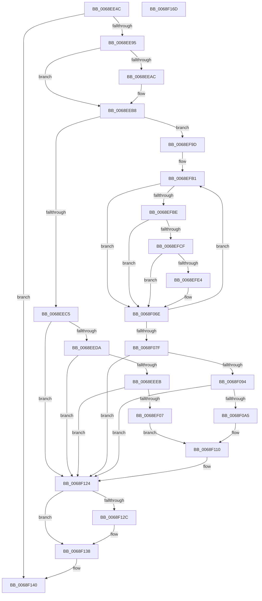

# MiLogSlabEntriesDemote

- RVA: `0x0068EE4C`–`0x0068F16E` (길이 `802` bytes)
- VA: `0x000000014068EE4C`
- 실행 섹션: `.text`
- PDB 이름 있음: `예`; PDB Function 태그: `아니요`
- unwind 정보 RVA: `0x000D8F90`
- 디코드: `183`개 명령, `802/802` bytes 표시
- 미해석 바이트: `0` (있으면 어셈블리에 `.byte`로 보존)

> 이 문서는 커널 이미지의 기계어와 PDB 기호를 분석해 생성했습니다. 4번과 5번은 함수 원형과 자료형을 바이너리 사용 방식에서 추정한 C 해석이며 원본 소스 복구 결과는 아닙니다.

## 1. Dependencies

- 직접 호출 지점: **8**; 고유 호출 대상: **5**
- 직접 호출자로 확인된 함수: **2**
- RIP 상대 이미지 참조: **6**

### Outgoing calls
- `0x0068EEB1` → [KiRaiseIrqlProcessIrqlFlags](../4F/KiRaiseIrqlProcessIrqlFlags_function_004F56FC.md) (function, `0x004F56FC`)
- `0x0068EEF8` → [tlgKeywordOn](../42/tlgKeywordOn_function_0042EAA0.md) (function, `0x0042EAA0`)
- `0x0068EFD5` → [tlgKeywordOn](../42/tlgKeywordOn_function_0042EAA0.md) (function, `0x0042EAA0`)
- `0x0068F067` → [tlgWriteAgg](../2F/tlgWriteAgg_function_002F0F7C.md) (function, `0x002F0F7C`)
- `0x0068F09A` → [tlgKeywordOn](../42/tlgKeywordOn_function_0042EAA0.md) (function, `0x0042EAA0`)
- `0x0068F11D` → [tlgWriteAgg](../2F/tlgWriteAgg_function_002F0F7C.md) (function, `0x002F0F7C`)
- `0x0068F133` → [KiLowerIrqlProcessIrqlFlags](../4F/KiLowerIrqlProcessIrqlFlags_function_004F5698.md) (function, `0x004F5698`)
- `0x0068F147` → [_security_check_cookie](../6A/_security_check_cookie_function_006AC640.md) (function, `0x006AC640`)

### Direct callers
- [MiDemoteSlabEntries](../4D/MiDemoteSlabEntries_function_004D89A0.md) at `0x004D8A60`
- [sub_006DDE00](../6D/Unknown_function_006DDE00.md) at `0x006DDE4D`

### Static image references
- `0x0068EE6F` → RVA `0x00E0A740` (`.data`; read)
- `0x0068EE88` → RVA `0x00E37618` (`.data`; read)
- `0x0068EEA4` → RVA `0x00FC6D20` (`ALMOSTRO`; read)
- `0x0068EF23` → RVA `0x00059831` (`.rdata`; read)
- `0x0068F004` → RVA `0x000597B7` (`.rdata`; read)
- `0x0068F0B1` → RVA `0x0005993B` (`.rdata`; read)

## 2. Other-region calls and transfers

- 다른 실행 섹션으로 향하는 call: **0**
- 별도 외부 분기/꼬리 이동을 확인하지 못했습니다.

## 3. Assembly (complete function range)

```asm
0068EE4C  48 8B C4                        mov rax, rsp
0068EE4F  48 89 58 08                     mov qword ptr [rax + 8], rbx
0068EE53  48 89 78 10                     mov qword ptr [rax + 0x10], rdi
0068EE57  4C 89 60 18                     mov qword ptr [rax + 0x18], r12
0068EE5B  4C 89 68 20                     mov qword ptr [rax + 0x20], r13
0068EE5F  55                              push rbp
0068EE60  41 56                           push r14
0068EE62  41 57                           push r15
0068EE64  48 8D 68 A1                     lea rbp, [rax - 0x5f]
0068EE68  48 81 EC F0 00 00 00            sub rsp, 0xf0
0068EE6F  48 8B 05 CA B8 77 00            mov rax, qword ptr [rip + 0x77b8ca]
0068EE76  48 33 C4                        xor rax, rsp
0068EE79  48 89 45 37                     mov qword ptr [rbp + 0x37], rax
0068EE7D  44 8B F2                        mov r14d, edx
0068EE80  89 55 8F                        mov dword ptr [rbp - 0x71], edx
0068EE83  33 D2                           xor edx, edx
0068EE85  48 8B D9                        mov rbx, rcx
0068EE88  48 39 15 89 87 7A 00            cmp qword ptr [rip + 0x7a8789], rdx
0068EE8F  0F 84 AB 02 00 00               je 0x14068f140
0068EE95  44 0F 20 C7                     mov rdi, cr8
0068EE99  48 89 7D A7                     mov qword ptr [rbp - 0x59], rdi
0068EE9D  8D 42 02                        lea eax, [rdx + 2]
0068EEA0  44 0F 22 C0                     mov cr8, rax
0068EEA4  39 15 76 7E 93 00               cmp dword ptr [rip + 0x937e76], edx
0068EEAA  74 0C                           je 0x14068eeb8
0068EEAC  8A D0                           mov dl, al
0068EEAE  40 8A CF                        mov cl, dil
0068EEB1  E8 46 68 E6 FF                  call 0x1404f56fc
0068EEB6  33 D2                           xor edx, edx
0068EEB8  4C 8B 43 58                     mov r8, qword ptr [rbx + 0x58]
0068EEBC  4D 85 C0                        test r8, r8
0068EEBF  0F 84 D8 00 00 00               je 0x14068ef9d
0068EEC5  45 8B 88 80 00 00 00            mov r9d, dword ptr [r8 + 0x80]
0068EECC  4E 8B 5C CB 08                  mov r11, qword ptr [rbx + r9*8 + 8]
0068EED1  4D 85 DB                        test r11, r11
0068EED4  0F 84 4A 02 00 00               je 0x14068f124
0068EEDA  4C 8B 15 37 87 7A 00            mov r10, qword ptr [rip + 0x7a8737]
0068EEE1  41 83 3A 05                     cmp dword ptr [r10], 5
0068EEE5  0F 86 39 02 00 00               jbe 0x14068f124
0068EEEB  48 BA 00 04 00 00 00 40 00 00   movabs rdx, 0x400000000400
0068EEF5  49 8B CA                        mov rcx, r10
0068EEF8  E8 A3 FB D9 FF                  call 0x14042eaa0
0068EEFD  33 D2                           xor edx, edx
0068EEFF  84 C0                           test al, al
0068EF01  0F 84 1D 02 00 00               je 0x14068f124
0068EF07  44 89 4D 8F                     mov dword ptr [rbp - 0x71], r9d
0068EF0B  48 8D 45 9F                     lea rax, [rbp - 0x61]
0068EF0F  48 89 45 D7                     mov qword ptr [rbp - 0x29], rax
0068EF13  44 8D 4A 08                     lea r9d, [rdx + 8]
0068EF17  48 8D 45 8F                     lea rax, [rbp - 0x71]
0068EF1B  4C 89 5D 9F                     mov qword ptr [rbp - 0x61], r11
0068EF1F  48 89 45 E7                     mov qword ptr [rbp - 0x19], rax
0068EF23  48 8D 15 07 A9 9C FF            lea rdx, [rip - 0x6356f9]
0068EF2A  48 C7 45 DF 08 00 00 00         mov qword ptr [rbp - 0x21], 8
0068EF32  48 C7 45 EF 04 00 00 00         mov qword ptr [rbp - 0x11], 4
0068EF3A  41 8B 80 84 00 00 00            mov eax, dword ptr [r8 + 0x84]
0068EF41  89 45 93                        mov dword ptr [rbp - 0x6d], eax
0068EF44  48 8D 45 93                     lea rax, [rbp - 0x6d]
0068EF48  48 89 45 F7                     mov qword ptr [rbp - 9], rax
0068EF4C  48 8B 03                        mov rax, qword ptr [rbx]
0068EF4F  48 C7 45 FF 04 00 00 00         mov qword ptr [rbp - 1], 4
0068EF57  0F B7 08                        movzx ecx, word ptr [rax]
0068EF5A  48 8D 45 87                     lea rax, [rbp - 0x79]
0068EF5E  48 89 45 07                     mov qword ptr [rbp + 7], rax
0068EF62  48 8D 45 8B                     lea rax, [rbp - 0x75]
0068EF66  48 89 45 17                     mov qword ptr [rbp + 0x17], rax
0068EF6A  48 8D 45 97                     lea rax, [rbp - 0x69]
0068EF6E  48 89 45 27                     mov qword ptr [rbp + 0x27], rax
0068EF72  48 8D 45 B7                     lea rax, [rbp - 0x49]
0068EF76  89 4D 87                        mov dword ptr [rbp - 0x79], ecx
0068EF79  49 8B CA                        mov rcx, r10
0068EF7C  48 C7 45 0F 04 00 00 00         mov qword ptr [rbp + 0xf], 4
0068EF84  44 89 75 8B                     mov dword ptr [rbp - 0x75], r14d
0068EF88  48 C7 45 1F 04 00 00 00         mov qword ptr [rbp + 0x1f], 4
0068EF90  48 C7 45 2F 08 00 00 00         mov qword ptr [rbp + 0x2f], 8
0068EF98  E9 73 01 00 00                  jmp 0x14068f110
0068EF9D  8B 7D 8F                        mov edi, dword ptr [rbp - 0x71]
0068EFA0  4C 8D 63 08                     lea r12, [rbx + 8]
0068EFA4  44 8B F2                        mov r14d, edx
0068EFA7  49 BF 00 04 00 00 00 40 00 00   movabs r15, 0x400000000400
0068EFB1  4D 8B 0C 24                     mov r9, qword ptr [r12]
0068EFB5  4D 85 C9                        test r9, r9
0068EFB8  0F 84 B0 00 00 00               je 0x14068f06e
0068EFBE  4C 8B 05 53 86 7A 00            mov r8, qword ptr [rip + 0x7a8653]
0068EFC5  41 83 38 05                     cmp dword ptr [r8], 5
0068EFC9  0F 86 9F 00 00 00               jbe 0x14068f06e
0068EFCF  49 8B D7                        mov rdx, r15
0068EFD2  49 8B C8                        mov rcx, r8
0068EFD5  E8 C6 FA D9 FF                  call 0x14042eaa0
0068EFDA  33 D2                           xor edx, edx
0068EFDC  84 C0                           test al, al
0068EFDE  0F 84 8A 00 00 00               je 0x14068f06e
0068EFE4  4C 89 4D 97                     mov qword ptr [rbp - 0x69], r9
0068EFE8  48 8D 45 97                     lea rax, [rbp - 0x69]
0068EFEC  48 89 45 D7                     mov qword ptr [rbp - 0x29], rax
0068EFF0  44 8D 4A 07                     lea r9d, [rdx + 7]
0068EFF4  48 8D 45 8B                     lea rax, [rbp - 0x75]
0068EFF8  48 C7 45 DF 08 00 00 00         mov qword ptr [rbp - 0x21], 8
0068F000  48 89 45 E7                     mov qword ptr [rbp - 0x19], rax
0068F004  48 8D 15 AC A7 9C FF            lea rdx, [rip - 0x635854]
0068F00B  48 8B 03                        mov rax, qword ptr [rbx]
0068F00E  44 89 75 8B                     mov dword ptr [rbp - 0x75], r14d
0068F012  48 C7 45 EF 04 00 00 00         mov qword ptr [rbp - 0x11], 4
0068F01A  0F B7 08                        movzx ecx, word ptr [rax]
0068F01D  48 8D 45 87                     lea rax, [rbp - 0x79]
0068F021  48 89 45 F7                     mov qword ptr [rbp - 9], rax
0068F025  48 8D 45 93                     lea rax, [rbp - 0x6d]
0068F029  48 89 45 07                     mov qword ptr [rbp + 7], rax
0068F02D  48 8D 45 9F                     lea rax, [rbp - 0x61]
0068F031  48 89 45 17                     mov qword ptr [rbp + 0x17], rax
0068F035  48 8D 45 B7                     lea rax, [rbp - 0x49]
0068F039  89 4D 87                        mov dword ptr [rbp - 0x79], ecx
0068F03C  49 8B C8                        mov rcx, r8
0068F03F  48 89 44 24 20                  mov qword ptr [rsp + 0x20], rax
0068F044  48 C7 45 FF 04 00 00 00         mov qword ptr [rbp - 1], 4
0068F04C  89 7D 93                        mov dword ptr [rbp - 0x6d], edi
0068F04F  48 C7 45 0F 04 00 00 00         mov qword ptr [rbp + 0xf], 4
0068F057  48 C7 45 9F 00 00 00 01         mov qword ptr [rbp - 0x61], 0x1000000
0068F05F  48 C7 45 1F 08 00 00 00         mov qword ptr [rbp + 0x1f], 8
0068F067  E8 10 1F C6 FF                  call 0x1402f0f7c
0068F06C  33 D2                           xor edx, edx
0068F06E  41 FF C6                        inc r14d
0068F071  49 83 C4 08                     add r12, 8
0068F075  41 83 FE 09                     cmp r14d, 9
0068F079  0F 82 32 FF FF FF               jb 0x14068efb1
0068F07F  4C 8B 05 92 85 7A 00            mov r8, qword ptr [rip + 0x7a8592]
0068F086  48 8B 7D A7                     mov rdi, qword ptr [rbp - 0x59]
0068F08A  41 83 38 05                     cmp dword ptr [r8], 5
0068F08E  0F 86 90 00 00 00               jbe 0x14068f124
0068F094  49 8B D7                        mov rdx, r15
0068F097  49 8B C8                        mov rcx, r8
0068F09A  E8 01 FA D9 FF                  call 0x14042eaa0
0068F09F  33 D2                           xor edx, edx
0068F0A1  84 C0                           test al, al
0068F0A3  74 7F                           je 0x14068f124
0068F0A5  48 8B 43 50                     mov rax, qword ptr [rbx + 0x50]
0068F0A9  44 8D 4A 06                     lea r9d, [rdx + 6]
0068F0AD  44 8B 75 8F                     mov r14d, dword ptr [rbp - 0x71]
0068F0B1  48 8D 15 83 A8 9C FF            lea rdx, [rip - 0x63577d]
0068F0B8  48 89 45 A7                     mov qword ptr [rbp - 0x59], rax
0068F0BC  48 8D 45 A7                     lea rax, [rbp - 0x59]
0068F0C0  48 89 45 D7                     mov qword ptr [rbp - 0x29], rax
0068F0C4  48 8B 03                        mov rax, qword ptr [rbx]
0068F0C7  48 C7 45 DF 08 00 00 00         mov qword ptr [rbp - 0x21], 8
0068F0CF  0F B7 08                        movzx ecx, word ptr [rax]
0068F0D2  48 8D 45 8B                     lea rax, [rbp - 0x75]
0068F0D6  48 89 45 E7                     mov qword ptr [rbp - 0x19], rax
0068F0DA  48 8D 45 87                     lea rax, [rbp - 0x79]
0068F0DE  48 89 45 F7                     mov qword ptr [rbp - 9], rax
0068F0E2  48 8D 45 97                     lea rax, [rbp - 0x69]
0068F0E6  48 89 45 07                     mov qword ptr [rbp + 7], rax
0068F0EA  48 8D 45 B7                     lea rax, [rbp - 0x49]
0068F0EE  89 4D 8B                        mov dword ptr [rbp - 0x75], ecx
0068F0F1  49 8B C8                        mov rcx, r8
0068F0F4  48 C7 45 EF 04 00 00 00         mov qword ptr [rbp - 0x11], 4
0068F0FC  44 89 75 87                     mov dword ptr [rbp - 0x79], r14d
0068F100  48 C7 45 FF 04 00 00 00         mov qword ptr [rbp - 1], 4
0068F108  48 C7 45 0F 08 00 00 00         mov qword ptr [rbp + 0xf], 8
0068F110  48 89 44 24 20                  mov qword ptr [rsp + 0x20], rax
0068F115  48 C7 45 97 00 00 00 01         mov qword ptr [rbp - 0x69], 0x1000000
0068F11D  E8 5A 1E C6 FF                  call 0x1402f0f7c
0068F122  33 D2                           xor edx, edx
0068F124  39 15 F6 7B 93 00               cmp dword ptr [rip + 0x937bf6], edx
0068F12A  74 0C                           je 0x14068f138
0068F12C  44 0F 20 C1                     mov rcx, cr8
0068F130  40 8A D7                        mov dl, dil
0068F133  E8 60 65 E6 FF                  call 0x1404f5698
0068F138  40 0F B6 C7                     movzx eax, dil
0068F13C  44 0F 22 C0                     mov cr8, rax
0068F140  48 8B 4D 37                     mov rcx, qword ptr [rbp + 0x37]
0068F144  48 33 CC                        xor rcx, rsp
0068F147  E8 F4 D4 01 00                  call 0x1406ac640
0068F14C  4C 8D 9C 24 F0 00 00 00         lea r11, [rsp + 0xf0]
0068F154  49 8B 5B 20                     mov rbx, qword ptr [r11 + 0x20]
0068F158  49 8B 7B 28                     mov rdi, qword ptr [r11 + 0x28]
0068F15C  4D 8B 63 30                     mov r12, qword ptr [r11 + 0x30]
0068F160  4D 8B 6B 38                     mov r13, qword ptr [r11 + 0x38]
0068F164  49 8B E3                        mov rsp, r11
0068F167  41 5F                           pop r15
0068F169  41 5E                           pop r14
0068F16B  5D                              pop rbp
0068F16C  C3                              ret
0068F16D  CC                              int3
```

## 4. C-style interpretation (structured pseudocode)

```c
__int64 __fastcall MiLogSlabEntriesDemote(__int64 a1, int a2)
{
    __int64 result;
    __int64 v_r12;
    __int64 v_r14;
    __int64 v_rsp;
    unsigned __int64 v_stack_m18;
    unsigned __int64 v_stack_mE8;

    *(unsigned __int64 *)(v_rsp + 8) = v_rbx;
    *(unsigned __int64 *)(v_rsp + 16) = v_rdi;
    *(unsigned __int64 *)(v_rsp + 24) = v_r12;
    *(unsigned __int64 *)(v_rsp + 32) = v_r13;
    v_rsp = (v_rsp) - (240);
    result = (*(unsigned __int64 *)(v_rip + 7846090)) ^ (v_rsp);
    *(unsigned __int64 *)(v_rsp - 95 + 55) = result;
    *(unsigned int *)(v_rsp - 95 - 113) = a2;
    a2 = 0;
    if ((*(unsigned __int64 *)(v_rip + 8030089)) == 0) goto loc_0068F140;
    *(unsigned __int64 *)(v_rsp - 95 - 89) = v_cr8;
    result = a2 + 2;
    if ((*(unsigned int *)(v_rip + 9666166)) != 0) {
        a2 = (unsigned __int8)(a2 + 2);
        a1 = (unsigned __int8)(v_cr8);
        result = KiRaiseIrqlProcessIrqlFlags(a1, a2, a3, a4);
        a2 = 0;
    }
    if (*(unsigned __int64 *)(a1 + 88) == 0) goto loc_0068EF9D;
    if (*(unsigned __int64 *)(a1 + (unsigned int)(*(unsigned int *)(*(unsigned __int64 *)(a1 + 88) + 128)) * 8 + 8) == 0) goto loc_0068F124;
    if ((*(unsigned int *)(*(unsigned __int64 *)(v_rip + 8030007))) <= 5) goto loc_0068F124;
    result = tlgKeywordOn(*(unsigned __int64 *)(v_rip + 8030007), a2, *(unsigned __int64 *)(a1 + 88), (unsigned int)(*(unsigned int *)(*(unsigned __int64 *)(a1 + 88) + 128)));
    a2 = 0;
    if ((unsigned __int8)(result) == 0) goto loc_0068F124;
    *(unsigned int *)(v_rsp - 95 - 113) = (unsigned int)((unsigned int)(*(unsigned int *)(*(unsigned __int64 *)(a1 + 88) + 128)));
    *(unsigned __int64 *)(v_rsp - 95 - 41) = v_rsp - 95 - 97;
    *(unsigned __int64 *)(v_rsp - 95 - 97) = *(unsigned __int64 *)(a1 + (unsigned int)(*(unsigned int *)(*(unsigned __int64 *)(a1 + 88) + 128)) * 8 + 8);
    *(unsigned __int64 *)(v_rsp - 95 - 25) = v_rsp - 95 - 113;
    *(unsigned __int64 *)(v_rsp - 95 - 33) = 8;
    *(unsigned __int64 *)(v_rsp - 95 - 17) = 4;
    *(unsigned int *)(v_rsp - 95 - 109) = (unsigned int)((unsigned int)(*(unsigned int *)(*(unsigned __int64 *)(a1 + 88) + 132)));
    *(unsigned __int64 *)(v_rsp - 95 - 9) = v_rsp - 95 - 109;
    *(unsigned __int64 *)(v_rsp - 95 - 1) = 4;
    *(unsigned __int64 *)(v_rsp - 95 + 7) = v_rsp - 95 - 121;
    *(unsigned __int64 *)(v_rsp - 95 + 23) = v_rsp - 95 - 117;
    *(unsigned __int64 *)(v_rsp - 95 + 39) = v_rsp - 95 - 105;
    *(unsigned int *)(v_rsp - 95 - 121) = (unsigned int)(*(unsigned __int16 *)(*(unsigned __int64 *)(a1)));
    *(unsigned __int64 *)(v_rsp - 95 + 15) = 4;
    *(unsigned int *)(v_rsp - 95 - 117) = (unsigned int)((unsigned int)(a2));
    *(unsigned __int64 *)(v_rsp - 95 + 31) = 4;
    *(unsigned __int64 *)(v_rsp - 95 + 47) = 8;
    goto loc_0068F110;
loc_0068EF9D:
loc_0068EFB1:
    if (*(unsigned __int64 *)(a1 + 8) == 0) goto loc_0068F06E;
    if ((*(unsigned int *)(*(unsigned __int64 *)(v_rip + 8029779))) <= 5) goto loc_0068F06E;
    result = tlgKeywordOn(*(unsigned __int64 *)(v_rip + 8029779), v_r15, *(unsigned __int64 *)(v_rip + 8029779), *(unsigned __int64 *)(a1 + 8));
    a2 = 0;
    if ((unsigned __int8)(result) != 0) {
        *(unsigned __int64 *)(v_rsp - 95 - 105) = *(unsigned __int64 *)(a1 + 8);
        result = v_rsp - 95 - 105;
        *(unsigned __int64 *)(v_rsp - 95 - 41) = result;
        a4 = a2 + 7;
        result = v_rsp - 95 - 117;
        *(unsigned __int64 *)(v_rsp - 95 - 33) = 8;
        *(unsigned __int64 *)(v_rsp - 95 - 25) = result;
        a2 = v_rip - 6510676;
        result = *(unsigned __int64 *)(a1);
        *(unsigned int *)(v_rsp - 95 - 117) = (unsigned int)((unsigned int)((unsigned int)(v_rip - 6510329)));
        *(unsigned __int64 *)(v_rsp - 95 - 17) = 4;
        a1 = *(unsigned __int16 *)(result);
        result = v_rsp - 95 - 121;
        *(unsigned __int64 *)(v_rsp - 95 - 9) = result;
        result = v_rsp - 95 - 109;
        *(unsigned __int64 *)(v_rsp - 95 + 7) = result;
        result = v_rsp - 95 - 97;
        *(unsigned __int64 *)(v_rsp - 95 + 23) = result;
        result = v_rsp - 95 - 73;
        *(unsigned int *)(v_rsp - 95 - 121) = (unsigned int)(a1);
        a1 = *(unsigned __int64 *)(v_rip + 8029779);
        v_stack_mE8 = result;
        *(unsigned __int64 *)(v_rsp - 95 - 1) = 4;
        *(unsigned int *)(v_rsp - 95 - 109) = (unsigned int)((unsigned int)(*(unsigned int *)(v_rsp - 95 - 113)));
        *(unsigned __int64 *)(v_rsp - 95 + 15) = 4;
        *(unsigned __int64 *)(v_rsp - 95 - 97) = 0x1000000ULL;
        *(unsigned __int64 *)(v_rsp - 95 + 31) = 8;
        result = tlgWriteAgg(a1, a2, *(unsigned __int64 *)(v_rip + 8029779), a4);
        a2 = 0;
    }
    v_r14 = (unsigned int)(((unsigned int)((unsigned int)(v_rip - 6510329))) + 1);
    v_r12 = (a1 + 8) + (8);
    if (((unsigned int)(v_r14)) < 9) goto loc_0068EFB1;
    if ((*(unsigned int *)(*(unsigned __int64 *)(v_rip + 8029586))) <= 5) goto loc_0068F124;
    result = tlgKeywordOn(*(unsigned __int64 *)(v_rip + 8029586), v_r15, *(unsigned __int64 *)(v_rip + 8029586), a4);
    a2 = 0;
    if ((unsigned __int8)(result) == 0) goto loc_0068F124;
    *(unsigned __int64 *)(v_rsp - 95 - 89) = *(unsigned __int64 *)(a1 + 80);
    *(unsigned __int64 *)(v_rsp - 95 - 41) = v_rsp - 95 - 89;
    *(unsigned __int64 *)(v_rsp - 95 - 33) = 8;
    *(unsigned __int64 *)(v_rsp - 95 - 25) = v_rsp - 95 - 117;
    *(unsigned __int64 *)(v_rsp - 95 - 9) = v_rsp - 95 - 121;
    *(unsigned __int64 *)(v_rsp - 95 + 7) = v_rsp - 95 - 105;
    *(unsigned int *)(v_rsp - 95 - 117) = (unsigned int)(*(unsigned __int16 *)(*(unsigned __int64 *)(a1)));
    *(unsigned __int64 *)(v_rsp - 95 - 17) = 4;
    *(unsigned int *)(v_rsp - 95 - 121) = (unsigned int)((unsigned int)(*(unsigned int *)(v_rsp - 95 - 113)));
    *(unsigned __int64 *)(v_rsp - 95 - 1) = 4;
    *(unsigned __int64 *)(v_rsp - 95 + 15) = 8;
loc_0068F110:
    v_stack_mE8 = v_rsp - 95 - 73;
    *(unsigned __int64 *)(v_rsp - 95 - 105) = 0x1000000ULL;
    result = tlgWriteAgg(*(unsigned __int64 *)(v_rip + 8029586), v_rip - 6510461, *(unsigned __int64 *)(v_rip + 8029586), a2 + 6);
    a2 = 0;
loc_0068F124:
    if ((*(unsigned int *)(v_rip + 9665526)) != 0) {
        a1 = a2 + 2;
        a2 = (unsigned __int8)(*(unsigned __int64 *)(v_rsp - 95 - 89));
        result = KiLowerIrqlProcessIrqlFlags(a1, a2, *(unsigned __int64 *)(v_rip + 8029586), a2 + 6);
    }
loc_0068F140:
    a1 = (*(unsigned __int64 *)(v_rsp - 95 + 55)) ^ (v_rsp);
    result = _security_check_cookie(a1, a2, *(unsigned __int64 *)(v_rip + 8029586), a2 + 6);
    return result;
}
```

## 5. (Beta) C Style

```c
int64_t MiLogSlabEntriesDemote(void *Arg1, int32_t Arg2)
{
    uint8_t *arg1 = (uint8_t *)Arg1;

    int64_t result;
    int64_t local_r12;
    int64_t local_r14;
    int64_t local_rsp;
    uint64_t v_stack_m18;
    uint64_t v_stack_mE8;

    *(uint64_t *)(local_rsp + 0x8) = local_rbx;
    *(uint64_t *)(local_rsp + 0x10) = local_rdi;
    *(uint64_t *)(local_rsp + 0x18) = local_r12;
    *(uint64_t *)(local_rsp + 0x20) = local_r13;
    local_rsp = (local_rsp) - (240);
    result = (*(uint64_t *)(v_rip + 0x77B8CA)) ^ (local_rsp);
    *(uint64_t *)(local_rsp - 0x5F + 0x37) = result;
    *(uint32_t *)(local_rsp - 0x5F - 0x71) = Arg2;
    Arg2 = 0;
    if ((*(uint64_t *)(v_rip + 0x7A8789)) == 0) goto loc_0068F140;
    *(uint64_t *)(local_rsp - 0x5F - 0x59) = v_cr8;
    result = Arg2 + 2;
    if ((*(uint32_t *)(v_rip + 0x937E76)) != 0) {
        Arg2 = (uint8_t)(Arg2 + 2);
        Arg1 = (uint8_t)(v_cr8);
        result = KiRaiseIrqlProcessIrqlFlags(Arg1, Arg2, a3, a4);
        Arg2 = 0;
    }
    if (*(uint64_t *)(arg1 + 0x58) == 0) goto loc_0068EF9D;
    if (*(uint64_t *)(arg1 + (uint32_t)(*(uint32_t *)(*(uint64_t *)(arg1 + 0x58) + 0x80)) * 8 + 0x8) == 0) goto loc_0068F124;
    if ((*(uint32_t *)(*(uint64_t *)(v_rip + 0x7A8737))) <= 5) goto loc_0068F124;
    result = tlgKeywordOn(*(uint64_t *)(v_rip + 0x7A8737), Arg2, *(uint64_t *)(arg1 + 0x58), (uint32_t)(*(uint32_t *)(*(uint64_t *)(arg1 + 0x58) + 0x80)));
    Arg2 = 0;
    if ((uint8_t)(result) == 0) goto loc_0068F124;
    *(uint32_t *)(local_rsp - 0x5F - 0x71) = (uint32_t)((uint32_t)(*(uint32_t *)(*(uint64_t *)(arg1 + 0x58) + 0x80)));
    *(uint64_t *)(local_rsp - 0x5F - 0x29) = local_rsp - 95 - 97;
    *(uint64_t *)(local_rsp - 0x5F - 0x61) = *(uint64_t *)(arg1 + (uint32_t)(*(uint32_t *)(*(uint64_t *)(arg1 + 0x58) + 0x80)) * 8 + 0x8);
    *(uint64_t *)(local_rsp - 0x5F - 0x19) = local_rsp - 95 - 113;
    *(uint64_t *)(local_rsp - 0x5F - 0x21) = 8;
    *(uint64_t *)(local_rsp - 0x5F - 0x11) = 4;
    *(uint32_t *)(local_rsp - 0x5F - 0x6D) = (uint32_t)((uint32_t)(*(uint32_t *)(*(uint64_t *)(arg1 + 0x58) + 0x84)));
    *(uint64_t *)(local_rsp - 0x5F - 0x9) = local_rsp - 95 - 109;
    *(uint64_t *)(local_rsp - 0x5F - 0x1) = 4;
    *(uint64_t *)(local_rsp - 0x5F + 0x7) = local_rsp - 95 - 121;
    *(uint64_t *)(local_rsp - 0x5F + 0x17) = local_rsp - 95 - 117;
    *(uint64_t *)(local_rsp - 0x5F + 0x27) = local_rsp - 95 - 105;
    *(uint32_t *)(local_rsp - 0x5F - 0x79) = (uint32_t)(*(uint16_t *)(*(uint64_t *)(arg1)));
    *(uint64_t *)(local_rsp - 0x5F + 0xF) = 4;
    *(uint32_t *)(local_rsp - 0x5F - 0x75) = (uint32_t)((uint32_t)(Arg2));
    *(uint64_t *)(local_rsp - 0x5F + 0x1F) = 4;
    *(uint64_t *)(local_rsp - 0x5F + 0x2F) = 8;
    goto loc_0068F110;
loc_0068EF9D:
loc_0068EFB1:
    if (*(uint64_t *)(arg1 + 0x8) == 0) goto loc_0068F06E;
    if ((*(uint32_t *)(*(uint64_t *)(v_rip + 0x7A8653))) <= 5) goto loc_0068F06E;
    result = tlgKeywordOn(*(uint64_t *)(v_rip + 0x7A8653), local_r15, *(uint64_t *)(v_rip + 0x7A8653), *(uint64_t *)(arg1 + 0x8));
    Arg2 = 0;
    if ((uint8_t)(result) != 0) {
        *(uint64_t *)(local_rsp - 0x5F - 0x69) = *(uint64_t *)(arg1 + 0x8);
        result = local_rsp - 95 - 105;
        *(uint64_t *)(local_rsp - 0x5F - 0x29) = result;
        a4 = Arg2 + 7;
        result = local_rsp - 95 - 117;
        *(uint64_t *)(local_rsp - 0x5F - 0x21) = 8;
        *(uint64_t *)(local_rsp - 0x5F - 0x19) = result;
        Arg2 = v_rip - 6510676;
        result = *(uint64_t *)(arg1);
        *(uint32_t *)(local_rsp - 0x5F - 0x75) = (uint32_t)((uint32_t)((uint32_t)(v_rip - 6510329)));
        *(uint64_t *)(local_rsp - 0x5F - 0x11) = 4;
        Arg1 = *(uint16_t *)(result);
        result = local_rsp - 95 - 121;
        *(uint64_t *)(local_rsp - 0x5F - 0x9) = result;
        result = local_rsp - 95 - 109;
        *(uint64_t *)(local_rsp - 0x5F + 0x7) = result;
        result = local_rsp - 95 - 97;
        *(uint64_t *)(local_rsp - 0x5F + 0x17) = result;
        result = local_rsp - 95 - 73;
        *(uint32_t *)(local_rsp - 0x5F - 0x79) = (uint32_t)(Arg1);
        Arg1 = *(uint64_t *)(v_rip + 0x7A8653);
        v_stack_mE8 = result;
        *(uint64_t *)(local_rsp - 0x5F - 0x1) = 4;
        *(uint32_t *)(local_rsp - 0x5F - 0x6D) = (uint32_t)((uint32_t)(*(uint32_t *)(local_rsp - 0x5F - 0x71)));
        *(uint64_t *)(local_rsp - 0x5F + 0xF) = 4;
        *(uint64_t *)(local_rsp - 0x5F - 0x61) = 0x1000000ULL;
        *(uint64_t *)(local_rsp - 0x5F + 0x1F) = 8;
        result = tlgWriteAgg(Arg1, Arg2, *(uint64_t *)(v_rip + 0x7A8653), a4);
        Arg2 = 0;
    }
    local_r14 = (uint32_t)(((uint32_t)((uint32_t)(v_rip - 6510329))) + 1);
    local_r12 = (Arg1 + 8) + (8);
    if (((uint32_t)(local_r14)) < 9) goto loc_0068EFB1;
    if ((*(uint32_t *)(*(uint64_t *)(v_rip + 0x7A8592))) <= 5) goto loc_0068F124;
    result = tlgKeywordOn(*(uint64_t *)(v_rip + 0x7A8592), local_r15, *(uint64_t *)(v_rip + 0x7A8592), a4);
    Arg2 = 0;
    if ((uint8_t)(result) == 0) goto loc_0068F124;
    *(uint64_t *)(local_rsp - 0x5F - 0x59) = *(uint64_t *)(arg1 + 0x50);
    *(uint64_t *)(local_rsp - 0x5F - 0x29) = local_rsp - 95 - 89;
    *(uint64_t *)(local_rsp - 0x5F - 0x21) = 8;
    *(uint64_t *)(local_rsp - 0x5F - 0x19) = local_rsp - 95 - 117;
    *(uint64_t *)(local_rsp - 0x5F - 0x9) = local_rsp - 95 - 121;
    *(uint64_t *)(local_rsp - 0x5F + 0x7) = local_rsp - 95 - 105;
    *(uint32_t *)(local_rsp - 0x5F - 0x75) = (uint32_t)(*(uint16_t *)(*(uint64_t *)(arg1)));
    *(uint64_t *)(local_rsp - 0x5F - 0x11) = 4;
    *(uint32_t *)(local_rsp - 0x5F - 0x79) = (uint32_t)((uint32_t)(*(uint32_t *)(local_rsp - 0x5F - 0x71)));
    *(uint64_t *)(local_rsp - 0x5F - 0x1) = 4;
    *(uint64_t *)(local_rsp - 0x5F + 0xF) = 8;
loc_0068F110:
    v_stack_mE8 = local_rsp - 95 - 73;
    *(uint64_t *)(local_rsp - 0x5F - 0x69) = 0x1000000ULL;
    result = tlgWriteAgg(*(uint64_t *)(v_rip + 0x7A8592), v_rip - 6510461, *(uint64_t *)(v_rip + 0x7A8592), Arg2 + 6);
    Arg2 = 0;
loc_0068F124:
    if ((*(uint32_t *)(v_rip + 0x937BF6)) != 0) {
        Arg1 = Arg2 + 2;
        Arg2 = (uint8_t)(*(uint64_t *)(local_rsp - 0x5F - 0x59));
        result = KiLowerIrqlProcessIrqlFlags(Arg1, Arg2, *(uint64_t *)(v_rip + 0x7A8592), Arg2 + 6);
    }
loc_0068F140:
    Arg1 = (*(uint64_t *)(local_rsp - 0x5F + 0x37)) ^ (local_rsp);
    result = _security_check_cookie(Arg1, Arg2, *(uint64_t *)(v_rip + 0x7A8592), Arg2 + 6);
    return result;
}
```

### 관측된 메모리 오프셋

구조체 형식이 확인되지 않은 접근은 인자 기준의 오프셋으로만 기록했습니다.

| 기준 인자 | 오프셋 표현 | 폭 (bit) | 접근 |
|---|---:|---:|---|
| `Arg1` | `+ 0x0` | `64` | `R` |
| `Arg1` | `+ 0x8` | `64` | `R` |
| `Arg1` | `+ 0x8 + r9*8` | `64` | `R` |
| `Arg1` | `+ 0x50` | `64` | `R` |
| `Arg1` | `+ 0x58` | `64` | `R` |

## 6. Execution-region graph

[열기: 2D/3D 그래프와 함수 탐색 컨트롤 패널](../../../control-panel.html?section=text&rva=0x0068EE4C&view=graph)

- 2D 그래프는 위에서 아래로 흐르고, 3D 그래프는 빈 공간을 드래그해 회전합니다. Shift+드래그는 이동, 휠은 확대·축소, 함수 노드 선택은 대상 보고서 이동입니다.

### Static fallback


