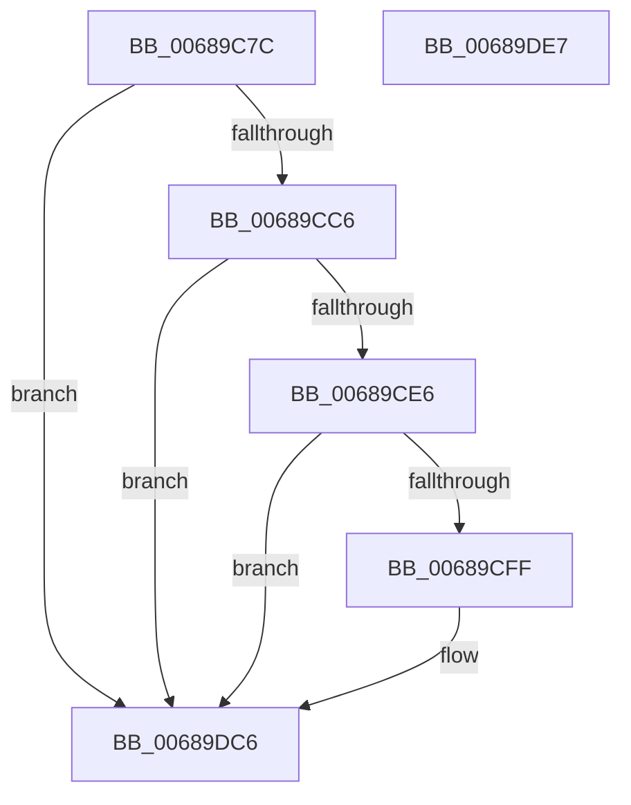

# MiLogUnlockVmTrim

- RVA: `0x00689C7C`–`0x00689DE8` (길이 `364` bytes)
- VA: `0x0000000140689C7C`
- 실행 섹션: `.text`
- PDB 이름 있음: `예`; PDB Function 태그: `아니요`
- unwind 정보 RVA: `0x000CCFD4`
- 디코드: `83`개 명령, `364/364` bytes 표시
- 미해석 바이트: `0` (있으면 어셈블리에 `.byte`로 보존)

> 이 문서는 커널 이미지의 기계어와 PDB 기호를 분석해 생성했습니다. 4번과 5번은 함수 원형과 자료형을 바이너리 사용 방식에서 추정한 C 해석이며 원본 소스 복구 결과는 아닙니다.

## 1. Dependencies

- 직접 호출 지점: **5**; 고유 호출 대상: **5**
- 직접 호출자로 확인된 함수: **1**
- RIP 상대 이미지 참조: **3**

### Outgoing calls
- `0x00689CD0` → [MiFillLogProcessInfo](../44/MiFillLogProcessInfo_function_00448110.md) (function, `0x00448110`)
- `0x00689CF2` → [tlgKeywordOn](../42/tlgKeywordOn_function_0042EAA0.md) (function, `0x0042EAA0`)
- `0x00689D26` → [tlgCreate1Sz_char](../42/tlgCreate1Sz_char_function_00427304.md) (function, `0x00427304`)
- `0x00689DC1` → [tlgWriteEx_EtwWriteEx](../4A/tlgWriteEx_EtwWriteEx_function_004AA348.md) (function, `0x004AA348`)
- `0x00689DCD` → [_security_check_cookie](../6A/_security_check_cookie_function_006AC640.md) (function, `0x006AC640`)

### Direct callers
- [NtUnlockVirtualMemory](../4E/NtUnlockVirtualMemory_function_004EE890.md) at `0x004EEF73`

### Static image references
- `0x00689C93` → RVA `0x00E0A740` (`.data`; read)
- `0x00689CB2` → RVA `0x00E37618` (`.data`; read)
- `0x00689D9E` → RVA `0x0005948A` (`.rdata`; read)

## 2. Other-region calls and transfers

- 다른 실행 섹션으로 향하는 call: **0**
- 별도 외부 분기/꼬리 이동을 확인하지 못했습니다.

## 3. Assembly (complete function range)

```asm
00689C7C  48 89 5C 24 10                  mov qword ptr [rsp + 0x10], rbx
00689C81  48 89 7C 24 18                  mov qword ptr [rsp + 0x18], rdi
00689C86  55                              push rbp
00689C87  48 8D 6C 24 F0                  lea rbp, [rsp - 0x10]
00689C8C  48 81 EC 10 01 00 00            sub rsp, 0x110
00689C93  48 8B 05 A6 0A 78 00            mov rax, qword ptr [rip + 0x780aa6]
00689C9A  48 33 C4                        xor rax, rsp
00689C9D  48 89 45 00                     mov qword ptr [rbp], rax
00689CA1  83 64 24 44 00                  and dword ptr [rsp + 0x44], 0
00689CA6  4D 8B D9                        mov r11, r9
00689CA9  48 83 64 24 48 00               and qword ptr [rsp + 0x48], 0
00689CAF  49 8B D8                        mov rbx, r8
00689CB2  48 83 3D 5E D9 7A 00 00         cmp qword ptr [rip + 0x7ad95e], 0
00689CBA  48 8B FA                        mov rdi, rdx
00689CBD  4C 8B D1                        mov r10, rcx
00689CC0  0F 84 00 01 00 00               je 0x140689dc6
00689CC6  4C 8D 44 24 48                  lea r8, [rsp + 0x48]
00689CCB  48 8D 54 24 44                  lea rdx, [rsp + 0x44]
00689CD0  E8 3B E4 DB FF                  call 0x140448110
00689CD5  4C 8B 05 3C D9 7A 00            mov r8, qword ptr [rip + 0x7ad93c]
00689CDC  41 83 38 05                     cmp dword ptr [r8], 5
00689CE0  0F 86 E0 00 00 00               jbe 0x140689dc6
00689CE6  41 B9 01 00 00 00               mov r9d, 1
00689CEC  49 8B C8                        mov rcx, r8
00689CEF  41 8B D1                        mov edx, r9d
00689CF2  E8 A9 4D DA FF                  call 0x14042eaa0
00689CF7  84 C0                           test al, al
00689CF9  0F 84 C7 00 00 00               je 0x140689dc6
00689CFF  41 8B 82 B8 00 00 00            mov eax, dword ptr [r10 + 0xb8]
00689D06  48 8D 4D A0                     lea rcx, [rbp - 0x60]
00689D0A  48 8B 54 24 48                  mov rdx, qword ptr [rsp + 0x48]
00689D0F  24 0F                           and al, 0xf
00689D11  83 65 9C 00                     and dword ptr [rbp - 0x64], 0
00689D15  88 44 24 40                     mov byte ptr [rsp + 0x40], al
00689D19  48 8D 44 24 40                  lea rax, [rsp + 0x40]
00689D1E  48 89 45 90                     mov qword ptr [rbp - 0x70], rax
00689D22  44 89 4D 98                     mov dword ptr [rbp - 0x68], r9d
00689D26  E8 D9 D5 D9 FF                  call 0x140427304
00689D2B  8B 4C 24 44                     mov ecx, dword ptr [rsp + 0x44]
00689D2F  41 8D 51 03                     lea edx, [r9 + 3]
00689D33  83 65 BC 00                     and dword ptr [rbp - 0x44], 0
00689D37  48 8D 44 24 50                  lea rax, [rsp + 0x50]
00689D3C  83 65 CC 00                     and dword ptr [rbp - 0x34], 0
00689D40  83 65 DC 00                     and dword ptr [rbp - 0x24], 0
00689D44  83 65 EC 00                     and dword ptr [rbp - 0x14], 0
00689D48  83 65 FC 00                     and dword ptr [rbp - 4], 0
00689D4C  48 89 45 B0                     mov qword ptr [rbp - 0x50], rax
00689D50  48 8D 44 24 58                  lea rax, [rsp + 0x58]
00689D55  48 89 45 C0                     mov qword ptr [rbp - 0x40], rax
00689D59  48 8D 44 24 60                  lea rax, [rsp + 0x60]
00689D5E  48 89 45 D0                     mov qword ptr [rbp - 0x30], rax
00689D62  48 8D 44 24 68                  lea rax, [rsp + 0x68]
00689D67  48 89 45 E0                     mov qword ptr [rbp - 0x20], rax
00689D6B  41 0F B7 82 AE 00 00 00         movzx eax, word ptr [r10 + 0xae]
00689D73  89 44 24 48                     mov dword ptr [rsp + 0x48], eax
00689D77  48 8D 44 24 48                  lea rax, [rsp + 0x48]
00689D7C  89 4C 24 50                     mov dword ptr [rsp + 0x50], ecx
00689D80  8D 4A 04                        lea ecx, [rdx + 4]
00689D83  48 89 45 F0                     mov qword ptr [rbp - 0x10], rax
00689D87  48 8D 44 24 70                  lea rax, [rsp + 0x70]
00689D8C  89 55 B8                        mov dword ptr [rbp - 0x48], edx
00689D8F  89 4D C8                        mov dword ptr [rbp - 0x38], ecx
00689D92  89 4D D8                        mov dword ptr [rbp - 0x28], ecx
00689D95  89 4D E8                        mov dword ptr [rbp - 0x18], ecx
00689D98  49 8B C8                        mov rcx, r8
00689D9B  89 55 F8                        mov dword ptr [rbp - 8], edx
00689D9E  48 8D 15 E5 F6 9C FF            lea rdx, [rip - 0x63091b]
00689DA5  48 89 44 24 38                  mov qword ptr [rsp + 0x38], rax
00689DAA  C7 44 24 30 09 00 00 00         mov dword ptr [rsp + 0x30], 9
00689DB2  48 89 7C 24 58                  mov qword ptr [rsp + 0x58], rdi
00689DB7  48 89 5C 24 60                  mov qword ptr [rsp + 0x60], rbx
00689DBC  4C 89 5C 24 68                  mov qword ptr [rsp + 0x68], r11
00689DC1  E8 82 05 E2 FF                  call 0x1404aa348
00689DC6  48 8B 4D 00                     mov rcx, qword ptr [rbp]
00689DCA  48 33 CC                        xor rcx, rsp
00689DCD  E8 6E 28 02 00                  call 0x1406ac640
00689DD2  4C 8D 9C 24 10 01 00 00         lea r11, [rsp + 0x110]
00689DDA  49 8B 5B 18                     mov rbx, qword ptr [r11 + 0x18]
00689DDE  49 8B 7B 20                     mov rdi, qword ptr [r11 + 0x20]
00689DE2  49 8B E3                        mov rsp, r11
00689DE5  5D                              pop rbp
00689DE6  C3                              ret
00689DE7  CC                              int3
```

## 4. C-style interpretation (structured pseudocode)

```c
__int64 __fastcall MiLogUnlockVmTrim(__int64 a1, __int64 a2, __int64 a3, __int64 a4)
{
    __int64 result;
    __int64 v_rsp;
    unsigned __int64 v_stack_m18;
    unsigned int v_stack_m1C;
    unsigned int v_stack_m20;
    unsigned __int64 v_stack_m28;
    unsigned int v_stack_m2C;
    unsigned int v_stack_m30;
    unsigned __int64 v_stack_m38;
    unsigned int v_stack_m3C;
    unsigned int v_stack_m40;
    unsigned __int64 v_stack_m48;
    unsigned int v_stack_m4C;
    unsigned int v_stack_m50;
    unsigned __int64 v_stack_m58;
    unsigned int v_stack_m5C;
    unsigned int v_stack_m60;
    unsigned __int64 v_stack_m68;
    unsigned __int64 v_stack_m78;
    unsigned int v_stack_m7C;
    unsigned __int64 v_stack_m8;
    unsigned int v_stack_m80;
    unsigned __int64 v_stack_m88;
    unsigned __int64 v_stack_mA8;
    unsigned __int64 v_stack_mB0;
    unsigned __int64 v_stack_mB8;
    unsigned __int64 v_stack_mC0;
    unsigned __int64 v_stack_mC8;
    unsigned __int64 v_stack_mD0;
    unsigned int v_stack_mD4;
    unsigned __int8 v_stack_mD8;
    unsigned __int64 v_stack_mE0;
    unsigned int v_stack_mE8;
    unsigned __int64 v_stack_p10;
    unsigned __int64 v_stack_p18;

    v_stack_p10 = v_rbx;
    v_stack_p18 = v_rdi;
    v_rsp = (v_rsp) - (272);
    result = (*(unsigned __int64 *)(v_rip + 7867046)) ^ (v_rsp);
    v_stack_m18 = result;
    if ((*(unsigned __int64 *)(v_rip + 8051038)) == 0) goto loc_00689DC6;
    result = MiFillLogProcessInfo(a1, v_stack_mD4, v_stack_mD0, a4);
    if ((*(unsigned int *)(*(unsigned __int64 *)(v_rip + 8051004))) <= 5) goto loc_00689DC6;
    result = tlgKeywordOn(*(unsigned __int64 *)(v_rip + 8051004), 1, *(unsigned __int64 *)(v_rip + 8051004), 1);
    if ((unsigned __int8)(result) != 0) {
        result = *(unsigned int *)(a1 + 184);
        a1 = v_stack_m78;
        a2 = v_stack_mD0;
        result = (unsigned __int8)((result) & (15));
        v_stack_mD8 = (unsigned __int8)(result);
        result = v_stack_mD8;
        v_stack_m88 = result;
        v_stack_m80 = 1;
        result = tlgCreate1Sz_char(a1, a2, *(unsigned __int64 *)(v_rip + 8051004), 1);
        a1 = v_stack_mD4;
        a2 = 1 + 3;
        result = v_stack_mC8;
        v_stack_m68 = result;
        result = v_stack_mC0;
        v_stack_m58 = result;
        result = v_stack_mB8;
        v_stack_m48 = result;
        result = v_stack_mB0;
        v_stack_m38 = result;
        result = *(unsigned __int16 *)(a1 + 174);
        v_stack_mD0 = (unsigned int)(result);
        result = v_stack_mD0;
        v_stack_mC8 = (unsigned int)(a1);
        a1 = a2 + 4;
        v_stack_m28 = result;
        result = v_stack_mA8;
        v_stack_m60 = (unsigned int)(a2);
        v_stack_m50 = (unsigned int)(a1);
        v_stack_m40 = (unsigned int)(a1);
        v_stack_m30 = (unsigned int)(a1);
        a1 = *(unsigned __int64 *)(v_rip + 8051004);
        v_stack_m20 = (unsigned int)(a2);
        a2 = v_rip - 6490395;
        v_stack_mE0 = result;
        v_stack_mE8 = 9;
        v_stack_mC0 = a2;
        v_stack_mB8 = a3;
        v_stack_mB0 = a4;
        result = tlgWriteEx_EtwWriteEx(a1, a2, *(unsigned __int64 *)(v_rip + 8051004), 1);
    }
    a1 = (v_stack_m18) ^ (v_rsp);
    result = _security_check_cookie(a1, a2, *(unsigned __int64 *)(v_rip + 8051004), 1);
    return result;
}
```

## 5. (Beta) C Style

```c
int64_t MiLogUnlockVmTrim(int64_t Arg1, int64_t Arg2, int64_t Arg3, int64_t Arg4)
{
    int64_t result;
    int64_t local_rsp;
    uint64_t v_stack_m18;
    uint32_t v_stack_m1C;
    uint32_t v_stack_m20;
    uint64_t v_stack_m28;
    uint32_t v_stack_m2C;
    uint32_t v_stack_m30;
    uint64_t v_stack_m38;
    uint32_t v_stack_m3C;
    uint32_t v_stack_m40;
    uint64_t v_stack_m48;
    uint32_t v_stack_m4C;
    uint32_t v_stack_m50;
    uint64_t v_stack_m58;
    uint32_t v_stack_m5C;
    uint32_t v_stack_m60;
    uint64_t v_stack_m68;
    uint64_t v_stack_m78;
    uint32_t v_stack_m7C;
    uint64_t v_stack_m8;
    uint32_t v_stack_m80;
    uint64_t v_stack_m88;
    uint64_t v_stack_mA8;
    uint64_t v_stack_mB0;
    uint64_t v_stack_mB8;
    uint64_t v_stack_mC0;
    uint64_t v_stack_mC8;
    uint64_t v_stack_mD0;
    uint32_t v_stack_mD4;
    uint8_t v_stack_mD8;
    uint64_t v_stack_mE0;
    uint32_t v_stack_mE8;
    uint64_t v_stack_p10;
    uint64_t v_stack_p18;

    v_stack_p10 = local_rbx;
    v_stack_p18 = local_rdi;
    local_rsp = (local_rsp) - (272);
    result = (*(uint64_t *)(v_rip + 0x780AA6)) ^ (local_rsp);
    v_stack_m18 = result;
    if ((*(uint64_t *)(v_rip + 0x7AD95E)) == 0) goto loc_00689DC6;
    result = MiFillLogProcessInfo(Arg1, v_stack_mD4, v_stack_mD0, Arg4);
    if ((*(uint32_t *)(*(uint64_t *)(v_rip + 0x7AD93C))) <= 5) goto loc_00689DC6;
    result = tlgKeywordOn(*(uint64_t *)(v_rip + 0x7AD93C), 1, *(uint64_t *)(v_rip + 0x7AD93C), 1);
    if ((uint8_t)(result) != 0) {
        result = *(uint32_t *)(Arg1 + 0xB8);
        Arg1 = v_stack_m78;
        Arg2 = v_stack_mD0;
        result = (uint8_t)((result) & (15));
        v_stack_mD8 = (uint8_t)(result);
        result = v_stack_mD8;
        v_stack_m88 = result;
        v_stack_m80 = 1;
        result = tlgCreate1Sz_char(Arg1, Arg2, *(uint64_t *)(v_rip + 0x7AD93C), 1);
        Arg1 = v_stack_mD4;
        Arg2 = 1 + 3;
        result = v_stack_mC8;
        v_stack_m68 = result;
        result = v_stack_mC0;
        v_stack_m58 = result;
        result = v_stack_mB8;
        v_stack_m48 = result;
        result = v_stack_mB0;
        v_stack_m38 = result;
        result = *(uint16_t *)(Arg1 + 0xAE);
        v_stack_mD0 = (uint32_t)(result);
        result = v_stack_mD0;
        v_stack_mC8 = (uint32_t)(Arg1);
        Arg1 = Arg2 + 4;
        v_stack_m28 = result;
        result = v_stack_mA8;
        v_stack_m60 = (uint32_t)(Arg2);
        v_stack_m50 = (uint32_t)(Arg1);
        v_stack_m40 = (uint32_t)(Arg1);
        v_stack_m30 = (uint32_t)(Arg1);
        Arg1 = *(uint64_t *)(v_rip + 0x7AD93C);
        v_stack_m20 = (uint32_t)(Arg2);
        Arg2 = v_rip - 6490395;
        v_stack_mE0 = result;
        v_stack_mE8 = 9;
        v_stack_mC0 = Arg2;
        v_stack_mB8 = Arg3;
        v_stack_mB0 = Arg4;
        result = tlgWriteEx_EtwWriteEx(Arg1, Arg2, *(uint64_t *)(v_rip + 0x7AD93C), 1);
    }
    Arg1 = (v_stack_m18) ^ (local_rsp);
    result = _security_check_cookie(Arg1, Arg2, *(uint64_t *)(v_rip + 0x7AD93C), 1);
    return result;
}
```

## 6. Execution-region graph

[열기: 2D/3D 그래프와 함수 탐색 컨트롤 패널](../../../control-panel.html?section=text&rva=0x00689C7C&view=graph)

- 2D 그래프는 위에서 아래로 흐르고, 3D 그래프는 빈 공간을 드래그해 회전합니다. Shift+드래그는 이동, 휠은 확대·축소, 함수 노드 선택은 대상 보고서 이동입니다.

### Static fallback


