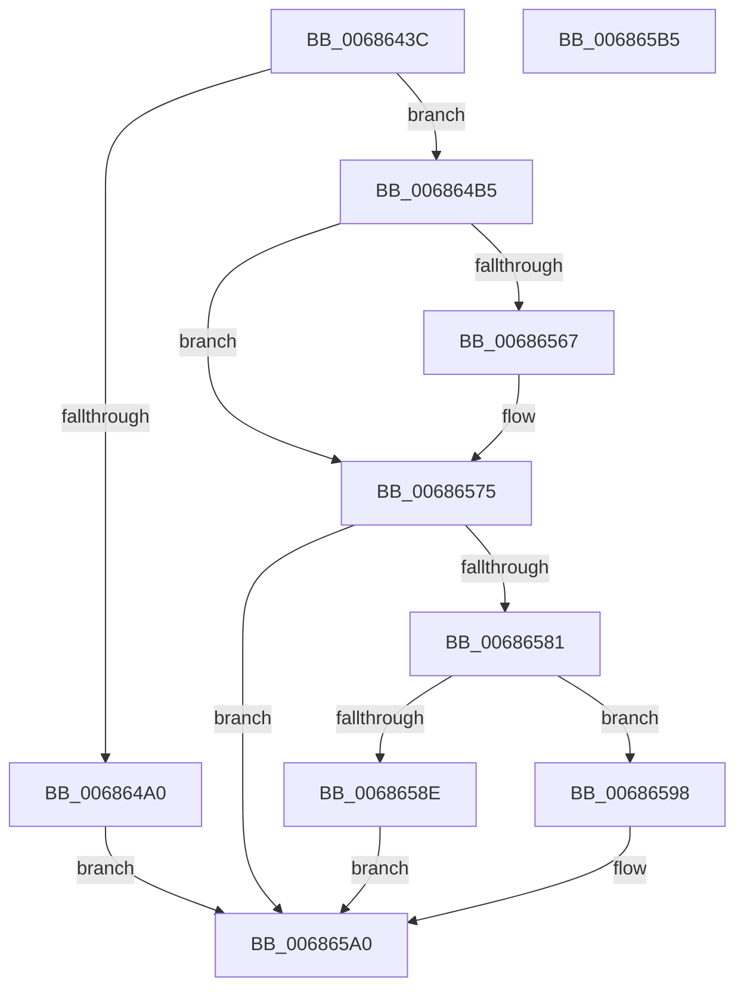

# MiMarkBootGuardPage

- RVA: `0x0068643C`–`0x006865B6` (길이 `378` bytes)
- VA: `0x000000014068643C`
- 실행 섹션: `.text`
- PDB 이름 있음: `예`; PDB Function 태그: `아니요`
- unwind 정보 RVA: `0x000BE6C8`
- 디코드: `103`개 명령, `378/378` bytes 표시
- 미해석 바이트: `0` (있으면 어셈블리에 `.byte`로 보존)

> 이 문서는 커널 이미지의 기계어와 PDB 기호를 분석해 생성했습니다. 4번과 5번은 함수 원형과 자료형을 바이너리 사용 방식에서 추정한 C 해석이며 원본 소스 복구 결과는 아닙니다.

## 1. Dependencies

- 직접 호출 지점: **11**; 고유 호출 대상: **9**
- 직접 호출자로 확인된 함수: **2**
- RIP 상대 이미지 참조: **5**

### Outgoing calls
- `0x00686477` → [MiVaToFlushVm](../31/MiVaToFlushVm_function_0031AD84.md) (function, `0x0031AD84`)
- `0x0068648A` → [MiLockWorkingSetOptimal](../23/MiLockWorkingSetOptimal_function_00238FC0.md) (function, `0x00238FC0`)
- `0x006864AB` → [MiUnlockWorkingSetOptimal](../23/MiUnlockWorkingSetOptimal_function_00238DFC.md) (function, `0x00238DFC`)
- `0x0068651B` → [MiDecreaseUsedPtes](../37/MiDecreaseUsedPtes_function_00378080.md) (function, `0x00378080`)
- `0x00686526` → [MiLockAndDecrementShareCount](../2A/MiLockAndDecrementShareCount_function_002A2854.md) (function, `0x002A2854`)
- `0x00686532` → [MiLockAndDecrementShareCount](../2A/MiLockAndDecrementShareCount_function_002A2854.md) (function, `0x002A2854`)
- `0x00686542` → [MiUnlockWorkingSetOptimal](../23/MiUnlockWorkingSetOptimal_function_00238DFC.md) (function, `0x00238DFC`)
- `0x00686552` → [MiFlushSingleTbEntry](../28/MiFlushSingleTbEntry_function_0028E730.md) (function, `0x0028E730`)
- `0x0068655D` → [MiReturnResident](../28/MiReturnResident_function_00286890.md) (function, `0x00286890`)
- `0x00686570` → [MiReturnCommit](../24/MiReturnCommit_function_00248410.md) (function, `0x00248410`)
- `0x00686584` → [MiGetSystemRegionType](../28/MiGetSystemRegionType_function_0028EC80.md) (function, `0x0028EC80`)

### Direct callers
- [MmAllocateIsrStack](../../page/80/MmAllocateIsrStack_function_00807ECC.md) at `0x00807FB0`
- [MiInitializeKernelStacks](../../init/C6/MiInitializeKernelStacks_function_00C680B8.md) at `0x00C68157`
- [MiInitializeKernelStacks](../../init/C6/MiInitializeKernelStacks_function_00C680B8.md) at `0x00C68160`

### Static image references
- `0x006864FA` → RVA `0x00E30088` (`.data`; read)
- `0x00686511` → RVA `0x00010880` (`.rdata`; read)
- `0x00686575` → RVA `0x00E38D00` (`.data`; read)
- `0x0068658E` → RVA `0x00E376E8` (`.data`; read/write)
- `0x00686598` → RVA `0x00E376D8` (`.data`; read/write)

## 2. Other-region calls and transfers

- 다른 실행 섹션으로 향하는 call: **0**
- 별도 외부 분기/꼬리 이동을 확인하지 못했습니다.

## 3. Assembly (complete function range)

```asm
0068643C  48 89 5C 24 18                  mov qword ptr [rsp + 0x18], rbx
00686441  55                              push rbp
00686442  56                              push rsi
00686443  57                              push rdi
00686444  41 54                           push r12
00686446  41 55                           push r13
00686448  41 56                           push r14
0068644A  41 57                           push r15
0068644C  48 83 EC 20                     sub rsp, 0x20
00686450  48 8B F1                        mov rsi, rcx
00686453  C6 44 24 60 00                  mov byte ptr [rsp + 0x60], 0
00686458  48 C1 E6 19                     shl rsi, 0x19
0068645C  4C 8B F1                        mov r14, rcx
0068645F  48 B8 00 00 00 00 80 F6 FF FF   movabs rax, 0xfffff68000000000
00686469  48 C1 E0 19                     shl rax, 0x19
0068646D  48 2B F0                        sub rsi, rax
00686470  48 C1 FE 10                     sar rsi, 0x10
00686474  48 8B CE                        mov rcx, rsi
00686477  E8 08 49 C9 FF                  call 0x14031ad84
0068647C  4C 8D 44 24 60                  lea r8, [rsp + 0x60]
00686481  49 8B D6                        mov rdx, r14
00686484  48 8B C8                        mov rcx, rax
00686487  48 8B E8                        mov rbp, rax
0068648A  E8 31 2B BB FF                  call 0x140238fc0
0068648F  49 8B 0E                        mov rcx, qword ptr [r14]
00686492  41 BD 01 00 00 00               mov r13d, 1
00686498  4C 8B E0                        mov r12, rax
0068649B  41 84 CD                        test r13b, cl
0068649E  75 15                           jne 0x1406864b5
006864A0  44 8A 44 24 60                  mov r8b, byte ptr [rsp + 0x60]
006864A5  48 8B D0                        mov rdx, rax
006864A8  48 8B CD                        mov rcx, rbp
006864AB  E8 4C 29 BB FF                  call 0x140238dfc
006864B0  E9 EB 00 00 00                  jmp 0x1406865a0
006864B5  48 C1 E9 0C                     shr rcx, 0xc
006864B9  48 BA FF FF FF FF FF 00 00 00   movabs rdx, 0xffffffffff
006864C3  48 23 CA                        and rcx, rdx
006864C6  48 8D 1C 49                     lea rbx, [rcx + rcx*2]
006864CA  48 B9 00 00 00 00 00 DE FF FF   movabs rcx, 0xffffde0000000000
006864D4  48 C1 E3 04                     shl rbx, 4
006864D8  48 8B C1                        mov rax, rcx
006864DB  48 03 D8                        add rbx, rax
006864DE  48 8B 43 28                     mov rax, qword ptr [rbx + 0x28]
006864E2  48 23 C2                        and rax, rdx
006864E5  48 8D 3C 40                     lea rdi, [rax + rax*2]
006864E9  48 C1 E7 04                     shl rdi, 4
006864ED  48 8B C1                        mov rax, rcx
006864F0  48 03 F8                        add rdi, rax
006864F3  45 8B C5                        mov r8d, r13d
006864F6  48 8B 43 28                     mov rax, qword ptr [rbx + 0x28]
006864FA  48 8B 15 87 9B 7A 00            mov rdx, qword ptr [rip + 0x7a9b87]
00686501  48 C1 E8 2B                     shr rax, 0x2b
00686505  25 FF 03 00 00                  and eax, 0x3ff
0068650A  4C 8B 3C C2                     mov r15, qword ptr [rdx + rax*8]
0068650E  49 8B D4                        mov rdx, r12
00686511  48 8B 05 68 A3 98 FF            mov rax, qword ptr [rip - 0x675c98]
00686518  49 89 06                        mov qword ptr [r14], rax
0068651B  E8 60 1B CF FF                  call 0x140378080
00686520  41 8B D5                        mov edx, r13d
00686523  48 8B CB                        mov rcx, rbx
00686526  E8 29 C3 C1 FF                  call 0x1402a2854
0068652B  33 D2                           xor edx, edx
0068652D  48 8B CF                        mov rcx, rdi
00686530  8B D8                           mov ebx, eax
00686532  E8 1D C3 C1 FF                  call 0x1402a2854
00686537  44 8A 44 24 60                  mov r8b, byte ptr [rsp + 0x60]
0068653C  49 8B D4                        mov rdx, r12
0068653F  48 8B CD                        mov rcx, rbp
00686542  E8 B5 28 BB FF                  call 0x140238dfc
00686547  45 8B C5                        mov r8d, r13d
0068654A  BA 02 00 00 00                  mov edx, 2
0068654F  48 8B CE                        mov rcx, rsi
00686552  E8 D9 81 C0 FF                  call 0x14028e730
00686557  49 8B D5                        mov rdx, r13
0068655A  49 8B CF                        mov rcx, r15
0068655D  E8 2E 03 C0 FF                  call 0x140286890
00686562  83 FB 03                        cmp ebx, 3
00686565  74 0E                           je 0x140686575
00686567  45 33 C0                        xor r8d, r8d
0068656A  49 8B D5                        mov rdx, r13
0068656D  49 8B CF                        mov rcx, r15
00686570  E8 9B 1E BC FF                  call 0x140248410
00686575  48 8D 05 84 27 7B 00            lea rax, [rip + 0x7b2784]
0068657C  4C 3B F8                        cmp r15, rax
0068657F  75 1F                           jne 0x1406865a0
00686581  48 8B CE                        mov rcx, rsi
00686584  E8 F7 86 C0 FF                  call 0x14028ec80
00686589  83 F8 0D                        cmp eax, 0xd
0068658C  75 0A                           jne 0x140686598
0068658E  F0 48 FF 0D 52 11 7B 00         lock dec qword ptr [rip + 0x7b1152]
00686596  EB 08                           jmp 0x1406865a0
00686598  F0 48 FF 0D 38 11 7B 00         lock dec qword ptr [rip + 0x7b1138]
006865A0  48 8B 5C 24 70                  mov rbx, qword ptr [rsp + 0x70]
006865A5  48 83 C4 20                     add rsp, 0x20
006865A9  41 5F                           pop r15
006865AB  41 5E                           pop r14
006865AD  41 5D                           pop r13
006865AF  41 5C                           pop r12
006865B1  5F                              pop rdi
006865B2  5E                              pop rsi
006865B3  5D                              pop rbp
006865B4  C3                              ret
006865B5  CC                              int3
```

## 4. C-style interpretation (structured pseudocode)

```c
__int64 __fastcall MiMarkBootGuardPage(__int64 a1)
{
    __int64 result;
    __int64 v_rbx;
    __int64 v_rdi;
    __int64 v_rsi;
    __int64 v_rsp;
    unsigned __int64 v_stack_p18;
    unsigned __int8 v_stack_p8;

    v_stack_p18 = v_rbx;
    v_rsp = (v_rsp) - (32);
    v_stack_p8 = 0;
    v_rsi = (a1) << (25);
    result = (result) << (25);
    v_rsi = (v_rsi) - (result);
    v_rsi = (v_rsi) >> (16);
    result = MiVaToFlushVm(v_rsi, a2, a3, a4);
    result = MiLockWorkingSetOptimal(result, a1, v_stack_p8, a4);
    if (((1) & ((unsigned __int8)(*(unsigned __int64 *)(a1)))) != 0) goto loc_006864B5;
    result = MiUnlockWorkingSetOptimal(result, result, v_stack_p8, a4);
    goto loc_006865A0;
loc_006864B5:
    a1 = (result) >> (12);
    a1 = (a1) & (result);
    v_rbx = (a1 + a1 * 2) << (4);
    v_rbx = (v_rbx) + (a1);
    result = (*(unsigned __int64 *)(v_rbx + 40)) & (result);
    v_rdi = (result + result * 2) << (4);
    v_rdi = (v_rdi) + (a1);
    result = (*(unsigned __int64 *)(v_rbx + 40)) >> (43);
    result = (unsigned int)((result) & (0x3FFULL));
    *(unsigned __int64 *)(a1) = *(unsigned __int64 *)(v_rip - 6773912);
    result = MiDecreaseUsedPtes(a1, result, 1, a4);
    result = MiLockAndDecrementShareCount(v_rbx, 1, 1, a4);
    a2 = 0;
    result = MiLockAndDecrementShareCount(v_rdi, a2, 1, a4);
    result = MiUnlockWorkingSetOptimal(result, result, v_stack_p8, a4);
    result = MiFlushSingleTbEntry(v_rsi, 2, 1, a4);
    result = MiReturnResident(*(unsigned __int64 *)(*(unsigned __int64 *)(v_rip + 8035207) + result * 8), 1, 1, a4);
    if (((unsigned int)((unsigned int)((unsigned int)(result)))) != 3) {
        a3 = 0;
        a2 = 1;
        a1 = *(unsigned __int64 *)(*(unsigned __int64 *)(v_rip + 8035207) + result * 8);
        result = MiReturnCommit(a1, a2, a3, a4);
    }
    if ((*(unsigned __int64 *)(*(unsigned __int64 *)(v_rip + 8035207) + result * 8)) != (v_rip + 8071044)) goto loc_006865A0;
    result = MiGetSystemRegionType(v_rsi, a2, a3, a4);
    if (((unsigned int)(result)) != 13) goto loc_00686598;
    goto loc_006865A0;
loc_00686598:
loc_006865A0:
    v_rsp = (v_rsp) + (32);
    return result;
}
```

## 5. (Beta) C Style

```c
int64_t MiMarkBootGuardPage(void *Arg1)
{
    uint8_t *arg1 = (uint8_t *)Arg1;

    int64_t result;
    int64_t local_rbx;
    int64_t local_rdi;
    int64_t local_rsi;
    int64_t local_rsp;
    uint64_t v_stack_p18;
    uint8_t v_stack_p8;

    v_stack_p18 = local_rbx;
    local_rsp = (local_rsp) - (32);
    v_stack_p8 = 0;
    local_rsi = (Arg1) << (25);
    result = (result) << (25);
    local_rsi = (local_rsi) - (result);
    local_rsi = (local_rsi) >> (16);
    result = MiVaToFlushVm(local_rsi, a2, a3, a4);
    result = MiLockWorkingSetOptimal(result, Arg1, v_stack_p8, a4);
    if (((1) & ((uint8_t)(*(uint64_t *)(arg1)))) != 0) goto loc_006864B5;
    result = MiUnlockWorkingSetOptimal(result, result, v_stack_p8, a4);
    goto loc_006865A0;
loc_006864B5:
    Arg1 = (result) >> (12);
    Arg1 = (Arg1) & (result);
    local_rbx = (Arg1 + Arg1 * 2) << (4);
    local_rbx = (local_rbx) + (Arg1);
    result = (*(uint64_t *)(local_rbx + 0x28)) & (result);
    local_rdi = (result + result * 2) << (4);
    local_rdi = (local_rdi) + (Arg1);
    result = (*(uint64_t *)(local_rbx + 0x28)) >> (43);
    result = (uint32_t)((result) & (0x3FFULL));
    *(uint64_t *)(arg1) = *(uint64_t *)(v_rip - 0x675C98);
    result = MiDecreaseUsedPtes(Arg1, result, 1, a4);
    result = MiLockAndDecrementShareCount(local_rbx, 1, 1, a4);
    a2 = 0;
    result = MiLockAndDecrementShareCount(local_rdi, a2, 1, a4);
    result = MiUnlockWorkingSetOptimal(result, result, v_stack_p8, a4);
    result = MiFlushSingleTbEntry(local_rsi, 2, 1, a4);
    result = MiReturnResident(*(uint64_t *)(*(uint64_t *)(v_rip + 0x7A9B87) + result * 8), 1, 1, a4);
    if (((uint32_t)((uint32_t)((uint32_t)(result)))) != 3) {
        a3 = 0;
        a2 = 1;
        Arg1 = *(uint64_t *)(*(uint64_t *)(v_rip + 0x7A9B87) + result * 8);
        result = MiReturnCommit(Arg1, a2, a3, a4);
    }
    if ((*(uint64_t *)(*(uint64_t *)(v_rip + 0x7A9B87) + result * 8)) != (v_rip + 8071044)) goto loc_006865A0;
    result = MiGetSystemRegionType(local_rsi, a2, a3, a4);
    if (((uint32_t)(result)) != 13) goto loc_00686598;
    goto loc_006865A0;
loc_00686598:
loc_006865A0:
    local_rsp = (local_rsp) + (32);
    return result;
}
```

### 관측된 메모리 오프셋

구조체 형식이 확인되지 않은 접근은 인자 기준의 오프셋으로만 기록했습니다.

| 기준 인자 | 오프셋 표현 | 폭 (bit) | 접근 |
|---|---:|---:|---|
| `Arg1` | `+ 0x0` | `64` | `R` |
| `Arg1` | `+ 0x0` | `64` | `W` |

## 6. Execution-region graph

[열기: 2D/3D 그래프와 함수 탐색 컨트롤 패널](../../../control-panel.html?section=text&rva=0x0068643C&view=graph)

- 2D 그래프는 위에서 아래로 흐르고, 3D 그래프는 빈 공간을 드래그해 회전합니다. Shift+드래그는 이동, 휠은 확대·축소, 함수 노드 선택은 대상 보고서 이동입니다.

### Static fallback


