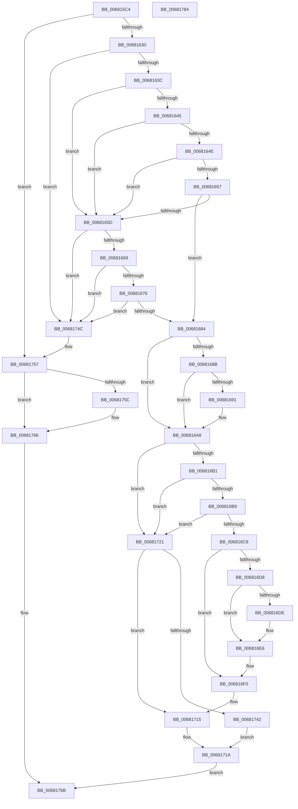

# MiMarkFileOnlyPfnBad

- RVA: `0x006815C4`–`0x00681785` (길이 `449` bytes)
- VA: `0x00000001406815C4`
- 실행 섹션: `.text`
- PDB 이름 있음: `예`; PDB Function 태그: `아니요`
- unwind 정보 RVA: `0x0006B074`
- 디코드: `127`개 명령, `449/449` bytes 표시
- 미해석 바이트: `0` (있으면 어셈블리에 `.byte`로 보존)

> 이 문서는 커널 이미지의 기계어와 PDB 기호를 분석해 생성했습니다. 4번과 5번은 함수 원형과 자료형을 바이너리 사용 방식에서 추정한 C 해석이며 원본 소스 복구 결과는 아닙니다.

## 1. Dependencies

- 직접 호출 지점: **12**; 고유 호출 대상: **10**
- 직접 호출자로 확인된 함수: **1**
- RIP 상대 이미지 참조: **0**

### Outgoing calls
- `0x006815F0` → [MiAllocatePool](../35/MiAllocatePool_function_0035B540.md) (function, `0x0035B540`)
- `0x0068161D` → [MiSafeLockPage](../32/MiSafeLockPage_function_00321620.md) (function, `0x00321620`)
- `0x006816CD` → [MiUnlinkPageFromListEx](../28/MiUnlinkPageFromListEx_function_00287590.md) (function, `0x00287590`)
- `0x006816E1` → [MiPersistPage](MiPersistPage_function_00681A68.md) (function, `0x00681A68`)
- `0x006816EB` → [MiSetPfnModified](../36/MiSetPfnModified_function_00362960.md) (function, `0x00362960`)
- `0x006816FD` → [MiSetPfnRemovalRequested](../67/MiSetPfnRemovalRequested_function_0067A4D0.md) (function, `0x0067A4D0`)
- `0x0068170A` → [MiInsertPageInList](../2B/MiInsertPageInList_function_002BA000.md) (function, `0x002BA000`)
- `0x00681715` → [MiUnlockPage](../31/MiUnlockPage_function_0031A3E0.md) (function, `0x0031A3E0`)
- `0x0068172E` → [MiSetPfnRemovalRequested](../67/MiSetPfnRemovalRequested_function_0067A4D0.md) (function, `0x0067A4D0`)
- `0x00681745` → [MiTrimSharedPage](../29/MiTrimSharedPage_function_00297D14.md) (function, `0x00297D14`)
- `0x00681752` → [MiUnlockPage](../31/MiUnlockPage_function_0031A3E0.md) (function, `0x0031A3E0`)
- `0x00681761` → [ExFreePoolWithTag](../../poolcode/B8/ExFreePoolWithTag_function_00B82870.md) (function, `0x00B82870`)

### Direct callers
- [MmMarkPhysicalMemoryAsBad](../67/MmMarkPhysicalMemoryAsBad_function_0067AA50.md) at `0x0067AB8F`

### Static image references
- 디코드된 RIP-relative 메모리 참조가 없습니다.

## 2. Other-region calls and transfers

- 다른 실행 섹션으로 향하는 call: **1**
  - `0x00681761` → [ExFreePoolWithTag](../../poolcode/B8/ExFreePoolWithTag_function_00B82870.md) (`.text` → `POOLCODE`)
- 별도 외부 분기/꼬리 이동을 확인하지 못했습니다.

## 3. Assembly (complete function range)

```asm
006815C4  48 89 5C 24 10                  mov qword ptr [rsp + 0x10], rbx
006815C9  48 89 6C 24 18                  mov qword ptr [rsp + 0x18], rbp
006815CE  48 89 74 24 20                  mov qword ptr [rsp + 0x20], rsi
006815D3  57                              push rdi
006815D4  41 56                           push r14
006815D6  41 57                           push r15
006815D8  48 83 EC 20                     sub rsp, 0x20
006815DC  44 8B F2                        mov r14d, edx
006815DF  48 8B D9                        mov rbx, rcx
006815E2  BA 20 00 00 00                  mov edx, 0x20
006815E7  41 B8 4D 69 42 6C               mov r8d, 0x6c42694d
006815ED  8D 4A 20                        lea ecx, [rdx + 0x20]
006815F0  E8 4B 9F CD FF                  call 0x14035b540
006815F5  48 8B F0                        mov rsi, rax
006815F8  48 B8 00 00 00 00 00 DE FF FF   movabs rax, 0xffffde0000000000
00681602  48 8B EB                        mov rbp, rbx
00681605  48 2B E8                        sub rbp, rax
00681608  48 B8 AB AA AA AA AA AA AA AA   movabs rax, 0xaaaaaaaaaaaaaaab
00681612  48 C1 FD 04                     sar rbp, 4
00681616  48 0F AF E8                     imul rbp, rax
0068161A  48 8B CD                        mov rcx, rbp
0068161D  E8 FE FF C9 FF                  call 0x140321620
00681622  45 33 FF                        xor r15d, r15d
00681625  40 8A F8                        mov dil, al
00681628  3C 11                           cmp al, 0x11
0068162A  0F 84 27 01 00 00               je 0x140681757
00681630  48 0F BA 63 28 35               bt qword ptr [rbx + 0x28], 0x35
00681636  0F 83 10 01 00 00               jae 0x14068174c
0068163C  8A 43 22                        mov al, byte ptr [rbx + 0x22]
0068163F  24 07                           and al, 7
00681641  3C 05                           cmp al, 5
00681643  75 18                           jne 0x14068165d
00681645  48 8B 43 28                     mov rax, qword ptr [rbx + 0x28]
00681649  48 85 C0                        test rax, rax
0068164C  78 0F                           js 0x14068165d
0068164E  48 8B 43 08                     mov rax, qword ptr [rbx + 8]
00681652  48 85 C0                        test rax, rax
00681655  75 06                           jne 0x14068165d
00681657  4C 39 7B 10                     cmp qword ptr [rbx + 0x10], r15
0068165B  74 27                           je 0x140681684
0068165D  48 0F BA 63 28 35               bt qword ptr [rbx + 0x28], 0x35
00681663  0F 83 E3 00 00 00               jae 0x14068174c
00681669  48 8B 43 28                     mov rax, qword ptr [rbx + 0x28]
0068166D  48 85 C0                        test rax, rax
00681670  0F 89 D6 00 00 00               jns 0x14068174c
00681676  8B 43 10                        mov eax, dword ptr [rbx + 0x10]
00681679  48 0F BA E0 0A                  bt rax, 0xa
0068167E  0F 83 C8 00 00 00               jae 0x14068174c
00681684  41 0F BA E6 1C                  bt r14d, 0x1c
00681689  73 1D                           jae 0x1406816a8
0068168B  44 38 7B 23                     cmp byte ptr [rbx + 0x23], r15b
0068168F  7C 17                           jl 0x1406816a8
00681691  8B 43 20                        mov eax, dword ptr [rbx + 0x20]
00681694  89 44 24 40                     mov dword ptr [rsp + 0x40], eax
00681698  C1 E8 18                        shr eax, 0x18
0068169B  0C 80                           or al, 0x80
0068169D  88 44 24 43                     mov byte ptr [rsp + 0x43], al
006816A1  8B 44 24 40                     mov eax, dword ptr [rsp + 0x40]
006816A5  89 43 20                        mov dword ptr [rbx + 0x20], eax
006816A8  8B 43 20                        mov eax, dword ptr [rbx + 0x20]
006816AB  F6 43 23 10                     test byte ptr [rbx + 0x23], 0x10
006816AF  75 70                           jne 0x140681721
006816B1  8B 43 20                        mov eax, dword ptr [rbx + 0x20]
006816B4  66 85 C0                        test ax, ax
006816B7  75 68                           jne 0x140681721
006816B9  0F B6 43 22                     movzx eax, byte ptr [rbx + 0x22]
006816BD  83 E0 07                        and eax, 7
006816C0  83 E8 02                        sub eax, 2
006816C3  83 F8 01                        cmp eax, 1
006816C6  77 59                           ja 0x140681721
006816C8  33 D2                           xor edx, edx
006816CA  48 8B CB                        mov rcx, rbx
006816CD  E8 BE 5E C0 FF                  call 0x140287590
006816D2  F6 43 22 10                     test byte ptr [rbx + 0x22], 0x10
006816D6  74 18                           je 0x1406816f0
006816D8  44 38 7B 23                     cmp byte ptr [rbx + 0x23], r15b
006816DC  7C 08                           jl 0x1406816e6
006816DE  48 8B CD                        mov rcx, rbp
006816E1  E8 82 03 00 00                  call 0x140681a68
006816E6  33 D2                           xor edx, edx
006816E8  48 8B CB                        mov rcx, rbx
006816EB  E8 70 12 CE FF                  call 0x140362960
006816F0  45 33 C0                        xor r8d, r8d
006816F3  4C 8B CE                        mov r9, rsi
006816F6  48 8B CB                        mov rcx, rbx
006816F9  41 8D 50 01                     lea edx, [r8 + 1]
006816FD  E8 CE 8D FF FF                  call 0x14067a4d0
00681702  BA 04 00 00 00                  mov edx, 4
00681707  48 8B CB                        mov rcx, rbx
0068170A  E8 F1 88 C3 FF                  call 0x1402ba000
0068170F  40 8A D7                        mov dl, dil
00681712  48 8B CB                        mov rcx, rbx
00681715  E8 C6 8C C9 FF                  call 0x14031a3e0
0068171A  B8 03 01 00 00                  mov eax, 0x103
0068171F  EB 4A                           jmp 0x14068176b
00681721  45 33 C0                        xor r8d, r8d
00681724  4C 8B CE                        mov r9, rsi
00681727  48 8B CB                        mov rcx, rbx
0068172A  41 8D 50 01                     lea edx, [r8 + 1]
0068172E  E8 9D 8D FF FF                  call 0x14067a4d0
00681733  8A 43 22                        mov al, byte ptr [rbx + 0x22]
00681736  40 8A D7                        mov dl, dil
00681739  24 07                           and al, 7
0068173B  48 8B CB                        mov rcx, rbx
0068173E  3C 06                           cmp al, 6
00681740  75 D3                           jne 0x140681715
00681742  45 8B C6                        mov r8d, r14d
00681745  E8 CA 65 C1 FF                  call 0x140297d14
0068174A  EB CE                           jmp 0x14068171a
0068174C  40 8A D7                        mov dl, dil
0068174F  48 8B CB                        mov rcx, rbx
00681752  E8 89 8C C9 FF                  call 0x14031a3e0
00681757  48 85 F6                        test rsi, rsi
0068175A  74 0A                           je 0x140681766
0068175C  33 D2                           xor edx, edx
0068175E  48 8B CE                        mov rcx, rsi
00681761  E8 0A 11 50 00                  call 0x140b82870
00681766  B8 34 04 00 C0                  mov eax, 0xc0000434
0068176B  48 8B 5C 24 48                  mov rbx, qword ptr [rsp + 0x48]
00681770  48 8B 6C 24 50                  mov rbp, qword ptr [rsp + 0x50]
00681775  48 8B 74 24 58                  mov rsi, qword ptr [rsp + 0x58]
0068177A  48 83 C4 20                     add rsp, 0x20
0068177E  41 5F                           pop r15
00681780  41 5E                           pop r14
00681782  5F                              pop rdi
00681783  C3                              ret
00681784  CC                              int3
```

## 4. C-style interpretation (structured pseudocode)

```c
__int64 __fastcall MiMarkFileOnlyPfnBad(__int64 a1, int a2)
{
    __int64 result;
    __int64 v_r15;
    __int64 v_rbp;
    __int64 v_rsp;
    unsigned __int64 v_stack_p10;
    unsigned __int64 v_stack_p18;
    unsigned __int64 v_stack_p20;
    unsigned int v_stack_p8;
    unsigned __int8 v_stack_pB;

    v_stack_p10 = v_rbx;
    v_stack_p18 = v_rbp;
    v_stack_p20 = v_rsi;
    v_rsp = (v_rsp) - (32);
    result = MiAllocatePool(32 + 32, 32, (unsigned int)(0x6C42694DULL), a4);
    v_rbp = (a1) - (result);
    v_rbp = (v_rbp) >> (4);
    v_rbp = (v_rbp) * (result);
    result = MiSafeLockPage(v_rbp, 32, (unsigned int)(0x6C42694DULL), a4);
    v_r15 = 0;
    if (((unsigned __int8)(result)) == 17) goto loc_00681757;
    if (((unsigned __int8)(result)) >= 17) goto loc_0068174C;
    result = (unsigned __int8)((*(unsigned __int8 *)(a1 + 34)) & (7));
    if (((unsigned __int8)(result)) != 5) goto loc_0068165D;
    if (sign_flag) goto loc_0068165D;
    if (*(unsigned __int64 *)(a1 + 8) != 0) goto loc_0068165D;
    if ((*(unsigned __int64 *)(a1 + 16)) == 0) goto loc_00681684;
loc_0068165D:
    if ((*(unsigned __int64 *)(a1 + 16)) >= 0) goto loc_0068174C;
    if (!sign_flag) goto loc_0068174C;
    if (condition_is_above_or_equal) goto loc_0068174C;
loc_00681684:
    if (condition_is_above_or_equal) goto loc_006816A8;
    result = (unsigned int)(*(unsigned int *)(a1 + 16));
    if ((*(unsigned __int8 *)(a1 + 35)) >= 0) {
        result = *(unsigned int *)(a1 + 32);
        v_stack_p8 = (unsigned int)(result);
        result = (unsigned int)((result) >> (24));
        result = (unsigned __int8)((result) | (128));
        v_stack_pB = (unsigned __int8)(result);
        result = v_stack_p8;
        *(unsigned int *)(a1 + 32) = (unsigned int)(result);
    }
    if (((*(unsigned __int8 *)(a1 + 35)) & (16)) != 0) goto loc_00681721;
    if ((unsigned __int16)((unsigned int)(*(unsigned int *)(a1 + 32))) != 0) goto loc_00681721;
    result = (unsigned int)((*(unsigned __int8 *)(a1 + 34)) & (7));
    result = (unsigned int)((result) - (2));
    if (((unsigned int)(result)) > 1) goto loc_00681721;
    a2 = 0;
    result = MiUnlinkPageFromListEx(a1, a2, (unsigned int)(0x6C42694DULL), a4);
    if (((*(unsigned __int8 *)(a1 + 34)) & (16)) == 0) goto loc_006816F0;
    if ((*(unsigned __int8 *)(a1 + 35)) >= 0) {
        a1 = v_rbp;
        result = MiPersistPage(a1, a2, (unsigned int)(0x6C42694DULL), a4);
    }
    a2 = 0;
    result = MiSetPfnModified(a1, a2, (unsigned int)(0x6C42694DULL), a4);
loc_006816F0:
    a3 = 0;
    result = MiSetPfnRemovalRequested(a1, a3 + 1, a3, result);
    result = MiInsertPageInList(a1, 4, a3, result);
loc_00681715:
    result = MiUnlockPage(a1, (unsigned __int8)((unsigned __int8)(result)), a3, result);
loc_0068171A:
    goto loc_0068176B;
loc_00681721:
    a3 = 0;
    result = MiSetPfnRemovalRequested(a1, a3 + 1, a3, result);
    result = (unsigned __int8)((*(unsigned __int8 *)(a1 + 34)) & (7));
    if (((unsigned __int8)(result)) != 6) goto loc_00681715;
    result = MiTrimSharedPage(a1, (unsigned __int8)((unsigned __int8)(result)), (unsigned int)((unsigned int)((unsigned int)(a2))), result);
    goto loc_0068171A;
loc_0068174C:
    result = MiUnlockPage(a1, (unsigned __int8)((unsigned __int8)(result)), (unsigned int)((unsigned int)((unsigned int)(a2))), result);
loc_00681757:
    if (result != 0) {
        a2 = 0;
        a1 = result;
        result = ExFreePoolWithTag(a1, a2, (unsigned int)((unsigned int)((unsigned int)(a2))), result);
    }
loc_0068176B:
    v_rsp = (v_rsp) + (32);
    return (unsigned int)(0xC0000434ULL);
}
```

## 5. (Beta) C Style

```c
int64_t MiMarkFileOnlyPfnBad(void *Arg1, int32_t Arg2)
{
    uint8_t *arg1 = (uint8_t *)Arg1;

    int64_t result;
    int64_t local_r15;
    int64_t local_rbp;
    int64_t local_rsp;
    uint64_t v_stack_p10;
    uint64_t v_stack_p18;
    uint64_t v_stack_p20;
    uint32_t v_stack_p8;
    uint8_t v_stack_pB;

    v_stack_p10 = local_rbx;
    v_stack_p18 = local_rbp;
    v_stack_p20 = local_rsi;
    local_rsp = (local_rsp) - (32);
    result = MiAllocatePool(32 + 32, 32, (uint32_t)(0x6C42694DULL), a4);
    local_rbp = (Arg1) - (result);
    local_rbp = (local_rbp) >> (4);
    local_rbp = (local_rbp) * (result);
    result = MiSafeLockPage(local_rbp, 32, (uint32_t)(0x6C42694DULL), a4);
    local_r15 = 0;
    if (((uint8_t)(result)) == 17) goto loc_00681757;
    if (((uint8_t)(result)) >= 17) goto loc_0068174C;
    result = (uint8_t)((*(uint8_t *)(arg1 + 0x22)) & (7));
    if (((uint8_t)(result)) != 5) goto loc_0068165D;
    if (sign_flag) goto loc_0068165D;
    if (*(uint64_t *)(arg1 + 0x8) != 0) goto loc_0068165D;
    if ((*(uint64_t *)(arg1 + 0x10)) == 0) goto loc_00681684;
loc_0068165D:
    if ((*(uint64_t *)(arg1 + 0x10)) >= 0) goto loc_0068174C;
    if (!sign_flag) goto loc_0068174C;
    if (condition_is_above_or_equal) goto loc_0068174C;
loc_00681684:
    if (condition_is_above_or_equal) goto loc_006816A8;
    result = (uint32_t)(*(uint32_t *)(arg1 + 0x10));
    if ((*(uint8_t *)(arg1 + 0x23)) >= 0) {
        result = *(uint32_t *)(arg1 + 0x20);
        v_stack_p8 = (uint32_t)(result);
        result = (uint32_t)((result) >> (24));
        result = (uint8_t)((result) | (128));
        v_stack_pB = (uint8_t)(result);
        result = v_stack_p8;
        *(uint32_t *)(arg1 + 0x20) = (uint32_t)(result);
    }
    if (((*(uint8_t *)(arg1 + 0x23)) & (16)) != 0) goto loc_00681721;
    if ((uint16_t)((uint32_t)(*(uint32_t *)(arg1 + 0x20))) != 0) goto loc_00681721;
    result = (uint32_t)((*(uint8_t *)(arg1 + 0x22)) & (7));
    result = (uint32_t)((result) - (2));
    if (((uint32_t)(result)) > 1) goto loc_00681721;
    Arg2 = 0;
    result = MiUnlinkPageFromListEx(Arg1, Arg2, (uint32_t)(0x6C42694DULL), a4);
    if (((*(uint8_t *)(arg1 + 0x22)) & (16)) == 0) goto loc_006816F0;
    if ((*(uint8_t *)(arg1 + 0x23)) >= 0) {
        Arg1 = local_rbp;
        result = MiPersistPage(Arg1, Arg2, (uint32_t)(0x6C42694DULL), a4);
    }
    Arg2 = 0;
    result = MiSetPfnModified(Arg1, Arg2, (uint32_t)(0x6C42694DULL), a4);
loc_006816F0:
    a3 = 0;
    result = MiSetPfnRemovalRequested(Arg1, a3 + 1, a3, result);
    result = MiInsertPageInList(Arg1, 4, a3, result);
loc_00681715:
    result = MiUnlockPage(Arg1, (uint8_t)((uint8_t)(result)), a3, result);
loc_0068171A:
    goto loc_0068176B;
loc_00681721:
    a3 = 0;
    result = MiSetPfnRemovalRequested(Arg1, a3 + 1, a3, result);
    result = (uint8_t)((*(uint8_t *)(arg1 + 0x22)) & (7));
    if (((uint8_t)(result)) != 6) goto loc_00681715;
    result = MiTrimSharedPage(Arg1, (uint8_t)((uint8_t)(result)), (uint32_t)((uint32_t)((uint32_t)(Arg2))), result);
    goto loc_0068171A;
loc_0068174C:
    result = MiUnlockPage(Arg1, (uint8_t)((uint8_t)(result)), (uint32_t)((uint32_t)((uint32_t)(Arg2))), result);
loc_00681757:
    if (result != 0) {
        Arg2 = 0;
        Arg1 = result;
        result = ExFreePoolWithTag(Arg1, Arg2, (uint32_t)((uint32_t)((uint32_t)(Arg2))), result);
    }
loc_0068176B:
    local_rsp = (local_rsp) + (32);
    return (uint32_t)(0xC0000434ULL);
}
```

### 관측된 메모리 오프셋

구조체 형식이 확인되지 않은 접근은 인자 기준의 오프셋으로만 기록했습니다.

| 기준 인자 | 오프셋 표현 | 폭 (bit) | 접근 |
|---|---:|---:|---|
| `Arg1` | `+ 0x8` | `64` | `R` |
| `Arg1` | `+ 0x10` | `32` | `R` |
| `Arg1` | `+ 0x10` | `64` | `R` |
| `Arg1` | `+ 0x20` | `32` | `R` |
| `Arg1` | `+ 0x20` | `32` | `W` |
| `Arg1` | `+ 0x22` | `8` | `R` |
| `Arg1` | `+ 0x23` | `8` | `R` |
| `Arg1` | `+ 0x28` | `64` | `R` |

## 6. Execution-region graph

[열기: 2D/3D 그래프와 함수 탐색 컨트롤 패널](../../../control-panel.html?section=text&rva=0x006815C4&view=graph)

- 2D 그래프는 위에서 아래로 흐르고, 3D 그래프는 빈 공간을 드래그해 회전합니다. Shift+드래그는 이동, 휠은 확대·축소, 함수 노드 선택은 대상 보고서 이동입니다.

### Static fallback


