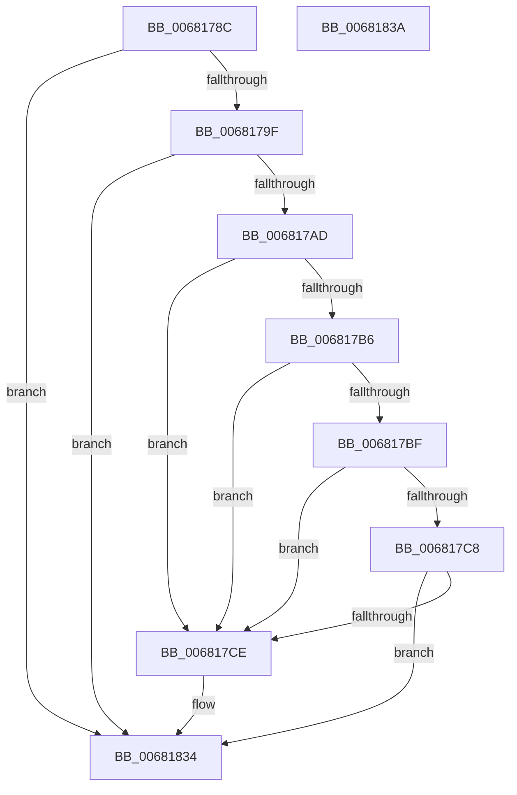

# MiMarkFileOnlyPfnGood

- RVA: `0x0068178C`–`0x0068183B` (길이 `175` bytes)
- VA: `0x000000014068178C`
- 실행 섹션: `.text`
- PDB 이름 있음: `예`; PDB Function 태그: `아니요`
- unwind 정보 RVA: `0x0005CF00`
- 디코드: `47`개 명령, `175/175` bytes 표시
- 미해석 바이트: `0` (있으면 어셈블리에 `.byte`로 보존)

> 이 문서는 커널 이미지의 기계어와 PDB 기호를 분석해 생성했습니다. 4번과 5번은 함수 원형과 자료형을 바이너리 사용 방식에서 추정한 C 해석이며 원본 소스 복구 결과는 아닙니다.

## 1. Dependencies

- 직접 호출 지점: **4**; 고유 호출 대상: **4**
- 직접 호출자로 확인된 함수: **1**
- RIP 상대 이미지 참조: **1**

### Outgoing calls
- `0x006817D5` → [ExAcquireSpinLockExclusiveAtDpcLevel](../24/ExAcquireSpinLockExclusiveAtDpcLevel_function_00248E80.md) (function, `0x00248E80`)
- `0x006817E2` → [MiUnlinkPageFromBadList](../3B/MiUnlinkPageFromBadList_function_003BD620.md) (function, `0x003BD620`)
- `0x006817EE` → [ExReleaseSpinLockExclusiveFromDpcLevel](../24/ExReleaseSpinLockExclusiveFromDpcLevel_function_002497E0.md) (function, `0x002497E0`)
- `0x0068182F` → [MiPfnReferenceCountIsZero](../2B/MiPfnReferenceCountIsZero_function_002B9E40.md) (function, `0x002B9E40`)

### Direct callers
- [MiUnlinkBadPages](../67/MiUnlinkBadPages_function_0067A6FC.md) at `0x0067A7E4`

### Static image references
- `0x006817CE` → RVA `0x00E3A8A0` (`.data`; read)

## 2. Other-region calls and transfers

- 다른 실행 섹션으로 향하는 call: **0**
- 별도 외부 분기/꼬리 이동을 확인하지 못했습니다.

## 3. Assembly (complete function range)

```asm
0068178C  40 53                           push rbx
0068178E  48 83 EC 20                     sub rsp, 0x20
00681792  F6 41 23 10                     test byte ptr [rcx + 0x23], 0x10
00681796  48 8B D9                        mov rbx, rcx
00681799  0F 84 95 00 00 00               je 0x140681834
0068179F  8B 41 20                        mov eax, dword ptr [rcx + 0x20]
006817A2  33 C9                           xor ecx, ecx
006817A4  66 85 C0                        test ax, ax
006817A7  0F 85 87 00 00 00               jne 0x140681834
006817AD  8A 43 22                        mov al, byte ptr [rbx + 0x22]
006817B0  24 07                           and al, 7
006817B2  3C 05                           cmp al, 5
006817B4  75 18                           jne 0x1406817ce
006817B6  48 8B 43 28                     mov rax, qword ptr [rbx + 0x28]
006817BA  48 85 C0                        test rax, rax
006817BD  78 0F                           js 0x1406817ce
006817BF  48 8B 43 08                     mov rax, qword ptr [rbx + 8]
006817C3  48 85 C0                        test rax, rax
006817C6  75 06                           jne 0x1406817ce
006817C8  48 39 4B 10                     cmp qword ptr [rbx + 0x10], rcx
006817CC  74 66                           je 0x140681834
006817CE  48 8D 0D CB 90 7B 00            lea rcx, [rip + 0x7b90cb]
006817D5  E8 A6 76 BC FF                  call 0x140248e80
006817DA  BA 80 00 00 00                  mov edx, 0x80
006817DF  48 8B CB                        mov rcx, rbx
006817E2  E8 39 BE D3 FF                  call 0x1403bd620
006817E7  48 8D 0D B2 90 7B 00            lea rcx, [rip + 0x7b90b2]
006817EE  E8 ED 7F BC FF                  call 0x1402497e0
006817F3  8B 43 20                        mov eax, dword ptr [rbx + 0x20]
006817F6  89 44 24 30                     mov dword ptr [rsp + 0x30], eax
006817FA  C1 E8 18                        shr eax, 0x18
006817FD  24 EF                           and al, 0xef
006817FF  88 44 24 33                     mov byte ptr [rsp + 0x33], al
00681803  8B 44 24 30                     mov eax, dword ptr [rsp + 0x30]
00681807  89 43 20                        mov dword ptr [rbx + 0x20], eax
0068180A  48 B8 00 00 00 00 00 DE FF FF   movabs rax, 0xffffde0000000000
00681814  48 8B D3                        mov rdx, rbx
00681817  48 8B CB                        mov rcx, rbx
0068181A  48 2B D0                        sub rdx, rax
0068181D  48 B8 AB AA AA AA AA AA AA AA   movabs rax, 0xaaaaaaaaaaaaaaab
00681827  48 C1 FA 04                     sar rdx, 4
0068182B  48 0F AF D0                     imul rdx, rax
0068182F  E8 0C 86 C3 FF                  call 0x1402b9e40
00681834  48 83 C4 20                     add rsp, 0x20
00681838  5B                              pop rbx
00681839  C3                              ret
0068183A  CC                              int3
```

## 4. C-style interpretation (structured pseudocode)

```c
__int64 __fastcall MiMarkFileOnlyPfnGood(__int64 a1)
{
    __int64 result;
    __int64 v_rsp;
    unsigned int v_stack_p8;
    unsigned __int8 v_stack_pB;

    v_rsp = (v_rsp) - (32);
    if (((*(unsigned __int8 *)(a1 + 35)) & (16)) == 0) goto loc_00681834;
    a1 = 0;
    if ((unsigned __int16)((unsigned int)(*(unsigned int *)(a1 + 32))) != 0) goto loc_00681834;
    result = (unsigned __int8)((*(unsigned __int8 *)(a1 + 34)) & (7));
    if (((unsigned __int8)(result)) != 5) goto loc_006817CE;
    if (sign_flag) goto loc_006817CE;
    if (*(unsigned __int64 *)(a1 + 8) != 0) goto loc_006817CE;
    result = *(unsigned __int64 *)(a1 + 8);
    if ((*(unsigned __int64 *)(a1 + 16)) != 0) {
        a1 = v_rip + 8097995;
        result = ExAcquireSpinLockExclusiveAtDpcLevel(a1, a2, a3, a4);
        a2 = 128;
        a1 = a1;
        result = MiUnlinkPageFromBadList(a1, a2, a3, a4);
        a1 = v_rip + 8097970;
        result = ExReleaseSpinLockExclusiveFromDpcLevel(a1, a2, a3, a4);
        result = *(unsigned int *)(a1 + 32);
        v_stack_p8 = (unsigned int)(result);
        result = (unsigned int)((result) >> (24));
        result = (unsigned __int8)((result) & (239));
        v_stack_pB = (unsigned __int8)(result);
        result = v_stack_p8;
        *(unsigned int *)(a1 + 32) = (unsigned int)(result);
        a2 = a1;
        a1 = a1;
        a2 = (a2) - (result);
        a2 = (a2) >> (4);
        a2 = (a2) * (result);
        result = MiPfnReferenceCountIsZero(a1, a2, a3, a4);
    }
    v_rsp = (v_rsp) + (32);
    return result;
}
```

## 5. (Beta) C Style

```c
int64_t MiMarkFileOnlyPfnGood(void *Arg1)
{
    uint8_t *arg1 = (uint8_t *)Arg1;

    int64_t result;
    int64_t local_rsp;
    uint32_t v_stack_p8;
    uint8_t v_stack_pB;

    local_rsp = (local_rsp) - (32);
    if (((*(uint8_t *)(arg1 + 0x23)) & (16)) == 0) goto loc_00681834;
    Arg1 = 0;
    if ((uint16_t)((uint32_t)(*(uint32_t *)(arg1 + 0x20))) != 0) goto loc_00681834;
    result = (uint8_t)((*(uint8_t *)(arg1 + 0x22)) & (7));
    if (((uint8_t)(result)) != 5) goto loc_006817CE;
    if (sign_flag) goto loc_006817CE;
    if (*(uint64_t *)(arg1 + 0x8) != 0) goto loc_006817CE;
    result = *(uint64_t *)(arg1 + 0x8);
    if ((*(uint64_t *)(arg1 + 0x10)) != 0) {
        Arg1 = v_rip + 8097995;
        result = ExAcquireSpinLockExclusiveAtDpcLevel(Arg1, a2, a3, a4);
        a2 = 128;
        Arg1 = Arg1;
        result = MiUnlinkPageFromBadList(Arg1, a2, a3, a4);
        Arg1 = v_rip + 8097970;
        result = ExReleaseSpinLockExclusiveFromDpcLevel(Arg1, a2, a3, a4);
        result = *(uint32_t *)(arg1 + 0x20);
        v_stack_p8 = (uint32_t)(result);
        result = (uint32_t)((result) >> (24));
        result = (uint8_t)((result) & (239));
        v_stack_pB = (uint8_t)(result);
        result = v_stack_p8;
        *(uint32_t *)(arg1 + 0x20) = (uint32_t)(result);
        a2 = Arg1;
        Arg1 = Arg1;
        a2 = (a2) - (result);
        a2 = (a2) >> (4);
        a2 = (a2) * (result);
        result = MiPfnReferenceCountIsZero(Arg1, a2, a3, a4);
    }
    local_rsp = (local_rsp) + (32);
    return result;
}
```

### 관측된 메모리 오프셋

구조체 형식이 확인되지 않은 접근은 인자 기준의 오프셋으로만 기록했습니다.

| 기준 인자 | 오프셋 표현 | 폭 (bit) | 접근 |
|---|---:|---:|---|
| `Arg1` | `+ 0x8` | `64` | `R` |
| `Arg1` | `+ 0x10` | `64` | `R` |
| `Arg1` | `+ 0x20` | `32` | `R` |
| `Arg1` | `+ 0x20` | `32` | `W` |
| `Arg1` | `+ 0x22` | `8` | `R` |
| `Arg1` | `+ 0x23` | `8` | `R` |
| `Arg1` | `+ 0x28` | `64` | `R` |

## 6. Execution-region graph

[열기: 2D/3D 그래프와 함수 탐색 컨트롤 패널](../../../control-panel.html?section=text&rva=0x0068178C&view=graph)

- 2D 그래프는 위에서 아래로 흐르고, 3D 그래프는 빈 공간을 드래그해 회전합니다. Shift+드래그는 이동, 휠은 확대·축소, 함수 노드 선택은 대상 보고서 이동입니다.

### Static fallback


