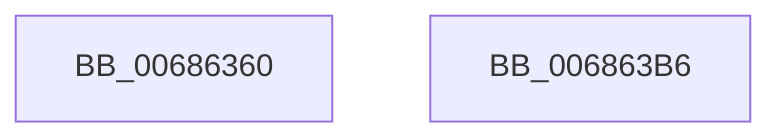

# MiMarkPxeAsShadowed

- RVA: `0x00686360`–`0x006863B7` (길이 `87` bytes)
- VA: `0x0000000140686360`
- 실행 섹션: `.text`
- PDB 이름 있음: `예`; PDB Function 태그: `아니요`
- unwind 정보 RVA: `0x0005CF00`
- 디코드: `23`개 명령, `87/87` bytes 표시
- 미해석 바이트: `0` (있으면 어셈블리에 `.byte`로 보존)

> 이 문서는 커널 이미지의 기계어와 PDB 기호를 분석해 생성했습니다. 4번과 5번은 함수 원형과 자료형을 바이너리 사용 방식에서 추정한 C 해석이며 원본 소스 복구 결과는 아닙니다.

## 1. Dependencies

- 직접 호출 지점: **2**; 고유 호출 대상: **2**
- 직접 호출자로 확인된 함수: **1**
- RIP 상대 이미지 참조: **2**

### Outgoing calls
- `0x0068637F` → [ExAcquireSpinLockExclusive](../24/ExAcquireSpinLockExclusive_function_00248690.md) (function, `0x00248690`)
- `0x006863AB` → [MiReleaseSpinLockExclusive](../24/MiReleaseSpinLockExclusive_function_002482C0.md) (function, `0x002482C0`)

### Direct callers
- [MiInitializeShadowPageTable](../../page/80/MiInitializeShadowPageTable_function_0080778C.md) at `0x00807963`

### Static image references
- `0x00686369` → RVA `0x00E374C0` (`.data`; read)
- `0x00686384` → RVA `0x00E2F18C` (`.data`; read)

## 2. Other-region calls and transfers

- 다른 실행 섹션으로 향하는 call: **0**
- 별도 외부 분기/꼬리 이동을 확인하지 못했습니다.

## 3. Assembly (complete function range)

```asm
00686360  40 53                           push rbx
00686362  48 83 EC 20                     sub rsp, 0x20
00686366  48 8B D9                        mov rbx, rcx
00686369  48 8D 0D 50 11 7B 00            lea rcx, [rip + 0x7b1150]
00686370  C1 EB 03                        shr ebx, 3
00686373  81 E3 FF 01 00 00               and ebx, 0x1ff
00686379  81 EB 00 01 00 00               sub ebx, 0x100
0068637F  E8 0C 23 BC FF                  call 0x140248690
00686384  48 8D 15 01 8E 7A 00            lea rdx, [rip + 0x7a8e01]
0068638B  44 8B C3                        mov r8d, ebx
0068638E  49 C1 E8 03                     shr r8, 3
00686392  48 8D 0D 27 11 7B 00            lea rcx, [rip + 0x7b1127]
00686399  4C 03 C2                        add r8, rdx
0068639C  83 E3 07                        and ebx, 7
0068639F  41 0F BE 10                     movsx edx, byte ptr [r8]
006863A3  0F AB DA                        bts edx, ebx
006863A6  41 88 10                        mov byte ptr [r8], dl
006863A9  8A D0                           mov dl, al
006863AB  E8 10 1F BC FF                  call 0x1402482c0
006863B0  48 83 C4 20                     add rsp, 0x20
006863B4  5B                              pop rbx
006863B5  C3                              ret
006863B6  CC                              int3
```

## 4. C-style interpretation (structured pseudocode)

```c
__int64 __fastcall MiMarkPxeAsShadowed(__int64 a1)
{
    __int64 result;
    __int64 v_rbx;
    __int64 v_rsp;

    v_rsp = (v_rsp) - (32);
    v_rbx = (unsigned int)((a1) >> (3));
    v_rbx = (unsigned int)((v_rbx) & (511));
    v_rbx = (unsigned int)((v_rbx) - (256));
    result = ExAcquireSpinLockExclusive(v_rip + 8065360, a2, a3, a4);
    a3 = ((unsigned int)((unsigned int)(v_rbx))) >> (3);
    a3 = (a3) + (v_rip + 8031745);
    v_rbx = (unsigned int)((v_rbx) & (7));
    *(unsigned __int8 *)(a3) = (unsigned __int8)((__int8)(*(unsigned __int8 *)(a3)));
    result = MiReleaseSpinLockExclusive(v_rip + 8065319, (unsigned __int8)(result), a3, a4);
    v_rsp = (v_rsp) + (32);
    return result;
}
```

## 5. (Beta) C Style

```c
int64_t MiMarkPxeAsShadowed(int64_t Arg1)
{
    int64_t result;
    int64_t local_rbx;
    int64_t local_rsp;

    local_rsp = (local_rsp) - (32);
    local_rbx = (uint32_t)((Arg1) >> (3));
    local_rbx = (uint32_t)((local_rbx) & (511));
    local_rbx = (uint32_t)((local_rbx) - (256));
    result = ExAcquireSpinLockExclusive(v_rip + 8065360, a2, a3, a4);
    a3 = ((uint32_t)((uint32_t)(local_rbx))) >> (3);
    a3 = (a3) + (v_rip + 8031745);
    local_rbx = (uint32_t)((local_rbx) & (7));
    *(uint8_t *)(a3) = (uint8_t)((int8_t)(*(uint8_t *)(a3)));
    result = MiReleaseSpinLockExclusive(v_rip + 8065319, (uint8_t)(result), a3, a4);
    local_rsp = (local_rsp) + (32);
    return result;
}
```

## 6. Execution-region graph

[열기: 2D/3D 그래프와 함수 탐색 컨트롤 패널](../../../control-panel.html?section=text&rva=0x00686360&view=graph)

- 2D 그래프는 위에서 아래로 흐르고, 3D 그래프는 빈 공간을 드래그해 회전합니다. Shift+드래그는 이동, 휠은 확대·축소, 함수 노드 선택은 대상 보고서 이동입니다.

### Static fallback


