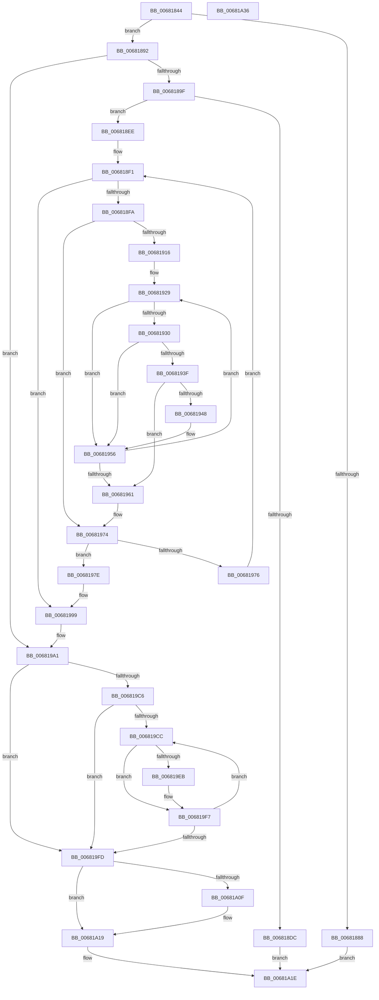

# MiMergeCopyExtents

- RVA: `0x00681844`–`0x00681A37` (길이 `499` bytes)
- VA: `0x0000000140681844`
- 실행 섹션: `.text`
- PDB 이름 있음: `예`; PDB Function 태그: `아니요`
- unwind 정보 RVA: `0x000D8248`
- 디코드: `145`개 명령, `499/499` bytes 표시
- 미해석 바이트: `0` (있으면 어셈블리에 `.byte`로 보존)

> 이 문서는 커널 이미지의 기계어와 PDB 기호를 분석해 생성했습니다. 4번과 5번은 함수 원형과 자료형을 바이너리 사용 방식에서 추정한 C 해석이며 원본 소스 복구 결과는 아닙니다.

## 1. Dependencies

- 직접 호출 지점: **10**; 고유 호출 대상: **9**
- 직접 호출자로 확인된 함수: **1**
- RIP 상대 이미지 참조: **1**

### Outgoing calls
- `0x0068187B` → [MiFormCopyExtents](MiFormCopyExtents_function_006811A4.md) (function, `0x006811A4`)
- `0x006818DF` → [ExFreePoolWithTag](../../poolcode/B8/ExFreePoolWithTag_function_00B82870.md) (function, `0x00B82870`)
- `0x00681993` → [KeBugCheckEx](../4F/KeBugCheckEx_function_004FD660.md) (function, `0x004FD660`)
- `0x006819A8` → [ExAcquireSpinLockExclusive](../24/ExAcquireSpinLockExclusive_function_00248690.md) (function, `0x00248690`)
- `0x006819B7` → [MiReleaseSpinLockExclusive](../24/MiReleaseSpinLockExclusive_function_002482C0.md) (function, `0x002482C0`)
- `0x006819BC` → [MiLockFileExtentsExclusive](../../page/80/MiLockFileExtentsExclusive_function_00801298.md) (function, `0x00801298`)
- `0x006819F2` → [RtlAvlRemoveNode](../29/RtlAvlRemoveNode_function_00296650.md) (function, `0x00296650`)
- `0x00681A00` → [MiInsertExtentList](MiInsertExtentList_function_006814EC.md) (function, `0x006814EC`)
- `0x00681A05` → [MiUnlockFileExtentsExclusive](../../page/80/MiUnlockFileExtentsExclusive_function_00801318.md) (function, `0x00801318`)
- `0x00681A14` → [ExFreePoolWithTag](../../poolcode/B8/ExFreePoolWithTag_function_00B82870.md) (function, `0x00B82870`)

### Direct callers
- [MiAllocateFileExtents](../../page/AB/MiAllocateFileExtents_function_00ABDF54.md) at `0x00ABE341`

### Static image references
- `0x006819EB` → RVA `0x00E2D890` (`.data`; read)

## 2. Other-region calls and transfers

- 다른 실행 섹션으로 향하는 call: **4**
  - `0x006818DF` → [ExFreePoolWithTag](../../poolcode/B8/ExFreePoolWithTag_function_00B82870.md) (`.text` → `POOLCODE`)
  - `0x006819BC` → [MiLockFileExtentsExclusive](../../page/80/MiLockFileExtentsExclusive_function_00801298.md) (`.text` → `PAGE`)
  - `0x00681A05` → [MiUnlockFileExtentsExclusive](../../page/80/MiUnlockFileExtentsExclusive_function_00801318.md) (`.text` → `PAGE`)
  - `0x00681A14` → [ExFreePoolWithTag](../../poolcode/B8/ExFreePoolWithTag_function_00B82870.md) (`.text` → `POOLCODE`)
- 별도 외부 분기/꼬리 이동을 확인하지 못했습니다.

## 3. Assembly (complete function range)

```asm
00681844  48 8B C4                        mov rax, rsp
00681847  48 89 58 10                     mov qword ptr [rax + 0x10], rbx
0068184B  4C 89 48 20                     mov qword ptr [rax + 0x20], r9
0068184F  44 89 40 18                     mov dword ptr [rax + 0x18], r8d
00681853  48 89 48 08                     mov qword ptr [rax + 8], rcx
00681857  55                              push rbp
00681858  56                              push rsi
00681859  57                              push rdi
0068185A  41 54                           push r12
0068185C  41 55                           push r13
0068185E  41 56                           push r14
00681860  41 57                           push r15
00681862  48 83 EC 40                     sub rsp, 0x40
00681866  49 83 21 00                     and qword ptr [r9], 0
0068186A  48 8B C2                        mov rax, rdx
0068186D  4C 8B F1                        mov r14, rcx
00681870  BA 01 00 00 00                  mov edx, 1
00681875  48 8B C8                        mov rcx, rax
00681878  4D 8B F9                        mov r15, r9
0068187B  E8 24 F9 FF FF                  call 0x1406811a4
00681880  48 8B F0                        mov rsi, rax
00681883  48 85 C0                        test rax, rax
00681886  75 0A                           jne 0x140681892
00681888  B8 9A 00 00 C0                  mov eax, 0xc000009a
0068188D  E9 8C 01 00 00                  jmp 0x140681a1e
00681892  49 8B 7E 70                     mov rdi, qword ptr [r14 + 0x70]
00681896  48 85 FF                        test rdi, rdi
00681899  0F 84 02 01 00 00               je 0x1406819a1
0068189F  44 8B 18                        mov r11d, dword ptr [rax]
006818A2  44 8B 0F                        mov r9d, dword ptr [rdi]
006818A5  44 89 8C 24 90 00 00 00         mov dword ptr [rsp + 0x90], r9d
006818AD  41 8D 43 FF                     lea eax, [r11 - 1]
006818B1  48 8D 14 40                     lea rdx, [rax + rax*2]
006818B5  48 03 D2                        add rdx, rdx
006818B8  41 8D 41 FF                     lea eax, [r9 - 1]
006818BC  48 8D 04 40                     lea rax, [rax + rax*2]
006818C0  48 03 C0                        add rax, rax
006818C3  8B 4C C7 20                     mov ecx, dword ptr [rdi + rax*8 + 0x20]
006818C7  48 03 4C C7 30                  add rcx, qword ptr [rdi + rax*8 + 0x30]
006818CC  8B 44 D6 20                     mov eax, dword ptr [rsi + rdx*8 + 0x20]
006818D0  48 03 44 D6 30                  add rax, qword ptr [rsi + rdx*8 + 0x30]
006818D5  33 D2                           xor edx, edx
006818D7  48 3B C8                        cmp rcx, rax
006818DA  76 12                           jbe 0x1406818ee
006818DC  48 8B CE                        mov rcx, rsi
006818DF  E8 8C 0F 50 00                  call 0x140b82870
006818E4  B8 0A 02 00 C0                  mov eax, 0xc000020a
006818E9  E9 30 01 00 00                  jmp 0x140681a1e
006818EE  45 33 C0                        xor r8d, r8d
006818F1  45 3B C1                        cmp r8d, r9d
006818F4  0F 83 9F 00 00 00               jae 0x140681999
006818FA  4F 8D 14 40                     lea r10, [r8 + r8*2]
006818FE  49 C1 E2 04                     shl r10, 4
00681902  49 83 C2 08                     add r10, 8
00681906  4C 03 D7                        add r10, rdi
00681909  41 8B 6A 18                     mov ebp, dword ptr [r10 + 0x18]
0068190D  49 8B 42 28                     mov rax, qword ptr [r10 + 0x28]
00681911  41 3B D3                        cmp edx, r11d
00681914  73 5E                           jae 0x140681974
00681916  8B CA                           mov ecx, edx
00681918  4C 8B F0                        mov r14, rax
0068191B  48 FF C1                        inc rcx
0068191E  48 8D 0C 49                     lea rcx, [rcx + rcx*2]
00681922  48 C1 E1 04                     shl rcx, 4
00681926  48 03 CE                        add rcx, rsi
00681929  8B 59 F0                        mov ebx, dword ptr [rcx - 0x10]
0068192C  3B EB                           cmp ebp, ebx
0068192E  72 26                           jb 0x140681956
00681930  4C 8B 29                        mov r13, qword ptr [rcx]
00681933  44 8B CD                        mov r9d, ebp
00681936  4E 8D 3C 2B                     lea r15, [rbx + r13]
0068193A  4D 3B CF                        cmp r9, r15
0068193D  73 17                           jae 0x140681956
0068193F  4B 8D 04 31                     lea rax, [r9 + r14]
00681943  49 3B C7                        cmp rax, r15
00681946  76 19                           jbe 0x140681961
00681948  4C 2B CB                        sub r9, rbx
0068194B  41 8B ED                        mov ebp, r13d
0068194E  4D 2B CD                        sub r9, r13
00681951  4D 03 F1                        add r14, r9
00681954  03 EB                           add ebp, ebx
00681956  FF C2                           inc edx
00681958  48 83 C1 30                     add rcx, 0x30
0068195C  41 3B D3                        cmp edx, r11d
0068195F  72 C8                           jb 0x140681929
00681961  4C 8B B4 24 80 00 00 00         mov r14, qword ptr [rsp + 0x80]
00681969  41 3B D3                        cmp edx, r11d
0068196C  44 8B 8C 24 90 00 00 00         mov r9d, dword ptr [rsp + 0x90]
00681974  74 08                           je 0x14068197e
00681976  41 FF C0                        inc r8d
00681979  E9 73 FF FF FF                  jmp 0x1406818f1
0068197E  4C 8B CE                        mov r9, rsi
00681981  4C 89 54 24 20                  mov qword ptr [rsp + 0x20], r10
00681986  4C 8B C7                        mov r8, rdi
00681989  BA 85 14 00 00                  mov edx, 0x1485
0068198E  B9 1A 00 00 00                  mov ecx, 0x1a
00681993  E8 C8 BC E7 FF                  call 0x1404fd660
00681998  CC                              int3
00681999  4C 8B BC 24 98 00 00 00         mov r15, qword ptr [rsp + 0x98]
006819A1  49 8B 1E                        mov rbx, qword ptr [r14]
006819A4  48 8D 4B 48                     lea rcx, [rbx + 0x48]
006819A8  E8 E3 6C BC FF                  call 0x140248690
006819AD  8A D0                           mov dl, al
006819AF  49 89 76 70                     mov qword ptr [r14 + 0x70], rsi
006819B3  48 8D 4B 48                     lea rcx, [rbx + 0x48]
006819B7  E8 04 69 BC FF                  call 0x1402482c0
006819BC  E8 D7 F8 17 00                  call 0x140801298
006819C1  48 85 FF                        test rdi, rdi
006819C4  74 37                           je 0x1406819fd
006819C6  33 DB                           xor ebx, ebx
006819C8  39 1F                           cmp dword ptr [rdi], ebx
006819CA  76 31                           jbe 0x1406819fd
006819CC  48 8D 14 5B                     lea rdx, [rbx + rbx*2]
006819D0  48 B8 00 00 00 00 00 00 00 80   movabs rax, 0x8000000000000000
006819DA  48 C1 E2 04                     shl rdx, 4
006819DE  48 83 C2 08                     add rdx, 8
006819E2  48 03 D7                        add rdx, rdi
006819E5  48 39 42 20                     cmp qword ptr [rdx + 0x20], rax
006819E9  74 0C                           je 0x1406819f7
006819EB  48 8D 0D 9E BE 7A 00            lea rcx, [rip + 0x7abe9e]
006819F2  E8 59 4C C1 FF                  call 0x140296650
006819F7  FF C3                           inc ebx
006819F9  3B 1F                           cmp ebx, dword ptr [rdi]
006819FB  72 CF                           jb 0x1406819cc
006819FD  48 8B CE                        mov rcx, rsi
00681A00  E8 E7 FA FF FF                  call 0x1406814ec
00681A05  E8 0E F9 17 00                  call 0x140801318
00681A0A  48 85 FF                        test rdi, rdi
00681A0D  74 0A                           je 0x140681a19
00681A0F  33 D2                           xor edx, edx
00681A11  48 8B CF                        mov rcx, rdi
00681A14  E8 57 0E 50 00                  call 0x140b82870
00681A19  49 89 37                        mov qword ptr [r15], rsi
00681A1C  33 C0                           xor eax, eax
00681A1E  48 8B 9C 24 88 00 00 00         mov rbx, qword ptr [rsp + 0x88]
00681A26  48 83 C4 40                     add rsp, 0x40
00681A2A  41 5F                           pop r15
00681A2C  41 5E                           pop r14
00681A2E  41 5D                           pop r13
00681A30  41 5C                           pop r12
00681A32  5F                              pop rdi
00681A33  5E                              pop rsi
00681A34  5D                              pop rbp
00681A35  C3                              ret
00681A36  CC                              int3
```

## 4. C-style interpretation (structured pseudocode)

```c
__int64 __fastcall MiMergeCopyExtents(__int64 a1, __int64 a2, int a3, __int64 a4)
{
    __int64 result;
    __int64 v_r10;
    __int64 v_r14;
    __int64 v_rbp;
    __int64 v_rbx;
    __int64 v_rsp;
    unsigned __int64 v_stack_m58;
    unsigned __int64 v_stack_p10;
    unsigned int v_stack_p18;
    unsigned __int64 v_stack_p20;
    unsigned __int64 v_stack_p8;

    *(unsigned __int64 *)(v_rsp + 16) = v_rbx;
    *(unsigned __int64 *)(v_rsp + 32) = a4;
    *(unsigned int *)(v_rsp + 24) = a3;
    *(unsigned __int64 *)(v_rsp + 8) = a1;
    v_rsp = (v_rsp) - (64);
    result = MiFormCopyExtents(a2, 1, a3, a4);
    if (result != 0) goto loc_00681892;
    goto loc_00681A1E;
loc_00681892:
    if (*(unsigned __int64 *)(a1 + 112) == 0) goto loc_006819A1;
    v_stack_p18 = (unsigned int)((unsigned int)(*(unsigned int *)(*(unsigned __int64 *)(a1 + 112))));
    a2 = ((unsigned int)(*(unsigned int *)((unsigned int)(0xC000009AULL))) - 1 + (unsigned int)(*(unsigned int *)((unsigned int)(0xC000009AULL))) - 1 * 2) + ((unsigned int)(*(unsigned int *)((unsigned int)(0xC000009AULL))) - 1 + (unsigned int)(*(unsigned int *)((unsigned int)(0xC000009AULL))) - 1 * 2);
    result = ((unsigned int)(*(unsigned int *)(*(unsigned __int64 *)(a1 + 112))) - 1 + (unsigned int)(*(unsigned int *)(*(unsigned __int64 *)(a1 + 112))) - 1 * 2) + ((unsigned int)(*(unsigned int *)(*(unsigned __int64 *)(a1 + 112))) - 1 + (unsigned int)(*(unsigned int *)(*(unsigned __int64 *)(a1 + 112))) - 1 * 2);
    a1 = ((unsigned int)(*(unsigned int *)(*(unsigned __int64 *)(a1 + 112) + result * 8 + 32))) + (*(unsigned __int64 *)(*(unsigned __int64 *)(a1 + 112) + result * 8 + 48));
    result = ((unsigned int)(*(unsigned int *)(result + a2 * 8 + 32))) + (*(unsigned __int64 *)(result + a2 * 8 + 48));
    a2 = 0;
    if (a1 <= result) goto loc_006818EE;
    result = ExFreePoolWithTag(result, a2, a3, (unsigned int)(*(unsigned int *)(*(unsigned __int64 *)(a1 + 112))));
    goto loc_00681A1E;
loc_006818EE:
    a3 = 0;
loc_006818F1:
    if (0 >= ((unsigned int)((unsigned int)(*(unsigned int *)(*(unsigned __int64 *)(a1 + 112)))))) goto loc_00681999;
    v_r10 = (a3 + a3 * 2) << (4);
    v_r10 = (v_r10) + (8);
    v_r10 = (v_r10) + (*(unsigned __int64 *)(a1 + 112));
    if (0 >= ((unsigned int)((unsigned int)(*(unsigned int *)((unsigned int)(0xC000009AULL)))))) goto loc_00681974;
    a1 = (0) + 1;
    a1 = (a1 + a1 * 2) << (4);
    a1 = (a1) + (result);
loc_00681929:
    if (((unsigned int)((unsigned int)(*(unsigned int *)(v_r10 + 24)))) < ((unsigned int)((unsigned int)(*(unsigned int *)(a1 - 16))))) goto loc_00681956;
    if (((unsigned int)((unsigned int)((unsigned int)(*(unsigned int *)(v_r10 + 24))))) >= ((unsigned int)(*(unsigned int *)(a1 - 16)) + *(unsigned __int64 *)(a1) * 1)) goto loc_00681956;
    if (((unsigned int)((unsigned int)((unsigned int)(*(unsigned int *)(v_r10 + 24)))) + *(unsigned __int64 *)(v_r10 + 40) * 1) <= ((unsigned int)(*(unsigned int *)(a1 - 16)) + *(unsigned __int64 *)(a1) * 1)) goto loc_00681961;
    a4 = ((unsigned int)((unsigned int)((unsigned int)(*(unsigned int *)(v_r10 + 24))))) - ((unsigned int)(*(unsigned int *)(a1 - 16)));
    a4 = (a4) - (*(unsigned __int64 *)(a1));
    v_r14 = (*(unsigned __int64 *)(v_r10 + 40)) + (a4);
    v_rbp = (unsigned int)(((unsigned int)((unsigned int)(*(unsigned __int64 *)(a1)))) + ((unsigned int)((unsigned int)(*(unsigned int *)(a1 - 16)))));
loc_00681956:
    a2 = (unsigned int)((a2) + 1);
    a1 = (a1) + (48);
    if (((unsigned int)(a2)) < ((unsigned int)((unsigned int)(*(unsigned int *)((unsigned int)(0xC000009AULL)))))) goto loc_00681929;
loc_00681961:
loc_00681974:
    if (((unsigned int)(a2)) == ((unsigned int)((unsigned int)(*(unsigned int *)((unsigned int)(0xC000009AULL)))))) goto loc_0068197E;
    a3 = (unsigned int)((a3) + 1);
    goto loc_006818F1;
loc_0068197E:
    v_stack_m58 = v_r10;
    result = KeBugCheckEx(26, (unsigned int)(0x1485ULL), *(unsigned __int64 *)(a1 + 112), result);
loc_00681999:
loc_006819A1:
    result = ExAcquireSpinLockExclusive(*(unsigned __int64 *)(v_stack_p8) + 72, (unsigned int)(0x1485ULL), *(unsigned __int64 *)(a1 + 112), result);
    *(unsigned __int64 *)(v_stack_p8 + 112) = result;
    result = MiReleaseSpinLockExclusive(*(unsigned __int64 *)(v_stack_p8) + 72, (unsigned __int8)(result), *(unsigned __int64 *)(a1 + 112), result);
    result = MiLockFileExtentsExclusive(*(unsigned __int64 *)(v_stack_p8) + 72, (unsigned __int8)(result), *(unsigned __int64 *)(a1 + 112), result);
    if (*(unsigned __int64 *)(a1 + 112) == 0) goto loc_006819FD;
    v_rbx = 0;
    if ((*(unsigned int *)(*(unsigned __int64 *)(a1 + 112))) <= 0) goto loc_006819FD;
loc_006819CC:
    a2 = (v_rbx + v_rbx * 2) << (4);
    a2 = (a2) + (8);
    a2 = (a2) + (*(unsigned __int64 *)(a1 + 112));
    if ((*(unsigned __int64 *)(a2 + 32)) != result) {
        a1 = v_rip + 8044190;
        result = RtlAvlRemoveNode(a1, a2, *(unsigned __int64 *)(a1 + 112), result);
    }
    v_rbx = (unsigned int)((v_rbx) + 1);
    if (((unsigned int)(v_rbx)) < (*(unsigned int *)(*(unsigned __int64 *)(a1 + 112)))) goto loc_006819CC;
loc_006819FD:
    result = MiInsertExtentList(result, a2, *(unsigned __int64 *)(a1 + 112), result);
    result = MiUnlockFileExtentsExclusive(result, a2, *(unsigned __int64 *)(a1 + 112), result);
    if (*(unsigned __int64 *)(a1 + 112) != 0) {
        a2 = 0;
        a1 = *(unsigned __int64 *)(a1 + 112);
        result = ExFreePoolWithTag(a1, a2, *(unsigned __int64 *)(a1 + 112), result);
    }
    *(unsigned __int64 *)(v_stack_p20) = result;
    result = 0;
loc_00681A1E:
    v_rsp = (v_rsp) + (64);
    return result;
}
```

## 5. (Beta) C Style

```c
int64_t MiMergeCopyExtents(void *Arg1, int64_t Arg2, int32_t Arg3, void *Arg4)
{
    uint8_t *arg1 = (uint8_t *)Arg1;
    uint8_t *arg4 = (uint8_t *)Arg4;

    int64_t result;
    int64_t local_r10;
    int64_t local_r14;
    int64_t local_rbp;
    int64_t local_rbx;
    int64_t local_rsp;
    uint64_t v_stack_m58;
    uint64_t v_stack_p10;
    uint32_t v_stack_p18;
    uint64_t v_stack_p20;
    uint64_t v_stack_p8;

    *(uint64_t *)(local_rsp + 0x10) = local_rbx;
    *(void **)(local_rsp + 0x20) = Arg4;
    *(uint32_t *)(local_rsp + 0x18) = Arg3;
    *(void **)(local_rsp + 0x8) = Arg1;
    local_rsp = (local_rsp) - (64);
    result = MiFormCopyExtents(Arg2, 1, Arg3, Arg4);
    if (result != 0) goto loc_00681892;
    goto loc_00681A1E;
loc_00681892:
    if (*(uint64_t *)(arg1 + 0x70) == 0) goto loc_006819A1;
    v_stack_p18 = (uint32_t)((uint32_t)(*(uint32_t *)(*(uint64_t *)(arg1 + 0x70))));
    Arg2 = ((uint32_t)(*(uint32_t *)((uint32_t)(0xC000009AULL))) - 1 + (uint32_t)(*(uint32_t *)((uint32_t)(0xC000009AULL))) - 1 * 2) + ((uint32_t)(*(uint32_t *)((uint32_t)(0xC000009AULL))) - 1 + (uint32_t)(*(uint32_t *)((uint32_t)(0xC000009AULL))) - 1 * 2);
    result = ((uint32_t)(*(uint32_t *)(*(uint64_t *)(arg1 + 0x70))) - 1 + (uint32_t)(*(uint32_t *)(*(uint64_t *)(arg1 + 0x70))) - 1 * 2) + ((uint32_t)(*(uint32_t *)(*(uint64_t *)(arg1 + 0x70))) - 1 + (uint32_t)(*(uint32_t *)(*(uint64_t *)(arg1 + 0x70))) - 1 * 2);
    Arg1 = ((uint32_t)(*(uint32_t *)(*(uint64_t *)(arg1 + 0x70) + result * 8 + 0x20))) + (*(uint64_t *)(*(uint64_t *)(arg1 + 0x70) + result * 8 + 0x30));
    result = ((uint32_t)(*(uint32_t *)(result + Arg2 * 8 + 0x20))) + (*(uint64_t *)(result + Arg2 * 8 + 0x30));
    Arg2 = 0;
    if (Arg1 <= result) goto loc_006818EE;
    result = ExFreePoolWithTag(result, Arg2, Arg3, (uint32_t)(*(uint32_t *)(*(uint64_t *)(arg1 + 0x70))));
    goto loc_00681A1E;
loc_006818EE:
    Arg3 = 0;
loc_006818F1:
    if (0 >= ((uint32_t)((uint32_t)(*(uint32_t *)(*(uint64_t *)(arg1 + 0x70)))))) goto loc_00681999;
    local_r10 = (Arg3 + Arg3 * 2) << (4);
    local_r10 = (local_r10) + (8);
    local_r10 = (local_r10) + (*(uint64_t *)(arg1 + 0x70));
    if (0 >= ((uint32_t)((uint32_t)(*(uint32_t *)((uint32_t)(0xC000009AULL)))))) goto loc_00681974;
    Arg1 = (0) + 1;
    Arg1 = (Arg1 + Arg1 * 2) << (4);
    Arg1 = (Arg1) + (result);
loc_00681929:
    if (((uint32_t)((uint32_t)(*(uint32_t *)(local_r10 + 0x18)))) < ((uint32_t)((uint32_t)(*(uint32_t *)(arg1 - 0x10))))) goto loc_00681956;
    if (((uint32_t)((uint32_t)((uint32_t)(*(uint32_t *)(local_r10 + 0x18))))) >= ((uint32_t)(*(uint32_t *)(arg1 - 0x10)) + *(uint64_t *)(arg1) * 1)) goto loc_00681956;
    if (((uint32_t)((uint32_t)((uint32_t)(*(uint32_t *)(local_r10 + 0x18)))) + *(uint64_t *)(local_r10 + 0x28) * 1) <= ((uint32_t)(*(uint32_t *)(arg1 - 0x10)) + *(uint64_t *)(arg1) * 1)) goto loc_00681961;
    Arg4 = ((uint32_t)((uint32_t)((uint32_t)(*(uint32_t *)(local_r10 + 0x18))))) - ((uint32_t)(*(uint32_t *)(arg1 - 0x10)));
    Arg4 = (Arg4) - (*(uint64_t *)(arg1));
    local_r14 = (*(uint64_t *)(local_r10 + 0x28)) + (Arg4);
    local_rbp = (uint32_t)(((uint32_t)((uint32_t)(*(uint64_t *)(arg1)))) + ((uint32_t)((uint32_t)(*(uint32_t *)(arg1 - 0x10)))));
loc_00681956:
    Arg2 = (uint32_t)((Arg2) + 1);
    Arg1 = (Arg1) + (48);
    if (((uint32_t)(Arg2)) < ((uint32_t)((uint32_t)(*(uint32_t *)((uint32_t)(0xC000009AULL)))))) goto loc_00681929;
loc_00681961:
loc_00681974:
    if (((uint32_t)(Arg2)) == ((uint32_t)((uint32_t)(*(uint32_t *)((uint32_t)(0xC000009AULL)))))) goto loc_0068197E;
    Arg3 = (uint32_t)((Arg3) + 1);
    goto loc_006818F1;
loc_0068197E:
    v_stack_m58 = local_r10;
    result = KeBugCheckEx(26, (uint32_t)(0x1485ULL), *(uint64_t *)(arg1 + 0x70), result);
loc_00681999:
loc_006819A1:
    result = ExAcquireSpinLockExclusive(*(uint64_t *)(v_stack_p8) + 72, (uint32_t)(0x1485ULL), *(uint64_t *)(arg1 + 0x70), result);
    *(uint64_t *)(v_stack_p8 + 0x70) = result;
    result = MiReleaseSpinLockExclusive(*(uint64_t *)(v_stack_p8) + 72, (uint8_t)(result), *(uint64_t *)(arg1 + 0x70), result);
    result = MiLockFileExtentsExclusive(*(uint64_t *)(v_stack_p8) + 72, (uint8_t)(result), *(uint64_t *)(arg1 + 0x70), result);
    if (*(uint64_t *)(arg1 + 0x70) == 0) goto loc_006819FD;
    local_rbx = 0;
    if ((*(uint32_t *)(*(uint64_t *)(arg1 + 0x70))) <= 0) goto loc_006819FD;
loc_006819CC:
    Arg2 = (local_rbx + local_rbx * 2) << (4);
    Arg2 = (Arg2) + (8);
    Arg2 = (Arg2) + (*(uint64_t *)(arg1 + 0x70));
    if ((*(uint64_t *)(Arg2 + 0x20)) != result) {
        Arg1 = v_rip + 8044190;
        result = RtlAvlRemoveNode(Arg1, Arg2, *(uint64_t *)(arg1 + 0x70), result);
    }
    local_rbx = (uint32_t)((local_rbx) + 1);
    if (((uint32_t)(local_rbx)) < (*(uint32_t *)(*(uint64_t *)(arg1 + 0x70)))) goto loc_006819CC;
loc_006819FD:
    result = MiInsertExtentList(result, Arg2, *(uint64_t *)(arg1 + 0x70), result);
    result = MiUnlockFileExtentsExclusive(result, Arg2, *(uint64_t *)(arg1 + 0x70), result);
    if (*(uint64_t *)(arg1 + 0x70) != 0) {
        Arg2 = 0;
        Arg1 = *(uint64_t *)(arg1 + 0x70);
        result = ExFreePoolWithTag(Arg1, Arg2, *(uint64_t *)(arg1 + 0x70), result);
    }
    *(uint64_t *)(v_stack_p20) = result;
    result = 0;
loc_00681A1E:
    local_rsp = (local_rsp) + (64);
    return result;
}
```

### 관측된 메모리 오프셋

구조체 형식이 확인되지 않은 접근은 인자 기준의 오프셋으로만 기록했습니다.

| 기준 인자 | 오프셋 표현 | 폭 (bit) | 접근 |
|---|---:|---:|---|
| `Arg1` | `+ 0x70` | `64` | `R` |
| `Arg4` | `+ 0x0` | `64` | `R/W` |

## 6. Execution-region graph

[열기: 2D/3D 그래프와 함수 탐색 컨트롤 패널](../../../control-panel.html?section=text&rva=0x00681844&view=graph)

- 2D 그래프는 위에서 아래로 흐르고, 3D 그래프는 빈 공간을 드래그해 회전합니다. Shift+드래그는 이동, 휠은 확대·축소, 함수 노드 선택은 대상 보고서 이동입니다.

### Static fallback


