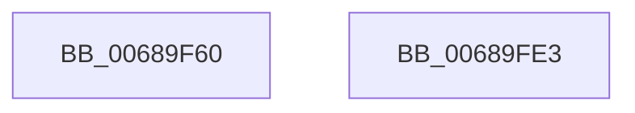

# MiMoveBadPageChargesCrossPartition

- RVA: `0x00689F60`–`0x00689FE4` (길이 `132` bytes)
- VA: `0x0000000140689F60`
- 실행 섹션: `.text`
- PDB 이름 있음: `예`; PDB Function 태그: `아니요`
- unwind 정보 RVA: `0x0005CAAC`
- 디코드: `30`개 명령, `132/132` bytes 표시
- 미해석 바이트: `0` (있으면 어셈블리에 `.byte`로 보존)

> 이 문서는 커널 이미지의 기계어와 PDB 기호를 분석해 생성했습니다. 4번과 5번은 함수 원형과 자료형을 바이너리 사용 방식에서 추정한 C 해석이며 원본 소스 복구 결과는 아닙니다.

## 1. Dependencies

- 직접 호출 지점: **3**; 고유 호출 대상: **3**
- 직접 호출자로 확인된 함수: **2**
- RIP 상대 이미지 참조: **0**

### Outgoing calls
- `0x00689F8F` → [MiPageToNode](../33/MiPageToNode_function_00338CD0.md) (function, `0x00338CD0`)
- `0x00689FC6` → [MiAcquireNonPagedResources](../28/MiAcquireNonPagedResources_function_00286C60.md) (function, `0x00286C60`)
- `0x00689FD3` → [MiReleaseNonPagedResources](../32/MiReleaseNonPagedResources_function_0032299C.md) (function, `0x0032299C`)

### Direct callers
- [MiActOnPartitionNodePages](MiActOnPartitionNodePages_function_0068F7F4.md) at `0x0068FC89`
- [MiTransferPartitionPageRun](../69/MiTransferPartitionPageRun_function_00691DCC.md) at `0x00692015`
- [MiTransferPartitionPageRun](../69/MiTransferPartitionPageRun_function_00691DCC.md) at `0x006920E2`

### Static image references
- 디코드된 RIP-relative 메모리 참조가 없습니다.

## 2. Other-region calls and transfers

- 다른 실행 섹션으로 향하는 call: **0**
- 별도 외부 분기/꼬리 이동을 확인하지 못했습니다.

## 3. Assembly (complete function range)

```asm
00689F60  48 89 5C 24 08                  mov qword ptr [rsp + 8], rbx
00689F65  57                              push rdi
00689F66  48 83 EC 20                     sub rsp, 0x20
00689F6A  49 8B D8                        mov rbx, r8
00689F6D  48 8B FA                        mov rdi, rdx
00689F70  48 B8 00 00 00 00 00 DE FF FF   movabs rax, 0xffffde0000000000
00689F7A  48 2B C8                        sub rcx, rax
00689F7D  48 B8 AB AA AA AA AA AA AA AA   movabs rax, 0xaaaaaaaaaaaaaaab
00689F87  48 C1 F9 04                     sar rcx, 4
00689F8B  48 0F AF C8                     imul rcx, rax
00689F8F  E8 3C ED CA FF                  call 0x140338cd0
00689F94  8B C0                           mov eax, eax
00689F96  48 69 C8 80 DF 00 00            imul rcx, rax, 0xdf80
00689F9D  48 8B 47 10                     mov rax, qword ptr [rdi + 0x10]
00689FA1  F0 48 FF 8C 08 98 3B 00 00      lock dec qword ptr [rax + rcx + 0x3b98]
00689FAA  48 8B 43 10                     mov rax, qword ptr [rbx + 0x10]
00689FAE  F0 48 FF 84 08 98 3B 00 00      lock inc qword ptr [rax + rcx + 0x3b98]
00689FB7  41 B9 01 00 00 00               mov r9d, 1
00689FBD  45 33 C0                        xor r8d, r8d
00689FC0  41 8B D1                        mov edx, r9d
00689FC3  48 8B CB                        mov rcx, rbx
00689FC6  E8 95 CC BF FF                  call 0x140286c60
00689FCB  BA 01 00 00 00                  mov edx, 1
00689FD0  48 8B CF                        mov rcx, rdi
00689FD3  E8 C4 89 C9 FF                  call 0x14032299c
00689FD8  48 8B 5C 24 30                  mov rbx, qword ptr [rsp + 0x30]
00689FDD  48 83 C4 20                     add rsp, 0x20
00689FE1  5F                              pop rdi
00689FE2  C3                              ret
00689FE3  CC                              int3
```

## 4. C-style interpretation (structured pseudocode)

```c
__int64 __fastcall MiMoveBadPageChargesCrossPartition(__int64 a1, __int64 a2, __int64 a3)
{
    __int64 result;
    __int64 v_rsp;
    unsigned __int64 v_stack_p8;

    v_stack_p8 = v_rbx;
    v_rsp = (v_rsp) - (32);
    a1 = (a1) - (result);
    a1 = (a1) >> (4);
    a1 = (a1) * (result);
    result = MiPageToNode(a1, a2, a3, a4);
    a1 = (a1) * ((unsigned int)((unsigned int)(result)));
    a3 = 0;
    result = MiAcquireNonPagedResources(0, 1, a3, 1);
    result = MiReleaseNonPagedResources(a2, 1, a3, 1);
    v_rsp = (v_rsp) + (32);
    return result;
}
```

## 5. (Beta) C Style

```c
int64_t MiMoveBadPageChargesCrossPartition(int64_t Arg1, void *Arg2, void *Arg3)
{
    uint8_t *arg2 = (uint8_t *)Arg2;
    uint8_t *arg3 = (uint8_t *)Arg3;

    int64_t result;
    int64_t local_rsp;
    uint64_t v_stack_p8;

    v_stack_p8 = local_rbx;
    local_rsp = (local_rsp) - (32);
    Arg1 = (Arg1) - (result);
    Arg1 = (Arg1) >> (4);
    Arg1 = (Arg1) * (result);
    result = MiPageToNode(Arg1, Arg2, Arg3, a4);
    Arg1 = (Arg1) * ((uint32_t)((uint32_t)(result)));
    Arg3 = 0;
    result = MiAcquireNonPagedResources(0, 1, Arg3, 1);
    result = MiReleaseNonPagedResources(Arg2, 1, Arg3, 1);
    local_rsp = (local_rsp) + (32);
    return result;
}
```

### 관측된 메모리 오프셋

구조체 형식이 확인되지 않은 접근은 인자 기준의 오프셋으로만 기록했습니다.

| 기준 인자 | 오프셋 표현 | 폭 (bit) | 접근 |
|---|---:|---:|---|
| `Arg2` | `+ 0x10` | `64` | `R` |
| `Arg3` | `+ 0x10` | `64` | `R` |

## 6. Execution-region graph

[열기: 2D/3D 그래프와 함수 탐색 컨트롤 패널](../../../control-panel.html?section=text&rva=0x00689F60&view=graph)

- 2D 그래프는 위에서 아래로 흐르고, 3D 그래프는 빈 공간을 드래그해 회전합니다. Shift+드래그는 이동, 휠은 확대·축소, 함수 노드 선택은 대상 보고서 이동입니다.

### Static fallback


