# MiNoPagesLastChance

- RVA: `0x0068B22C`–`0x0068B6EB` (길이 `1,215` bytes)
- VA: `0x000000014068B22C`
- 실행 섹션: `.text`
- PDB 이름 있음: `예`; PDB Function 태그: `아니요`
- unwind 정보 RVA: `0x000D8D88`
- 디코드: `299`개 명령, `1,215/1,215` bytes 표시
- 미해석 바이트: `0` (있으면 어셈블리에 `.byte`로 보존)

> 이 문서는 커널 이미지의 기계어와 PDB 기호를 분석해 생성했습니다. 4번과 5번은 함수 원형과 자료형을 바이너리 사용 방식에서 추정한 C 해석이며 원본 소스 복구 결과는 아닙니다.

## 1. Dependencies

- 직접 호출 지점: **22**; 고유 호출 대상: **16**
- 직접 호출자로 확인된 함수: **1**
- RIP 상대 이미지 참조: **11**

### Outgoing calls
- `0x0068B36C` → [ExAcquireSpinLockShared](../24/ExAcquireSpinLockShared_function_0024DCE0.md) (function, `0x0024DCE0`)
- `0x0068B37D` → [ExReleaseSpinLockShared](../2F/ExReleaseSpinLockShared_function_002F0EF0.md) (function, `0x002F0EF0`)
- `0x0068B389` → [KiQueryUnbiasedInterruptTime](../42/KiQueryUnbiasedInterruptTime_function_0042D180.md) (function, `0x0042D180`)
- `0x0068B3F6` → [DbgPrintEx](../35/DbgPrintEx_function_00359290.md) (function, `0x00359290`)
- `0x0068B422` → [MiSufficientAvailablePages](../36/MiSufficientAvailablePages_function_0036D0B0.md) (function, `0x0036D0B0`)
- `0x0068B47A` → [KiRaiseIrqlProcessIrqlFlags](../4F/KiRaiseIrqlProcessIrqlFlags_function_004F56FC.md) (function, `0x004F56FC`)
- `0x0068B482` → [ExAcquireSpinLockExclusiveAtDpcLevel](../24/ExAcquireSpinLockExclusiveAtDpcLevel_function_00248E80.md) (function, `0x00248E80`)
- `0x0068B515` → [ExAcquireSpinLockExclusiveAtDpcLevel](../24/ExAcquireSpinLockExclusiveAtDpcLevel_function_00248E80.md) (function, `0x00248E80`)
- `0x0068B52B` → [ExReleaseSpinLockExclusiveFromDpcLevel](../24/ExReleaseSpinLockExclusiveFromDpcLevel_function_002497E0.md) (function, `0x002497E0`)
- `0x0068B55B` → [ExReleaseSpinLockExclusiveFromDpcLevel](../24/ExReleaseSpinLockExclusiveFromDpcLevel_function_002497E0.md) (function, `0x002497E0`)
- `0x0068B56F` → [KiLowerIrqlProcessIrqlFlags](../4F/KiLowerIrqlProcessIrqlFlags_function_004F5698.md) (function, `0x004F5698`)
- `0x0068B5E8` → [ExQueueWorkItem](../2F/ExQueueWorkItem_function_002F9520.md) (function, `0x002F9520`)
- `0x0068B619` → [ObFastReferenceObjectLocked](../38/ObFastReferenceObjectLocked_function_00381DA0.md) (function, `0x00381DA0`)
- `0x0068B627` → [ExReleaseSpinLockExclusiveFromDpcLevel](../24/ExReleaseSpinLockExclusiveFromDpcLevel_function_002497E0.md) (function, `0x002497E0`)
- `0x0068B631` → [MiUnlinkPageFromListEx](../28/MiUnlinkPageFromListEx_function_00287590.md) (function, `0x00287590`)
- `0x0068B639` → [ExReleaseSpinLockExclusiveFromDpcLevel](../24/ExReleaseSpinLockExclusiveFromDpcLevel_function_002497E0.md) (function, `0x002497E0`)
- `0x0068B658` → [MiSetPfnModified](../36/MiSetPfnModified_function_00362960.md) (function, `0x00362960`)
- `0x0068B665` → [MiPfnReferenceCountIsZero](../2B/MiPfnReferenceCountIsZero_function_002B9E40.md) (function, `0x002B9E40`)
- `0x0068B66F` → [MiUnlockPage](../31/MiUnlockPage_function_0031A3E0.md) (function, `0x0031A3E0`)
- `0x0068B697` → [KiRaiseIrqlProcessIrqlFlags](../4F/KiRaiseIrqlProcessIrqlFlags_function_004F56FC.md) (function, `0x004F56FC`)
- `0x0068B69F` → [ExAcquireSpinLockExclusiveAtDpcLevel](../24/ExAcquireSpinLockExclusiveAtDpcLevel_function_00248E80.md) (function, `0x00248E80`)
- `0x0068B6E5` → [KeBugCheckEx](../4F/KeBugCheckEx_function_004FD660.md) (function, `0x004FD660`)

### Direct callers
- [MiWaitForFreePage](../2A/MiWaitForFreePage_function_002A3324.md) at `0x002A3535`

### Static image references
- `0x0068B2F8` → RVA `0x00E30144` (`.data`; read)
- `0x0068B38E` → RVA `0x00010868` (`.rdata`; read)
- `0x0068B3BE` → RVA `0x00E0AA1C` (`.data`; read)
- `0x0068B3C7` → RVA `0x00F475DC` (`.data`; read)
- `0x0068B3D4` → RVA `0x006D09A0` (` ?? ::FNODOBFM::`string'`; read)
- `0x0068B3FB` → RVA `0x00FC6A88` (`ALMOSTRO`; read)
- `0x0068B46C` → RVA `0x00FC6D20` (`ALMOSTRO`; read)
- `0x0068B4BA` → RVA `0x00E2DC80` (`.data`; read)
- `0x0068B5C9` → RVA `0x007FCFF0` (`MiLdwPopupWorker`; read)
- `0x0068B5ED` → RVA `0x00E2D7F0` (`.data`; read/write)
- `0x0068B674` → RVA `0x00E2D7F4` (`.data`; read/write)

## 2. Other-region calls and transfers

- 다른 실행 섹션으로 향하는 call: **0**
- 별도 외부 분기/꼬리 이동을 확인하지 못했습니다.

## 3. Assembly (complete function range)

```asm
0068B22C  48 89 5C 24 10                  mov qword ptr [rsp + 0x10], rbx
0068B231  48 89 4C 24 08                  mov qword ptr [rsp + 8], rcx
0068B236  55                              push rbp
0068B237  56                              push rsi
0068B238  57                              push rdi
0068B239  41 54                           push r12
0068B23B  41 55                           push r13
0068B23D  41 56                           push r14
0068B23F  41 57                           push r15
0068B241  48 83 EC 70                     sub rsp, 0x70
0068B245  8B 81 D8 02 00 00               mov eax, dword ptr [rcx + 0x2d8]
0068B24B  33 FF                           xor edi, edi
0068B24D  44 8B 81 D4 02 00 00            mov r8d, dword ptr [rcx + 0x2d4]
0068B254  44 8B C8                        mov r9d, eax
0068B257  4C 8B A9 A0 4C 00 00            mov r13, qword ptr [rcx + 0x4ca0]
0068B25E  48 8B F1                        mov rsi, rcx
0068B261  41 C1 E9 1F                     shr r9d, 0x1f
0068B265  41 8B C8                        mov ecx, r8d
0068B268  85 C0                           test eax, eax
0068B26A  44 8B FA                        mov r15d, edx
0068B26D  41 8B D1                        mov edx, r9d
0068B270  4C 89 6C 24 58                  mov qword ptr [rsp + 0x58], r13
0068B275  0F 49 C7                        cmovns eax, edi
0068B278  8D 6F 01                        lea ebp, [rdi + 1]
0068B27B  45 85 C0                        test r8d, r8d
0068B27E  8B DF                           mov ebx, edi
0068B280  44 8B DF                        mov r11d, edi
0068B283  41 BE 00 04 00 00               mov r14d, 0x400
0068B289  0F 49 C8                        cmovns ecx, eax
0068B28C  8B 86 58 48 00 00               mov eax, dword ptr [rsi + 0x4858]
0068B292  83 CA 02                        or edx, 2
0068B295  89 4C 24 40                     mov dword ptr [rsp + 0x40], ecx
0068B299  45 85 C0                        test r8d, r8d
0068B29C  41 0F 49 D1                     cmovns edx, r9d
0068B2A0  85 C0                           test eax, eax
0068B2A2  74 3C                           je 0x14068b2e0
0068B2A4  4C 8D 8E 60 48 00 00            lea r9, [rsi + 0x4860]
0068B2AB  44 8B D0                        mov r10d, eax
0068B2AE  4D 8B 01                        mov r8, qword ptr [r9]
0068B2B1  41 0F B7 80 AC 00 00 00         movzx eax, word ptr [r8 + 0xac]
0068B2B9  A8 50                           test al, 0x50
0068B2BB  75 15                           jne 0x14068b2d2
0068B2BD  41 8B 48 04                     mov ecx, dword ptr [r8 + 4]
0068B2C1  41 8B 00                        mov eax, dword ptr [r8]
0068B2C4  2B C8                           sub ecx, eax
0068B2C6  8B C1                           mov eax, ecx
0068B2C8  48 03 D8                        add rbx, rax
0068B2CB  41 8B 40 0C                     mov eax, dword ptr [r8 + 0xc]
0068B2CF  4C 03 D8                        add r11, rax
0068B2D2  49 83 C1 08                     add r9, 8
0068B2D6  4C 2B D5                        sub r10, rbp
0068B2D9  75 D3                           jne 0x14068b2ae
0068B2DB  4D 3B DE                        cmp r11, r14
0068B2DE  73 03                           jae 0x14068b2e3
0068B2E0  83 CA 04                        or edx, 4
0068B2E3  44 8B E2                        mov r12d, edx
0068B2E6  41 83 CC 08                     or r12d, 8
0068B2EA  49 3B DE                        cmp rbx, r14
0068B2ED  4C 8B B6 C0 4B 00 00            mov r14, qword ptr [rsi + 0x4bc0]
0068B2F4  44 0F 43 E2                     cmovae r12d, edx
0068B2F8  39 3D 46 4E 7A 00               cmp dword ptr [rip + 0x7a4e46], edi
0068B2FE  44 89 64 24 44                  mov dword ptr [rsp + 0x44], r12d
0068B303  74 07                           je 0x14068b30c
0068B305  BD F3 00 00 00                  mov ebp, 0xf3
0068B30A  EB 38                           jmp 0x14068b344
0068B30C  48 8B 86 40 4C 00 00            mov rax, qword ptr [rsi + 0x4c40]
0068B313  49 8B CE                        mov rcx, r14
0068B316  48 C1 E9 02                     shr rcx, 2
0068B31A  48 3B C1                        cmp rax, rcx
0068B31D  72 13                           jb 0x14068b332
0068B31F  4C 8B AE 40 4C 00 00            mov r13, qword ptr [rsi + 0x4c40]
0068B326  BD FD 00 00 00                  mov ebp, 0xfd
0068B32B  4C 89 6C 24 58                  mov qword ptr [rsp + 0x58], r13
0068B330  EB 12                           jmp 0x14068b344
0068B332  48 39 8E A0 4C 00 00            cmp qword ptr [rsi + 0x4ca0], rcx
0068B339  1B ED                           sbb ebp, ebp
0068B33B  81 E5 9E 00 00 00               and ebp, 0x9e
0068B341  83 C5 4D                        add ebp, 0x4d
0068B344  48 8B 86 B8 00 00 00            mov rax, qword ptr [rsi + 0xb8]
0068B34B  89 AC 24 C0 00 00 00            mov dword ptr [rsp + 0xc0], ebp
0068B352  48 8B 48 78                     mov rcx, qword ptr [rax + 0x78]
0068B356  48 8B B9 A0 02 00 00            mov rdi, qword ptr [rcx + 0x2a0]
0068B35D  48 85 FF                        test rdi, rdi
0068B360  74 57                           je 0x14068b3b9
0068B362  48 8D 9F 98 06 00 00            lea rbx, [rdi + 0x698]
0068B369  48 8B CB                        mov rcx, rbx
0068B36C  E8 6F 29 BC FF                  call 0x14024dce0
0068B371  48 8B BF C8 06 00 00            mov rdi, qword ptr [rdi + 0x6c8]
0068B378  8A D0                           mov dl, al
0068B37A  48 8B CB                        mov rcx, rbx
0068B37D  E8 6E 5B C6 FF                  call 0x1402f0ef0
0068B382  BB 01 00 00 00                  mov ebx, 1
0068B387  8A CB                           mov cl, bl
0068B389  E8 F2 1D DA FF                  call 0x14042d180
0068B38E  48 8B 0D D3 54 98 FF            mov rcx, qword ptr [rip - 0x67ab2d]
0068B395  48 2B C7                        sub rax, rdi
0068B398  48 F7 D9                        neg rcx
0068B39B  48 3B C1                        cmp rax, rcx
0068B39E  73 1E                           jae 0x14068b3be
0068B3A0  48 8B 9C 24 B8 00 00 00         mov rbx, qword ptr [rsp + 0xb8]
0068B3A8  48 83 C4 70                     add rsp, 0x70
0068B3AC  41 5F                           pop r15
0068B3AE  41 5E                           pop r14
0068B3B0  41 5D                           pop r13
0068B3B2  41 5C                           pop r12
0068B3B4  5F                              pop rdi
0068B3B5  5E                              pop rsi
0068B3B6  5D                              pop rbp
0068B3B7  C3                              ret
0068B3B8  CC                              int3
0068B3B9  BB 01 00 00 00                  mov ebx, 1
0068B3BE  80 3D 57 F6 77 00 00            cmp byte ptr [rip + 0x77f657], 0
0068B3C5  75 4A                           jne 0x14068b411
0068B3C7  80 3D 0E C2 8B 00 00            cmp byte ptr [rip + 0x8bc20e], 0
0068B3CE  75 41                           jne 0x14068b411
0068B3D0  8B 44 24 40                     mov eax, dword ptr [rsp + 0x40]
0068B3D4  4C 8D 05 C5 55 04 00            lea r8, [rip + 0x455c5]
0068B3DB  89 44 24 38                     mov dword ptr [rsp + 0x38], eax
0068B3DF  33 D2                           xor edx, edx
0068B3E1  44 89 64 24 30                  mov dword ptr [rsp + 0x30], r12d
0068B3E6  44 8B CD                        mov r9d, ebp
0068B3E9  4C 89 6C 24 28                  mov qword ptr [rsp + 0x28], r13
0068B3EE  4C 89 74 24 20                  mov qword ptr [rsp + 0x20], r14
0068B3F3  8D 4A 66                        lea ecx, [rdx + 0x66]
0068B3F6  E8 95 DE CC FF                  call 0x140359290
0068B3FB  F6 05 86 B6 93 00 08            test byte ptr [rip + 0x93b686], 8
0068B402  74 01                           je 0x14068b405
0068B404  CC                              int3
0068B405  89 9C 24 C8 00 00 00            mov dword ptr [rsp + 0xc8], ebx
0068B40C  45 33 ED                        xor r13d, r13d
0068B40F  EB 0B                           jmp 0x14068b41c
0068B411  45 33 ED                        xor r13d, r13d
0068B414  44 89 AC 24 C8 00 00 00         mov dword ptr [rsp + 0xc8], r13d
0068B41C  49 8B D7                        mov rdx, r15
0068B41F  48 8B CE                        mov rcx, rsi
0068B422  E8 89 1C CE FF                  call 0x14036d0b0
0068B427  85 C0                           test eax, eax
0068B429  0F 85 71 FF FF FF               jne 0x14068b3a0
0068B42F  8D 48 01                        lea ecx, [rax + 1]
0068B432  F0 0F B1 8E 1C 3F 00 00         lock cmpxchg dword ptr [rsi + 0x3f1c], ecx
0068B43A  0F 85 60 FF FF FF               jne 0x14068b3a0
0068B440  8D 79 0F                        lea edi, [rcx + 0xf]
0068B443  4C 89 6C 24 50                  mov qword ptr [rsp + 0x50], r13
0068B448  4C 8D B6 20 16 00 00            lea r14, [rsi + 0x1620]
0068B44F  48 89 7C 24 48                  mov qword ptr [rsp + 0x48], rdi
0068B454  48 BE FF FF FF FF 3F 00 00 00   movabs rsi, 0x3fffffffff
0068B45E  8D 69 01                        lea ebp, [rcx + 1]
0068B461  4D 8B E5                        mov r12, r13
0068B464  44 0F 20 C3                     mov rbx, cr8
0068B468  44 0F 22 C5                     mov cr8, rbp
0068B46C  44 39 2D AD B8 93 00            cmp dword ptr [rip + 0x93b8ad], r13d
0068B473  74 0A                           je 0x14068b47f
0068B475  40 8A D5                        mov dl, bpl
0068B478  8A CB                           mov cl, bl
0068B47A  E8 7D A2 E6 FF                  call 0x1404f56fc
0068B47F  49 8B CE                        mov rcx, r14
0068B482  E8 F9 D9 BB FF                  call 0x140248e80
0068B487  4D 8B 7E F0                     mov r15, qword ptr [r14 - 0x10]
0068B48B  4C 3B FE                        cmp r15, rsi
0068B48E  0F 84 C4 00 00 00               je 0x14068b558
0068B494  BE 01 00 00 00                  mov esi, 1
0068B499  48 BD FF FF FF FF 3F 00 00 00   movabs rbp, 0x3fffffffff
0068B4A3  4B 8D 3C 7F                     lea rdi, [r15 + r15*2]
0068B4A7  4C 89 7C 24 68                  mov qword ptr [rsp + 0x68], r15
0068B4AC  48 C1 E7 04                     shl rdi, 4
0068B4B0  48 B8 00 00 00 00 00 DE FF FF   movabs rax, 0xffffde0000000000
0068B4BA  48 8B 0D BF 27 7A 00            mov rcx, qword ptr [rip + 0x7a27bf]
0068B4C1  48 03 F8                        add rdi, rax
0068B4C4  48 B8 FF FF FF FF FF 00 00 00   movabs rax, 0xffffffffff
0068B4CE  4C 8B 3F                        mov r15, qword ptr [rdi]
0068B4D1  4C 23 F8                        and r15, rax
0068B4D4  48 8B 47 10                     mov rax, qword ptr [rdi + 0x10]
0068B4D8  48 85 C9                        test rcx, rcx
0068B4DB  74 0A                           je 0x14068b4e7
0068B4DD  A8 10                           test al, 0x10
0068B4DF  75 06                           jne 0x14068b4e7
0068B4E1  48 F7 D1                        not rcx
0068B4E4  48 23 C1                        and rax, rcx
0068B4E7  48 C1 F8 10                     sar rax, 0x10
0068B4EB  4C 8B 28                        mov r13, qword ptr [rax]
0068B4EE  41 8B 45 38                     mov eax, dword ptr [r13 + 0x38]
0068B4F2  A8 28                           test al, 0x28
0068B4F4  75 49                           jne 0x14068b53f
0068B4F6  4D 85 E4                        test r12, r12
0068B4F9  74 05                           je 0x14068b500
0068B4FB  4D 3B E5                        cmp r12, r13
0068B4FE  75 3F                           jne 0x14068b53f
0068B500  F0 48 0F BA 6F 18 3F            lock bts qword ptr [rdi + 0x18], 0x3f
0068B507  72 36                           jb 0x14068b53f
0068B509  49 8D 45 48                     lea rax, [r13 + 0x48]
0068B50D  48 8B C8                        mov rcx, rax
0068B510  48 89 44 24 60                  mov qword ptr [rsp + 0x60], rax
0068B515  E8 66 D9 BB FF                  call 0x140248e80
0068B51A  41 8B 45 38                     mov eax, dword ptr [r13 + 0x38]
0068B51E  A8 08                           test al, 8
0068B520  0F 84 D3 00 00 00               je 0x14068b5f9
0068B526  48 8B 4C 24 60                  mov rcx, qword ptr [rsp + 0x60]
0068B52B  E8 B0 E2 BB FF                  call 0x1402497e0
0068B530  48 B8 FF FF FF FF FF FF FF 7F   movabs rax, 0x7fffffffffffffff
0068B53A  F0 48 21 47 18                  lock and qword ptr [rdi + 0x18], rax
0068B53F  45 33 ED                        xor r13d, r13d
0068B542  4C 3B FD                        cmp r15, rbp
0068B545  0F 85 58 FF FF FF               jne 0x14068b4a3
0068B54B  48 8B 7C 24 48                  mov rdi, qword ptr [rsp + 0x48]
0068B550  48 8B F5                        mov rsi, rbp
0068B553  BD 02 00 00 00                  mov ebp, 2
0068B558  49 8B CE                        mov rcx, r14
0068B55B  E8 80 E2 BB FF                  call 0x1402497e0
0068B560  44 39 2D B9 B7 93 00            cmp dword ptr [rip + 0x93b7b9], r13d
0068B567  74 0B                           je 0x14068b574
0068B569  44 0F 20 C1                     mov rcx, cr8
0068B56D  8A D3                           mov dl, bl
0068B56F  E8 24 A1 E6 FF                  call 0x1404f5698
0068B574  0F B6 C3                        movzx eax, bl
0068B577  44 0F 22 C0                     mov cr8, rax
0068B57B  49 83 C6 58                     add r14, 0x58
0068B57F  41 BF 01 00 00 00               mov r15d, 1
0068B585  49 2B FF                        sub rdi, r15
0068B588  48 89 7C 24 48                  mov qword ptr [rsp + 0x48], rdi
0068B58D  0F 85 D1 FE FF FF               jne 0x14068b464
0068B593  48 8B B4 24 B0 00 00 00         mov rsi, qword ptr [rsp + 0xb0]
0068B59B  4D 85 E4                        test r12, r12
0068B59E  8B AC 24 C0 00 00 00            mov ebp, dword ptr [rsp + 0xc0]
0068B5A5  44 8B 64 24 44                  mov r12d, dword ptr [rsp + 0x44]
0068B5AA  48 8D 9E F0 3E 00 00            lea rbx, [rsi + 0x3ef0]
0068B5B1  0F 84 00 01 00 00               je 0x14068b6b7
0068B5B7  48 8B 7C 24 50                  mov rdi, qword ptr [rsp + 0x50]
0068B5BC  48 85 FF                        test rdi, rdi
0068B5BF  0F 84 E8 00 00 00               je 0x14068b6ad
0068B5C5  48 89 7B 20                     mov qword ptr [rbx + 0x20], rdi
0068B5C9  48 8D 05 20 1A 17 00            lea rax, [rip + 0x171a20]
0068B5D0  C7 43 28 02 01 00 C0            mov dword ptr [rbx + 0x28], 0xc0000102
0068B5D7  41 8B D7                        mov edx, r15d
0068B5DA  48 8B CB                        mov rcx, rbx
0068B5DD  48 89 43 10                     mov qword ptr [rbx + 0x10], rax
0068B5E1  48 89 5B 18                     mov qword ptr [rbx + 0x18], rbx
0068B5E5  4C 89 2B                        mov qword ptr [rbx], r13
0068B5E8  E8 33 DF C6 FF                  call 0x1402f9520
0068B5ED  44 01 3D FC 21 7A 00            add dword ptr [rip + 0x7a21fc], r15d
0068B5F4  E9 A7 FD FF FF                  jmp 0x14068b3a0
0068B5F9  4D 85 E4                        test r12, r12
0068B5FC  75 25                           jne 0x14068b623
0068B5FE  B9 00 08 00 00                  mov ecx, 0x800
0068B603  4D 8B E5                        mov r12, r13
0068B606  85 C1                           test ecx, eax
0068B608  75 19                           jne 0x14068b623
0068B60A  0B C1                           or eax, ecx
0068B60C  BA 4D 6D 4C 64                  mov edx, 0x644c6d4d
0068B611  49 8D 4D 40                     lea rcx, [r13 + 0x40]
0068B615  41 89 45 38                     mov dword ptr [r13 + 0x38], eax
0068B619  E8 82 67 CF FF                  call 0x140381da0
0068B61E  48 89 44 24 50                  mov qword ptr [rsp + 0x50], rax
0068B623  49 8D 4D 48                     lea rcx, [r13 + 0x48]
0068B627  E8 B4 E1 BB FF                  call 0x1402497e0
0068B62C  8B D6                           mov edx, esi
0068B62E  48 8B CF                        mov rcx, rdi
0068B631  E8 5A BF BF FF                  call 0x140287590
0068B636  49 8B CE                        mov rcx, r14
0068B639  E8 A2 E1 BB FF                  call 0x1402497e0
0068B63E  4C 8B 47 18                     mov r8, qword ptr [rdi + 0x18]
0068B642  48 B8 00 00 00 00 00 00 00 C0   movabs rax, 0xc000000000000000
0068B64C  4C 23 C0                        and r8, rax
0068B64F  33 D2                           xor edx, edx
0068B651  48 8B CF                        mov rcx, rdi
0068B654  4C 89 47 18                     mov qword ptr [rdi + 0x18], r8
0068B658  E8 03 73 CD FF                  call 0x140362960
0068B65D  48 8B 54 24 68                  mov rdx, qword ptr [rsp + 0x68]
0068B662  48 8B CF                        mov rcx, rdi
0068B665  E8 D6 E7 C2 FF                  call 0x1402b9e40
0068B66A  8A D3                           mov dl, bl
0068B66C  48 8B CF                        mov rcx, rdi
0068B66F  E8 6C ED C8 FF                  call 0x14031a3e0
0068B674  01 35 7A 21 7A 00               add dword ptr [rip + 0x7a217a], esi
0068B67A  44 0F 20 C3                     mov rbx, cr8
0068B67E  B8 02 00 00 00                  mov eax, 2
0068B683  44 0F 22 C0                     mov cr8, rax
0068B687  45 33 ED                        xor r13d, r13d
0068B68A  44 39 2D 8F B6 93 00            cmp dword ptr [rip + 0x93b68f], r13d
0068B691  74 09                           je 0x14068b69c
0068B693  8A D0                           mov dl, al
0068B695  8A CB                           mov cl, bl
0068B697  E8 60 A0 E6 FF                  call 0x1404f56fc
0068B69C  49 8B CE                        mov rcx, r14
0068B69F  E8 DC D7 BB FF                  call 0x140248e80
0068B6A4  4D 8B 7E F0                     mov r15, qword ptr [r14 - 0x10]
0068B6A8  E9 95 FE FF FF                  jmp 0x14068b542
0068B6AD  F0 44 21 6B 2C                  lock and dword ptr [rbx + 0x2c], r13d
0068B6B2  E9 E9 FC FF FF                  jmp 0x14068b3a0
0068B6B7  F0 44 21 6B 2C                  lock and dword ptr [rbx + 0x2c], r13d
0068B6BC  44 39 AC 24 C8 00 00 00         cmp dword ptr [rsp + 0xc8], r13d
0068B6C4  0F 85 D6 FC FF FF               jne 0x14068b3a0
0068B6CA  48 63 44 24 40                  movsxd rax, dword ptr [rsp + 0x40]
0068B6CF  4D 8B CC                        mov r9, r12
0068B6D2  48 8B 96 C0 4B 00 00            mov rdx, qword ptr [rsi + 0x4bc0]
0068B6D9  8B CD                           mov ecx, ebp
0068B6DB  4C 8B 44 24 58                  mov r8, qword ptr [rsp + 0x58]
0068B6E0  48 89 44 24 20                  mov qword ptr [rsp + 0x20], rax
0068B6E5  E8 76 1F E7 FF                  call 0x1404fd660
0068B6EA  CC                              int3
```

## 4. C-style interpretation (structured pseudocode)

```c
__int64 __fastcall MiNoPagesLastChance(__int64 a1, int a2)
{
    __int64 result;
    __int64 v_r10;
    __int64 v_r11;
    __int64 v_r12;
    __int64 v_r13;
    __int64 v_r14;
    __int64 v_r15;
    __int64 v_rbp;
    __int64 v_rbx;
    __int64 v_rdi;
    __int64 v_rsp;
    unsigned __int64 v_stack_m50;
    unsigned int v_stack_m64;
    unsigned int v_stack_m68;
    unsigned __int64 v_stack_p10;
    unsigned int v_stack_p18;
    unsigned __int64 v_stack_p20;
    unsigned __int64 v_stack_p28;
    unsigned int v_stack_p30;
    unsigned int v_stack_p38;
    unsigned int v_stack_p40;
    unsigned int v_stack_p44;
    unsigned __int64 v_stack_p48;
    unsigned __int64 v_stack_p50;
    unsigned __int64 v_stack_p58;
    unsigned __int64 v_stack_p60;
    unsigned __int64 v_stack_p68;
    unsigned __int64 v_stack_p8;
    unsigned __int64 v_stack_pB0;
    unsigned int v_stack_pC0;
    unsigned int v_stack_pC8;

    v_stack_p10 = v_rbx;
    v_stack_p8 = a1;
    v_rsp = (v_rsp) - (112);
    v_rdi = 0;
    a4 = (unsigned int)(((unsigned int)((unsigned int)((unsigned int)(*(unsigned int *)(a1 + 728))))) >> (31));
    v_stack_m50 = *(unsigned __int64 *)(a1 + 19616);
    result = (unsigned int)(*(unsigned int *)(a1 + 728));
    if (!sign_flag) { result = 0; }
    a1 = (unsigned int)((unsigned int)((unsigned int)(*(unsigned int *)(a1 + 724))));
    if (!sign_flag) { a1 = (unsigned int)(result); }
    a2 = (unsigned int)(((unsigned int)((unsigned int)(a4))) | (2));
    v_stack_m68 = (unsigned int)(a1);
    if (!sign_flag) { a2 = (unsigned int)(a4); }
    if ((unsigned int)((unsigned int)(*(unsigned int *)(a1 + 18520))) == 0) goto loc_0068B2E0;
loc_0068B2AE:
    result = *(unsigned __int16 *)(*(unsigned __int64 *)(a1 + 18528) + 172);
    v_rbx = 0;
    v_r11 = 0;
    if ((((unsigned __int8)(*(unsigned __int16 *)(*(unsigned __int64 *)(a1 + 18528) + 172))) & (80)) == 0) {
        a1 = *(unsigned int *)(*(unsigned __int64 *)(a1 + 18528) + 4);
        result = *(unsigned int *)(*(unsigned __int64 *)(a1 + 18528));
        a1 = (unsigned int)((a1) - ((unsigned int)(result)));
        result = (unsigned int)(a1);
        v_rbx = (0) + (result);
        result = *(unsigned int *)(*(unsigned __int64 *)(a1 + 18528) + 12);
        v_r11 = (0) + (result);
    }
    a4 = (a1 + 18528) + (8);
    v_r10 = ((unsigned int)((unsigned int)((unsigned int)(*(unsigned int *)(a1 + 18520))))) - (v_rdi + 1);
    if (condition_is_not_equal) goto loc_0068B2AE;
    if (v_r11 < ((unsigned int)(0x400ULL))) {
        a2 = (unsigned int)((a2) | (4));
    }
    v_r12 = (unsigned int)(((unsigned int)(a2)) | (8));
    if (v_rbx >= ((unsigned int)(0x400ULL))) { v_r12 = a2; }
    v_stack_m64 = (unsigned int)(v_r12);
    if ((*(unsigned int *)(v_rip + 8015430)) == 0) goto loc_0068B30C;
    goto loc_0068B344;
loc_0068B30C:
    a1 = (*(unsigned __int64 *)(a1 + 19392)) >> (2);
    if ((*(unsigned __int64 *)(a1 + 19520)) < a1) goto loc_0068B332;
    v_stack_m50 = *(unsigned __int64 *)(a1 + 19520);
    goto loc_0068B344;
loc_0068B332:
    v_rbp = (unsigned int)((253) & (158));
    v_rbp = (unsigned int)((v_rbp) + (77));
loc_0068B344:
    v_stack_p18 = (unsigned int)(v_rbp);
    if (*(unsigned __int64 *)(*(unsigned __int64 *)(*(unsigned __int64 *)(a1 + 184) + 120) + 672) == 0) goto loc_0068B3B9;
    result = ExAcquireSpinLockShared(*(unsigned __int64 *)(*(unsigned __int64 *)(*(unsigned __int64 *)(a1 + 184) + 120) + 672) + 1688, a2, *(unsigned __int64 *)(a1 + 18528), a4);
    result = ExReleaseSpinLockShared(*(unsigned __int64 *)(*(unsigned __int64 *)(*(unsigned __int64 *)(a1 + 184) + 120) + 672) + 1688, (unsigned __int8)(result), *(unsigned __int64 *)(a1 + 18528), a4);
    result = KiQueryUnbiasedInterruptTime(1, (unsigned __int8)(result), *(unsigned __int64 *)(a1 + 18528), a4);
    result = (result) - (*(unsigned __int64 *)(*(unsigned __int64 *)(*(unsigned __int64 *)(*(unsigned __int64 *)(a1 + 184) + 120) + 672) + 1736));
    a1 = -(*(unsigned __int64 *)(v_rip - 6794029));
    if (result >= a1) goto loc_0068B3BE;
loc_0068B3A0:
    v_rsp = (v_rsp) + (112);
    return result;
loc_0068B3B9:
loc_0068B3BE:
    if ((*(unsigned __int8 *)(v_rip + 7861847)) != 0) goto loc_0068B411;
    if ((*(unsigned __int8 *)(v_rip + 9159182)) != 0) goto loc_0068B411;
    v_stack_p38 = (unsigned int)((unsigned int)(v_stack_p40));
    a2 = 0;
    v_stack_p30 = (unsigned int)(v_r12);
    v_stack_p28 = *(unsigned __int64 *)(a1 + 19520);
    v_stack_p20 = *(unsigned __int64 *)(a1 + 19392);
    result = DbgPrintEx(a2 + 102, a2, v_rip + 284101, (unsigned int)((unsigned int)(v_rbp)));
    if (((*(unsigned __int8 *)(v_rip + 9680518)) & (8)) != 0) {
    }
    v_stack_pC8 = 1;
    v_r13 = 0;
    goto loc_0068B41C;
loc_0068B411:
    v_r13 = 0;
    v_stack_pC8 = 0;
loc_0068B41C:
    result = MiSufficientAvailablePages(a1, (unsigned int)(a2), v_rip + 284101, (unsigned int)((unsigned int)(v_rbp)));
    if ((unsigned int)(result) != 0) goto loc_0068B3A0;
    if ((unsigned int)(result) != 0) goto loc_0068B3A0;
    v_stack_p50 = 0;
    v_stack_p48 = result + 1 + 15;
loc_0068B464:
    if ((*(unsigned int *)(v_rip + 9681069)) != 0) {
        a2 = (unsigned __int8)(result + 1 + 1);
        a1 = (unsigned __int8)(v_cr8);
        result = KiRaiseIrqlProcessIrqlFlags(a1, a2, v_rip + 284101, (unsigned int)((unsigned int)(v_rbp)));
    }
    result = ExAcquireSpinLockExclusiveAtDpcLevel(a1 + 5664, a2, v_rip + 284101, (unsigned int)((unsigned int)(v_rbp)));
    if ((*(unsigned __int64 *)(a1 + 5664 - 16)) == a1) goto loc_0068B558;
loc_0068B4A3:
    v_stack_p68 = *(unsigned __int64 *)(a1 + 5664 - 16);
    v_rdi = (*(unsigned __int64 *)(a1 + 5664 - 16) + *(unsigned __int64 *)(a1 + 5664 - 16) * 2) << (4);
    v_rdi = (v_rdi) + (result);
    v_r15 = (*(unsigned __int64 *)(v_rdi)) & (result);
    if (*(unsigned __int64 *)(v_rip + 8005567) == 0) goto loc_0068B4E7;
    result = *(unsigned __int64 *)(v_rdi + 16);
    if ((((unsigned __int8)(*(unsigned __int64 *)(v_rdi + 16))) & (16)) == 0) {
        a1 = ~(*(unsigned __int64 *)(v_rip + 8005567));
        result = (*(unsigned __int64 *)(v_rdi + 16)) & (a1);
    }
    result = (result) >> (16);
    if ((((unsigned __int8)((unsigned int)(*(unsigned int *)(*(unsigned __int64 *)(result) + 56)))) & (40)) != 0) goto loc_0068B53F;
    if (0 == 0) goto loc_0068B500;
    if (0 != (*(unsigned __int64 *)(result))) goto loc_0068B53F;
loc_0068B500:
    if (0 < (*(unsigned __int64 *)(result))) goto loc_0068B53F;
    v_stack_p60 = *(unsigned __int64 *)(result) + 72;
    result = ExAcquireSpinLockExclusiveAtDpcLevel(*(unsigned __int64 *)(result) + 72, a2, v_rip + 284101, (unsigned int)((unsigned int)(v_rbp)));
    if ((((unsigned __int8)((unsigned int)(*(unsigned int *)(*(unsigned __int64 *)(result) + 56)))) & (8)) == 0) goto loc_0068B5F9;
    result = ExReleaseSpinLockExclusiveFromDpcLevel(v_stack_p60, a2, v_rip + 284101, (unsigned int)((unsigned int)(v_rbp)));
loc_0068B53F:
    v_r13 = 0;
loc_0068B542:
    if (v_r15 != (result + 1 + 1)) goto loc_0068B4A3;
loc_0068B558:
    result = ExReleaseSpinLockExclusiveFromDpcLevel(a1 + 5664, a2, v_rip + 284101, (unsigned int)((unsigned int)(v_rbp)));
    if ((*(unsigned int *)(v_rip + 9680825)) != 0) {
        a1 = result + 1 + 1;
        a2 = (unsigned __int8)(v_cr8);
        result = KiLowerIrqlProcessIrqlFlags(a1, a2, v_rip + 284101, (unsigned int)((unsigned int)(v_rbp)));
    }
    v_r14 = (a1 + 5664) + (88);
    v_rdi = (v_stack_p48) - (1);
    v_stack_p48 = v_rdi;
    if (condition_is_not_equal) goto loc_0068B464;
    if (0 == 0) goto loc_0068B6B7;
    if (v_stack_p50 == 0) goto loc_0068B6AD;
    *(unsigned __int64 *)(v_stack_pB0 + 16112 + 32) = v_stack_p50;
    *(unsigned int *)(v_stack_pB0 + 16112 + 40) = 0xC0000102ULL;
    *(unsigned __int64 *)(v_stack_pB0 + 16112 + 16) = v_rip + 1514016;
    *(unsigned __int64 *)(v_stack_pB0 + 16112 + 24) = v_stack_pB0 + 16112;
    *(unsigned __int64 *)(v_stack_pB0 + 16112) = 0;
    result = ExQueueWorkItem(v_stack_pB0 + 16112, 1, v_rip + 284101, (unsigned int)((unsigned int)(v_rbp)));
    goto loc_0068B3A0;
loc_0068B5F9:
    if ((unsigned int)(v_stack_p44) != 0) goto loc_0068B623;
    if ((((unsigned int)((unsigned int)(0x800ULL))) & ((unsigned int)(result))) == 0) {
        result = (unsigned int)((result) | ((unsigned int)((unsigned int)(0x800ULL))));
        a2 = 0x644C6D4DULL;
        a1 = v_r13 + 64;
        *(unsigned int *)(v_r13 + 56) = (unsigned int)(result);
        result = ObFastReferenceObjectLocked(a1, a2, v_rip + 284101, (unsigned int)((unsigned int)(v_rbp)));
        v_stack_p50 = result;
    }
    result = ExReleaseSpinLockExclusiveFromDpcLevel(v_r13 + 72, a2, v_rip + 284101, (unsigned int)((unsigned int)(v_rbp)));
    result = MiUnlinkPageFromListEx(v_stack_p50, (unsigned int)((unsigned int)(v_stack_pB0)), v_rip + 284101, (unsigned int)((unsigned int)(v_rbp)));
    result = ExReleaseSpinLockExclusiveFromDpcLevel(v_r14, (unsigned int)((unsigned int)(v_stack_pB0)), v_rip + 284101, (unsigned int)((unsigned int)(v_rbp)));
    a3 = (*(unsigned __int64 *)(v_stack_p50 + 24)) & (result);
    a2 = 0;
    *(unsigned __int64 *)(v_stack_p50 + 24) = a3;
    result = MiSetPfnModified(v_stack_p50, a2, a3, (unsigned int)((unsigned int)(v_rbp)));
    result = MiPfnReferenceCountIsZero(v_stack_p50, v_stack_p68, a3, (unsigned int)((unsigned int)(v_rbp)));
    result = MiUnlockPage(v_stack_p50, (unsigned __int8)(v_stack_pB0 + 16112), a3, (unsigned int)((unsigned int)(v_rbp)));
    v_r13 = 0;
    result = 2;
    if ((*(unsigned int *)(v_rip + 9680527)) != 0) {
        a2 = 2;
        a1 = (unsigned __int8)((unsigned __int8)(v_cr8));
        result = KiRaiseIrqlProcessIrqlFlags(a1, a2, a3, (unsigned int)((unsigned int)(v_rbp)));
    }
    result = ExAcquireSpinLockExclusiveAtDpcLevel(v_r14, a2, a3, (unsigned int)((unsigned int)(v_rbp)));
    goto loc_0068B542;
loc_0068B6AD:
    goto loc_0068B3A0;
loc_0068B6B7:
    if (v_stack_pC8 != 0) goto loc_0068B3A0;
    v_stack_p20 = (int)(v_stack_p40);
    result = KeBugCheckEx((unsigned int)((unsigned int)((unsigned int)(v_stack_pC0))), *(unsigned __int64 *)(v_stack_pB0 + 19392), v_stack_p58, 0);
    return result;
}
```

## 5. (Beta) C Style

```c
int64_t MiNoPagesLastChance(void *Arg1, int32_t Arg2)
{
    uint8_t *arg1 = (uint8_t *)Arg1;

    int64_t result;
    int64_t local_r10;
    int64_t local_r11;
    int64_t local_r12;
    int64_t local_r13;
    int64_t local_r14;
    int64_t local_r15;
    int64_t local_rbp;
    int64_t local_rbx;
    int64_t local_rdi;
    int64_t local_rsp;
    uint64_t v_stack_m50;
    uint32_t v_stack_m64;
    uint32_t v_stack_m68;
    uint64_t v_stack_p10;
    uint32_t v_stack_p18;
    uint64_t v_stack_p20;
    uint64_t v_stack_p28;
    uint32_t v_stack_p30;
    uint32_t v_stack_p38;
    uint32_t v_stack_p40;
    uint32_t v_stack_p44;
    uint64_t v_stack_p48;
    uint64_t v_stack_p50;
    uint64_t v_stack_p58;
    uint64_t v_stack_p60;
    uint64_t v_stack_p68;
    uint64_t v_stack_p8;
    uint64_t v_stack_pB0;
    uint32_t v_stack_pC0;
    uint32_t v_stack_pC8;

    v_stack_p10 = local_rbx;
    v_stack_p8 = Arg1;
    local_rsp = (local_rsp) - (112);
    local_rdi = 0;
    a4 = (uint32_t)(((uint32_t)((uint32_t)((uint32_t)(*(uint32_t *)(arg1 + 0x2D8))))) >> (31));
    v_stack_m50 = *(uint64_t *)(arg1 + 0x4CA0);
    result = (uint32_t)(*(uint32_t *)(arg1 + 0x2D8));
    if (!sign_flag) { result = 0; }
    Arg1 = (uint32_t)((uint32_t)((uint32_t)(*(uint32_t *)(arg1 + 0x2D4))));
    if (!sign_flag) { Arg1 = (uint32_t)(result); }
    Arg2 = (uint32_t)(((uint32_t)((uint32_t)(a4))) | (2));
    v_stack_m68 = (uint32_t)(Arg1);
    if (!sign_flag) { Arg2 = (uint32_t)(a4); }
    if ((uint32_t)((uint32_t)(*(uint32_t *)(arg1 + 0x4858))) == 0) goto loc_0068B2E0;
loc_0068B2AE:
    result = *(uint16_t *)(*(uint64_t *)(arg1 + 0x4860) + 0xAC);
    local_rbx = 0;
    local_r11 = 0;
    if ((((uint8_t)(*(uint16_t *)(*(uint64_t *)(arg1 + 0x4860) + 0xAC))) & (80)) == 0) {
        Arg1 = *(uint32_t *)(*(uint64_t *)(arg1 + 0x4860) + 0x4);
        result = *(uint32_t *)(*(uint64_t *)(arg1 + 0x4860));
        Arg1 = (uint32_t)((Arg1) - ((uint32_t)(result)));
        result = (uint32_t)(Arg1);
        local_rbx = (0) + (result);
        result = *(uint32_t *)(*(uint64_t *)(arg1 + 0x4860) + 0xC);
        local_r11 = (0) + (result);
    }
    a4 = (Arg1 + 18528) + (8);
    local_r10 = ((uint32_t)((uint32_t)((uint32_t)(*(uint32_t *)(arg1 + 0x4858))))) - (local_rdi + 1);
    if (condition_is_not_equal) goto loc_0068B2AE;
    if (local_r11 < ((uint32_t)(0x400ULL))) {
        Arg2 = (uint32_t)((Arg2) | (4));
    }
    local_r12 = (uint32_t)(((uint32_t)(Arg2)) | (8));
    if (local_rbx >= ((uint32_t)(0x400ULL))) { local_r12 = Arg2; }
    v_stack_m64 = (uint32_t)(local_r12);
    if ((*(uint32_t *)(v_rip + 0x7A4E46)) == 0) goto loc_0068B30C;
    goto loc_0068B344;
loc_0068B30C:
    Arg1 = (*(uint64_t *)(arg1 + 0x4BC0)) >> (2);
    if ((*(uint64_t *)(arg1 + 0x4C40)) < Arg1) goto loc_0068B332;
    v_stack_m50 = *(uint64_t *)(arg1 + 0x4C40);
    goto loc_0068B344;
loc_0068B332:
    local_rbp = (uint32_t)((253) & (158));
    local_rbp = (uint32_t)((local_rbp) + (77));
loc_0068B344:
    v_stack_p18 = (uint32_t)(local_rbp);
    if (*(uint64_t *)(*(uint64_t *)(*(uint64_t *)(arg1 + 0xB8) + 0x78) + 0x2A0) == 0) goto loc_0068B3B9;
    result = ExAcquireSpinLockShared(*(uint64_t *)(*(uint64_t *)(*(uint64_t *)(arg1 + 0xB8) + 0x78) + 0x2A0) + 1688, Arg2, *(uint64_t *)(arg1 + 0x4860), a4);
    result = ExReleaseSpinLockShared(*(uint64_t *)(*(uint64_t *)(*(uint64_t *)(arg1 + 0xB8) + 0x78) + 0x2A0) + 1688, (uint8_t)(result), *(uint64_t *)(arg1 + 0x4860), a4);
    result = KiQueryUnbiasedInterruptTime(1, (uint8_t)(result), *(uint64_t *)(arg1 + 0x4860), a4);
    result = (result) - (*(uint64_t *)(*(uint64_t *)(*(uint64_t *)(*(uint64_t *)(arg1 + 0xB8) + 0x78) + 0x2A0) + 0x6C8));
    Arg1 = -(*(uint64_t *)(v_rip - 0x67AB2D));
    if (result >= Arg1) goto loc_0068B3BE;
loc_0068B3A0:
    local_rsp = (local_rsp) + (112);
    return result;
loc_0068B3B9:
loc_0068B3BE:
    if ((*(uint8_t *)(v_rip + 0x77F657)) != 0) goto loc_0068B411;
    if ((*(uint8_t *)(v_rip + 0x8BC20E)) != 0) goto loc_0068B411;
    v_stack_p38 = (uint32_t)((uint32_t)(v_stack_p40));
    Arg2 = 0;
    v_stack_p30 = (uint32_t)(local_r12);
    v_stack_p28 = *(uint64_t *)(arg1 + 0x4C40);
    v_stack_p20 = *(uint64_t *)(arg1 + 0x4BC0);
    result = DbgPrintEx(Arg2 + 102, Arg2, v_rip + 284101, (uint32_t)((uint32_t)(local_rbp)));
    if (((*(uint8_t *)(v_rip + 0x93B686)) & (8)) != 0) {
    }
    v_stack_pC8 = 1;
    local_r13 = 0;
    goto loc_0068B41C;
loc_0068B411:
    local_r13 = 0;
    v_stack_pC8 = 0;
loc_0068B41C:
    result = MiSufficientAvailablePages(Arg1, (uint32_t)(Arg2), v_rip + 284101, (uint32_t)((uint32_t)(local_rbp)));
    if ((uint32_t)(result) != 0) goto loc_0068B3A0;
    if ((uint32_t)(result) != 0) goto loc_0068B3A0;
    v_stack_p50 = 0;
    v_stack_p48 = result + 1 + 15;
loc_0068B464:
    if ((*(uint32_t *)(v_rip + 0x93B8AD)) != 0) {
        Arg2 = (uint8_t)(result + 1 + 1);
        Arg1 = (uint8_t)(v_cr8);
        result = KiRaiseIrqlProcessIrqlFlags(Arg1, Arg2, v_rip + 284101, (uint32_t)((uint32_t)(local_rbp)));
    }
    result = ExAcquireSpinLockExclusiveAtDpcLevel(Arg1 + 5664, Arg2, v_rip + 284101, (uint32_t)((uint32_t)(local_rbp)));
    if ((*(uint64_t *)(arg1 + 0x1620 - 0x10)) == Arg1) goto loc_0068B558;
loc_0068B4A3:
    v_stack_p68 = *(uint64_t *)(arg1 + 0x1620 - 0x10);
    local_rdi = (*(uint64_t *)(arg1 + 0x1620 - 0x10) + *(uint64_t *)(arg1 + 0x1620 - 0x10) * 2) << (4);
    local_rdi = (local_rdi) + (result);
    local_r15 = (*(uint64_t *)(local_rdi)) & (result);
    if (*(uint64_t *)(v_rip + 0x7A27BF) == 0) goto loc_0068B4E7;
    result = *(uint64_t *)(local_rdi + 0x10);
    if ((((uint8_t)(*(uint64_t *)(local_rdi + 0x10))) & (16)) == 0) {
        Arg1 = ~(*(uint64_t *)(v_rip + 0x7A27BF));
        result = (*(uint64_t *)(local_rdi + 0x10)) & (Arg1);
    }
    result = (result) >> (16);
    if ((((uint8_t)((uint32_t)(*(uint32_t *)(*(uint64_t *)(result) + 0x38)))) & (40)) != 0) goto loc_0068B53F;
    if (0 == 0) goto loc_0068B500;
    if (0 != (*(uint64_t *)(result))) goto loc_0068B53F;
loc_0068B500:
    if (0 < (*(uint64_t *)(result))) goto loc_0068B53F;
    v_stack_p60 = *(uint64_t *)(result) + 72;
    result = ExAcquireSpinLockExclusiveAtDpcLevel(*(uint64_t *)(result) + 72, Arg2, v_rip + 284101, (uint32_t)((uint32_t)(local_rbp)));
    if ((((uint8_t)((uint32_t)(*(uint32_t *)(*(uint64_t *)(result) + 0x38)))) & (8)) == 0) goto loc_0068B5F9;
    result = ExReleaseSpinLockExclusiveFromDpcLevel(v_stack_p60, Arg2, v_rip + 284101, (uint32_t)((uint32_t)(local_rbp)));
loc_0068B53F:
    local_r13 = 0;
loc_0068B542:
    if (local_r15 != (result + 1 + 1)) goto loc_0068B4A3;
loc_0068B558:
    result = ExReleaseSpinLockExclusiveFromDpcLevel(Arg1 + 5664, Arg2, v_rip + 284101, (uint32_t)((uint32_t)(local_rbp)));
    if ((*(uint32_t *)(v_rip + 0x93B7B9)) != 0) {
        Arg1 = result + 1 + 1;
        Arg2 = (uint8_t)(v_cr8);
        result = KiLowerIrqlProcessIrqlFlags(Arg1, Arg2, v_rip + 284101, (uint32_t)((uint32_t)(local_rbp)));
    }
    local_r14 = (Arg1 + 5664) + (88);
    local_rdi = (v_stack_p48) - (1);
    v_stack_p48 = local_rdi;
    if (condition_is_not_equal) goto loc_0068B464;
    if (0 == 0) goto loc_0068B6B7;
    if (v_stack_p50 == 0) goto loc_0068B6AD;
    *(uint64_t *)(v_stack_pB0 + 0x3EF0 + 0x20) = v_stack_p50;
    *(uint32_t *)(v_stack_pB0 + 0x3EF0 + 0x28) = 0xC0000102ULL;
    *(uint64_t *)(v_stack_pB0 + 0x3EF0 + 0x10) = v_rip + 1514016;
    *(uint64_t *)(v_stack_pB0 + 0x3EF0 + 0x18) = v_stack_pB0 + 16112;
    *(uint64_t *)(v_stack_pB0 + 0x3EF0) = 0;
    result = ExQueueWorkItem(v_stack_pB0 + 16112, 1, v_rip + 284101, (uint32_t)((uint32_t)(local_rbp)));
    goto loc_0068B3A0;
loc_0068B5F9:
    if ((uint32_t)(v_stack_p44) != 0) goto loc_0068B623;
    if ((((uint32_t)((uint32_t)(0x800ULL))) & ((uint32_t)(result))) == 0) {
        result = (uint32_t)((result) | ((uint32_t)((uint32_t)(0x800ULL))));
        Arg2 = 0x644C6D4DULL;
        Arg1 = local_r13 + 64;
        *(uint32_t *)(local_r13 + 0x38) = (uint32_t)(result);
        result = ObFastReferenceObjectLocked(Arg1, Arg2, v_rip + 284101, (uint32_t)((uint32_t)(local_rbp)));
        v_stack_p50 = result;
    }
    result = ExReleaseSpinLockExclusiveFromDpcLevel(local_r13 + 72, Arg2, v_rip + 284101, (uint32_t)((uint32_t)(local_rbp)));
    result = MiUnlinkPageFromListEx(v_stack_p50, (uint32_t)((uint32_t)(v_stack_pB0)), v_rip + 284101, (uint32_t)((uint32_t)(local_rbp)));
    result = ExReleaseSpinLockExclusiveFromDpcLevel(local_r14, (uint32_t)((uint32_t)(v_stack_pB0)), v_rip + 284101, (uint32_t)((uint32_t)(local_rbp)));
    a3 = (*(uint64_t *)(v_stack_p50 + 0x18)) & (result);
    Arg2 = 0;
    *(uint64_t *)(v_stack_p50 + 0x18) = a3;
    result = MiSetPfnModified(v_stack_p50, Arg2, a3, (uint32_t)((uint32_t)(local_rbp)));
    result = MiPfnReferenceCountIsZero(v_stack_p50, v_stack_p68, a3, (uint32_t)((uint32_t)(local_rbp)));
    result = MiUnlockPage(v_stack_p50, (uint8_t)(v_stack_pB0 + 16112), a3, (uint32_t)((uint32_t)(local_rbp)));
    local_r13 = 0;
    result = 2;
    if ((*(uint32_t *)(v_rip + 0x93B68F)) != 0) {
        Arg2 = 2;
        Arg1 = (uint8_t)((uint8_t)(v_cr8));
        result = KiRaiseIrqlProcessIrqlFlags(Arg1, Arg2, a3, (uint32_t)((uint32_t)(local_rbp)));
    }
    result = ExAcquireSpinLockExclusiveAtDpcLevel(local_r14, Arg2, a3, (uint32_t)((uint32_t)(local_rbp)));
    goto loc_0068B542;
loc_0068B6AD:
    goto loc_0068B3A0;
loc_0068B6B7:
    if (v_stack_pC8 != 0) goto loc_0068B3A0;
    v_stack_p20 = (int32_t)(v_stack_p40);
    result = KeBugCheckEx((uint32_t)((uint32_t)((uint32_t)(v_stack_pC0))), *(uint64_t *)(v_stack_pB0 + 0x4BC0), v_stack_p58, 0);
    return result;
}
```

### 관측된 메모리 오프셋

구조체 형식이 확인되지 않은 접근은 인자 기준의 오프셋으로만 기록했습니다.

| 기준 인자 | 오프셋 표현 | 폭 (bit) | 접근 |
|---|---:|---:|---|
| `Arg1` | `- 0x10` | `64` | `R` |
| `Arg1` | `+ 0x0` | `64` | `R` |
| `Arg1` | `+ 0xB8` | `64` | `R` |
| `Arg1` | `+ 0x2D4` | `32` | `R` |
| `Arg1` | `+ 0x2D8` | `32` | `R` |
| `Arg1` | `+ 0x1620` | `64` | `R` |
| `Arg1` | `+ 0x3F1C` | `32` | `R` |
| `Arg1` | `+ 0x4858` | `32` | `R` |
| `Arg1` | `+ 0x4860` | `64` | `R` |
| `Arg1` | `+ 0x4BC0` | `64` | `R` |
| `Arg1` | `+ 0x4C40` | `64` | `R` |
| `Arg1` | `+ 0x4CA0` | `64` | `R` |

## 6. Execution-region graph

[열기: 2D/3D 그래프와 함수 탐색 컨트롤 패널](../../../control-panel.html?section=text&rva=0x0068B22C&view=graph)

- 2D 그래프는 위에서 아래로 흐르고, 3D 그래프는 빈 공간을 드래그해 회전합니다. Shift+드래그는 이동, 휠은 확대·축소, 함수 노드 선택은 대상 보고서 이동입니다.

### Static fallback

```mermaid
flowchart TD
  bb_0068B22C[BB_0068B22C]
  bb_0068B2A4[BB_0068B2A4]
  bb_0068B2AE[BB_0068B2AE]
  bb_0068B2BD[BB_0068B2BD]
  bb_0068B2D2[BB_0068B2D2]
  bb_0068B2DB[BB_0068B2DB]
  bb_0068B2E0[BB_0068B2E0]
  bb_0068B2E3[BB_0068B2E3]
  bb_0068B305[BB_0068B305]
  bb_0068B30C[BB_0068B30C]
  bb_0068B31F[BB_0068B31F]
  bb_0068B332[BB_0068B332]
  bb_0068B344[BB_0068B344]
  bb_0068B362[BB_0068B362]
  bb_0068B3A0[BB_0068B3A0]
  bb_0068B3B8[BB_0068B3B8]
  bb_0068B3B9[BB_0068B3B9]
  bb_0068B3BE[BB_0068B3BE]
  bb_0068B3C7[BB_0068B3C7]
  bb_0068B3D0[BB_0068B3D0]
  bb_0068B404[BB_0068B404]
  bb_0068B405[BB_0068B405]
  bb_0068B411[BB_0068B411]
  bb_0068B41C[BB_0068B41C]
  bb_0068B42F[BB_0068B42F]
  bb_0068B440[BB_0068B440]
  bb_0068B464[BB_0068B464]
  bb_0068B475[BB_0068B475]
  bb_0068B47F[BB_0068B47F]
  bb_0068B494[BB_0068B494]
  bb_0068B4A3[BB_0068B4A3]
  bb_0068B4DD[BB_0068B4DD]
  bb_0068B4E1[BB_0068B4E1]
  bb_0068B4E7[BB_0068B4E7]
  bb_0068B4F6[BB_0068B4F6]
  bb_0068B4FB[BB_0068B4FB]
  bb_0068B500[BB_0068B500]
  bb_0068B509[BB_0068B509]
  bb_0068B526[BB_0068B526]
  bb_0068B53F[BB_0068B53F]
  bb_0068B542[BB_0068B542]
  bb_0068B54B[BB_0068B54B]
  bb_0068B558[BB_0068B558]
  bb_0068B569[BB_0068B569]
  bb_0068B574[BB_0068B574]
  bb_0068B593[BB_0068B593]
  bb_0068B5B7[BB_0068B5B7]
  bb_0068B5C5[BB_0068B5C5]
  bb_0068B5F9[BB_0068B5F9]
  bb_0068B5FE[BB_0068B5FE]
  bb_0068B60A[BB_0068B60A]
  bb_0068B623[BB_0068B623]
  bb_0068B693[BB_0068B693]
  bb_0068B69C[BB_0068B69C]
  bb_0068B6AD[BB_0068B6AD]
  bb_0068B6B7[BB_0068B6B7]
  bb_0068B6CA[BB_0068B6CA]
  bb_0068B22C -->|branch| bb_0068B2E0
  bb_0068B22C -->|fallthrough| bb_0068B2A4
  bb_0068B2A4 -->|flow| bb_0068B2AE
  bb_0068B2AE -->|branch| bb_0068B2D2
  bb_0068B2AE -->|fallthrough| bb_0068B2BD
  bb_0068B2BD -->|flow| bb_0068B2D2
  bb_0068B2D2 -->|branch| bb_0068B2AE
  bb_0068B2D2 -->|fallthrough| bb_0068B2DB
  bb_0068B2DB -->|branch| bb_0068B2E3
  bb_0068B2DB -->|fallthrough| bb_0068B2E0
  bb_0068B2E0 -->|flow| bb_0068B2E3
  bb_0068B2E3 -->|branch| bb_0068B30C
  bb_0068B2E3 -->|fallthrough| bb_0068B305
  bb_0068B305 -->|branch| bb_0068B344
  bb_0068B30C -->|branch| bb_0068B332
  bb_0068B30C -->|fallthrough| bb_0068B31F
  bb_0068B31F -->|branch| bb_0068B344
  bb_0068B332 -->|flow| bb_0068B344
  bb_0068B344 -->|branch| bb_0068B3B9
  bb_0068B344 -->|fallthrough| bb_0068B362
  bb_0068B362 -->|branch| bb_0068B3BE
  bb_0068B362 -->|fallthrough| bb_0068B3A0
  bb_0068B3B8 -->|flow| bb_0068B3B9
  bb_0068B3B9 -->|flow| bb_0068B3BE
  bb_0068B3BE -->|branch| bb_0068B411
  bb_0068B3BE -->|fallthrough| bb_0068B3C7
  bb_0068B3C7 -->|branch| bb_0068B411
  bb_0068B3C7 -->|fallthrough| bb_0068B3D0
  bb_0068B3D0 -->|branch| bb_0068B405
  bb_0068B3D0 -->|fallthrough| bb_0068B404
  bb_0068B404 -->|flow| bb_0068B405
  bb_0068B405 -->|branch| bb_0068B41C
  bb_0068B411 -->|flow| bb_0068B41C
  bb_0068B41C -->|branch| bb_0068B3A0
  bb_0068B41C -->|fallthrough| bb_0068B42F
  bb_0068B42F -->|branch| bb_0068B3A0
  bb_0068B42F -->|fallthrough| bb_0068B440
  bb_0068B440 -->|flow| bb_0068B464
  bb_0068B464 -->|branch| bb_0068B47F
  bb_0068B464 -->|fallthrough| bb_0068B475
  bb_0068B475 -->|flow| bb_0068B47F
  bb_0068B47F -->|branch| bb_0068B558
  bb_0068B47F -->|fallthrough| bb_0068B494
  bb_0068B494 -->|flow| bb_0068B4A3
  bb_0068B4A3 -->|branch| bb_0068B4E7
  bb_0068B4A3 -->|fallthrough| bb_0068B4DD
  bb_0068B4DD -->|branch| bb_0068B4E7
  bb_0068B4DD -->|fallthrough| bb_0068B4E1
  bb_0068B4E1 -->|flow| bb_0068B4E7
  bb_0068B4E7 -->|branch| bb_0068B53F
  bb_0068B4E7 -->|fallthrough| bb_0068B4F6
  bb_0068B4F6 -->|branch| bb_0068B500
  bb_0068B4F6 -->|fallthrough| bb_0068B4FB
  bb_0068B4FB -->|branch| bb_0068B53F
  bb_0068B4FB -->|fallthrough| bb_0068B500
  bb_0068B500 -->|branch| bb_0068B53F
  bb_0068B500 -->|fallthrough| bb_0068B509
  bb_0068B509 -->|branch| bb_0068B5F9
  bb_0068B509 -->|fallthrough| bb_0068B526
  bb_0068B526 -->|flow| bb_0068B53F
  bb_0068B53F -->|flow| bb_0068B542
  bb_0068B542 -->|branch| bb_0068B4A3
  bb_0068B542 -->|fallthrough| bb_0068B54B
  bb_0068B54B -->|flow| bb_0068B558
  bb_0068B558 -->|branch| bb_0068B574
  bb_0068B558 -->|fallthrough| bb_0068B569
  bb_0068B569 -->|flow| bb_0068B574
  bb_0068B574 -->|branch| bb_0068B464
  bb_0068B574 -->|fallthrough| bb_0068B593
  bb_0068B593 -->|branch| bb_0068B6B7
  bb_0068B593 -->|fallthrough| bb_0068B5B7
  bb_0068B5B7 -->|branch| bb_0068B6AD
  bb_0068B5B7 -->|fallthrough| bb_0068B5C5
  bb_0068B5C5 -->|branch| bb_0068B3A0
  bb_0068B5F9 -->|branch| bb_0068B623
  bb_0068B5F9 -->|fallthrough| bb_0068B5FE
  bb_0068B5FE -->|branch| bb_0068B623
  bb_0068B5FE -->|fallthrough| bb_0068B60A
  bb_0068B60A -->|flow| bb_0068B623
  bb_0068B623 -->|branch| bb_0068B69C
  bb_0068B623 -->|fallthrough| bb_0068B693
  bb_0068B693 -->|flow| bb_0068B69C
  bb_0068B69C -->|branch| bb_0068B542
  bb_0068B6AD -->|branch| bb_0068B3A0
  bb_0068B6B7 -->|branch| bb_0068B3A0
  bb_0068B6B7 -->|fallthrough| bb_0068B6CA
```


