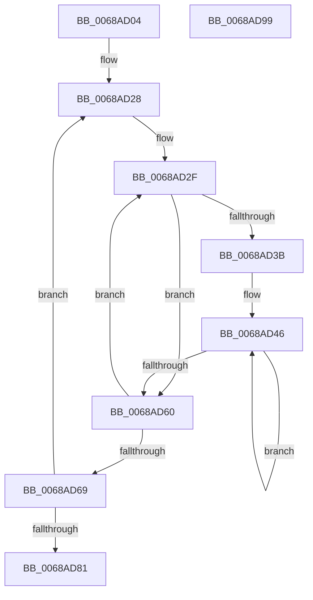

# MiNodeLargeFreeZeroPages2

- RVA: `0x0068AD04`–`0x0068AD9A` (길이 `150` bytes)
- VA: `0x000000014068AD04`
- 실행 섹션: `.text`
- PDB 이름 있음: `예`; PDB Function 태그: `아니요`
- unwind 정보 RVA: `0x000A5A38`
- 디코드: `41`개 명령, `150/150` bytes 표시
- 미해석 바이트: `0` (있으면 어셈블리에 `.byte`로 보존)

> 이 문서는 커널 이미지의 기계어와 PDB 기호를 분석해 생성했습니다. 4번과 5번은 함수 원형과 자료형을 바이너리 사용 방식에서 추정한 C 해석이며 원본 소스 복구 결과는 아닙니다.

## 1. Dependencies

- 직접 호출 지점: **0**; 고유 호출 대상: **0**
- 직접 호출자로 확인된 함수: **1**
- RIP 상대 이미지 참조: **2**

### Outgoing calls
- 직접 디코드된 call 명령이 없습니다.

### Direct callers
- [MiAddPhysicalMemoryChunks](../../page/7F/MiAddPhysicalMemoryChunks_function_007F98D4.md) at `0x007F9BAF`
- [MiAddPhysicalMemoryChunks](../../page/7F/MiAddPhysicalMemoryChunks_function_007F98D4.md) at `0x007F9C0F`

### Static image references
- `0x0068AD1D` → RVA `0x00011C60` (`.rdata`; read)
- `0x0068AD32` → RVA `0x00FC5002` (`ALMOSTRO`; read)

## 2. Other-region calls and transfers

- 다른 실행 섹션으로 향하는 call: **0**
- 별도 외부 분기/꼬리 이동을 확인하지 못했습니다.

## 3. Assembly (complete function range)

```asm
0068AD04  48 8B C4                        mov rax, rsp
0068AD07  48 89 58 08                     mov qword ptr [rax + 8], rbx
0068AD0B  48 89 68 10                     mov qword ptr [rax + 0x10], rbp
0068AD0F  48 89 70 18                     mov qword ptr [rax + 0x18], rsi
0068AD13  48 89 78 20                     mov qword ptr [rax + 0x20], rdi
0068AD17  45 33 C0                        xor r8d, r8d
0068AD1A  48 63 EA                        movsxd rbp, edx
0068AD1D  4C 8D 15 3C 6F 98 FF            lea r10, [rip - 0x6790c4]
0068AD24  41 8D 70 02                     lea esi, [r8 + 2]
0068AD28  4D 8B 0A                        mov r9, qword ptr [r10]
0068AD2B  33 FF                           xor edi, edi
0068AD2D  33 D2                           xor edx, edx
0068AD2F  45 32 DB                        xor r11b, r11b
0068AD32  44 38 1D C9 A2 93 00            cmp byte ptr [rip + 0x93a2c9], r11b
0068AD39  74 25                           je 0x14068ad60
0068AD3B  48 8D 5D 1D                     lea rbx, [rbp + 0x1d]
0068AD3F  48 8D 1C 5A                     lea rbx, [rdx + rbx*2]
0068AD43  48 03 DB                        add rbx, rbx
0068AD46  41 0F B6 C3                     movzx eax, r11b
0068AD4A  41 FE C3                        inc r11b
0068AD4D  48 03 C3                        add rax, rbx
0068AD50  48 8B 04 C1                     mov rax, qword ptr [rcx + rax*8]
0068AD54  48 03 F8                        add rdi, rax
0068AD57  44 3A 1D A4 A2 93 00            cmp r11b, byte ptr [rip + 0x93a2a4]
0068AD5E  72 E6                           jb 0x14068ad46
0068AD60  48 FF C2                        inc rdx
0068AD63  48 83 FA 01                     cmp rdx, 1
0068AD67  7E C6                           jle 0x14068ad2f
0068AD69  4C 0F AF CF                     imul r9, rdi
0068AD6D  48 81 C1 00 05 00 00            add rcx, 0x500
0068AD74  49 83 C2 08                     add r10, 8
0068AD78  4D 03 C1                        add r8, r9
0068AD7B  48 83 EE 01                     sub rsi, 1
0068AD7F  75 A7                           jne 0x14068ad28
0068AD81  48 8B 5C 24 08                  mov rbx, qword ptr [rsp + 8]
0068AD86  49 8B C0                        mov rax, r8
0068AD89  48 8B 6C 24 10                  mov rbp, qword ptr [rsp + 0x10]
0068AD8E  48 8B 74 24 18                  mov rsi, qword ptr [rsp + 0x18]
0068AD93  48 8B 7C 24 20                  mov rdi, qword ptr [rsp + 0x20]
0068AD98  C3                              ret
0068AD99  CC                              int3
```

## 4. C-style interpretation (structured pseudocode)

```c
__int64 __fastcall MiNodeLargeFreeZeroPages2(__int64 a1, int a2, int a3)
{
    __int64 result;
    __int64 v_r10;
    __int64 v_r11;
    __int64 v_rbx;
    __int64 v_rdi;
    __int64 v_rsi;
    unsigned __int64 v_stack_p10;
    unsigned __int64 v_stack_p18;
    unsigned __int64 v_stack_p20;
    unsigned __int64 v_stack_p8;

    *(unsigned __int64 *)(v_rsp + 8) = v_rbx;
    *(unsigned __int64 *)(v_rsp + 16) = v_rbp;
    *(unsigned __int64 *)(v_rsp + 24) = v_rsi;
    *(unsigned __int64 *)(v_rsp + 32) = v_rdi;
    a3 = 0;
loc_0068AD28:
    v_rdi = 0;
    a2 = 0;
loc_0068AD2F:
    v_r11 = 0;
    if ((*(unsigned __int8 *)(v_rip + 9675465)) == 0) goto loc_0068AD60;
    v_rbx = (a2 + (int)(a2) + 29 * 2) + (a2 + (int)(a2) + 29 * 2);
loc_0068AD46:
    v_r11 = (unsigned __int8)((v_r11) + 1);
    result = (0) + (v_rbx);
    v_rdi = (v_rdi) + (*(unsigned __int64 *)(a1 + result * 8));
    if (((unsigned __int8)(v_r11)) < (*(unsigned __int8 *)(v_rip + 9675428))) goto loc_0068AD46;
loc_0068AD60:
    a2 = (a2) + 1;
    if (a2 <= 1) goto loc_0068AD2F;
    a4 = (*(unsigned __int64 *)(v_rip - 6787268)) * (v_rdi);
    a1 = (a1) + (0x500ULL);
    v_r10 = (v_rip - 6787268) + (8);
    a3 = (a3) + (a4);
    v_rsi = (a3 + 2) - (1);
    if (condition_is_not_equal) goto loc_0068AD28;
    return a3;
}
```

## 5. (Beta) C Style

```c
int64_t MiNodeLargeFreeZeroPages2(void *Arg1, void *Arg2, int32_t Arg3)
{
    uint8_t *arg1 = (uint8_t *)Arg1;
    uint8_t *arg2 = (uint8_t *)Arg2;

    int64_t result;
    int64_t local_r10;
    int64_t local_r11;
    int64_t local_rbx;
    int64_t local_rdi;
    int64_t local_rsi;
    uint64_t v_stack_p10;
    uint64_t v_stack_p18;
    uint64_t v_stack_p20;
    uint64_t v_stack_p8;

    *(uint64_t *)(local_rsp + 0x8) = local_rbx;
    *(uint64_t *)(local_rsp + 0x10) = local_rbp;
    *(uint64_t *)(local_rsp + 0x18) = local_rsi;
    *(uint64_t *)(local_rsp + 0x20) = local_rdi;
    Arg3 = 0;
loc_0068AD28:
    local_rdi = 0;
    Arg2 = 0;
loc_0068AD2F:
    local_r11 = 0;
    if ((*(uint8_t *)(v_rip + 0x93A2C9)) == 0) goto loc_0068AD60;
    local_rbx = (Arg2 + (int32_t)(Arg2) + 29 * 2) + (Arg2 + (int32_t)(Arg2) + 29 * 2);
loc_0068AD46:
    local_r11 = (uint8_t)((local_r11) + 1);
    result = (0) + (local_rbx);
    local_rdi = (local_rdi) + (*(uint64_t *)(arg1 + result * 8));
    if (((uint8_t)(local_r11)) < (*(uint8_t *)(v_rip + 0x93A2A4))) goto loc_0068AD46;
loc_0068AD60:
    Arg2 = (Arg2) + 1;
    if (Arg2 <= 1) goto loc_0068AD2F;
    a4 = (*(uint64_t *)(v_rip - 0x6790C4)) * (local_rdi);
    Arg1 = (Arg1) + (0x500ULL);
    local_r10 = (v_rip - 6787268) + (8);
    Arg3 = (Arg3) + (a4);
    local_rsi = (Arg3 + 2) - (1);
    if (condition_is_not_equal) goto loc_0068AD28;
    return Arg3;
}
```

### 관측된 메모리 오프셋

구조체 형식이 확인되지 않은 접근은 인자 기준의 오프셋으로만 기록했습니다.

| 기준 인자 | 오프셋 표현 | 폭 (bit) | 접근 |
|---|---:|---:|---|
| `Arg1` | `+ 0x0 + rax*8` | `64` | `R` |
| `Arg2` | `+ 0x1D` | `64` | `R` |

## 6. Execution-region graph

[열기: 2D/3D 그래프와 함수 탐색 컨트롤 패널](../../../control-panel.html?section=text&rva=0x0068AD04&view=graph)

- 2D 그래프는 위에서 아래로 흐르고, 3D 그래프는 빈 공간을 드래그해 회전합니다. Shift+드래그는 이동, 휠은 확대·축소, 함수 노드 선택은 대상 보고서 이동입니다.

### Static fallback


