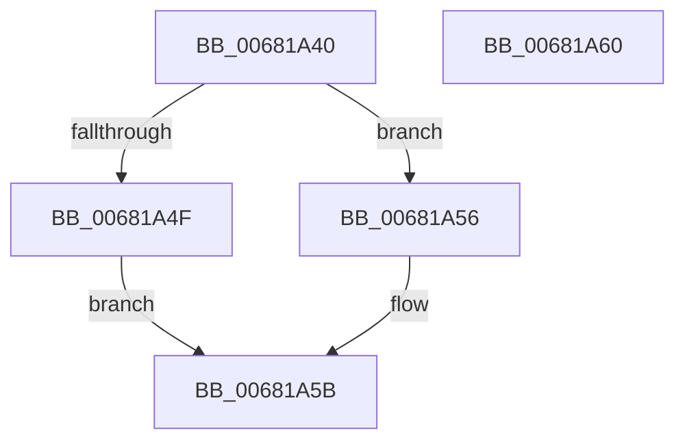

# MiPersistMemory

- RVA: `0x00681A40`–`0x00681A61` (길이 `33` bytes)
- VA: `0x0000000140681A40`
- 실행 섹션: `.text`
- PDB 이름 있음: `예`; PDB Function 태그: `아니요`
- unwind 정보 RVA: `0x0005C788`
- 디코드: `9`개 명령, `33/33` bytes 표시
- 미해석 바이트: `0` (있으면 어셈블리에 `.byte`로 보존)

> 이 문서는 커널 이미지의 기계어와 PDB 기호를 분석해 생성했습니다. 4번과 5번은 함수 원형과 자료형을 바이너리 사용 방식에서 추정한 C 해석이며 원본 소스 복구 결과는 아닙니다.

## 1. Dependencies

- 직접 호출 지점: **2**; 고유 호출 대상: **2**
- 직접 호출자로 확인된 함수: **2**
- RIP 상대 이미지 참조: **1**

### Outgoing calls
- `0x00681A4F` → [KePersistMemory](../6B/KePersistMemory_function_006BA0C0.md) (function, `0x006BA0C0`)
- `0x00681A56` → [KeInvalidateRangeAllCaches](../30/KeInvalidateRangeAllCaches_function_00308880.md) (function, `0x00308880`)

### Direct callers
- [MiPersistMdl](../40/MiPersistMdl_function_00402B2C.md) at `0x00402BA3`
- [MiPersistVa](MiPersistVa_function_00681AB8.md) at `0x00681ACA`

### Static image references
- `0x00681A44` → RVA `0x00FC6B30` (`ALMOSTRO`; read)

## 2. Other-region calls and transfers

- 다른 실행 섹션으로 향하는 call: **0**
- 별도 외부 분기/꼬리 이동을 확인하지 못했습니다.

## 3. Assembly (complete function range)

```asm
00681A40  48 83 EC 28                     sub rsp, 0x28
00681A44  48 0F BA 25 E3 50 94 00 24      bt qword ptr [rip + 0x9450e3], 0x24
00681A4D  73 07                           jae 0x140681a56
00681A4F  E8 6C 86 03 00                  call 0x1406ba0c0
00681A54  EB 05                           jmp 0x140681a5b
00681A56  E8 25 6E C8 FF                  call 0x140308880
00681A5B  48 83 C4 28                     add rsp, 0x28
00681A5F  C3                              ret
00681A60  CC                              int3
```

## 4. C-style interpretation (structured pseudocode)

```c
__int64 __fastcall MiPersistMemory(void)
{
    __int64 result;
    __int64 v_rsp;

    v_rsp = (v_rsp) - (40);
    if (condition_is_above_or_equal) goto loc_00681A56;
    result = KePersistMemory(a1, a2, a3, a4);
    goto loc_00681A5B;
loc_00681A56:
    result = KeInvalidateRangeAllCaches(a1, a2, a3, a4);
loc_00681A5B:
    v_rsp = (v_rsp) + (40);
    return result;
}
```

## 5. (Beta) C Style

```c
void MiPersistMemory(void)
{
    int64_t result;
    int64_t local_rsp;

    local_rsp = (local_rsp) - (40);
    if (condition_is_above_or_equal) goto loc_00681A56;
    result = KePersistMemory(a1, a2, a3, a4);
    goto loc_00681A5B;
loc_00681A56:
    result = KeInvalidateRangeAllCaches(a1, a2, a3, a4);
loc_00681A5B:
    local_rsp = (local_rsp) + (40);
    return result;
}
```

## 6. Execution-region graph

[열기: 2D/3D 그래프와 함수 탐색 컨트롤 패널](../../../control-panel.html?section=text&rva=0x00681A40&view=graph)

- 2D 그래프는 위에서 아래로 흐르고, 3D 그래프는 빈 공간을 드래그해 회전합니다. Shift+드래그는 이동, 휠은 확대·축소, 함수 노드 선택은 대상 보고서 이동입니다.

### Static fallback


