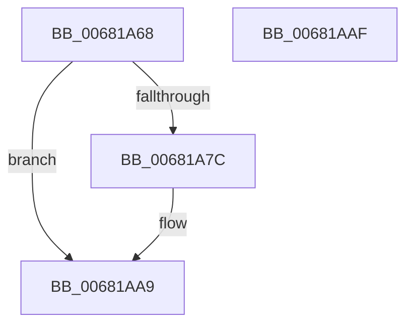

# MiPersistPage

- RVA: `0x00681A68`–`0x00681AB0` (길이 `72` bytes)
- VA: `0x0000000140681A68`
- 실행 섹션: `.text`
- PDB 이름 있음: `예`; PDB Function 태그: `아니요`
- unwind 정보 RVA: `0x0005CF00`
- 디코드: `19`개 명령, `72/72` bytes 표시
- 미해석 바이트: `0` (있으면 어셈블리에 `.byte`로 보존)

> 이 문서는 커널 이미지의 기계어와 PDB 기호를 분석해 생성했습니다. 4번과 5번은 함수 원형과 자료형을 바이너리 사용 방식에서 추정한 C 해석이며 원본 소스 복구 결과는 아닙니다.

## 1. Dependencies

- 직접 호출 지점: **3**; 고유 호출 대상: **3**
- 직접 호출자로 확인된 함수: **2**
- RIP 상대 이미지 참조: **1**

### Outgoing calls
- `0x00681A87` → [MiMapPageInHyperSpaceWorker](../33/MiMapPageInHyperSpaceWorker_function_00332B10.md) (function, `0x00332B10`)
- `0x00681A92` → [MiPersistVa](MiPersistVa_function_00681AB8.md) (function, `0x00681AB8`)
- `0x00681AA4` → [MiUnmapPageInHyperSpaceWorker](../43/MiUnmapPageInHyperSpaceWorker_function_00432800.md) (function, `0x00432800`)

### Direct callers
- [MiMarkFileOnlyPfnBad](MiMarkFileOnlyPfnBad_function_006815C4.md) at `0x006816E1`
- [MiPurgeFileOnlyPfn](MiPurgeFileOnlyPfn_function_00681CEC.md) at `0x00681E8D`

### Static image references
- `0x00681A6E` → RVA `0x00E2DC40` (`.data`; read)

## 2. Other-region calls and transfers

- 다른 실행 섹션으로 향하는 call: **0**
- 별도 외부 분기/꼬리 이동을 확인하지 못했습니다.

## 3. Assembly (complete function range)

```asm
00681A68  40 53                           push rbx
00681A6A  48 83 EC 20                     sub rsp, 0x20
00681A6E  80 3D CB C1 7A 00 00            cmp byte ptr [rip + 0x7ac1cb], 0
00681A75  C6 44 24 38 00                  mov byte ptr [rsp + 0x38], 0
00681A7A  75 2D                           jne 0x140681aa9
00681A7C  41 B8 00 00 00 80               mov r8d, 0x80000000
00681A82  48 8D 54 24 38                  lea rdx, [rsp + 0x38]
00681A87  E8 84 10 CB FF                  call 0x140332b10
00681A8C  48 8B C8                        mov rcx, rax
00681A8F  48 8B D8                        mov rbx, rax
00681A92  E8 21 00 00 00                  call 0x140681ab8
00681A97  8A 54 24 38                     mov dl, byte ptr [rsp + 0x38]
00681A9B  41 B8 00 00 00 80               mov r8d, 0x80000000
00681AA1  48 8B CB                        mov rcx, rbx
00681AA4  E8 57 0D DB FF                  call 0x140432800
00681AA9  48 83 C4 20                     add rsp, 0x20
00681AAD  5B                              pop rbx
00681AAE  C3                              ret
00681AAF  CC                              int3
```

## 4. C-style interpretation (structured pseudocode)

```c
__int64 __fastcall MiPersistPage(void)
{
    __int64 result;
    __int64 v_rbx;
    __int64 v_rsp;
    unsigned __int8 v_stack_p10;

    v_rsp = (v_rsp) - (32);
    v_stack_p10 = 0;
    if ((*(unsigned __int8 *)(v_rip + 8045003)) == 0) {
        a3 = 0x80000000ULL;
        a2 = v_stack_p10;
        result = MiMapPageInHyperSpaceWorker(a1, a2, a3, a4);
        a1 = result;
        v_rbx = result;
        result = MiPersistVa(a1, a2, a3, a4);
        a2 = v_stack_p10;
        a3 = 0x80000000ULL;
        a1 = v_rbx;
        result = MiUnmapPageInHyperSpaceWorker(a1, a2, a3, a4);
    }
    v_rsp = (v_rsp) + (32);
    return result;
}
```

## 5. (Beta) C Style

```c
void MiPersistPage(void)
{
    int64_t result;
    int64_t local_rbx;
    int64_t local_rsp;
    uint8_t v_stack_p10;

    local_rsp = (local_rsp) - (32);
    v_stack_p10 = 0;
    if ((*(uint8_t *)(v_rip + 0x7AC1CB)) == 0) {
        a3 = 0x80000000ULL;
        a2 = v_stack_p10;
        result = MiMapPageInHyperSpaceWorker(a1, a2, a3, a4);
        a1 = result;
        local_rbx = result;
        result = MiPersistVa(a1, a2, a3, a4);
        a2 = v_stack_p10;
        a3 = 0x80000000ULL;
        a1 = local_rbx;
        result = MiUnmapPageInHyperSpaceWorker(a1, a2, a3, a4);
    }
    local_rsp = (local_rsp) + (32);
    return result;
}
```

## 6. Execution-region graph

[열기: 2D/3D 그래프와 함수 탐색 컨트롤 패널](../../../control-panel.html?section=text&rva=0x00681A68&view=graph)

- 2D 그래프는 위에서 아래로 흐르고, 3D 그래프는 빈 공간을 드래그해 회전합니다. Shift+드래그는 이동, 휠은 확대·축소, 함수 노드 선택은 대상 보고서 이동입니다.

### Static fallback


