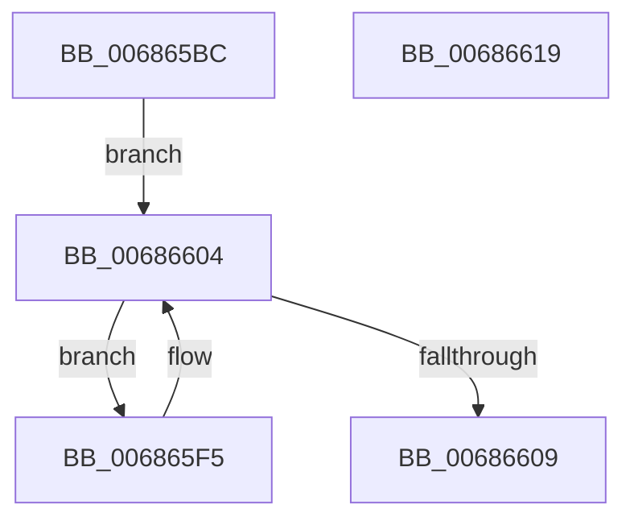

# MiPopulateFreeKernelShadowStackCacheEntries

- RVA: `0x006865BC`–`0x0068661A` (길이 `94` bytes)
- VA: `0x00000001406865BC`
- 실행 섹션: `.text`
- PDB 이름 있음: `예`; PDB Function 태그: `아니요`
- unwind 정보 RVA: `0x00060BC4`
- 디코드: `26`개 명령, `94/94` bytes 표시
- 미해석 바이트: `0` (있으면 어셈블리에 `.byte`로 보존)

> 이 문서는 커널 이미지의 기계어와 PDB 기호를 분석해 생성했습니다. 4번과 5번은 함수 원형과 자료형을 바이너리 사용 방식에서 추정한 C 해석이며 원본 소스 복구 결과는 아닙니다.

## 1. Dependencies

- 직접 호출 지점: **2**; 고유 호출 대상: **2**
- 직접 호출자로 확인된 함수: **1**
- RIP 상대 이미지 참조: **1**

### Outgoing calls
- `0x006865E7` → [InitializeSListHead](../46/InitializeSListHead_function_00468A90.md) (function, `0x00468A90`)
- `0x006865FB` → [ExpInterlockedPushEntrySList](../6B/ExpInterlockedPushEntrySList_function_006BA5B0.md) (function, `0x006BA5B0`)

### Direct callers
- [MiInitializePartition](../../page/7F/MiInitializePartition_function_007FD3E8.md) at `0x007FD6F8`

### Static image references
- `0x006865CB` → RVA `0x00FC5000` (`ALMOSTRO`; read)

## 2. Other-region calls and transfers

- 다른 실행 섹션으로 향하는 call: **0**
- 별도 외부 분기/꼬리 이동을 확인하지 못했습니다.

## 3. Assembly (complete function range)

```asm
006865BC  48 89 5C 24 08                  mov qword ptr [rsp + 8], rbx
006865C1  48 89 74 24 10                  mov qword ptr [rsp + 0x10], rsi
006865C6  57                              push rdi
006865C7  48 83 EC 20                     sub rsp, 0x20
006865CB  0F B7 05 2E EA 93 00            movzx eax, word ptr [rip + 0x93ea2e]
006865D2  48 8D B1 C0 01 00 00            lea rsi, [rcx + 0x1c0]
006865D9  48 8B 1E                        mov rbx, qword ptr [rsi]
006865DC  48 8B CE                        mov rcx, rsi
006865DF  48 8D 3C 40                     lea rdi, [rax + rax*2]
006865E3  48 C1 E7 09                     shl rdi, 9
006865E7  E8 A4 24 DE FF                  call 0x140468a90
006865EC  48 C1 E7 05                     shl rdi, 5
006865F0  48 03 FB                        add rdi, rbx
006865F3  EB 0F                           jmp 0x140686604
006865F5  48 8B D3                        mov rdx, rbx
006865F8  48 8B CE                        mov rcx, rsi
006865FB  E8 B0 3F 03 00                  call 0x1406ba5b0
00686600  48 83 C3 20                     add rbx, 0x20
00686604  48 3B DF                        cmp rbx, rdi
00686607  72 EC                           jb 0x1406865f5
00686609  48 8B 5C 24 30                  mov rbx, qword ptr [rsp + 0x30]
0068660E  48 8B 74 24 38                  mov rsi, qword ptr [rsp + 0x38]
00686613  48 83 C4 20                     add rsp, 0x20
00686617  5F                              pop rdi
00686618  C3                              ret
00686619  CC                              int3
```

## 4. C-style interpretation (structured pseudocode)

```c
__int64 __fastcall MiPopulateFreeKernelShadowStackCacheEntries(__int64 a1)
{
    __int64 result;
    __int64 v_rbx;
    __int64 v_rdi;
    __int64 v_rsp;
    unsigned __int64 v_stack_p10;
    unsigned __int64 v_stack_p8;

    v_stack_p8 = v_rbx;
    v_stack_p10 = v_rsi;
    v_rsp = (v_rsp) - (32);
    v_rdi = (*(unsigned __int16 *)(v_rip + 9693742) + *(unsigned __int16 *)(v_rip + 9693742) * 2) << (9);
    result = InitializeSListHead(a1 + 448, a2, a3, a4);
    v_rdi = (v_rdi) << (5);
    v_rdi = (v_rdi) + (*(unsigned __int64 *)(a1 + 448));
    goto loc_00686604;
loc_006865F5:
    result = ExpInterlockedPushEntrySList(a1 + 448, *(unsigned __int64 *)(a1 + 448), a3, a4);
    v_rbx = (*(unsigned __int64 *)(a1 + 448)) + (32);
loc_00686604:
    if (v_rbx < v_rdi) goto loc_006865F5;
    v_rsp = (v_rsp) + (32);
    return result;
}
```

## 5. (Beta) C Style

```c
int64_t MiPopulateFreeKernelShadowStackCacheEntries(void *Arg1)
{
    uint8_t *arg1 = (uint8_t *)Arg1;

    int64_t result;
    int64_t local_rbx;
    int64_t local_rdi;
    int64_t local_rsp;
    uint64_t v_stack_p10;
    uint64_t v_stack_p8;

    v_stack_p8 = local_rbx;
    v_stack_p10 = local_rsi;
    local_rsp = (local_rsp) - (32);
    local_rdi = (*(uint16_t *)(v_rip + 0x93EA2E) + *(uint16_t *)(v_rip + 0x93EA2E) * 2) << (9);
    result = InitializeSListHead(Arg1 + 448, a2, a3, a4);
    local_rdi = (local_rdi) << (5);
    local_rdi = (local_rdi) + (*(uint64_t *)(arg1 + 0x1C0));
    goto loc_00686604;
loc_006865F5:
    result = ExpInterlockedPushEntrySList(Arg1 + 448, *(uint64_t *)(arg1 + 0x1C0), a3, a4);
    local_rbx = (*(uint64_t *)(arg1 + 0x1C0)) + (32);
loc_00686604:
    if (local_rbx < local_rdi) goto loc_006865F5;
    local_rsp = (local_rsp) + (32);
    return result;
}
```

### 관측된 메모리 오프셋

구조체 형식이 확인되지 않은 접근은 인자 기준의 오프셋으로만 기록했습니다.

| 기준 인자 | 오프셋 표현 | 폭 (bit) | 접근 |
|---|---:|---:|---|
| `Arg1` | `+ 0x0` | `64` | `R` |
| `Arg1` | `+ 0x1C0` | `64` | `R` |

## 6. Execution-region graph

[열기: 2D/3D 그래프와 함수 탐색 컨트롤 패널](../../../control-panel.html?section=text&rva=0x006865BC&view=graph)

- 2D 그래프는 위에서 아래로 흐르고, 3D 그래프는 빈 공간을 드래그해 회전합니다. Shift+드래그는 이동, 휠은 확대·축소, 함수 노드 선택은 대상 보고서 이동입니다.

### Static fallback


