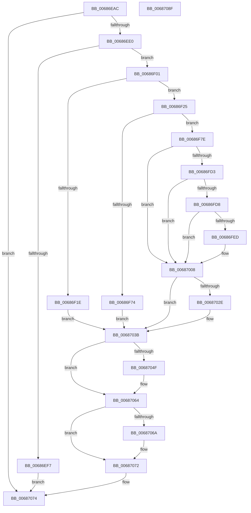

# MiPrepareEnclaveMetadataPage

- RVA: `0x00686EAC`–`0x00687090` (길이 `484` bytes)
- VA: `0x0000000140686EAC`
- 실행 섹션: `.text`
- PDB 이름 있음: `예`; PDB Function 태그: `아니요`
- unwind 정보 RVA: `0x00091ECC`
- 디코드: `110`개 명령, `484/484` bytes 표시
- 미해석 바이트: `0` (있으면 어셈블리에 `.byte`로 보존)

> 이 문서는 커널 이미지의 기계어와 PDB 기호를 분석해 생성했습니다. 4번과 5번은 함수 원형과 자료형을 바이너리 사용 방식에서 추정한 C 해석이며 원본 소스 복구 결과는 아닙니다.

## 1. Dependencies

- 직접 호출 지점: **10**; 고유 호출 대상: **10**
- 직접 호출자로 확인된 함수: **1**
- RIP 상대 이미지 참조: **7**

### Outgoing calls
- `0x00686EEA` → [MiReservePtes](../31/MiReservePtes_function_00318D20.md) (function, `0x00318D20`)
- `0x00686F0C` → [ExAcquireSpinLockExclusive](../24/ExAcquireSpinLockExclusive_function_00248690.md) (function, `0x00248690`)
- `0x00686F67` → [MiAllocateEnclavePages](../3B/MiAllocateEnclavePages_function_003BC43C.md) (function, `0x003BC43C`)
- `0x00686F83` → [MiUnlinkPageChainHead](../36/MiUnlinkPageChainHead_function_00365C40.md) (function, `0x00365C40`)
- `0x00686FB6` → [MiMakeValidPte](../2C/MiMakeValidPte_function_002C5590.md) (function, `0x002C5590`)
- `0x00686FF9` → [MiCheckLinearProtectedPteAccessedBit](../29/MiCheckLinearProtectedPteAccessedBit_function_00292D80.md) (function, `0x00292D80`)
- `0x00687023` → [KeCreateEnclaveMetadataPage](../5B/KeCreateEnclaveMetadataPage_function_005BBBA0.md) (function, `0x005BBBA0`)
- `0x00687045` → [MiReleaseSpinLockExclusive](../24/MiReleaseSpinLockExclusive_function_002482C0.md) (function, `0x002482C0`)
- `0x0068705F` → [MiReleasePtes](../24/MiReleasePtes_function_00247240.md) (function, `0x00247240`)
- `0x0068706D` → [MiReturnEnclavePage](../4D/MiReturnEnclavePage_function_004DEEF8.md) (function, `0x004DEEF8`)

### Direct callers
- [MiCreateHardwareEnclave](../../page/80/MiCreateHardwareEnclave_function_00808500.md) at `0x0080866B`

### Static image references
- `0x00686ECA` → RVA `0x00E375C0` (`.data`; read)
- `0x00686EE3` → RVA `0x00E37668` (`.data`; read)
- `0x00686F01` → RVA `0x00E375D8` (`.data`; read)
- `0x00686F2E` → RVA `0x00FC8C40` (`ALMOSTRO`; read)
- `0x00686F60` → RVA `0x00E38D00` (`.data`; read)
- `0x00686FBB` → RVA `0x00FC6A88` (`ALMOSTRO`; read)
- `0x00687032` → RVA `0x00E375C0` (`.data`; write)

## 2. Other-region calls and transfers

- 다른 실행 섹션으로 향하는 call: **0**
- 별도 외부 분기/꼬리 이동을 확인하지 못했습니다.

## 3. Assembly (complete function range)

```asm
00686EAC  4C 8B DC                        mov r11, rsp
00686EAF  49 89 5B 08                     mov qword ptr [r11 + 8], rbx
00686EB3  49 89 6B 10                     mov qword ptr [r11 + 0x10], rbp
00686EB7  49 89 73 18                     mov qword ptr [r11 + 0x18], rsi
00686EBB  49 89 7B 20                     mov qword ptr [r11 + 0x20], rdi
00686EBF  41 56                           push r14
00686EC1  48 83 EC 50                     sub rsp, 0x50
00686EC5  33 C0                           xor eax, eax
00686EC7  0F 57 C0                        xorps xmm0, xmm0
00686ECA  48 39 05 EF 06 7B 00            cmp qword ptr [rip + 0x7b06ef], rax
00686ED1  0F 11 44 24 30                  movups xmmword ptr [rsp + 0x30], xmm0
00686ED6  49 89 43 E8                     mov qword ptr [r11 - 0x18], rax
00686EDA  0F 85 94 01 00 00               jne 0x140687074
00686EE0  8D 50 01                        lea edx, [rax + 1]
00686EE3  48 8D 0D 7E 07 7B 00            lea rcx, [rip + 0x7b077e]
00686EEA  E8 31 1E C9 FF                  call 0x140318d20
00686EEF  48 8B F8                        mov rdi, rax
00686EF2  48 85 C0                        test rax, rax
00686EF5  75 0A                           jne 0x140686f01
00686EF7  B8 9A 00 00 C0                  mov eax, 0xc000009a
00686EFC  E9 73 01 00 00                  jmp 0x140687074
00686F01  48 8D 0D D0 06 7B 00            lea rcx, [rip + 0x7b06d0]
00686F08  48 83 CE FF                     or rsi, 0xffffffffffffffff
00686F0C  E8 7F 17 BC FF                  call 0x140248690
00686F11  48 83 3D A7 06 7B 00 00         cmp qword ptr [rip + 0x7b06a7], 0
00686F19  44 8A F0                        mov r14b, al
00686F1C  74 07                           je 0x140686f25
00686F1E  33 DB                           xor ebx, ebx
00686F20  E9 16 01 00 00                  jmp 0x14068703b
00686F25  65 48 8B 04 25 88 01 00 00      mov rax, qword ptr gs:[0x188]
00686F2E  48 8D 0D 0B 1D 94 00            lea rcx, [rip + 0x941d0b]
00686F35  41 B9 01 00 00 00               mov r9d, 1
00686F3B  45 33 C0                        xor r8d, r8d
00686F3E  8B 80 4C 02 00 00               mov eax, dword ptr [rax + 0x24c]
00686F44  48 8B 04 C1                     mov rax, qword ptr [rcx + rax*8]
00686F48  48 8B 88 C0 00 00 00            mov rcx, qword ptr [rax + 0xc0]
00686F4F  48 8D 44 24 30                  lea rax, [rsp + 0x30]
00686F54  48 89 44 24 20                  mov qword ptr [rsp + 0x20], rax
00686F59  0F B7 91 8A 00 00 00            movzx edx, word ptr [rcx + 0x8a]
00686F60  48 8D 0D 99 1D 7B 00            lea rcx, [rip + 0x7b1d99]
00686F67  E8 D0 54 D3 FF                  call 0x1403bc43c
00686F6C  48 83 7C 24 40 00               cmp qword ptr [rsp + 0x40], 0
00686F72  75 0A                           jne 0x140686f7e
00686F74  BB 9A 00 00 C0                  mov ebx, 0xc000009a
00686F79  E9 BD 00 00 00                  jmp 0x14068703b
00686F7E  48 8D 4C 24 30                  lea rcx, [rsp + 0x30]
00686F83  E8 B8 EC CD FF                  call 0x140365c40
00686F88  48 8B F0                        mov rsi, rax
00686F8B  48 B8 00 00 00 00 00 DE FF FF   movabs rax, 0xffffde0000000000
00686F95  48 2B F0                        sub rsi, rax
00686F98  41 B8 04 00 00 C0               mov r8d, 0xc0000004
00686F9E  48 B8 AB AA AA AA AA AA AA AA   movabs rax, 0xaaaaaaaaaaaaaaab
00686FA8  48 C1 FE 04                     sar rsi, 4
00686FAC  48 0F AF F0                     imul rsi, rax
00686FB0  48 8B CF                        mov rcx, rdi
00686FB3  48 8B D6                        mov rdx, rsi
00686FB6  E8 D5 E5 C3 FF                  call 0x1402c5590
00686FBB  48 0F BA 25 C4 FA 93 00 24      bt qword ptr [rip + 0x93fac4], 0x24
00686FC4  48 BA 00 00 00 00 80 F6 FF FF   movabs rdx, 0xfffff68000000000
00686FCE  48 8B D8                        mov rbx, rax
00686FD1  73 35                           jae 0x140687008
00686FD3  F6 C3 20                        test bl, 0x20
00686FD6  75 30                           jne 0x140687008
00686FD8  48 8B C2                        mov rax, rdx
00686FDB  48 B9 00 00 00 00 40 00 00 00   movabs rcx, 0x4000000000
00686FE5  48 03 C1                        add rax, rcx
00686FE8  48 3B F8                        cmp rdi, rax
00686FEB  72 1B                           jb 0x140687008
00686FED  41 B8 80 00 00 00               mov r8d, 0x80
00686FF3  48 8B D3                        mov rdx, rbx
00686FF6  48 8B CF                        mov rcx, rdi
00686FF9  E8 82 BD C0 FF                  call 0x140292d80
00686FFE  48 BA 00 00 00 00 80 F6 FF FF   movabs rdx, 0xfffff68000000000
00687008  48 8B EF                        mov rbp, rdi
0068700B  48 89 1F                        mov qword ptr [rdi], rbx
0068700E  48 C1 E5 19                     shl rbp, 0x19
00687012  48 8B C2                        mov rax, rdx
00687015  48 C1 E0 19                     shl rax, 0x19
00687019  48 2B E8                        sub rbp, rax
0068701C  48 C1 FD 10                     sar rbp, 0x10
00687020  48 8B CD                        mov rcx, rbp
00687023  E8 78 4B F3 FF                  call 0x1405bbba0
00687028  8B D8                           mov ebx, eax
0068702A  85 C0                           test eax, eax
0068702C  78 0D                           js 0x14068703b
0068702E  48 83 CE FF                     or rsi, 0xffffffffffffffff
00687032  48 89 2D 87 05 7B 00            mov qword ptr [rip + 0x7b0587], rbp
00687039  33 FF                           xor edi, edi
0068703B  41 8A D6                        mov dl, r14b
0068703E  48 8D 0D 93 05 7B 00            lea rcx, [rip + 0x7b0593]
00687045  E8 76 12 BC FF                  call 0x1402482c0
0068704A  48 85 FF                        test rdi, rdi
0068704D  74 15                           je 0x140687064
0068704F  41 B8 01 00 00 00               mov r8d, 1
00687055  48 8D 0D 0C 06 7B 00            lea rcx, [rip + 0x7b060c]
0068705C  48 8B D7                        mov rdx, rdi
0068705F  E8 DC 01 BC FF                  call 0x140247240
00687064  48 83 FE FF                     cmp rsi, -1
00687068  74 08                           je 0x140687072
0068706A  48 8B CE                        mov rcx, rsi
0068706D  E8 86 7E E5 FF                  call 0x1404deef8
00687072  8B C3                           mov eax, ebx
00687074  48 8B 5C 24 60                  mov rbx, qword ptr [rsp + 0x60]
00687079  48 8B 6C 24 68                  mov rbp, qword ptr [rsp + 0x68]
0068707E  48 8B 74 24 70                  mov rsi, qword ptr [rsp + 0x70]
00687083  48 8B 7C 24 78                  mov rdi, qword ptr [rsp + 0x78]
00687088  48 83 C4 50                     add rsp, 0x50
0068708C  41 5E                           pop r14
0068708E  C3                              ret
0068708F  CC                              int3
```

## 4. C-style interpretation (structured pseudocode)

```c
__int64 __fastcall MiPrepareEnclaveMetadataPage(__int64 a1, __int64 a2, int a3)
{
    __int64 result;
    __int64 v_rbp;
    __int64 v_rbx;
    __int64 v_rdi;
    __int64 v_rsi;
    __int64 v_rsp;
    unsigned __int64 v_stack_m18;
    unsigned __int64 v_stack_m28;
    unsigned __int64 v_stack_m38;
    unsigned __int64 v_stack_p10;
    unsigned __int64 v_stack_p18;
    unsigned __int64 v_stack_p20;
    unsigned __int64 v_stack_p8;

    *(unsigned __int64 *)(v_rsp + 8) = v_rbx;
    *(unsigned __int64 *)(v_rsp + 16) = v_rbp;
    *(unsigned __int64 *)(v_rsp + 24) = v_rsi;
    *(unsigned __int64 *)(v_rsp + 32) = v_rdi;
    v_rsp = (v_rsp) - (80);
    result = 0;
    v_stack_m28 = v_xmm0;
    *(unsigned __int64 *)(v_rsp - 24) = 0;
    if ((*(unsigned __int64 *)(v_rip + 8062703)) != 0) goto loc_00687074;
    result = MiReservePtes(v_rip + 8062846, result + 1, a3, a4);
    if (result != 0) goto loc_00686F01;
    goto loc_00687074;
loc_00686F01:
    v_rsi = (v_rsi) | (-1);
    result = ExAcquireSpinLockExclusive(v_rip + 8062672, result + 1, a3, a4);
    if ((*(unsigned __int64 *)(v_rip + 8062631)) == 0) goto loc_00686F25;
    v_rbx = 0;
    goto loc_0068703B;
loc_00686F25:
    a3 = 0;
    v_stack_m38 = v_stack_m28;
    result = MiAllocateEnclavePages(v_rip + 8068505, *(unsigned __int16 *)(*(unsigned __int64 *)(*(unsigned __int64 *)(v_rip + 9706763 + (unsigned int)(*(unsigned int *)(*(unsigned __int64 *)(gs_base + (0 + 392)) + 588)) * 8) + 192) + 138), a3, 1);
    if (v_stack_m18 != 0) goto loc_00686F7E;
    goto loc_0068703B;
loc_00686F7E:
    result = MiUnlinkPageChainHead(v_stack_m28, *(unsigned __int16 *)(*(unsigned __int64 *)(*(unsigned __int64 *)(v_rip + 9706763 + (unsigned int)(*(unsigned int *)(*(unsigned __int64 *)(gs_base + (0 + 392)) + 588)) * 8) + 192) + 138), a3, 1);
    v_rsi = (result) - (result);
    v_rsi = (v_rsi) >> (4);
    v_rsi = (v_rsi) * (result);
    result = MiMakeValidPte(result, v_rsi, (unsigned int)(0xC0000004ULL), 1);
    if (condition_is_above_or_equal) goto loc_00687008;
    if ((((unsigned __int8)(result)) & (32)) != 0) goto loc_00687008;
    result = (v_rsi) + (result);
    if (result >= result) {
        a3 = 128;
        a2 = result;
        a1 = result;
        result = MiCheckLinearProtectedPteAccessedBit(a1, a2, a3, 1);
    }
    *(unsigned __int64 *)(result) = result;
    v_rbp = (result) << (25);
    result = (a2) << (25);
    v_rbp = (v_rbp) - (result);
    v_rbp = (v_rbp) >> (16);
    result = KeCreateEnclaveMetadataPage(v_rbp, a2, a3, 1);
    v_rdi = result;
    if (!(sign_flag)) {
        v_rsi = (v_rsi) | (-1);
        *(unsigned __int64 *)(v_rip + 8062343) = v_rbp;
        v_rdi = 0;
    }
    result = MiReleaseSpinLockExclusive(v_rip + 8062355, (unsigned __int8)((unsigned __int8)(result)), a3, 1);
    if (0 != 0) {
        a3 = 1;
        a1 = v_rip + 8062476;
        a2 = 0;
        result = MiReleasePtes(a1, a2, a3, 1);
    }
    if (v_rsi != -1) {
        a1 = v_rsi;
        result = MiReturnEnclavePage(a1, a2, a3, 1);
    }
loc_00687074:
    v_rsp = (v_rsp) + (80);
    return (unsigned int)((unsigned int)((unsigned int)((unsigned int)(result))));
}
```

## 5. (Beta) C Style

```c
int64_t MiPrepareEnclaveMetadataPage(int64_t Arg1, int64_t Arg2, int32_t Arg3)
{
    int64_t result;
    int64_t local_rbp;
    int64_t local_rbx;
    int64_t local_rdi;
    int64_t local_rsi;
    int64_t local_rsp;
    uint64_t v_stack_m18;
    uint64_t v_stack_m28;
    uint64_t v_stack_m38;
    uint64_t v_stack_p10;
    uint64_t v_stack_p18;
    uint64_t v_stack_p20;
    uint64_t v_stack_p8;

    *(uint64_t *)(local_rsp + 0x8) = local_rbx;
    *(uint64_t *)(local_rsp + 0x10) = local_rbp;
    *(uint64_t *)(local_rsp + 0x18) = local_rsi;
    *(uint64_t *)(local_rsp + 0x20) = local_rdi;
    local_rsp = (local_rsp) - (80);
    result = 0;
    v_stack_m28 = v_xmm0;
    *(uint64_t *)(local_rsp - 0x18) = 0;
    if ((*(uint64_t *)(v_rip + 0x7B06EF)) != 0) goto loc_00687074;
    result = MiReservePtes(v_rip + 8062846, result + 1, Arg3, a4);
    if (result != 0) goto loc_00686F01;
    goto loc_00687074;
loc_00686F01:
    local_rsi = (local_rsi) | (-1);
    result = ExAcquireSpinLockExclusive(v_rip + 8062672, result + 1, Arg3, a4);
    if ((*(uint64_t *)(v_rip + 0x7B06A7)) == 0) goto loc_00686F25;
    local_rbx = 0;
    goto loc_0068703B;
loc_00686F25:
    Arg3 = 0;
    v_stack_m38 = v_stack_m28;
    result = MiAllocateEnclavePages(v_rip + 8068505, *(uint16_t *)(*(uint64_t *)(*(uint64_t *)(v_rip + 0x941D0B + (uint32_t)(*(uint32_t *)(*(uint64_t *)(gs_base + (0 + 0x188)) + 0x24C)) * 8) + 0xC0) + 0x8A), Arg3, 1);
    if (v_stack_m18 != 0) goto loc_00686F7E;
    goto loc_0068703B;
loc_00686F7E:
    result = MiUnlinkPageChainHead(v_stack_m28, *(uint16_t *)(*(uint64_t *)(*(uint64_t *)(v_rip + 0x941D0B + (uint32_t)(*(uint32_t *)(*(uint64_t *)(gs_base + (0 + 0x188)) + 0x24C)) * 8) + 0xC0) + 0x8A), Arg3, 1);
    local_rsi = (result) - (result);
    local_rsi = (local_rsi) >> (4);
    local_rsi = (local_rsi) * (result);
    result = MiMakeValidPte(result, local_rsi, (uint32_t)(0xC0000004ULL), 1);
    if (condition_is_above_or_equal) goto loc_00687008;
    if ((((uint8_t)(result)) & (32)) != 0) goto loc_00687008;
    result = (local_rsi) + (result);
    if (result >= result) {
        Arg3 = 128;
        Arg2 = result;
        Arg1 = result;
        result = MiCheckLinearProtectedPteAccessedBit(Arg1, Arg2, Arg3, 1);
    }
    *(uint64_t *)(result) = result;
    local_rbp = (result) << (25);
    result = (Arg2) << (25);
    local_rbp = (local_rbp) - (result);
    local_rbp = (local_rbp) >> (16);
    result = KeCreateEnclaveMetadataPage(local_rbp, Arg2, Arg3, 1);
    local_rdi = result;
    if (!(sign_flag)) {
        local_rsi = (local_rsi) | (-1);
        *(uint64_t *)(v_rip + 0x7B0587) = local_rbp;
        local_rdi = 0;
    }
    result = MiReleaseSpinLockExclusive(v_rip + 8062355, (uint8_t)((uint8_t)(result)), Arg3, 1);
    if (0 != 0) {
        Arg3 = 1;
        Arg1 = v_rip + 8062476;
        Arg2 = 0;
        result = MiReleasePtes(Arg1, Arg2, Arg3, 1);
    }
    if (local_rsi != -1) {
        Arg1 = local_rsi;
        result = MiReturnEnclavePage(Arg1, Arg2, Arg3, 1);
    }
loc_00687074:
    local_rsp = (local_rsp) + (80);
    return (uint32_t)((uint32_t)((uint32_t)((uint32_t)(result))));
}
```

## 6. Execution-region graph

[열기: 2D/3D 그래프와 함수 탐색 컨트롤 패널](../../../control-panel.html?section=text&rva=0x00686EAC&view=graph)

- 2D 그래프는 위에서 아래로 흐르고, 3D 그래프는 빈 공간을 드래그해 회전합니다. Shift+드래그는 이동, 휠은 확대·축소, 함수 노드 선택은 대상 보고서 이동입니다.

### Static fallback


