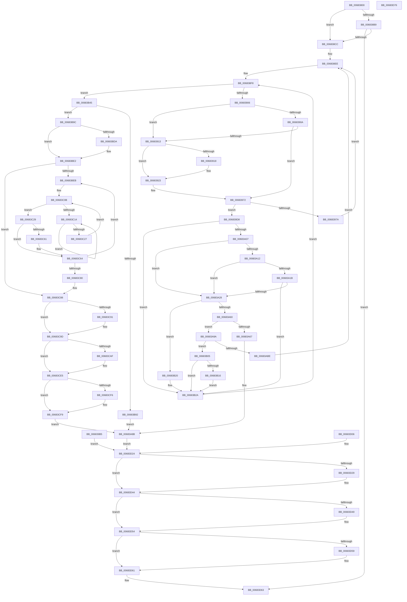

# MiPrepareImagePagesForHotPatch

- RVA: `0x00683800`–`0x00683D77` (길이 `1,399` bytes)
- VA: `0x0000000140683800`
- 실행 섹션: `.text`
- PDB 이름 있음: `예`; PDB Function 태그: `아니요`
- unwind 정보 RVA: `0x000D856C`
- 디코드: `336`개 명령, `1,399/1,399` bytes 표시
- 미해석 바이트: `0` (있으면 어셈블리에 `.byte`로 보존)

> 이 문서는 커널 이미지의 기계어와 PDB 기호를 분석해 생성했습니다. 4번과 5번은 함수 원형과 자료형을 바이너리 사용 방식에서 추정한 C 해석이며 원본 소스 복구 결과는 아닙니다.

## 1. Dependencies

- 직접 호출 지점: **26**; 고유 호출 대상: **17**
- 직접 호출자로 확인된 함수: **2**
- RIP 상대 이미지 참조: **1**

### Outgoing calls
- `0x006838AA` → [MiCountSharedPages](../2C/MiCountSharedPages_function_002C30A4.md) (function, `0x002C30A4`)
- `0x006838BF` → [MiChargeFullProcessCommitment](../../page/88/MiChargeFullProcessCommitment_function_00887630.md) (function, `0x00887630`)
- `0x006838E2` → [MiLockWorkingSetShared](../27/MiLockWorkingSetShared_function_0027CBF0.md) (function, `0x0027CBF0`)
- `0x0068391E` → [MiUnlockPageTable](../21/MiUnlockPageTable_function_00216EC0.md) (function, `0x00216EC0`)
- `0x0068395E` → [MiMakeSystemAddressValid](../27/MiMakeSystemAddressValid_function_0027FF70.md) (function, `0x0027FF70`)
- `0x00683980` → [MiUnlockPageTable](../21/MiUnlockPageTable_function_00216EC0.md) (function, `0x00216EC0`)
- `0x0068398F` → [MiUnlockWorkingSetShared](../27/MiUnlockWorkingSetShared_function_0027D690.md) (function, `0x0027D690`)
- `0x006839AB` → [MiLockWorkingSetShared](../27/MiLockWorkingSetShared_function_0027CBF0.md) (function, `0x0027CBF0`)
- `0x00683A45` → [MiGetProtoPteAddress](../32/MiGetProtoPteAddress_function_0032E970.md) (function, `0x0032E970`)
- `0x00683A6D` → [MiUnlockPageTable](../21/MiUnlockPageTable_function_00216EC0.md) (function, `0x00216EC0`)
- `0x00683A7C` → [MiUnlockWorkingSetShared](../27/MiUnlockWorkingSetShared_function_0027D690.md) (function, `0x0027D690`)
- `0x00683AB3` → [MiCopyOnWrite](../36/MiCopyOnWrite_function_00362A0C.md) (function, `0x00362A0C`)
- `0x00683AC4` → [MiUnlockPageTable](../21/MiUnlockPageTable_function_00216EC0.md) (function, `0x00216EC0`)
- `0x00683AD3` → [MiUnlockWorkingSetShared](../27/MiUnlockWorkingSetShared_function_0027D690.md) (function, `0x0027D690`)
- `0x00683AE5` → [MiCopyOnWriteCheckConditions](../2A/MiCopyOnWriteCheckConditions_function_002A750C.md) (function, `0x002A750C`)
- `0x00683AF6` → [MiLockWorkingSetShared](../27/MiLockWorkingSetShared_function_0027CBF0.md) (function, `0x0027CBF0`)
- `0x00683B4B` → [MiUnlockPageTable](../21/MiUnlockPageTable_function_00216EC0.md) (function, `0x00216EC0`)
- `0x00683B5A` → [MiUnlockWorkingSetShared](../27/MiUnlockWorkingSetShared_function_0027D690.md) (function, `0x0027D690`)
- `0x00683B80` → [IoAllocateMdl](../29/IoAllocateMdl_function_0029EBF0.md) (function, `0x0029EBF0`)
- `0x00683BA4` → [MmProbeAndLockPages](../23/MmProbeAndLockPages_function_0023B990.md) (function, `0x0023B990`)
- `0x00683BDD` → [KiRaiseIrqlProcessIrqlFlags](../4F/KiRaiseIrqlProcessIrqlFlags_function_004F56FC.md) (function, `0x004F56FC`)
- `0x00683C19` → [KeYieldProcessorEx](../3F/KeYieldProcessorEx_function_003FBD00.md) (function, `0x003FBD00`)
- `0x00683C98` → [KiLowerIrqlProcessIrqlFlags](../4F/KiLowerIrqlProcessIrqlFlags_function_004F5698.md) (function, `0x004F5698`)
- `0x00683CE0` → [MiLogHotPatchPagesLocked](../../page/80/MiLogHotPatchPagesLocked_function_008055FC.md) (function, `0x008055FC`)
- `0x00683D4F` → [MiReturnFullProcessCommitment](../../page/9E/MiReturnFullProcessCommitment_function_009E5D58.md) (function, `0x009E5D58`)
- `0x00683D5C` → [IoFreeMdl](../29/IoFreeMdl_function_0029EA80.md) (function, `0x0029EA80`)

### Direct callers
- [MiPrepareToHotPatchImage](../../page/80/MiPrepareToHotPatchImage_function_00806820.md) at `0x00806BAA`
- [MiPrepareToHotPatchImage](../../page/80/MiPrepareToHotPatchImage_function_00806820.md) at `0x00806D62`
- [MmPrepareImagePagesForHotPatch](../../page/80/MmPrepareImagePagesForHotPatch_function_008074E8.md) at `0x008075B2`

### Static image references
- `0x00683BD1` → RVA `0x00FC6D20` (`ALMOSTRO`; read)

## 2. Other-region calls and transfers

- 다른 실행 섹션으로 향하는 call: **3**
  - `0x006838BF` → [MiChargeFullProcessCommitment](../../page/88/MiChargeFullProcessCommitment_function_00887630.md) (`.text` → `PAGE`)
  - `0x00683CE0` → [MiLogHotPatchPagesLocked](../../page/80/MiLogHotPatchPagesLocked_function_008055FC.md) (`.text` → `PAGE`)
  - `0x00683D4F` → [MiReturnFullProcessCommitment](../../page/9E/MiReturnFullProcessCommitment_function_009E5D58.md) (`.text` → `PAGE`)
- 별도 외부 분기/꼬리 이동을 확인하지 못했습니다.

## 3. Assembly (complete function range)

```asm
00683800  48 8B C4                        mov rax, rsp
00683803  4C 89 40 18                     mov qword ptr [rax + 0x18], r8
00683807  48 89 50 10                     mov qword ptr [rax + 0x10], rdx
0068380B  48 89 48 08                     mov qword ptr [rax + 8], rcx
0068380F  53                              push rbx
00683810  56                              push rsi
00683811  57                              push rdi
00683812  41 54                           push r12
00683814  41 55                           push r13
00683816  41 56                           push r14
00683818  41 57                           push r15
0068381A  48 81 EC A0 00 00 00            sub rsp, 0xa0
00683821  4C 8B E2                        mov r12, rdx
00683824  48 83 60 B8 00                  and qword ptr [rax - 0x48], 0
00683829  48 83 60 98 00                  and qword ptr [rax - 0x68], 0
0068382E  65 48 8B 04 25 88 01 00 00      mov rax, qword ptr gs:[0x188]
00683837  48 8B 98 B8 00 00 00            mov rbx, qword ptr [rax + 0xb8]
0068383E  48 89 5C 24 58                  mov qword ptr [rsp + 0x58], rbx
00683843  48 89 5C 24 78                  mov qword ptr [rsp + 0x78], rbx
00683848  4C 8D BB 00 04 00 00            lea r15, [rbx + 0x400]
0068384F  48 8B 39                        mov rdi, qword ptr [rcx]
00683852  48 89 7C 24 38                  mov qword ptr [rsp + 0x38], rdi
00683857  48 89 BC 24 80 00 00 00         mov qword ptr [rsp + 0x80], rdi
0068385F  33 F6                           xor esi, esi
00683861  48 89 74 24 68                  mov qword ptr [rsp + 0x68], rsi
00683866  4C 8B F2                        mov r14, rdx
00683869  49 C1 EE 09                     shr r14, 9
0068386D  48 B8 F8 FF FF FF 7F 00 00 00   movabs rax, 0x7ffffffff8
00683877  4C 23 F0                        and r14, rax
0068387A  48 B8 00 00 00 00 80 F6 FF FF   movabs rax, 0xfffff68000000000
00683884  48 8B C0                        mov rax, rax
00683887  4C 03 F0                        add r14, rax
0068388A  49 FF C8                        dec r8
0068388D  4B 8D 04 C6                     lea rax, [r14 + r8*8]
00683891  48 89 84 24 88 00 00 00         mov qword ptr [rsp + 0x88], rax
00683899  45 33 ED                        xor r13d, r13d
0068389C  4C 89 6C 24 60                  mov qword ptr [rsp + 0x60], r13
006838A1  4C 8B C0                        mov r8, rax
006838A4  49 8B D6                        mov rdx, r14
006838A7  48 8B CF                        mov rcx, rdi
006838AA  E8 F5 F7 C3 FF                  call 0x1402c30a4
006838AF  48 89 44 24 48                  mov qword ptr [rsp + 0x48], rax
006838B4  48 85 C0                        test rax, rax
006838B7  74 13                           je 0x1406838cc
006838B9  48 8B D0                        mov rdx, rax
006838BC  48 8B CB                        mov rcx, rbx
006838BF  E8 6C 3D 20 00                  call 0x140887630
006838C4  85 C0                           test eax, eax
006838C6  0F 88 97 04 00 00               js 0x140683d63
006838CC  4C 89 64 24 40                  mov qword ptr [rsp + 0x40], r12
006838D1  45 33 E4                        xor r12d, r12d
006838D4  41 8D 44 24 01                  lea eax, [r12 + 1]
006838D9  8B D8                           mov ebx, eax
006838DB  89 44 24 30                     mov dword ptr [rsp + 0x30], eax
006838DF  49 8B CF                        mov rcx, r15
006838E2  E8 09 93 BF FF                  call 0x14027cbf0
006838E7  88 84 24 F8 00 00 00            mov byte ptr [rsp + 0xf8], al
006838EE  48 BA 00 00 00 00 00 DE FF FF   movabs rdx, 0xffffde0000000000
006838F8  4C 3B B4 24 88 00 00 00         cmp r14, qword ptr [rsp + 0x88]
00683900  0F 87 3F 02 00 00               ja 0x140683b45
00683906  85 DB                           test ebx, ebx
00683908  75 09                           jne 0x140683913
0068390A  49 F7 C6 FF 0F 00 00            test r14, 0xfff
00683911  75 5F                           jne 0x140683972
00683913  4D 85 E4                        test r12, r12
00683916  74 0B                           je 0x140683923
00683918  49 8B D4                        mov rdx, r12
0068391B  49 8B CF                        mov rcx, r15
0068391E  E8 9D 35 B9 FF                  call 0x140216ec0
00683923  4D 8B E6                        mov r12, r14
00683926  49 C1 EC 09                     shr r12, 9
0068392A  48 B8 F8 FF FF FF 7F 00 00 00   movabs rax, 0x7ffffffff8
00683934  4C 23 E0                        and r12, rax
00683937  48 B8 00 00 00 00 80 F6 FF FF   movabs rax, 0xfffff68000000000
00683941  48 8B C0                        mov rax, rax
00683944  4C 03 E0                        add r12, rax
00683947  8B 57 30                        mov edx, dword ptr [rdi + 0x30]
0068394A  C1 EA 0C                        shr edx, 0xc
0068394D  83 E2 7F                        and edx, 0x7f
00683950  45 33 C9                        xor r9d, r9d
00683953  44 8A 84 24 F8 00 00 00         mov r8b, byte ptr [rsp + 0xf8]
0068395B  49 8B CE                        mov rcx, r14
0068395E  E8 0D C6 BF FF                  call 0x14027ff70
00683963  83 64 24 30 00                  and dword ptr [rsp + 0x30], 0
00683968  48 BA 00 00 00 00 00 DE FF FF   movabs rdx, 0xffffde0000000000
00683972  49 8B 1E                        mov rbx, qword ptr [r14]
00683975  F6 C3 01                        test bl, 1
00683978  75 5E                           jne 0x1406839d8
0068397A  49 8B D4                        mov rdx, r12
0068397D  49 8B CF                        mov rcx, r15
00683980  E8 3B 35 B9 FF                  call 0x140216ec0
00683985  8A 94 24 F8 00 00 00            mov dl, byte ptr [rsp + 0xf8]
0068398C  49 8B CF                        mov rcx, r15
0068398F  E8 FC 9C BF FF                  call 0x14027d690
00683994  45 33 E4                        xor r12d, r12d
00683997  48 8B 44 24 40                  mov rax, qword ptr [rsp + 0x40]
0068399C  48 8B 00                        mov rax, qword ptr [rax]
0068399F  BB 01 00 00 00                  mov ebx, 1
006839A4  89 5C 24 30                     mov dword ptr [rsp + 0x30], ebx
006839A8  49 8B CF                        mov rcx, r15
006839AB  E8 40 92 BF FF                  call 0x14027cbf0
006839B0  E9 39 FF FF FF                  jmp 0x1406838ee
006839B5  8B D8                           mov ebx, eax
006839B7  4C 8B 4C 24 78                  mov r9, qword ptr [rsp + 0x78]
006839BC  4C 8B 44 24 48                  mov r8, qword ptr [rsp + 0x48]
006839C1  4C 8B 6C 24 60                  mov r13, qword ptr [rsp + 0x60]
006839C6  48 8B 74 24 68                  mov rsi, qword ptr [rsp + 0x68]
006839CB  48 8B BC 24 80 00 00 00         mov rdi, qword ptr [rsp + 0x80]
006839D3  E9 4C 03 00 00                  jmp 0x140683d24
006839D8  48 8B C3                        mov rax, rbx
006839DB  48 C1 E8 0C                     shr rax, 0xc
006839DF  48 B9 FF FF FF FF FF 00 00 00   movabs rcx, 0xffffffffff
006839E9  48 23 C1                        and rax, rcx
006839EC  48 8D 3C 40                     lea rdi, [rax + rax*2]
006839F0  48 C1 E7 04                     shl rdi, 4
006839F4  48 8B C2                        mov rax, rdx
006839F7  48 03 F8                        add rdi, rax
006839FA  48 8B 47 28                     mov rax, qword ptr [rdi + 0x28]
006839FE  48 85 C0                        test rax, rax
00683A01  0F 89 23 01 00 00               jns 0x140683b2a
00683A07  48 8B 47 28                     mov rax, qword ptr [rdi + 0x28]
00683A0B  48 0F BA E0 28                  bt rax, 0x28
00683A10  72 16                           jb 0x140683a28
00683A12  48 8B 47 08                     mov rax, qword ptr [rdi + 8]
00683A16  48 85 C0                        test rax, rax
00683A19  78 0D                           js 0x140683a28
00683A1B  48 8B 47 08                     mov rax, qword ptr [rdi + 8]
00683A1F  48 85 C0                        test rax, rax
00683A22  0F 85 02 01 00 00               jne 0x140683b2a
00683A28  48 8B 7F 08                     mov rdi, qword ptr [rdi + 8]
00683A2C  48 8B 54 24 40                  mov rdx, qword ptr [rsp + 0x40]
00683A31  48 C1 EA 0C                     shr rdx, 0xc
00683A35  4C 8D 8C 24 90 00 00 00         lea r9, [rsp + 0x90]
00683A3D  45 33 C0                        xor r8d, r8d
00683A40  48 8B 4C 24 38                  mov rcx, qword ptr [rsp + 0x38]
00683A45  E8 26 AF CA FF                  call 0x14032e970
00683A4A  48 B9 00 00 00 00 00 00 00 80   movabs rcx, 0x8000000000000000
00683A54  48 0B F9                        or rdi, rcx
00683A57  48 3B F8                        cmp rdi, rax
00683A5A  0F 85 C0 00 00 00               jne 0x140683b20
00683A60  48 0F BA E3 0B                  bt rbx, 0xb
00683A65  73 33                           jae 0x140683a9a
00683A67  49 8B D4                        mov rdx, r12
00683A6A  49 8B CF                        mov rcx, r15
00683A6D  E8 4E 34 B9 FF                  call 0x140216ec0
00683A72  8A 94 24 F8 00 00 00            mov dl, byte ptr [rsp + 0xf8]
00683A79  49 8B CF                        mov rcx, r15
00683A7C  E8 0F 9C BF FF                  call 0x14027d690
00683A81  BB 45 00 00 C0                  mov ebx, 0xc0000045
00683A86  48 8B 7C 24 38                  mov rdi, qword ptr [rsp + 0x38]
00683A8B  4C 8B 44 24 48                  mov r8, qword ptr [rsp + 0x48]
00683A90  4C 8B 4C 24 58                  mov r9, qword ptr [rsp + 0x58]
00683A95  E9 8A 02 00 00                  jmp 0x140683d24
00683A9A  48 8D 44 24 70                  lea rax, [rsp + 0x70]
00683A9F  48 89 44 24 20                  mov qword ptr [rsp + 0x20], rax
00683AA4  45 33 C9                        xor r9d, r9d
00683AA7  49 83 C8 FF                     or r8, 0xffffffffffffffff
00683AAB  49 8B D6                        mov rdx, r14
00683AAE  48 8B 4C 24 40                  mov rcx, qword ptr [rsp + 0x40]
00683AB3  E8 54 EF CD FF                  call 0x140362a0c
00683AB8  8B F8                           mov edi, eax
00683ABA  85 C0                           test eax, eax
00683ABC  79 47                           jns 0x140683b05
00683ABE  49 8B D4                        mov rdx, r12
00683AC1  49 8B CF                        mov rcx, r15
00683AC4  E8 F7 33 B9 FF                  call 0x140216ec0
00683AC9  8A 94 24 F8 00 00 00            mov dl, byte ptr [rsp + 0xf8]
00683AD0  49 8B CF                        mov rcx, r15
00683AD3  E8 B8 9B BF FF                  call 0x14027d690
00683AD8  45 33 E4                        xor r12d, r12d
00683ADB  4C 8B 44 24 70                  mov r8, qword ptr [rsp + 0x70]
00683AE0  8B D7                           mov edx, edi
00683AE2  49 8B CF                        mov rcx, r15
00683AE5  E8 22 3A C2 FF                  call 0x1402a750c
00683AEA  41 8D 5C 24 01                  lea ebx, [r12 + 1]
00683AEF  89 5C 24 30                     mov dword ptr [rsp + 0x30], ebx
00683AF3  49 8B CF                        mov rcx, r15
00683AF6  E8 F5 90 BF FF                  call 0x14027cbf0
00683AFB  48 8B 7C 24 38                  mov rdi, qword ptr [rsp + 0x38]
00683B00  E9 E9 FD FF FF                  jmp 0x1406838ee
00683B05  48 BA 00 00 00 00 00 DE FF FF   movabs rdx, 0xffffde0000000000
00683B0F  48 0F BA E3 09                  bt rbx, 9
00683B14  72 14                           jb 0x140683b2a
00683B16  49 FF C5                        inc r13
00683B19  4C 89 6C 24 60                  mov qword ptr [rsp + 0x60], r13
00683B1E  EB 0A                           jmp 0x140683b2a
00683B20  48 BA 00 00 00 00 00 DE FF FF   movabs rdx, 0xffffde0000000000
00683B2A  49 83 C6 08                     add r14, 8
00683B2E  48 81 44 24 40 00 10 00 00      add qword ptr [rsp + 0x40], 0x1000
00683B37  48 8B 7C 24 38                  mov rdi, qword ptr [rsp + 0x38]
00683B3C  8B 5C 24 30                     mov ebx, dword ptr [rsp + 0x30]
00683B40  E9 B3 FD FF FF                  jmp 0x1406838f8
00683B45  49 8B D4                        mov rdx, r12
00683B48  49 8B CF                        mov rcx, r15
00683B4B  E8 70 33 B9 FF                  call 0x140216ec0
00683B50  8A 94 24 F8 00 00 00            mov dl, byte ptr [rsp + 0xf8]
00683B57  49 8B CF                        mov rcx, r15
00683B5A  E8 31 9B BF FF                  call 0x14027d690
00683B5F  48 8B 9C 24 F0 00 00 00         mov rbx, qword ptr [rsp + 0xf0]
00683B67  8B D3                           mov edx, ebx
00683B69  C1 E2 0C                        shl edx, 0xc
00683B6C  48 83 64 24 20 00               and qword ptr [rsp + 0x20], 0
00683B72  45 33 C9                        xor r9d, r9d
00683B75  45 33 C0                        xor r8d, r8d
00683B78  48 8B 8C 24 E8 00 00 00         mov rcx, qword ptr [rsp + 0xe8]
00683B80  E8 6B B0 C1 FF                  call 0x14029ebf0
00683B85  48 8B F0                        mov rsi, rax
00683B88  48 89 44 24 68                  mov qword ptr [rsp + 0x68], rax
00683B8D  48 85 C0                        test rax, rax
00683B90  75 0A                           jne 0x140683b9c
00683B92  BB 9A 00 00 C0                  mov ebx, 0xc000009a
00683B97  E9 EF FE FF FF                  jmp 0x140683a8b
00683B9C  45 33 C0                        xor r8d, r8d
00683B9F  33 D2                           xor edx, edx
00683BA1  48 8B CE                        mov rcx, rsi
00683BA4  E8 E7 7D BB FF                  call 0x14023b990
00683BA9  B8 80 00 00 00                  mov eax, 0x80
00683BAE  66 0B 46 0A                     or ax, word ptr [rsi + 0xa]
00683BB2  66 89 46 0A                     mov word ptr [rsi + 0xa], ax
00683BB6  45 33 F6                        xor r14d, r14d
00683BB9  48 8D 7E 30                     lea rdi, [rsi + 0x30]
00683BBD  4C 8D 63 06                     lea r12, [rbx + 6]
00683BC1  4E 8D 24 E6                     lea r12, [rsi + r12*8]
00683BC5  45 0F 20 C7                     mov r15, cr8
00683BC9  41 8D 56 02                     lea edx, [r14 + 2]
00683BCD  44 0F 22 C2                     mov cr8, rdx
00683BD1  44 39 35 48 31 94 00            cmp dword ptr [rip + 0x943148], r14d
00683BD8  74 08                           je 0x140683be2
00683BDA  41 8A CF                        mov cl, r15b
00683BDD  E8 1A 1B E7 FF                  call 0x1404f56fc
00683BE2  49 3B FC                        cmp rdi, r12
00683BE5  0F 83 9D 00 00 00               jae 0x140683c88
00683BEB  48 8B 07                        mov rax, qword ptr [rdi]
00683BEE  48 8D 1C 40                     lea rbx, [rax + rax*2]
00683BF2  48 C1 E3 04                     shl rbx, 4
00683BF6  48 B8 00 00 00 00 00 DE FF FF   movabs rax, 0xffffde0000000000
00683C00  48 8B C0                        mov rax, rax
00683C03  48 03 D8                        add rbx, rax
00683C06  83 64 24 50 00                  and dword ptr [rsp + 0x50], 0
00683C0B  F0 48 0F BA 6B 18 3F            lock bts qword ptr [rbx + 0x18], 0x3f
00683C12  73 15                           jae 0x140683c29
00683C14  48 8D 4C 24 50                  lea rcx, [rsp + 0x50]
00683C19  E8 E2 80 D7 FF                  call 0x1403fbd00
00683C1E  48 8B 43 18                     mov rax, qword ptr [rbx + 0x18]
00683C22  48 85 C0                        test rax, rax
00683C25  78 ED                           js 0x140683c14
00683C27  EB E2                           jmp 0x140683c0b
00683C29  48 8B 43 18                     mov rax, qword ptr [rbx + 0x18]
00683C2D  48 B9 FF FF FF FF FF FF FF 3F   movabs rcx, 0x3fffffffffffffff
00683C37  48 23 C1                        and rax, rcx
00683C3A  48 F7 D8                        neg rax
00683C3D  66 1B D2                        sbb dx, dx
00683C40  66 F7 DA                        neg dx
00683C43  41 B8 01 00 00 00               mov r8d, 1
00683C49  66 41 03 D0                     add dx, r8w
00683C4D  41 8D 0C 10                     lea ecx, [r8 + rdx]
00683C51  F6 43 22 08                     test byte ptr [rbx + 0x22], 8
00683C55  66 0F 44 CA                     cmove cx, dx
00683C59  8B 43 20                        mov eax, dword ptr [rbx + 0x20]
00683C5C  66 3B C1                        cmp ax, cx
00683C5F  76 03                           jbe 0x140683c64
00683C61  4D 03 F0                        add r14, r8
00683C64  48 B8 FF FF FF FF FF FF FF 7F   movabs rax, 0x7fffffffffffffff
00683C6E  F0 48 21 43 18                  lock and qword ptr [rbx + 0x18], rax
00683C73  48 83 C7 08                     add rdi, 8
00683C77  49 3B FC                        cmp rdi, r12
00683C7A  0F 82 6B FF FF FF               jb 0x140683beb
00683C80  48 8B 9C 24 F0 00 00 00         mov rbx, qword ptr [rsp + 0xf0]
00683C88  83 3D 91 30 94 00 00            cmp dword ptr [rip + 0x943091], 0
00683C8F  74 0C                           je 0x140683c9d
00683C91  44 0F 20 C1                     mov rcx, cr8
00683C95  41 8A D7                        mov dl, r15b
00683C98  E8 FB 19 E7 FF                  call 0x1404f5698
00683C9D  41 0F B6 C7                     movzx eax, r15b
00683CA1  44 0F 22 C0                     mov cr8, rax
00683CA5  48 8B 7C 24 38                  mov rdi, qword ptr [rsp + 0x38]
00683CAA  4D 85 F6                        test r14, r14
00683CAD  74 36                           je 0x140683ce5
00683CAF  48 8B 47 48                     mov rax, qword ptr [rdi + 0x48]
00683CB3  48 8B 08                        mov rcx, qword ptr [rax]
00683CB6  48 8B 01                        mov rax, qword ptr [rcx]
00683CB9  4C 8B 40 38                     mov r8, qword ptr [rax + 0x38]
00683CBD  48 C1 E3 0C                     shl rbx, 0xc
00683CC1  48 8B 84 24 E8 00 00 00         mov rax, qword ptr [rsp + 0xe8]
00683CC9  48 8D 50 FF                     lea rdx, [rax - 1]
00683CCD  48 03 D3                        add rdx, rbx
00683CD0  44 89 74 24 20                  mov dword ptr [rsp + 0x20], r14d
00683CD5  45 8B 48 48                     mov r9d, dword ptr [r8 + 0x48]
00683CD9  45 8B 40 3C                     mov r8d, dword ptr [r8 + 0x3c]
00683CDD  48 8B C8                        mov rcx, rax
00683CE0  E8 17 19 18 00                  call 0x1408055fc
00683CE5  48 8B 8C 24 E0 00 00 00         mov rcx, qword ptr [rsp + 0xe0]
00683CED  48 8B 41 38                     mov rax, qword ptr [rcx + 0x38]
00683CF1  48 85 C0                        test rax, rax
00683CF4  74 03                           je 0x140683cf9
00683CF6  48 89 06                        mov qword ptr [rsi], rax
00683CF9  48 89 71 38                     mov qword ptr [rcx + 0x38], rsi
00683CFD  33 F6                           xor esi, esi
00683CFF  33 DB                           xor ebx, ebx
00683D01  E9 85 FD FF FF                  jmp 0x140683a8b
00683D06  8B D8                           mov ebx, eax
00683D08  4C 8B 4C 24 78                  mov r9, qword ptr [rsp + 0x78]
00683D0D  4C 8B 44 24 48                  mov r8, qword ptr [rsp + 0x48]
00683D12  4C 8B 6C 24 60                  mov r13, qword ptr [rsp + 0x60]
00683D17  48 8B 74 24 68                  mov rsi, qword ptr [rsp + 0x68]
00683D1C  48 8B BC 24 80 00 00 00         mov rdi, qword ptr [rsp + 0x80]
00683D24  4D 85 ED                        test r13, r13
00683D27  74 1B                           je 0x140683d44
00683D29  8B 4F 34                        mov ecx, dword ptr [rdi + 0x34]
00683D2C  0F B6 57 22                     movzx edx, byte ptr [rdi + 0x22]
00683D30  48 C1 E2 20                     shl rdx, 0x20
00683D34  48 0B D1                        or rdx, rcx
00683D37  49 03 D5                        add rdx, r13
00683D3A  89 57 34                        mov dword ptr [rdi + 0x34], edx
00683D3D  48 C1 EA 20                     shr rdx, 0x20
00683D41  88 57 22                        mov byte ptr [rdi + 0x22], dl
00683D44  4D 2B C5                        sub r8, r13
00683D47  74 0B                           je 0x140683d54
00683D49  49 8B D0                        mov rdx, r8
00683D4C  49 8B C9                        mov rcx, r9
00683D4F  E8 04 20 36 00                  call 0x1409e5d58
00683D54  48 85 F6                        test rsi, rsi
00683D57  74 08                           je 0x140683d61
00683D59  48 8B CE                        mov rcx, rsi
00683D5C  E8 1F AD C1 FF                  call 0x14029ea80
00683D61  8B C3                           mov eax, ebx
00683D63  48 81 C4 A0 00 00 00            add rsp, 0xa0
00683D6A  41 5F                           pop r15
00683D6C  41 5E                           pop r14
00683D6E  41 5D                           pop r13
00683D70  41 5C                           pop r12
00683D72  5F                              pop rdi
00683D73  5E                              pop rsi
00683D74  5B                              pop rbx
00683D75  C3                              ret
00683D76  CC                              int3
```

## 4. C-style interpretation (structured pseudocode)

```c
__int64 __fastcall MiPrepareImagePagesForHotPatch(__int64 a1, __int64 a2, __int64 a3, int a4)
{
    __int64 result;
    __int64 v_r12;
    __int64 v_r13;
    __int64 v_r14;
    __int64 v_rbx;
    __int64 v_rdi;
    __int64 v_rsi;
    __int64 v_rsp;
    unsigned __int64 v_stack_m48;
    unsigned __int64 v_stack_m50;
    unsigned __int64 v_stack_m58;
    unsigned __int64 v_stack_m60;
    unsigned __int64 v_stack_m68;
    unsigned __int64 v_stack_m70;
    unsigned __int64 v_stack_m78;
    unsigned __int64 v_stack_m80;
    unsigned int v_stack_m88;
    unsigned __int64 v_stack_m90;
    unsigned __int64 v_stack_m98;
    unsigned __int64 v_stack_mA0;
    unsigned int v_stack_mA8;
    unsigned __int64 v_stack_mB8;
    unsigned __int64 v_stack_p10;
    unsigned __int64 v_stack_p18;
    unsigned __int8 v_stack_p20;
    unsigned __int64 v_stack_p8;

    *(unsigned __int64 *)(v_rsp + 24) = a3;
    *(unsigned __int64 *)(v_rsp + 16) = a2;
    *(unsigned __int64 *)(v_rsp + 8) = a1;
    v_rsp = (v_rsp) - (160);
    v_stack_m80 = *(unsigned __int64 *)(*(unsigned __int64 *)(gs_base + (0 + 392)) + 184);
    v_stack_m60 = *(unsigned __int64 *)(*(unsigned __int64 *)(gs_base + (0 + 392)) + 184);
    v_stack_mA0 = *(unsigned __int64 *)(a1);
    v_stack_m58 = *(unsigned __int64 *)(a1);
    v_rsi = 0;
    v_stack_m70 = 0;
    v_r14 = (a2) >> (9);
    v_r14 = (v_r14) & (*(unsigned __int64 *)(gs_base + (0 + 392)));
    v_r14 = (v_r14) + (*(unsigned __int64 *)(gs_base + (0 + 392)));
    a3 = (a3) - 1;
    v_stack_m50 = v_r14 + a3 * 8;
    v_r13 = 0;
    v_stack_m78 = 0;
    result = MiCountSharedPages(*(unsigned __int64 *)(a1), v_r14, v_r14 + a3 * 8, a4);
    v_stack_m90 = result;
    if (result == 0) goto loc_006838CC;
    result = MiChargeFullProcessCommitment(*(unsigned __int64 *)(*(unsigned __int64 *)(gs_base + (0 + 392)) + 184), result, v_r14 + a3 * 8, a4);
    if (sign_flag) goto loc_00683D63;
loc_006838CC:
    v_stack_m98 = a2;
    v_r12 = 0;
    v_stack_mA8 = (unsigned int)(v_r12 + 1);
    result = MiLockWorkingSetShared(*(unsigned __int64 *)(*(unsigned __int64 *)(gs_base + (0 + 392)) + 184) + 1024, result, v_r14 + a3 * 8, a4);
    v_stack_p20 = (unsigned __int8)(result);
loc_006838EE:
loc_006838F8:
    if (v_r14 > v_stack_m50) goto loc_00683B45;
    if ((unsigned int)((unsigned int)((unsigned int)(v_r12 + 1))) != 0) goto loc_00683913;
    if (((v_r14) & (0xFFFULL)) != 0) goto loc_00683972;
loc_00683913:
    if (0 != 0) {
        a2 = 0;
        a1 = *(unsigned __int64 *)(*(unsigned __int64 *)(gs_base + (0 + 392)) + 184) + 1024;
        result = MiUnlockPageTable(a1, a2, v_r14 + a3 * 8, a4);
    }
    v_r12 = (v_r14) >> (9);
    v_r12 = (v_r12) & (result);
    v_r12 = (v_r12) + (result);
    a2 = (unsigned int)(((unsigned int)(*(unsigned int *)(*(unsigned __int64 *)(a1) + 48))) >> (12));
    a2 = (unsigned int)((a2) & (127));
    a4 = 0;
    result = MiMakeSystemAddressValid(v_r14, a2, v_stack_p20, a4);
loc_00683972:
    if ((((unsigned __int8)(*(unsigned __int64 *)(v_r14))) & (1)) != 0) goto loc_006839D8;
    result = MiUnlockPageTable(*(unsigned __int64 *)(*(unsigned __int64 *)(gs_base + (0 + 392)) + 184) + 1024, v_r12, v_stack_p20, a4);
    result = MiUnlockWorkingSetShared(*(unsigned __int64 *)(*(unsigned __int64 *)(gs_base + (0 + 392)) + 184) + 1024, v_stack_p20, v_stack_p20, a4);
    v_r12 = 0;
    v_stack_mA8 = 1;
    result = MiLockWorkingSetShared(*(unsigned __int64 *)(*(unsigned __int64 *)(gs_base + (0 + 392)) + 184) + 1024, v_stack_p20, v_stack_p20, a4);
    goto loc_006838EE;
loc_006839D8:
    result = (1) >> (12);
    result = (result) & (*(unsigned __int64 *)(*(unsigned __int64 *)(gs_base + (0 + 392)) + 184) + 1024);
    v_rdi = (result + result * 2) << (4);
    v_rdi = (v_rdi) + (v_stack_p20);
    if (!sign_flag) goto loc_00683B2A;
    if (condition_is_below) goto loc_00683A28;
    if (sign_flag) goto loc_00683A28;
    if (*(unsigned __int64 *)(v_rdi + 8) != 0) goto loc_00683B2A;
loc_00683A28:
    a2 = (v_stack_m98) >> (12);
    a3 = 0;
    result = MiGetProtoPteAddress(v_stack_mA0, a2, a3, v_stack_m48);
    v_rdi = (*(unsigned __int64 *)(v_rdi + 8)) | (v_stack_mA0);
    if (v_rdi != result) goto loc_00683B20;
    if (v_rdi >= result) goto loc_00683A9A;
    result = MiUnlockPageTable(*(unsigned __int64 *)(*(unsigned __int64 *)(gs_base + (0 + 392)) + 184) + 1024, 0, a3, v_stack_m48);
    result = MiUnlockWorkingSetShared(*(unsigned __int64 *)(*(unsigned __int64 *)(gs_base + (0 + 392)) + 184) + 1024, v_stack_p20, a3, v_stack_m48);
loc_00683A8B:
    goto loc_00683D24;
loc_00683A9A:
    v_stack_mB8 = v_stack_m68;
    a4 = 0;
    a3 = (v_stack_m90) | (-1);
    result = MiCopyOnWrite(v_stack_m98, v_r14, a3, a4);
    if (!sign_flag) goto loc_00683B05;
    result = MiUnlockPageTable(*(unsigned __int64 *)(*(unsigned __int64 *)(gs_base + (0 + 392)) + 184) + 1024, 0, a3, a4);
    result = MiUnlockWorkingSetShared(*(unsigned __int64 *)(*(unsigned __int64 *)(gs_base + (0 + 392)) + 184) + 1024, v_stack_p20, a3, a4);
    v_r12 = 0;
    result = MiCopyOnWriteCheckConditions(*(unsigned __int64 *)(*(unsigned __int64 *)(gs_base + (0 + 392)) + 184) + 1024, (unsigned int)((unsigned int)((unsigned int)((unsigned int)(result)))), v_stack_m68, a4);
    v_stack_mA8 = (unsigned int)(v_r12 + 1);
    result = MiLockWorkingSetShared(*(unsigned __int64 *)(*(unsigned __int64 *)(gs_base + (0 + 392)) + 184) + 1024, (unsigned int)((unsigned int)((unsigned int)((unsigned int)(result)))), v_stack_m68, a4);
    goto loc_006838EE;
loc_00683B05:
    if (condition_is_below) goto loc_00683B2A;
    v_r13 = (v_r13) + 1;
    v_stack_m78 = v_r13;
    goto loc_00683B2A;
loc_00683B20:
loc_00683B2A:
    v_r14 = (v_r14) + (8);
    goto loc_006838F8;
loc_00683B45:
    result = MiUnlockPageTable(*(unsigned __int64 *)(*(unsigned __int64 *)(gs_base + (0 + 392)) + 184) + 1024, 0, v_stack_m68, a4);
    result = MiUnlockWorkingSetShared(*(unsigned __int64 *)(*(unsigned __int64 *)(gs_base + (0 + 392)) + 184) + 1024, v_stack_p20, v_stack_m68, a4);
    a2 = (unsigned int)(((unsigned int)((unsigned int)(v_stack_p18))) << (12));
    a4 = 0;
    a3 = 0;
    result = IoAllocateMdl(v_stack_p10, a2, a3, a4);
    v_stack_m70 = result;
    if (result != 0) goto loc_00683B9C;
    goto loc_00683A8B;
loc_00683B9C:
    a3 = 0;
    a2 = 0;
    result = MmProbeAndLockPages(result, a2, a3, a4);
    result = (unsigned __int16)((128) | (*(unsigned __int16 *)(result + 10)));
    *(unsigned __int16 *)(result + 10) = (unsigned __int16)(result);
    v_r14 = 0;
    if ((*(unsigned int *)(v_rip + 9711944)) != 0) {
        a1 = (unsigned __int8)(v_cr8);
        result = KiRaiseIrqlProcessIrqlFlags(a1, v_r14 + 2, a3, a4);
    }
    if ((result + 48) >= (result + (unsigned int)(0xC000009AULL) + 6 * 8)) goto loc_00683C88;
loc_00683BEB:
    v_rbx = (*(unsigned __int64 *)(result + 48) + *(unsigned __int64 *)(result + 48) * 2) << (4);
    v_rbx = (v_rbx) + (*(unsigned __int64 *)(result + 48));
loc_00683C0B:
    if (condition_is_above_or_equal) goto loc_00683C29;
loc_00683C14:
    result = KeYieldProcessorEx(v_stack_m88, v_r14 + 2, a3, a4);
    if (sign_flag) goto loc_00683C14;
    goto loc_00683C0B;
loc_00683C29:
    result = (*(unsigned __int64 *)(v_rbx + 24)) & (v_stack_m88);
    result = -(result);
    a2 = (unsigned __int16)(-(v_r14 + 2));
    a2 = (unsigned __int16)((a2) + (1));
    a1 = 1 + a2 * 1;
    if (((*(unsigned __int8 *)(v_rbx + 34)) & (8)) == 0) { a1 = (unsigned __int16)(a2); }
    if (((unsigned __int16)((unsigned int)(*(unsigned int *)(v_rbx + 32)))) >= = ((unsigned __int16)(a1))) {
        v_r14 = (v_r14) + (1);
    }
    v_rdi = (result + 48) + (8);
    if (v_rdi < (result + (unsigned int)(0xC000009AULL) + 6 * 8)) goto loc_00683BEB;
loc_00683C88:
    result = (unsigned int)(*(unsigned int *)(v_rbx + 32));
    if ((*(unsigned int *)(v_rip + 9711761)) != 0) {
        a1 = v_r14 + 2;
        a2 = (unsigned __int8)(v_cr8);
        result = KiLowerIrqlProcessIrqlFlags(a1, a2, 1, a4);
    }
    result = (unsigned __int8)(v_cr8);
    v_rbx = v_stack_p18;
    if (v_r14 != 0) {
        result = *(unsigned __int64 *)(v_stack_mA0 + 72);
        a1 = *(unsigned __int64 *)(result);
        result = *(unsigned __int64 *)(a1);
        a3 = *(unsigned __int64 *)(result + 56);
        v_rbx = (v_stack_p18) << (12);
        result = v_stack_p10;
        a2 = result - 1;
        a2 = (a2) + (v_rbx);
        v_stack_mB8 = (unsigned int)(v_r14);
        a4 = *(unsigned int *)(a3 + 72);
        a3 = *(unsigned int *)(a3 + 60);
        a1 = result;
        result = MiLogHotPatchPagesLocked(a1, a2, a3, a4);
    }
    if (*(unsigned __int64 *)(v_stack_p8 + 56) != 0) {
        *(unsigned __int64 *)(result) = *(unsigned __int64 *)(v_stack_p8 + 56);
    }
    *(unsigned __int64 *)(v_stack_p8 + 56) = result;
    v_rsi = 0;
    v_rbx = 0;
    goto loc_00683A8B;
loc_00683D24:
    if (v_r13 != 0) {
        a1 = *(unsigned int *)(v_stack_mA0 + 52);
        a2 = *(unsigned __int8 *)(v_stack_mA0 + 34);
        a2 = (a2) << (32);
        a2 = (a2) | (a1);
        a2 = (a2) + (v_r13);
        *(unsigned int *)(v_stack_mA0 + 52) = (unsigned int)(a2);
        a2 = (a2) >> (32);
        *(unsigned __int8 *)(v_stack_mA0 + 34) = (unsigned __int8)(a2);
    }
    a3 = (a3) - (v_r13);
    result = *(unsigned __int64 *)(v_stack_p8 + 56);
    if (!(condition_is_equal)) {
        a2 = a3;
        a1 = a4;
        result = MiReturnFullProcessCommitment(a1, a2, a3, a4);
    }
    if (0 != 0) {
        a1 = 0;
        result = IoFreeMdl(a1, a2, a3, a4);
    }
loc_00683D63:
    v_rsp = (v_rsp) + (160);
    return 0;
}
```

## 5. (Beta) C Style

```c
int64_t MiPrepareImagePagesForHotPatch(void *Arg1, int64_t Arg2, int64_t Arg3, int32_t Arg4)
{
    uint8_t *arg1 = (uint8_t *)Arg1;

    int64_t result;
    int64_t local_r12;
    int64_t local_r13;
    int64_t local_r14;
    int64_t local_rbx;
    int64_t local_rdi;
    int64_t local_rsi;
    int64_t local_rsp;
    uint64_t v_stack_m48;
    uint64_t v_stack_m50;
    uint64_t v_stack_m58;
    uint64_t v_stack_m60;
    uint64_t v_stack_m68;
    uint64_t v_stack_m70;
    uint64_t v_stack_m78;
    uint64_t v_stack_m80;
    uint32_t v_stack_m88;
    uint64_t v_stack_m90;
    uint64_t v_stack_m98;
    uint64_t v_stack_mA0;
    uint32_t v_stack_mA8;
    uint64_t v_stack_mB8;
    uint64_t v_stack_p10;
    uint64_t v_stack_p18;
    uint8_t v_stack_p20;
    uint64_t v_stack_p8;

    *(uint64_t *)(local_rsp + 0x18) = Arg3;
    *(uint64_t *)(local_rsp + 0x10) = Arg2;
    *(void **)(local_rsp + 0x8) = Arg1;
    local_rsp = (local_rsp) - (160);
    v_stack_m80 = *(uint64_t *)(*(uint64_t *)(gs_base + (0 + 0x188)) + 0xB8);
    v_stack_m60 = *(uint64_t *)(*(uint64_t *)(gs_base + (0 + 0x188)) + 0xB8);
    v_stack_mA0 = *(uint64_t *)(arg1);
    v_stack_m58 = *(uint64_t *)(arg1);
    local_rsi = 0;
    v_stack_m70 = 0;
    local_r14 = (Arg2) >> (9);
    local_r14 = (local_r14) & (*(uint64_t *)(gs_base + (0 + 0x188)));
    local_r14 = (local_r14) + (*(uint64_t *)(gs_base + (0 + 0x188)));
    Arg3 = (Arg3) - 1;
    v_stack_m50 = local_r14 + Arg3 * 8;
    local_r13 = 0;
    v_stack_m78 = 0;
    result = MiCountSharedPages(*(uint64_t *)(arg1), local_r14, local_r14 + Arg3 * 8, Arg4);
    v_stack_m90 = result;
    if (result == 0) goto loc_006838CC;
    result = MiChargeFullProcessCommitment(*(uint64_t *)(*(uint64_t *)(gs_base + (0 + 0x188)) + 0xB8), result, local_r14 + Arg3 * 8, Arg4);
    if (sign_flag) goto loc_00683D63;
loc_006838CC:
    v_stack_m98 = Arg2;
    local_r12 = 0;
    v_stack_mA8 = (uint32_t)(local_r12 + 1);
    result = MiLockWorkingSetShared(*(uint64_t *)(*(uint64_t *)(gs_base + (0 + 0x188)) + 0xB8) + 1024, result, local_r14 + Arg3 * 8, Arg4);
    v_stack_p20 = (uint8_t)(result);
loc_006838EE:
loc_006838F8:
    if (local_r14 > v_stack_m50) goto loc_00683B45;
    if ((uint32_t)((uint32_t)((uint32_t)(local_r12 + 1))) != 0) goto loc_00683913;
    if (((local_r14) & (0xFFFULL)) != 0) goto loc_00683972;
loc_00683913:
    if (0 != 0) {
        Arg2 = 0;
        Arg1 = *(uint64_t *)(*(uint64_t *)(gs_base + (0 + 0x188)) + 0xB8) + 1024;
        result = MiUnlockPageTable(Arg1, Arg2, local_r14 + Arg3 * 8, Arg4);
    }
    local_r12 = (local_r14) >> (9);
    local_r12 = (local_r12) & (result);
    local_r12 = (local_r12) + (result);
    Arg2 = (uint32_t)(((uint32_t)(*(uint32_t *)(*(uint64_t *)(arg1) + 0x30))) >> (12));
    Arg2 = (uint32_t)((Arg2) & (127));
    Arg4 = 0;
    result = MiMakeSystemAddressValid(local_r14, Arg2, v_stack_p20, Arg4);
loc_00683972:
    if ((((uint8_t)(*(uint64_t *)(local_r14))) & (1)) != 0) goto loc_006839D8;
    result = MiUnlockPageTable(*(uint64_t *)(*(uint64_t *)(gs_base + (0 + 0x188)) + 0xB8) + 1024, local_r12, v_stack_p20, Arg4);
    result = MiUnlockWorkingSetShared(*(uint64_t *)(*(uint64_t *)(gs_base + (0 + 0x188)) + 0xB8) + 1024, v_stack_p20, v_stack_p20, Arg4);
    local_r12 = 0;
    v_stack_mA8 = 1;
    result = MiLockWorkingSetShared(*(uint64_t *)(*(uint64_t *)(gs_base + (0 + 0x188)) + 0xB8) + 1024, v_stack_p20, v_stack_p20, Arg4);
    goto loc_006838EE;
loc_006839D8:
    result = (1) >> (12);
    result = (result) & (*(uint64_t *)(*(uint64_t *)(gs_base + (0 + 0x188)) + 0xB8) + 1024);
    local_rdi = (result + result * 2) << (4);
    local_rdi = (local_rdi) + (v_stack_p20);
    if (!sign_flag) goto loc_00683B2A;
    if (condition_is_below) goto loc_00683A28;
    if (sign_flag) goto loc_00683A28;
    if (*(uint64_t *)(local_rdi + 0x8) != 0) goto loc_00683B2A;
loc_00683A28:
    Arg2 = (v_stack_m98) >> (12);
    Arg3 = 0;
    result = MiGetProtoPteAddress(v_stack_mA0, Arg2, Arg3, v_stack_m48);
    local_rdi = (*(uint64_t *)(local_rdi + 0x8)) | (v_stack_mA0);
    if (local_rdi != result) goto loc_00683B20;
    if (local_rdi >= result) goto loc_00683A9A;
    result = MiUnlockPageTable(*(uint64_t *)(*(uint64_t *)(gs_base + (0 + 0x188)) + 0xB8) + 1024, 0, Arg3, v_stack_m48);
    result = MiUnlockWorkingSetShared(*(uint64_t *)(*(uint64_t *)(gs_base + (0 + 0x188)) + 0xB8) + 1024, v_stack_p20, Arg3, v_stack_m48);
loc_00683A8B:
    goto loc_00683D24;
loc_00683A9A:
    v_stack_mB8 = v_stack_m68;
    Arg4 = 0;
    Arg3 = (v_stack_m90) | (-1);
    result = MiCopyOnWrite(v_stack_m98, local_r14, Arg3, Arg4);
    if (!sign_flag) goto loc_00683B05;
    result = MiUnlockPageTable(*(uint64_t *)(*(uint64_t *)(gs_base + (0 + 0x188)) + 0xB8) + 1024, 0, Arg3, Arg4);
    result = MiUnlockWorkingSetShared(*(uint64_t *)(*(uint64_t *)(gs_base + (0 + 0x188)) + 0xB8) + 1024, v_stack_p20, Arg3, Arg4);
    local_r12 = 0;
    result = MiCopyOnWriteCheckConditions(*(uint64_t *)(*(uint64_t *)(gs_base + (0 + 0x188)) + 0xB8) + 1024, (uint32_t)((uint32_t)((uint32_t)((uint32_t)(result)))), v_stack_m68, Arg4);
    v_stack_mA8 = (uint32_t)(local_r12 + 1);
    result = MiLockWorkingSetShared(*(uint64_t *)(*(uint64_t *)(gs_base + (0 + 0x188)) + 0xB8) + 1024, (uint32_t)((uint32_t)((uint32_t)((uint32_t)(result)))), v_stack_m68, Arg4);
    goto loc_006838EE;
loc_00683B05:
    if (condition_is_below) goto loc_00683B2A;
    local_r13 = (local_r13) + 1;
    v_stack_m78 = local_r13;
    goto loc_00683B2A;
loc_00683B20:
loc_00683B2A:
    local_r14 = (local_r14) + (8);
    goto loc_006838F8;
loc_00683B45:
    result = MiUnlockPageTable(*(uint64_t *)(*(uint64_t *)(gs_base + (0 + 0x188)) + 0xB8) + 1024, 0, v_stack_m68, Arg4);
    result = MiUnlockWorkingSetShared(*(uint64_t *)(*(uint64_t *)(gs_base + (0 + 0x188)) + 0xB8) + 1024, v_stack_p20, v_stack_m68, Arg4);
    Arg2 = (uint32_t)(((uint32_t)((uint32_t)(v_stack_p18))) << (12));
    Arg4 = 0;
    Arg3 = 0;
    result = IoAllocateMdl(v_stack_p10, Arg2, Arg3, Arg4);
    v_stack_m70 = result;
    if (result != 0) goto loc_00683B9C;
    goto loc_00683A8B;
loc_00683B9C:
    Arg3 = 0;
    Arg2 = 0;
    result = MmProbeAndLockPages(result, Arg2, Arg3, Arg4);
    result = (uint16_t)((128) | (*(uint16_t *)(result + 0xA)));
    *(uint16_t *)(result + 0xA) = (uint16_t)(result);
    local_r14 = 0;
    if ((*(uint32_t *)(v_rip + 0x943148)) != 0) {
        Arg1 = (uint8_t)(v_cr8);
        result = KiRaiseIrqlProcessIrqlFlags(Arg1, local_r14 + 2, Arg3, Arg4);
    }
    if ((result + 48) >= (result + (uint32_t)(0xC000009AULL) + 6 * 8)) goto loc_00683C88;
loc_00683BEB:
    local_rbx = (*(uint64_t *)(result + 0x30) + *(uint64_t *)(result + 0x30) * 2) << (4);
    local_rbx = (local_rbx) + (*(uint64_t *)(result + 0x30));
loc_00683C0B:
    if (condition_is_above_or_equal) goto loc_00683C29;
loc_00683C14:
    result = KeYieldProcessorEx(v_stack_m88, local_r14 + 2, Arg3, Arg4);
    if (sign_flag) goto loc_00683C14;
    goto loc_00683C0B;
loc_00683C29:
    result = (*(uint64_t *)(local_rbx + 0x18)) & (v_stack_m88);
    result = -(result);
    Arg2 = (uint16_t)(-(local_r14 + 2));
    Arg2 = (uint16_t)((Arg2) + (1));
    Arg1 = 1 + Arg2 * 1;
    if (((*(uint8_t *)(local_rbx + 0x22)) & (8)) == 0) { Arg1 = (uint16_t)(Arg2); }
    if (((uint16_t)((uint32_t)(*(uint32_t *)(local_rbx + 0x20)))) >= = ((uint16_t)(Arg1))) {
        local_r14 = (local_r14) + (1);
    }
    local_rdi = (result + 48) + (8);
    if (local_rdi < (result + (uint32_t)(0xC000009AULL) + 6 * 8)) goto loc_00683BEB;
loc_00683C88:
    result = (uint32_t)(*(uint32_t *)(local_rbx + 0x20));
    if ((*(uint32_t *)(v_rip + 0x943091)) != 0) {
        Arg1 = local_r14 + 2;
        Arg2 = (uint8_t)(v_cr8);
        result = KiLowerIrqlProcessIrqlFlags(Arg1, Arg2, 1, Arg4);
    }
    result = (uint8_t)(v_cr8);
    local_rbx = v_stack_p18;
    if (local_r14 != 0) {
        result = *(uint64_t *)(v_stack_mA0 + 0x48);
        Arg1 = *(uint64_t *)(result);
        result = *(uint64_t *)(arg1);
        Arg3 = *(uint64_t *)(result + 0x38);
        local_rbx = (v_stack_p18) << (12);
        result = v_stack_p10;
        Arg2 = result - 1;
        Arg2 = (Arg2) + (local_rbx);
        v_stack_mB8 = (uint32_t)(local_r14);
        Arg4 = *(uint32_t *)(Arg3 + 0x48);
        Arg3 = *(uint32_t *)(Arg3 + 0x3C);
        Arg1 = result;
        result = MiLogHotPatchPagesLocked(Arg1, Arg2, Arg3, Arg4);
    }
    if (*(uint64_t *)(v_stack_p8 + 0x38) != 0) {
        *(uint64_t *)(result) = *(uint64_t *)(v_stack_p8 + 0x38);
    }
    *(uint64_t *)(v_stack_p8 + 0x38) = result;
    local_rsi = 0;
    local_rbx = 0;
    goto loc_00683A8B;
loc_00683D24:
    if (local_r13 != 0) {
        Arg1 = *(uint32_t *)(v_stack_mA0 + 0x34);
        Arg2 = *(uint8_t *)(v_stack_mA0 + 0x22);
        Arg2 = (Arg2) << (32);
        Arg2 = (Arg2) | (Arg1);
        Arg2 = (Arg2) + (local_r13);
        *(uint32_t *)(v_stack_mA0 + 0x34) = (uint32_t)(Arg2);
        Arg2 = (Arg2) >> (32);
        *(uint8_t *)(v_stack_mA0 + 0x22) = (uint8_t)(Arg2);
    }
    Arg3 = (Arg3) - (local_r13);
    result = *(uint64_t *)(v_stack_p8 + 0x38);
    if (!(condition_is_equal)) {
        Arg2 = Arg3;
        Arg1 = Arg4;
        result = MiReturnFullProcessCommitment(Arg1, Arg2, Arg3, Arg4);
    }
    if (0 != 0) {
        Arg1 = 0;
        result = IoFreeMdl(Arg1, Arg2, Arg3, Arg4);
    }
loc_00683D63:
    local_rsp = (local_rsp) + (160);
    return 0;
}
```

### 관측된 메모리 오프셋

구조체 형식이 확인되지 않은 접근은 인자 기준의 오프셋으로만 기록했습니다.

| 기준 인자 | 오프셋 표현 | 폭 (bit) | 접근 |
|---|---:|---:|---|
| `Arg1` | `+ 0x0` | `64` | `R` |

## 6. Execution-region graph

[열기: 2D/3D 그래프와 함수 탐색 컨트롤 패널](../../../control-panel.html?section=text&rva=0x00683800&view=graph)

- 2D 그래프는 위에서 아래로 흐르고, 3D 그래프는 빈 공간을 드래그해 회전합니다. Shift+드래그는 이동, 휠은 확대·축소, 함수 노드 선택은 대상 보고서 이동입니다.

### Static fallback


