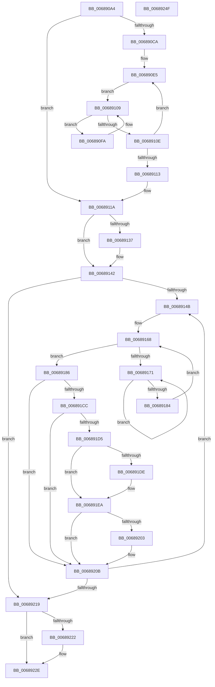

# MiPreparePhysicalPagesMdlForFree

- RVA: `0x006890A4`–`0x00689250` (길이 `428` bytes)
- VA: `0x00000001406890A4`
- 실행 섹션: `.text`
- PDB 이름 있음: `예`; PDB Function 태그: `아니요`
- unwind 정보 RVA: `0x000D3ABC`
- 디코드: `109`개 명령, `428/428` bytes 표시
- 미해석 바이트: `0` (있으면 어셈블리에 `.byte`로 보존)

> 이 문서는 커널 이미지의 기계어와 PDB 기호를 분석해 생성했습니다. 4번과 5번은 함수 원형과 자료형을 바이너리 사용 방식에서 추정한 C 해석이며 원본 소스 복구 결과는 아닙니다.

## 1. Dependencies

- 직접 호출 지점: **6**; 고유 호출 대상: **4**
- 직접 호출자로 확인된 함수: **1**
- RIP 상대 이미지 참조: **1**

### Outgoing calls
- `0x0068913D` → [KiRaiseIrqlProcessIrqlFlags](../4F/KiRaiseIrqlProcessIrqlFlags_function_004F56FC.md) (function, `0x004F56FC`)
- `0x00689176` → [KeYieldProcessorEx](../3F/KeYieldProcessorEx_function_003FBD00.md) (function, `0x003FBD00`)
- `0x006891CC` → [KeShouldYieldProcessor](../27/KeShouldYieldProcessor_function_002773E0.md) (function, `0x002773E0`)
- `0x006891E5` → [KiLowerIrqlProcessIrqlFlags](../4F/KiLowerIrqlProcessIrqlFlags_function_004F5698.md) (function, `0x004F5698`)
- `0x00689206` → [KiRaiseIrqlProcessIrqlFlags](../4F/KiRaiseIrqlProcessIrqlFlags_function_004F56FC.md) (function, `0x004F56FC`)
- `0x00689229` → [KiLowerIrqlProcessIrqlFlags](../4F/KiLowerIrqlProcessIrqlFlags_function_004F5698.md) (function, `0x004F5698`)

### Direct callers
- [NtFreeUserPhysicalPages](../../page/80/NtFreeUserPhysicalPages_function_0080AF30.md) at `0x0080B2B0`

### Static image references
- `0x0068912F` → RVA `0x00FC6D20` (`ALMOSTRO`; read)

## 2. Other-region calls and transfers

- 다른 실행 섹션으로 향하는 call: **0**
- 별도 외부 분기/꼬리 이동을 확인하지 못했습니다.

## 3. Assembly (complete function range)

```asm
006890A4  48 89 5C 24 10                  mov qword ptr [rsp + 0x10], rbx
006890A9  48 89 6C 24 18                  mov qword ptr [rsp + 0x18], rbp
006890AE  48 89 74 24 20                  mov qword ptr [rsp + 0x20], rsi
006890B3  57                              push rdi
006890B4  41 55                           push r13
006890B6  41 56                           push r14
006890B8  48 83 EC 20                     sub rsp, 0x20
006890BC  83 61 2C 00                     and dword ptr [rcx + 0x2c], 0
006890C0  4C 8D 71 30                     lea r14, [rcx + 0x30]
006890C4  48 83 FA 01                     cmp rdx, 1
006890C8  74 50                           je 0x14068911a
006890CA  44 8B 41 28                     mov r8d, dword ptr [rcx + 0x28]
006890CE  4C 8D 1C D5 00 00 00 00         lea r11, [rdx*8]
006890D6  49 C1 E8 0C                     shr r8, 0xc
006890DA  49 8B C0                        mov rax, r8
006890DD  48 0F AF C2                     imul rax, rdx
006890E1  4D 8D 14 C6                     lea r10, [r14 + rax*8]
006890E5  49 FF C8                        dec r8
006890E8  41 B9 01 00 00 00               mov r9d, 1
006890EE  4D 2B D3                        sub r10, r11
006890F1  4B 8B 04 C6                     mov rax, qword ptr [r14 + r8*8]
006890F5  49 89 02                        mov qword ptr [r10], rax
006890F8  EB 0F                           jmp 0x140689109
006890FA  4B 8B 44 CA F8                  mov rax, qword ptr [r10 + r9*8 - 8]
006890FF  48 FF C0                        inc rax
00689102  4B 89 04 CA                     mov qword ptr [r10 + r9*8], rax
00689106  49 FF C1                        inc r9
00689109  4C 3B CA                        cmp r9, rdx
0068910C  72 EC                           jb 0x1406890fa
0068910E  4D 85 C0                        test r8, r8
00689111  75 D2                           jne 0x1406890e5
00689113  0F AF 51 28                     imul edx, dword ptr [rcx + 0x28]
00689117  89 51 28                        mov dword ptr [rcx + 0x28], edx
0068911A  8B 71 28                        mov esi, dword ptr [rcx + 0x28]
0068911D  33 ED                           xor ebp, ebp
0068911F  48 C1 EE 0C                     shr rsi, 0xc
00689123  44 0F 20 C7                     mov rdi, cr8
00689127  44 8D 6D 02                     lea r13d, [rbp + 2]
0068912B  45 0F 22 C5                     mov cr8, r13
0068912F  39 2D EB DB 93 00               cmp dword ptr [rip + 0x93dbeb], ebp
00689135  74 0B                           je 0x140689142
00689137  41 8A D5                        mov dl, r13b
0068913A  40 8A CF                        mov cl, dil
0068913D  E8 BA C5 E6 FF                  call 0x1404f56fc
00689142  48 85 F6                        test rsi, rsi
00689145  0F 84 CE 00 00 00               je 0x140689219
0068914B  49 8B 06                        mov rax, qword ptr [r14]
0068914E  48 8D 1C 40                     lea rbx, [rax + rax*2]
00689152  48 C1 E3 04                     shl rbx, 4
00689156  48 B8 00 00 00 00 00 DE FF FF   movabs rax, 0xffffde0000000000
00689160  48 03 D8                        add rbx, rax
00689163  83 64 24 40 00                  and dword ptr [rsp + 0x40], 0
00689168  F0 48 0F BA 6B 18 3F            lock bts qword ptr [rbx + 0x18], 0x3f
0068916F  73 15                           jae 0x140689186
00689171  48 8D 4C 24 40                  lea rcx, [rsp + 0x40]
00689176  E8 85 2B D7 FF                  call 0x1403fbd00
0068917B  48 8B 43 18                     mov rax, qword ptr [rbx + 0x18]
0068917F  48 85 C0                        test rax, rax
00689182  78 ED                           js 0x140689171
00689184  EB E2                           jmp 0x140689168
00689186  48 8B 43 18                     mov rax, qword ptr [rbx + 0x18]
0068918A  48 B9 01 00 00 00 00 00 00 C0   movabs rcx, 0xc000000000000001
00689194  48 23 C1                        and rax, rcx
00689197  48 B9 FF FF FF FF FF FF FF BF   movabs rcx, 0xbfffffffffffffff
006891A1  48 83 C8 01                     or rax, 1
006891A5  48 89 43 18                     mov qword ptr [rbx + 0x18], rax
006891A9  48 8B 43 18                     mov rax, qword ptr [rbx + 0x18]
006891AD  48 23 C1                        and rax, rcx
006891B0  48 89 43 18                     mov qword ptr [rbx + 0x18], rax
006891B4  48 B8 FF FF FF FF FF FF FF 7F   movabs rax, 0x7fffffffffffffff
006891BE  F0 48 21 43 18                  lock and qword ptr [rbx + 0x18], rax
006891C3  48 FF C5                        inc rbp
006891C6  40 F6 C5 7F                     test bpl, 0x7f
006891CA  75 3F                           jne 0x14068920b
006891CC  E8 0F E2 BE FF                  call 0x1402773e0
006891D1  85 C0                           test eax, eax
006891D3  74 36                           je 0x14068920b
006891D5  83 3D 44 DB 93 00 00            cmp dword ptr [rip + 0x93db44], 0
006891DC  74 0C                           je 0x1406891ea
006891DE  44 0F 20 C1                     mov rcx, cr8
006891E2  40 8A D7                        mov dl, dil
006891E5  E8 AE C4 E6 FF                  call 0x1404f5698
006891EA  40 0F B6 C7                     movzx eax, dil
006891EE  44 0F 22 C0                     mov cr8, rax
006891F2  44 0F 20 C1                     mov rcx, cr8
006891F6  45 0F 22 C5                     mov cr8, r13
006891FA  83 3D 1F DB 93 00 00            cmp dword ptr [rip + 0x93db1f], 0
00689201  74 08                           je 0x14068920b
00689203  41 8A D5                        mov dl, r13b
00689206  E8 F1 C4 E6 FF                  call 0x1404f56fc
0068920B  49 83 C6 08                     add r14, 8
0068920F  48 83 EE 01                     sub rsi, 1
00689213  0F 85 32 FF FF FF               jne 0x14068914b
00689219  83 3D 00 DB 93 00 00            cmp dword ptr [rip + 0x93db00], 0
00689220  74 0C                           je 0x14068922e
00689222  44 0F 20 C1                     mov rcx, cr8
00689226  40 8A D7                        mov dl, dil
00689229  E8 6A C4 E6 FF                  call 0x1404f5698
0068922E  40 0F B6 C7                     movzx eax, dil
00689232  44 0F 22 C0                     mov cr8, rax
00689236  48 8B 5C 24 48                  mov rbx, qword ptr [rsp + 0x48]
0068923B  48 8B 6C 24 50                  mov rbp, qword ptr [rsp + 0x50]
00689240  48 8B 74 24 58                  mov rsi, qword ptr [rsp + 0x58]
00689245  48 83 C4 20                     add rsp, 0x20
00689249  41 5E                           pop r14
0068924B  41 5D                           pop r13
0068924D  5F                              pop rdi
0068924E  C3                              ret
0068924F  CC                              int3
```

## 4. C-style interpretation (structured pseudocode)

```c
__int64 __fastcall MiPreparePhysicalPagesMdlForFree(__int64 a1, __int64 a2)
{
    __int64 result;
    __int64 v_r10;
    __int64 v_r14;
    __int64 v_rbp;
    __int64 v_rbx;
    __int64 v_rsi;
    __int64 v_rsp;
    unsigned __int64 v_stack_p10;
    unsigned __int64 v_stack_p18;
    unsigned __int64 v_stack_p20;
    unsigned int v_stack_p8;

    v_stack_p10 = v_rbx;
    v_stack_p18 = v_rbp;
    v_stack_p20 = v_rsi;
    v_rsp = (v_rsp) - (32);
    if (a2 == 1) goto loc_0068911A;
    a3 = ((unsigned int)(*(unsigned int *)(a1 + 40))) >> (12);
    result = (a3) * (a2);
loc_006890E5:
    a3 = (a3) - 1;
    v_r10 = (a1 + 48 + result * 8) - (a2 * 8);
    *(unsigned __int64 *)(v_r10) = *(unsigned __int64 *)(a1 + 48 + a3 * 8);
    goto loc_00689109;
loc_006890FA:
    result = (*(unsigned __int64 *)(v_r10 + 1 * 8 - 8)) + 1;
    *(unsigned __int64 *)(v_r10 + 1 * 8) = result;
    a4 = (1) + 1;
loc_00689109:
    if (a4 < a2) goto loc_006890FA;
    if (a3 != 0) goto loc_006890E5;
    a2 = (unsigned int)((a2) * (*(unsigned int *)(a1 + 40)));
    *(unsigned int *)(a1 + 40) = (unsigned int)(a2);
loc_0068911A:
    v_rbp = 0;
    v_rsi = ((unsigned int)(*(unsigned int *)(a1 + 40))) >> (12);
    if ((*(unsigned int *)(v_rip + 9690091)) != 0) {
        a2 = (unsigned __int8)(v_rbp + 2);
        a1 = (unsigned __int8)(v_cr8);
        result = KiRaiseIrqlProcessIrqlFlags(a1, a2, a3, a4);
    }
    if (v_rsi == 0) goto loc_00689219;
loc_0068914B:
    v_rbx = (*(unsigned __int64 *)(a1 + 48) + *(unsigned __int64 *)(a1 + 48) * 2) << (4);
    v_rbx = (v_rbx) + (*(unsigned __int64 *)(a1 + 48));
loc_00689168:
    if (condition_is_above_or_equal) goto loc_00689186;
loc_00689171:
    result = KeYieldProcessorEx(v_stack_p8, a2, a3, a4);
    if (sign_flag) goto loc_00689171;
    goto loc_00689168;
loc_00689186:
    result = (*(unsigned __int64 *)(v_rbx + 24)) & (v_stack_p8);
    result = (result) | (1);
    *(unsigned __int64 *)(v_rbx + 24) = result;
    result = (*(unsigned __int64 *)(v_rbx + 24)) & (v_stack_p8);
    *(unsigned __int64 *)(v_rbx + 24) = result;
    v_rbp = (v_rbp) + 1;
    if ((((unsigned __int8)(v_rbp)) & (127)) != 0) goto loc_0068920B;
    result = KeShouldYieldProcessor(v_stack_p8, a2, a3, a4);
    if ((unsigned int)(result) == 0) goto loc_0068920B;
    if ((*(unsigned int *)(v_rip + 9689924)) != 0) {
        a1 = v_rbp + 2;
        a2 = (unsigned __int8)(v_cr8);
        result = KiLowerIrqlProcessIrqlFlags(a1, a2, a3, a4);
    }
    result = (unsigned __int8)(v_cr8);
    if ((*(unsigned int *)(v_rip + 9689887)) != 0) {
        a2 = (unsigned __int8)(v_rbp + 2);
        result = KiRaiseIrqlProcessIrqlFlags((unsigned __int8)(v_cr8), a2, a3, a4);
    }
    v_r14 = (a1 + 48) + (8);
    v_rsi = (v_rsi) - (1);
    if (condition_is_not_equal) goto loc_0068914B;
loc_00689219:
    if ((*(unsigned int *)(v_rip + 9689856)) != 0) {
        a1 = v_rbp + 2;
        a2 = (unsigned __int8)(v_cr8);
        result = KiLowerIrqlProcessIrqlFlags(a1, a2, a3, a4);
    }
    v_rsp = (v_rsp) + (32);
    return (unsigned __int8)(v_cr8);
}
```

## 5. (Beta) C Style

```c
int64_t MiPreparePhysicalPagesMdlForFree(void *Arg1, int64_t Arg2)
{
    uint8_t *arg1 = (uint8_t *)Arg1;

    int64_t result;
    int64_t local_r10;
    int64_t local_r14;
    int64_t local_rbp;
    int64_t local_rbx;
    int64_t local_rsi;
    int64_t local_rsp;
    uint64_t v_stack_p10;
    uint64_t v_stack_p18;
    uint64_t v_stack_p20;
    uint32_t v_stack_p8;

    v_stack_p10 = local_rbx;
    v_stack_p18 = local_rbp;
    v_stack_p20 = local_rsi;
    local_rsp = (local_rsp) - (32);
    if (Arg2 == 1) goto loc_0068911A;
    a3 = ((uint32_t)(*(uint32_t *)(arg1 + 0x28))) >> (12);
    result = (a3) * (Arg2);
loc_006890E5:
    a3 = (a3) - 1;
    local_r10 = (Arg1 + 48 + result * 8) - (Arg2 * 8);
    *(uint64_t *)(local_r10) = *(uint64_t *)(arg1 + 0x30 + a3 * 8);
    goto loc_00689109;
loc_006890FA:
    result = (*(uint64_t *)(local_r10 + 0x1 * 8 - 0x8)) + 1;
    *(uint64_t *)(local_r10 + 0x1 * 8) = result;
    a4 = (1) + 1;
loc_00689109:
    if (a4 < Arg2) goto loc_006890FA;
    if (a3 != 0) goto loc_006890E5;
    Arg2 = (uint32_t)((Arg2) * (*(uint32_t *)(arg1 + 0x28)));
    *(uint32_t *)(arg1 + 0x28) = (uint32_t)(Arg2);
loc_0068911A:
    local_rbp = 0;
    local_rsi = ((uint32_t)(*(uint32_t *)(arg1 + 0x28))) >> (12);
    if ((*(uint32_t *)(v_rip + 0x93DBEB)) != 0) {
        Arg2 = (uint8_t)(local_rbp + 2);
        Arg1 = (uint8_t)(v_cr8);
        result = KiRaiseIrqlProcessIrqlFlags(Arg1, Arg2, a3, a4);
    }
    if (local_rsi == 0) goto loc_00689219;
loc_0068914B:
    local_rbx = (*(uint64_t *)(arg1 + 0x30) + *(uint64_t *)(arg1 + 0x30) * 2) << (4);
    local_rbx = (local_rbx) + (*(uint64_t *)(arg1 + 0x30));
loc_00689168:
    if (condition_is_above_or_equal) goto loc_00689186;
loc_00689171:
    result = KeYieldProcessorEx(v_stack_p8, Arg2, a3, a4);
    if (sign_flag) goto loc_00689171;
    goto loc_00689168;
loc_00689186:
    result = (*(uint64_t *)(local_rbx + 0x18)) & (v_stack_p8);
    result = (result) | (1);
    *(uint64_t *)(local_rbx + 0x18) = result;
    result = (*(uint64_t *)(local_rbx + 0x18)) & (v_stack_p8);
    *(uint64_t *)(local_rbx + 0x18) = result;
    local_rbp = (local_rbp) + 1;
    if ((((uint8_t)(local_rbp)) & (127)) != 0) goto loc_0068920B;
    result = KeShouldYieldProcessor(v_stack_p8, Arg2, a3, a4);
    if ((uint32_t)(result) == 0) goto loc_0068920B;
    if ((*(uint32_t *)(v_rip + 0x93DB44)) != 0) {
        Arg1 = local_rbp + 2;
        Arg2 = (uint8_t)(v_cr8);
        result = KiLowerIrqlProcessIrqlFlags(Arg1, Arg2, a3, a4);
    }
    result = (uint8_t)(v_cr8);
    if ((*(uint32_t *)(v_rip + 0x93DB1F)) != 0) {
        Arg2 = (uint8_t)(local_rbp + 2);
        result = KiRaiseIrqlProcessIrqlFlags((uint8_t)(v_cr8), Arg2, a3, a4);
    }
    local_r14 = (Arg1 + 48) + (8);
    local_rsi = (local_rsi) - (1);
    if (condition_is_not_equal) goto loc_0068914B;
loc_00689219:
    if ((*(uint32_t *)(v_rip + 0x93DB00)) != 0) {
        Arg1 = local_rbp + 2;
        Arg2 = (uint8_t)(v_cr8);
        result = KiLowerIrqlProcessIrqlFlags(Arg1, Arg2, a3, a4);
    }
    local_rsp = (local_rsp) + (32);
    return (uint8_t)(v_cr8);
}
```

### 관측된 메모리 오프셋

구조체 형식이 확인되지 않은 접근은 인자 기준의 오프셋으로만 기록했습니다.

| 기준 인자 | 오프셋 표현 | 폭 (bit) | 접근 |
|---|---:|---:|---|
| `Arg1` | `- 0x8 + r9*8` | `64` | `R` |
| `Arg1` | `+ 0x0` | `64` | `R` |
| `Arg1` | `+ 0x0` | `64` | `W` |
| `Arg1` | `+ 0x0 + r8*8` | `64` | `R` |
| `Arg1` | `+ 0x0 + r9*8` | `64` | `W` |
| `Arg1` | `+ 0x0 + rax*8` | `64` | `R` |
| `Arg1` | `+ 0x28` | `32` | `R` |
| `Arg1` | `+ 0x28` | `32` | `W` |
| `Arg1` | `+ 0x2C` | `32` | `R/W` |
| `Arg1` | `+ 0x30` | `64` | `R` |

## 6. Execution-region graph

[열기: 2D/3D 그래프와 함수 탐색 컨트롤 패널](../../../control-panel.html?section=text&rva=0x006890A4&view=graph)

- 2D 그래프는 위에서 아래로 흐르고, 3D 그래프는 빈 공간을 드래그해 회전합니다. Shift+드래그는 이동, 휠은 확대·축소, 함수 노드 선택은 대상 보고서 이동입니다.

### Static fallback


