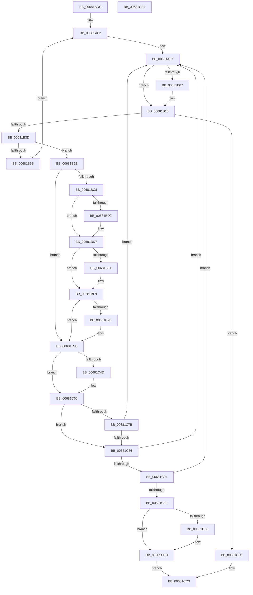

# MiPurgeBadFileOnlyPages

- RVA: `0x00681ADC`–`0x00681CE5` (길이 `521` bytes)
- VA: `0x0000000140681ADC`
- 실행 섹션: `.text`
- PDB 이름 있음: `예`; PDB Function 태그: `아니요`
- unwind 정보 RVA: `0x000BE6C8`
- 디코드: `137`개 명령, `521/521` bytes 표시
- 미해석 바이트: `0` (있으면 어셈블리에 `.byte`로 보존)

> 이 문서는 커널 이미지의 기계어와 PDB 기호를 분석해 생성했습니다. 4번과 5번은 함수 원형과 자료형을 바이너리 사용 방식에서 추정한 C 해석이며 원본 소스 복구 결과는 아닙니다.

## 1. Dependencies

- 직접 호출 지점: **22**; 고유 호출 대상: **17**
- 직접 호출자로 확인된 함수: **1**
- RIP 상대 이미지 참조: **5**

### Outgoing calls
- `0x00681B0B` → [KiRaiseIrqlProcessIrqlFlags](../4F/KiRaiseIrqlProcessIrqlFlags_function_004F56FC.md) (function, `0x004F56FC`)
- `0x00681B17` → [ExAcquireSpinLockExclusiveAtDpcLevel](../24/ExAcquireSpinLockExclusiveAtDpcLevel_function_00248E80.md) (function, `0x00248E80`)
- `0x00681B64` → [MiReleaseSpinLockExclusive](../24/MiReleaseSpinLockExclusive_function_002482C0.md) (function, `0x002482C0`)
- `0x00681B7A` → [MiUnlinkPageFromBadList](../3B/MiUnlinkPageFromBadList_function_003BD620.md) (function, `0x003BD620`)
- `0x00681B86` → [ExReleaseSpinLockExclusiveFromDpcLevel](../24/ExReleaseSpinLockExclusiveFromDpcLevel_function_002497E0.md) (function, `0x002497E0`)
- `0x00681B93` → [MiAddLockedPageCharge](../28/MiAddLockedPageCharge_function_0028B550.md) (function, `0x0028B550`)
- `0x00681BAF` → [MiPreventControlAreaDeletion](../2B/MiPreventControlAreaDeletion_function_002BBD10.md) (function, `0x002BBD10`)
- `0x00681BBC` → [MiUnlockPage](../31/MiUnlockPage_function_0031A3E0.md) (function, `0x0031A3E0`)
- `0x00681BD2` → [MiReleaseControlAreaWaiters](../28/MiReleaseControlAreaWaiters_function_002865F0.md) (function, `0x002865F0`)
- `0x00681BDA` → [MiPurgeFileOnlyPfn](MiPurgeFileOnlyPfn_function_00681CEC.md) (function, `0x00681CEC`)
- `0x00681BF4` → [MiDecrementSubsection](../29/MiDecrementSubsection_function_00298D68.md) (function, `0x00298D68`)
- `0x00681BFD` → [ExAcquireSpinLockExclusive](../24/ExAcquireSpinLockExclusive_function_00248690.md) (function, `0x00248690`)
- `0x00681C11` → [MiDecrementModifiedWriteCount](../29/MiDecrementModifiedWriteCount_function_00298184.md) (function, `0x00298184`)
- `0x00681C24` → [MiReleaseSpinLockExclusive](../24/MiReleaseSpinLockExclusive_function_002482C0.md) (function, `0x002482C0`)
- `0x00681C31` → [MiReleaseControlAreaWaiters](../28/MiReleaseControlAreaWaiters_function_002865F0.md) (function, `0x002865F0`)
- `0x00681C39` → [MiLockPageInline](../31/MiLockPageInline_function_0031A340.md) (function, `0x0031A340`)
- `0x00681C44` → [MiRemoveLockedPageCharge](../24/MiRemoveLockedPageCharge_function_00246950.md) (function, `0x00246950`)
- `0x00681C56` → [MiSetPfnTbFlushStamp](../2B/MiSetPfnTbFlushStamp_function_002B7A70.md) (function, `0x002B7A70`)
- `0x00681C61` → [MiPfnReferenceCountIsZero](../2B/MiPfnReferenceCountIsZero_function_002B9E40.md) (function, `0x002B9E40`)
- `0x00681C6F` → [MiUnlockPage](../31/MiUnlockPage_function_0031A3E0.md) (function, `0x0031A3E0`)
- `0x00681CA5` → [ExAcquireSpinLockExclusive](../24/ExAcquireSpinLockExclusive_function_00248690.md) (function, `0x00248690`)
- `0x00681CCA` → [MiReleaseSpinLockExclusive](../24/MiReleaseSpinLockExclusive_function_002482C0.md) (function, `0x002482C0`)

### Direct callers
- [MiDeleteExtentPfns](MiDeleteExtentPfns_function_006808B0.md) at `0x00680984`

### Static image references
- `0x00681AFF` → RVA `0x00FC6D20` (`ALMOSTRO`; read)
- `0x00681B10` → RVA `0x00E3A8A0` (`.data`; read)
- `0x00681B1C` → RVA `0x00E2D660` (`.data`; read)
- `0x00681B2D` → RVA `0x00E2D702` (`.data`; write)
- `0x00681B6B` → RVA `0x00E2D650` (`.data`; read)

## 2. Other-region calls and transfers

- 다른 실행 섹션으로 향하는 call: **0**
- 별도 외부 분기/꼬리 이동을 확인하지 못했습니다.

## 3. Assembly (complete function range)

```asm
00681ADC  48 89 5C 24 18                  mov qword ptr [rsp + 0x18], rbx
00681AE1  55                              push rbp
00681AE2  56                              push rsi
00681AE3  57                              push rdi
00681AE4  41 54                           push r12
00681AE6  41 55                           push r13
00681AE8  41 56                           push r14
00681AEA  41 57                           push r15
00681AEC  48 83 EC 20                     sub rsp, 0x20
00681AF0  33 F6                           xor esi, esi
00681AF2  B8 02 00 00 00                  mov eax, 2
00681AF7  44 0F 20 C3                     mov rbx, cr8
00681AFB  44 0F 22 C0                     mov cr8, rax
00681AFF  39 35 1B 52 94 00               cmp dword ptr [rip + 0x94521b], esi
00681B05  74 09                           je 0x140681b10
00681B07  8A D0                           mov dl, al
00681B09  8A CB                           mov cl, bl
00681B0B  E8 EC 3B E7 FF                  call 0x1404f56fc
00681B10  48 8D 0D 89 8D 7B 00            lea rcx, [rip + 0x7b8d89]
00681B17  E8 64 73 BC FF                  call 0x140248e80
00681B1C  4C 8B 35 3D BB 7A 00            mov r14, qword ptr [rip + 0x7abb3d]
00681B23  48 B8 FF FF FF FF 3F 00 00 00   movabs rax, 0x3fffffffff
00681B2D  40 88 35 CE BB 7A 00            mov byte ptr [rip + 0x7abbce], sil
00681B34  4C 3B F0                        cmp r14, rax
00681B37  0F 84 84 01 00 00               je 0x140681cc1
00681B3D  4B 8D 2C 76                     lea rbp, [r14 + r14*2]
00681B41  48 C1 E5 04                     shl rbp, 4
00681B45  48 B8 00 00 00 00 00 DE FF FF   movabs rax, 0xffffde0000000000
00681B4F  48 03 E8                        add rbp, rax
00681B52  F0 48 0F BA 6D 18 3F            lock bts qword ptr [rbp + 0x18], 0x3f
00681B59  73 10                           jae 0x140681b6b
00681B5B  8A D3                           mov dl, bl
00681B5D  48 8D 0D 3C 8D 7B 00            lea rcx, [rip + 0x7b8d3c]
00681B64  E8 57 67 BC FF                  call 0x1402482c0
00681B69  EB 87                           jmp 0x140681af2
00681B6B  4C 8B 3D DE BA 7A 00            mov r15, qword ptr [rip + 0x7abade]
00681B72  BA 80 00 00 00                  mov edx, 0x80
00681B77  48 8B CD                        mov rcx, rbp
00681B7A  E8 A1 BA D3 FF                  call 0x1403bd620
00681B7F  48 8D 0D 1A 8D 7B 00            lea rcx, [rip + 0x7b8d1a]
00681B86  E8 55 7C BC FF                  call 0x1402497e0
00681B8B  BA 01 00 00 00                  mov edx, 1
00681B90  48 8B CD                        mov rcx, rbp
00681B93  E8 B8 99 C0 FF                  call 0x14028b550
00681B98  4C 8D 44 24 60                  lea r8, [rsp + 0x60]
00681B9D  48 89 74 24 60                  mov qword ptr [rsp + 0x60], rsi
00681BA2  48 8D 54 24 68                  lea rdx, [rsp + 0x68]
00681BA7  48 89 74 24 68                  mov qword ptr [rsp + 0x68], rsi
00681BAC  48 8B CD                        mov rcx, rbp
00681BAF  E8 5C A1 C3 FF                  call 0x1402bbd10
00681BB4  8A D3                           mov dl, bl
00681BB6  48 8B CD                        mov rcx, rbp
00681BB9  4C 8B E8                        mov r13, rax
00681BBC  E8 1F 88 C9 FF                  call 0x14031a3e0
00681BC1  8B FE                           mov edi, esi
00681BC3  4D 85 ED                        test r13, r13
00681BC6  74 6E                           je 0x140681c36
00681BC8  48 8B 4C 24 60                  mov rcx, qword ptr [rsp + 0x60]
00681BCD  48 85 C9                        test rcx, rcx
00681BD0  74 05                           je 0x140681bd7
00681BD2  E8 19 4A C0 FF                  call 0x1402865f0
00681BD7  48 8B CD                        mov rcx, rbp
00681BDA  E8 0D 01 00 00                  call 0x140681cec
00681BDF  48 8B 7D 18                     mov rdi, qword ptr [rbp + 0x18]
00681BE3  48 8B 4C 24 68                  mov rcx, qword ptr [rsp + 0x68]
00681BE8  48 C1 EF 3E                     shr rdi, 0x3e
00681BEC  83 E7 01                        and edi, 1
00681BEF  48 85 C9                        test rcx, rcx
00681BF2  74 05                           je 0x140681bf9
00681BF4  E8 6F 71 C1 FF                  call 0x140298d68
00681BF9  49 8D 4D 48                     lea rcx, [r13 + 0x48]
00681BFD  E8 8E 6A BC FF                  call 0x140248690
00681C02  41 83 65 38 FB                  and dword ptr [r13 + 0x38], 0xfffffffb
00681C07  BA 01 00 00 00                  mov edx, 1
00681C0C  49 8B CD                        mov rcx, r13
00681C0F  8A D8                           mov bl, al
00681C11  E8 6E 65 C1 FF                  call 0x140298184
00681C16  8A D3                           mov dl, bl
00681C18  48 89 44 24 60                  mov qword ptr [rsp + 0x60], rax
00681C1D  49 8D 4D 48                     lea rcx, [r13 + 0x48]
00681C21  4C 8B E0                        mov r12, rax
00681C24  E8 97 66 BC FF                  call 0x1402482c0
00681C29  4D 85 E4                        test r12, r12
00681C2C  74 08                           je 0x140681c36
00681C2E  49 8B CC                        mov rcx, r12
00681C31  E8 BA 49 C0 FF                  call 0x1402865f0
00681C36  48 8B CD                        mov rcx, rbp
00681C39  E8 02 87 C9 FF                  call 0x14031a340
00681C3E  48 8B CD                        mov rcx, rbp
00681C41  40 8A F0                        mov sil, al
00681C44  E8 07 4D BC FF                  call 0x140246950
00681C49  85 C0                           test eax, eax
00681C4B  74 19                           je 0x140681c66
00681C4D  33 D2                           xor edx, edx
00681C4F  48 8B CD                        mov rcx, rbp
00681C52  44 8D 42 01                     lea r8d, [rdx + 1]
00681C56  E8 15 5E C3 FF                  call 0x1402b7a70
00681C5B  49 8B D6                        mov rdx, r14
00681C5E  48 8B CD                        mov rcx, rbp
00681C61  E8 DA 81 C3 FF                  call 0x1402b9e40
00681C66  8B 5D 20                        mov ebx, dword ptr [rbp + 0x20]
00681C69  40 8A D6                        mov dl, sil
00681C6C  48 8B CD                        mov rcx, rbp
00681C6F  E8 6C 87 C9 FF                  call 0x14031a3e0
00681C74  33 F6                           xor esi, esi
00681C76  66 85 DB                        test bx, bx
00681C79  75 0B                           jne 0x140681c86
00681C7B  8D 46 02                        lea eax, [rsi + 2]
00681C7E  85 FF                           test edi, edi
00681C80  0F 85 71 FE FF FF               jne 0x140681af7
00681C86  B8 02 00 00 00                  mov eax, 2
00681C8B  4D 85 FF                        test r15, r15
00681C8E  0F 84 63 FE FF FF               je 0x140681af7
00681C94  49 83 FF 01                     cmp r15, 1
00681C98  0F 85 59 FE FF FF               jne 0x140681af7
00681C9E  48 8D 0D FB 8B 7B 00            lea rcx, [rip + 0x7b8bfb]
00681CA5  E8 E6 69 BC FF                  call 0x140248690
00681CAA  48 8B 15 9F B9 7A 00            mov rdx, qword ptr [rip + 0x7ab99f]
00681CB1  48 85 D2                        test rdx, rdx
00681CB4  74 07                           je 0x140681cbd
00681CB6  44 88 3D 45 BA 7A 00            mov byte ptr [rip + 0x7aba45], r15b
00681CBD  8A D0                           mov dl, al
00681CBF  EB 02                           jmp 0x140681cc3
00681CC1  8A D3                           mov dl, bl
00681CC3  48 8D 0D D6 8B 7B 00            lea rcx, [rip + 0x7b8bd6]
00681CCA  E8 F1 65 BC FF                  call 0x1402482c0
00681CCF  48 8B 5C 24 70                  mov rbx, qword ptr [rsp + 0x70]
00681CD4  48 83 C4 20                     add rsp, 0x20
00681CD8  41 5F                           pop r15
00681CDA  41 5E                           pop r14
00681CDC  41 5D                           pop r13
00681CDE  41 5C                           pop r12
00681CE0  5F                              pop rdi
00681CE1  5E                              pop rsi
00681CE2  5D                              pop rbp
00681CE3  C3                              ret
00681CE4  CC                              int3
```

## 4. C-style interpretation (structured pseudocode)

```c
__int64 __fastcall MiPurgeBadFileOnlyPages(void)
{
    __int64 result;
    __int64 v_rbp;
    __int64 v_rdi;
    __int64 v_rsi;
    __int64 v_rsp;
    unsigned __int64 v_stack_p10;
    unsigned __int64 v_stack_p18;
    unsigned __int64 v_stack_p8;

    v_stack_p18 = v_rbx;
    v_rsp = (v_rsp) - (32);
    v_rsi = 0;
loc_00681AF2:
loc_00681AF7:
    result = 2;
    if ((*(unsigned int *)(v_rip + 9720347)) != 0) {
        a2 = 2;
        a1 = (unsigned __int8)(v_cr8);
        result = KiRaiseIrqlProcessIrqlFlags(a1, a2, a3, a4);
    }
    result = ExAcquireSpinLockExclusiveAtDpcLevel(v_rip + 8097161, a2, a3, a4);
    *(unsigned __int8 *)(v_rip + 8043470) = 0;
    if ((*(unsigned __int64 *)(v_rip + 8043325)) == result) goto loc_00681CC1;
    v_rbp = (*(unsigned __int64 *)(v_rip + 8043325) + *(unsigned __int64 *)(v_rip + 8043325) * 2) << (4);
    v_rbp = (v_rbp) + (result);
    if (condition_is_above_or_equal) goto loc_00681B6B;
    result = MiReleaseSpinLockExclusive(v_rip + 8097084, (unsigned __int8)(v_cr8), a3, a4);
    goto loc_00681AF2;
loc_00681B6B:
    result = MiUnlinkPageFromBadList(v_rbp, 128, a3, a4);
    result = ExReleaseSpinLockExclusiveFromDpcLevel(v_rip + 8097050, 128, a3, a4);
    result = MiAddLockedPageCharge(v_rbp, 1, a3, a4);
    v_stack_p8 = 0;
    v_stack_p10 = 0;
    result = MiPreventControlAreaDeletion(v_rbp, v_stack_p10, v_stack_p8, a4);
    result = MiUnlockPage(v_rbp, (unsigned __int8)(v_cr8), v_stack_p8, a4);
    if (result == 0) goto loc_00681C36;
    if (v_stack_p8 != 0) {
        result = MiReleaseControlAreaWaiters(v_stack_p8, (unsigned __int8)(v_cr8), v_stack_p8, a4);
    }
    result = MiPurgeFileOnlyPfn(v_rbp, (unsigned __int8)(v_cr8), v_stack_p8, a4);
    v_rdi = (*(unsigned __int64 *)(v_rbp + 24)) >> (62);
    v_rdi = (unsigned int)((v_rdi) & (1));
    if (v_stack_p10 != 0) {
        result = MiDecrementSubsection(v_stack_p10, (unsigned __int8)(v_cr8), v_stack_p8, a4);
    }
    result = ExAcquireSpinLockExclusive(result + 72, (unsigned __int8)(v_cr8), v_stack_p8, a4);
    result = MiDecrementModifiedWriteCount(result, 1, v_stack_p8, a4);
    v_stack_p8 = result;
    result = MiReleaseSpinLockExclusive(result + 72, (unsigned __int8)((unsigned __int8)(result)), v_stack_p8, a4);
    if (result != 0) {
        a1 = result;
        result = MiReleaseControlAreaWaiters(a1, (unsigned __int8)((unsigned __int8)(result)), v_stack_p8, a4);
    }
    result = MiLockPageInline(v_rbp, (unsigned __int8)((unsigned __int8)(result)), v_stack_p8, a4);
    result = MiRemoveLockedPageCharge(v_rbp, (unsigned __int8)((unsigned __int8)(result)), v_stack_p8, a4);
    if ((unsigned int)(result) != 0) {
        a2 = 0;
        a1 = v_rbp;
        a3 = a2 + 1;
        result = MiSetPfnTbFlushStamp(a1, a2, a3, a4);
        a2 = *(unsigned __int64 *)(v_rip + 8043325);
        a1 = v_rbp;
        result = MiPfnReferenceCountIsZero(a1, a2, a3, a4);
    }
    result = MiUnlockPage(v_rbp, (unsigned __int8)((unsigned __int8)(result)), a3, a4);
    v_rsi = 0;
    if ((unsigned __int16)((unsigned int)(*(unsigned int *)(v_rbp + 32))) != 0) goto loc_00681C86;
    if ((unsigned int)(v_rdi) != 0) goto loc_00681AF7;
loc_00681C86:
    if (*(unsigned __int64 *)(v_rip + 8043230) == 0) goto loc_00681AF7;
    if ((*(unsigned __int64 *)(v_rip + 8043230)) != 1) goto loc_00681AF7;
    result = ExAcquireSpinLockExclusive(v_rip + 8096763, (unsigned __int8)((unsigned __int8)(result)), a3, a4);
    if (*(unsigned __int64 *)(v_rip + 8042911) != 0) {
        *(unsigned __int8 *)(v_rip + 8043077) = (unsigned __int8)(*(unsigned __int64 *)(v_rip + 8043230));
    }
    goto loc_00681CC3;
loc_00681CC1:
loc_00681CC3:
    result = MiReleaseSpinLockExclusive(v_rip + 8096726, (unsigned __int8)((unsigned int)(*(unsigned int *)(v_rbp + 32))), a3, a4);
    v_rsp = (v_rsp) + (32);
    return result;
}
```

## 5. (Beta) C Style

```c
void MiPurgeBadFileOnlyPages(void)
{
    int64_t result;
    int64_t local_rbp;
    int64_t local_rdi;
    int64_t local_rsi;
    int64_t local_rsp;
    uint64_t v_stack_p10;
    uint64_t v_stack_p18;
    uint64_t v_stack_p8;

    v_stack_p18 = local_rbx;
    local_rsp = (local_rsp) - (32);
    local_rsi = 0;
loc_00681AF2:
loc_00681AF7:
    result = 2;
    if ((*(uint32_t *)(v_rip + 0x94521B)) != 0) {
        a2 = 2;
        a1 = (uint8_t)(v_cr8);
        result = KiRaiseIrqlProcessIrqlFlags(a1, a2, a3, a4);
    }
    result = ExAcquireSpinLockExclusiveAtDpcLevel(v_rip + 8097161, a2, a3, a4);
    *(uint8_t *)(v_rip + 0x7ABBCE) = 0;
    if ((*(uint64_t *)(v_rip + 0x7ABB3D)) == result) goto loc_00681CC1;
    local_rbp = (*(uint64_t *)(v_rip + 0x7ABB3D) + *(uint64_t *)(v_rip + 0x7ABB3D) * 2) << (4);
    local_rbp = (local_rbp) + (result);
    if (condition_is_above_or_equal) goto loc_00681B6B;
    result = MiReleaseSpinLockExclusive(v_rip + 8097084, (uint8_t)(v_cr8), a3, a4);
    goto loc_00681AF2;
loc_00681B6B:
    result = MiUnlinkPageFromBadList(local_rbp, 128, a3, a4);
    result = ExReleaseSpinLockExclusiveFromDpcLevel(v_rip + 8097050, 128, a3, a4);
    result = MiAddLockedPageCharge(local_rbp, 1, a3, a4);
    v_stack_p8 = 0;
    v_stack_p10 = 0;
    result = MiPreventControlAreaDeletion(local_rbp, v_stack_p10, v_stack_p8, a4);
    result = MiUnlockPage(local_rbp, (uint8_t)(v_cr8), v_stack_p8, a4);
    if (result == 0) goto loc_00681C36;
    if (v_stack_p8 != 0) {
        result = MiReleaseControlAreaWaiters(v_stack_p8, (uint8_t)(v_cr8), v_stack_p8, a4);
    }
    result = MiPurgeFileOnlyPfn(local_rbp, (uint8_t)(v_cr8), v_stack_p8, a4);
    local_rdi = (*(uint64_t *)(local_rbp + 0x18)) >> (62);
    local_rdi = (uint32_t)((local_rdi) & (1));
    if (v_stack_p10 != 0) {
        result = MiDecrementSubsection(v_stack_p10, (uint8_t)(v_cr8), v_stack_p8, a4);
    }
    result = ExAcquireSpinLockExclusive(result + 72, (uint8_t)(v_cr8), v_stack_p8, a4);
    result = MiDecrementModifiedWriteCount(result, 1, v_stack_p8, a4);
    v_stack_p8 = result;
    result = MiReleaseSpinLockExclusive(result + 72, (uint8_t)((uint8_t)(result)), v_stack_p8, a4);
    if (result != 0) {
        a1 = result;
        result = MiReleaseControlAreaWaiters(a1, (uint8_t)((uint8_t)(result)), v_stack_p8, a4);
    }
    result = MiLockPageInline(local_rbp, (uint8_t)((uint8_t)(result)), v_stack_p8, a4);
    result = MiRemoveLockedPageCharge(local_rbp, (uint8_t)((uint8_t)(result)), v_stack_p8, a4);
    if ((uint32_t)(result) != 0) {
        a2 = 0;
        a1 = local_rbp;
        a3 = a2 + 1;
        result = MiSetPfnTbFlushStamp(a1, a2, a3, a4);
        a2 = *(uint64_t *)(v_rip + 0x7ABB3D);
        a1 = local_rbp;
        result = MiPfnReferenceCountIsZero(a1, a2, a3, a4);
    }
    result = MiUnlockPage(local_rbp, (uint8_t)((uint8_t)(result)), a3, a4);
    local_rsi = 0;
    if ((uint16_t)((uint32_t)(*(uint32_t *)(local_rbp + 0x20))) != 0) goto loc_00681C86;
    if ((uint32_t)(local_rdi) != 0) goto loc_00681AF7;
loc_00681C86:
    if (*(uint64_t *)(v_rip + 0x7ABADE) == 0) goto loc_00681AF7;
    if ((*(uint64_t *)(v_rip + 0x7ABADE)) != 1) goto loc_00681AF7;
    result = ExAcquireSpinLockExclusive(v_rip + 8096763, (uint8_t)((uint8_t)(result)), a3, a4);
    if (*(uint64_t *)(v_rip + 0x7AB99F) != 0) {
        *(uint8_t *)(v_rip + 0x7ABA45) = (uint8_t)(*(uint64_t *)(v_rip + 0x7ABADE));
    }
    goto loc_00681CC3;
loc_00681CC1:
loc_00681CC3:
    result = MiReleaseSpinLockExclusive(v_rip + 8096726, (uint8_t)((uint32_t)(*(uint32_t *)(local_rbp + 0x20))), a3, a4);
    local_rsp = (local_rsp) + (32);
    return result;
}
```

## 6. Execution-region graph

[열기: 2D/3D 그래프와 함수 탐색 컨트롤 패널](../../../control-panel.html?section=text&rva=0x00681ADC&view=graph)

- 2D 그래프는 위에서 아래로 흐르고, 3D 그래프는 빈 공간을 드래그해 회전합니다. Shift+드래그는 이동, 휠은 확대·축소, 함수 노드 선택은 대상 보고서 이동입니다.

### Static fallback


