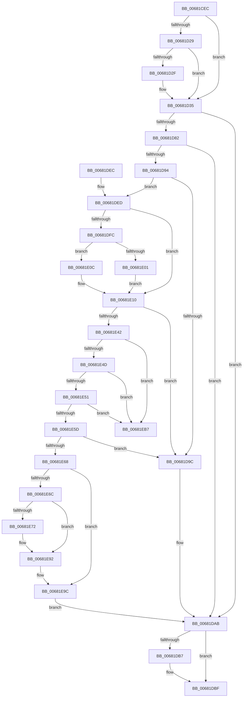

# MiPurgeFileOnlyPfn

- RVA: `0x00681CEC`–`0x00681ED3` (길이 `487` bytes)
- VA: `0x0000000140681CEC`
- 실행 섹션: `.text`
- PDB 이름 있음: `예`; PDB Function 태그: `아니요`
- unwind 정보 RVA: `0x000D8280`
- 디코드: `131`개 명령, `487/487` bytes 표시
- 미해석 바이트: `0` (있으면 어셈블리에 `.byte`로 보존)

> 이 문서는 커널 이미지의 기계어와 PDB 기호를 분석해 생성했습니다. 4번과 5번은 함수 원형과 자료형을 바이너리 사용 방식에서 추정한 C 해석이며 원본 소스 복구 결과는 아닙니다.

## 1. Dependencies

- 직접 호출 지점: **9**; 고유 호출 대상: **9**
- 직접 호출자로 확인된 함수: **1**
- RIP 상대 이미지 참조: **1**

### Outgoing calls
- `0x00681D5F` → [MiChangingSubsectionProtos](MiChangingSubsectionProtos_function_0068057C.md) (function, `0x0068057C`)
- `0x00681D75` → [MiCheckProtoPtePageState](../31/MiCheckProtoPtePageState_function_003183E0.md) (function, `0x003183E0`)
- `0x00681D87` → [MiLockLeafPage](../36/MiLockLeafPage_function_003658C0.md) (function, `0x003658C0`)
- `0x00681DBA` → [MiUnlockProtoPoolPage](../24/MiUnlockProtoPoolPage_function_00246090.md) (function, `0x00246090`)
- `0x00681DCD` → [MiSubsectionProtosCreated](../4D/MiSubsectionProtosCreated_function_004D9570.md) (function, `0x004D9570`)
- `0x00681E8D` → [MiPersistPage](MiPersistPage_function_00681A68.md) (function, `0x00681A68`)
- `0x00681E97` → [MiSetPfnModified](../36/MiSetPfnModified_function_00362960.md) (function, `0x00362960`)
- `0x00681EA8` → [MiDeleteTransitionPte](../37/MiDeleteTransitionPte_function_00371B70.md) (function, `0x00371B70`)
- `0x00681ECD` → [KeBugCheckEx](../4F/KeBugCheckEx_function_004FD660.md) (function, `0x004FD660`)

### Direct callers
- [MiPurgeBadFileOnlyPages](MiPurgeBadFileOnlyPages_function_00681ADC.md) at `0x00681BDA`

### Static image references
- `0x00681D1D` → RVA `0x00E2DC80` (`.data`; read)

## 2. Other-region calls and transfers

- 다른 실행 섹션으로 향하는 call: **0**
- 별도 외부 분기/꼬리 이동을 확인하지 못했습니다.

## 3. Assembly (complete function range)

```asm
00681CEC  4C 8B DC                        mov r11, rsp
00681CEF  49 89 5B 10                     mov qword ptr [r11 + 0x10], rbx
00681CF3  49 89 6B 18                     mov qword ptr [r11 + 0x18], rbp
00681CF7  49 89 73 20                     mov qword ptr [r11 + 0x20], rsi
00681CFB  57                              push rdi
00681CFC  41 54                           push r12
00681CFE  41 56                           push r14
00681D00  48 83 EC 60                     sub rsp, 0x60
00681D04  48 8B 71 10                     mov rsi, qword ptr [rcx + 0x10]
00681D08  33 C0                           xor eax, eax
00681D0A  0F 57 C0                        xorps xmm0, xmm0
00681D0D  33 FF                           xor edi, edi
00681D0F  0F 11 44 24 30                  movups xmmword ptr [rsp + 0x30], xmm0
00681D14  0F 11 44 24 40                  movups xmmword ptr [rsp + 0x40], xmm0
00681D19  49 89 43 D8                     mov qword ptr [r11 - 0x28], rax
00681D1D  48 8B 05 5C BF 7A 00            mov rax, qword ptr [rip + 0x7abf5c]
00681D24  48 85 C0                        test rax, rax
00681D27  74 0C                           je 0x140681d35
00681D29  40 F6 C6 10                     test sil, 0x10
00681D2D  75 06                           jne 0x140681d35
00681D2F  48 F7 D0                        not rax
00681D32  48 23 F0                        and rsi, rax
00681D35  4C 8B 71 08                     mov r14, qword ptr [rcx + 8]
00681D39  4C 8D 44 24 30                  lea r8, [rsp + 0x30]
00681D3E  48 C1 FE 10                     sar rsi, 0x10
00681D42  49 BC 00 00 00 00 00 00 00 80   movabs r12, 0x8000000000000000
00681D4C  48 8B CE                        mov rcx, rsi
00681D4F  C6 84 24 80 00 00 00 11         mov byte ptr [rsp + 0x80], 0x11
00681D57  BA 20 00 00 00                  mov edx, 0x20
00681D5C  4D 0B F4                        or r14, r12
00681D5F  E8 18 E8 FF FF                  call 0x14068057c
00681D64  48 8B 0E                        mov rcx, qword ptr [rsi]
00681D67  4C 8D 8C 24 80 00 00 00         lea r9, [rsp + 0x80]
00681D6F  45 33 C0                        xor r8d, r8d
00681D72  49 8B D6                        mov rdx, r14
00681D75  E8 66 66 C9 FF                  call 0x1403183e0
00681D7A  48 8B E8                        mov rbp, rax
00681D7D  48 85 C0                        test rax, rax
00681D80  74 29                           je 0x140681dab
00681D82  33 D2                           xor edx, edx
00681D84  49 8B CE                        mov rcx, r14
00681D87  E8 34 3B CE FF                  call 0x1403658c0
00681D8C  48 8B D8                        mov rbx, rax
00681D8F  48 85 C0                        test rax, rax
00681D92  74 17                           je 0x140681dab
00681D94  49 8B 0E                        mov rcx, qword ptr [r14]
00681D97  F6 C1 01                        test cl, 1
00681D9A  74 51                           je 0x140681ded
00681D9C  48 B8 FF FF FF FF FF FF FF 7F   movabs rax, 0x7fffffffffffffff
00681DA6  F0 48 21 43 18                  lock and qword ptr [rbx + 0x18], rax
00681DAB  8A 94 24 80 00 00 00            mov dl, byte ptr [rsp + 0x80]
00681DB2  80 FA 11                        cmp dl, 0x11
00681DB5  74 08                           je 0x140681dbf
00681DB7  48 8B CD                        mov rcx, rbp
00681DBA  E8 D1 42 BC FF                  call 0x140246090
00681DBF  44 8B CF                        mov r9d, edi
00681DC2  48 8D 54 24 30                  lea rdx, [rsp + 0x30]
00681DC7  45 33 C0                        xor r8d, r8d
00681DCA  48 8B CE                        mov rcx, rsi
00681DCD  E8 9E 77 E5 FF                  call 0x1404d9570
00681DD2  4C 8D 5C 24 60                  lea r11, [rsp + 0x60]
00681DD7  49 8B 5B 28                     mov rbx, qword ptr [r11 + 0x28]
00681DDB  49 8B 6B 30                     mov rbp, qword ptr [r11 + 0x30]
00681DDF  49 8B 73 38                     mov rsi, qword ptr [r11 + 0x38]
00681DE3  49 8B E3                        mov rsp, r11
00681DE6  41 5E                           pop r14
00681DE8  41 5C                           pop r12
00681DEA  5F                              pop rdi
00681DEB  C3                              ret
00681DEC  CC                              int3
00681DED  48 8B 15 8C BE 7A 00            mov rdx, qword ptr [rip + 0x7abe8c]
00681DF4  48 8B C1                        mov rax, rcx
00681DF7  48 85 D2                        test rdx, rdx
00681DFA  74 14                           je 0x140681e10
00681DFC  F6 C1 10                        test cl, 0x10
00681DFF  75 0B                           jne 0x140681e0c
00681E01  48 8B C2                        mov rax, rdx
00681E04  48 F7 D0                        not rax
00681E07  48 23 C1                        and rax, rcx
00681E0A  EB 04                           jmp 0x140681e10
00681E0C  48 83 E0 EF                     and rax, 0xffffffffffffffef
00681E10  48 BA FF FF FF FF FF 00 00 00   movabs rdx, 0xffffffffff
00681E1A  48 C1 E8 0C                     shr rax, 0xc
00681E1E  48 23 C2                        and rax, rdx
00681E21  49 B8 00 00 00 00 00 DE FF FF   movabs r8, 0xffffde0000000000
00681E2B  48 8D 14 40                     lea rdx, [rax + rax*2]
00681E2F  48 C1 E2 04                     shl rdx, 4
00681E33  49 8B C0                        mov rax, r8
00681E36  48 03 D0                        add rdx, rax
00681E39  48 3B DA                        cmp rbx, rdx
00681E3C  0F 85 5A FF FF FF               jne 0x140681d9c
00681E42  48 8B 43 10                     mov rax, qword ptr [rbx + 0x10]
00681E46  48 0F BA E0 0A                  bt rax, 0xa
00681E4B  73 6A                           jae 0x140681eb7
00681E4D  A8 01                           test al, 1
00681E4F  75 66                           jne 0x140681eb7
00681E51  48 8B 43 08                     mov rax, qword ptr [rbx + 8]
00681E55  49 0B C4                        or rax, r12
00681E58  49 3B C6                        cmp rax, r14
00681E5B  75 5A                           jne 0x140681eb7
00681E5D  8A 43 22                        mov al, byte ptr [rbx + 0x22]
00681E60  A8 08                           test al, 8
00681E62  0F 85 34 FF FF FF               jne 0x140681d9c
00681E68  A8 10                           test al, 0x10
00681E6A  74 30                           je 0x140681e9c
00681E6C  40 38 7B 23                     cmp byte ptr [rbx + 0x23], dil
00681E70  7C 20                           jl 0x140681e92
00681E72  49 8B C0                        mov rax, r8
00681E75  48 8B CB                        mov rcx, rbx
00681E78  48 2B C8                        sub rcx, rax
00681E7B  48 B8 AB AA AA AA AA AA AA AA   movabs rax, 0xaaaaaaaaaaaaaaab
00681E85  48 C1 F9 04                     sar rcx, 4
00681E89  48 0F AF C8                     imul rcx, rax
00681E8D  E8 D6 FB FF FF                  call 0x140681a68
00681E92  33 D2                           xor edx, edx
00681E94  48 8B CB                        mov rcx, rbx
00681E97  E8 C4 0A CE FF                  call 0x140362960
00681E9C  45 33 C9                        xor r9d, r9d
00681E9F  41 B0 02                        mov r8b, 2
00681EA2  48 8B D3                        mov rdx, rbx
00681EA5  49 8B CE                        mov rcx, r14
00681EA8  E8 C3 FC CE FF                  call 0x140371b70
00681EAD  BF 01 00 00 00                  mov edi, 1
00681EB2  E9 F4 FE FF FF                  jmp 0x140681dab
00681EB7  4C 8B 4B 08                     mov r9, qword ptr [rbx + 8]
00681EBB  4D 8B C6                        mov r8, r14
00681EBE  48 89 4C 24 20                  mov qword ptr [rsp + 0x20], rcx
00681EC3  BA 02 00 00 00                  mov edx, 2
00681EC8  B9 DE 00 00 00                  mov ecx, 0xde
00681ECD  E8 8E B7 E7 FF                  call 0x1404fd660
00681ED2  CC                              int3
```

## 4. C-style interpretation (structured pseudocode)

```c
__int64 __fastcall MiPurgeFileOnlyPfn(__int64 a1)
{
    __int64 result;
    __int64 v_r14;
    __int64 v_rdi;
    __int64 v_rsi;
    __int64 v_rsp;
    unsigned __int64 v_stack_m18;
    unsigned __int64 v_stack_m38;
    unsigned __int64 v_stack_m40;
    unsigned __int64 v_stack_m48;
    unsigned __int8 v_stack_p8;

    *(unsigned __int64 *)(v_rsp + 16) = v_rbx;
    *(unsigned __int64 *)(v_rsp + 24) = v_rbp;
    *(unsigned __int64 *)(v_rsp + 32) = v_rsi;
    v_rsp = (v_rsp) - (96);
    result = 0;
    v_rdi = 0;
    v_stack_m48 = v_xmm0;
    v_stack_m38 = v_xmm0;
    *(unsigned __int64 *)(v_rsp - 40) = 0;
    if (*(unsigned __int64 *)(v_rip + 8044380) == 0) goto loc_00681D35;
    result = *(unsigned __int64 *)(v_rip + 8044380);
    v_rsi = *(unsigned __int64 *)(a1 + 16);
    if ((((unsigned __int8)(*(unsigned __int64 *)(a1 + 16))) & (16)) == 0) {
        result = ~(*(unsigned __int64 *)(v_rip + 8044380));
        v_rsi = (*(unsigned __int64 *)(a1 + 16)) & (result);
    }
    v_rsi = (v_rsi) >> (16);
    v_stack_p8 = 17;
    v_r14 = (*(unsigned __int64 *)(a1 + 8)) | (v_r12);
    result = MiChangingSubsectionProtos(v_rsi, 32, v_stack_m48, a4);
    a3 = 0;
    result = MiCheckProtoPtePageState(*(unsigned __int64 *)(v_rsi), v_r14, a3, v_stack_p8);
    if (result == 0) goto loc_00681DAB;
    a2 = 0;
    result = MiLockLeafPage(v_r14, a2, a3, v_stack_p8);
    if (result == 0) goto loc_00681DAB;
    if ((((unsigned __int8)(*(unsigned __int64 *)(v_r14))) & (1)) == 0) goto loc_00681DED;
loc_00681D9C:
loc_00681DAB:
    if (((unsigned __int8)(v_stack_p8)) != 17) {
        a1 = result;
        result = MiUnlockProtoPoolPage(a1, v_stack_p8, a3, v_stack_p8);
    }
    a3 = 0;
    result = MiSubsectionProtosCreated(v_rsi, v_stack_m48, a3, 0);
    return result;
loc_00681DED:
    if (*(unsigned __int64 *)(v_rip + 8044172) == 0) goto loc_00681E10;
    if ((((unsigned __int8)(v_rsi)) & (16)) != 0) goto loc_00681E0C;
    result = ~(*(unsigned __int64 *)(v_rip + 8044172));
    result = (result) & (v_rsi);
    goto loc_00681E10;
loc_00681E0C:
    result = (result) & (-17);
loc_00681E10:
    result = (result) >> (12);
    result = (result) & (*(unsigned __int64 *)(v_rip + 8044172));
    a2 = (result + result * 2) << (4);
    a2 = (a2) + (0);
    if ((*(unsigned __int64 *)(v_stack_m18 + 40)) != a2) goto loc_00681D9C;
    if ((*(unsigned __int64 *)(v_stack_m18 + 40)) >= a2) goto loc_00681EB7;
    if ((((unsigned __int8)(*(unsigned __int64 *)(*(unsigned __int64 *)(v_stack_m18 + 40) + 16))) & (1)) != 0) goto loc_00681EB7;
    result = (*(unsigned __int64 *)(*(unsigned __int64 *)(v_stack_m18 + 40) + 8)) | (v_r12);
    if (result != v_r14) goto loc_00681EB7;
    if ((((unsigned __int8)(*(unsigned __int8 *)(*(unsigned __int64 *)(v_stack_m18 + 40) + 34))) & (8)) != 0) goto loc_00681D9C;
    if ((((unsigned __int8)(*(unsigned __int8 *)(*(unsigned __int64 *)(v_stack_m18 + 40) + 34))) & (16)) == 0) goto loc_00681E9C;
    result = *(unsigned __int8 *)(*(unsigned __int64 *)(v_stack_m18 + 40) + 34);
    if ((*(unsigned __int8 *)(*(unsigned __int64 *)(v_stack_m18 + 40) + 35)) >= 0) {
        result = 0;
        a1 = *(unsigned __int64 *)(v_stack_m18 + 40);
        a1 = (a1) - (result);
        a1 = (a1) >> (4);
        a1 = (a1) * (result);
        result = MiPersistPage(a1, a2, a3, 0);
    }
    a2 = 0;
    result = MiSetPfnModified(*(unsigned __int64 *)(v_stack_m18 + 40), a2, a3, 0);
loc_00681E9C:
    a4 = 0;
    result = MiDeleteTransitionPte(v_r14, *(unsigned __int64 *)(v_stack_m18 + 40), 2, a4);
    goto loc_00681DAB;
loc_00681EB7:
    v_stack_m40 = v_r14;
    result = KeBugCheckEx(222, 2, v_r14, *(unsigned __int64 *)(*(unsigned __int64 *)(v_stack_m18 + 40) + 8));
    return result;
}
```

## 5. (Beta) C Style

```c
int64_t MiPurgeFileOnlyPfn(void *Arg1)
{
    uint8_t *arg1 = (uint8_t *)Arg1;

    int64_t result;
    int64_t local_r14;
    int64_t local_rdi;
    int64_t local_rsi;
    int64_t local_rsp;
    uint64_t v_stack_m18;
    uint64_t v_stack_m38;
    uint64_t v_stack_m40;
    uint64_t v_stack_m48;
    uint8_t v_stack_p8;

    *(uint64_t *)(local_rsp + 0x10) = local_rbx;
    *(uint64_t *)(local_rsp + 0x18) = local_rbp;
    *(uint64_t *)(local_rsp + 0x20) = local_rsi;
    local_rsp = (local_rsp) - (96);
    result = 0;
    local_rdi = 0;
    v_stack_m48 = v_xmm0;
    v_stack_m38 = v_xmm0;
    *(uint64_t *)(local_rsp - 0x28) = 0;
    if (*(uint64_t *)(v_rip + 0x7ABF5C) == 0) goto loc_00681D35;
    result = *(uint64_t *)(v_rip + 0x7ABF5C);
    local_rsi = *(uint64_t *)(arg1 + 0x10);
    if ((((uint8_t)(*(uint64_t *)(arg1 + 0x10))) & (16)) == 0) {
        result = ~(*(uint64_t *)(v_rip + 0x7ABF5C));
        local_rsi = (*(uint64_t *)(arg1 + 0x10)) & (result);
    }
    local_rsi = (local_rsi) >> (16);
    v_stack_p8 = 17;
    local_r14 = (*(uint64_t *)(arg1 + 0x8)) | (local_r12);
    result = MiChangingSubsectionProtos(local_rsi, 32, v_stack_m48, a4);
    a3 = 0;
    result = MiCheckProtoPtePageState(*(uint64_t *)(local_rsi), local_r14, a3, v_stack_p8);
    if (result == 0) goto loc_00681DAB;
    a2 = 0;
    result = MiLockLeafPage(local_r14, a2, a3, v_stack_p8);
    if (result == 0) goto loc_00681DAB;
    if ((((uint8_t)(*(uint64_t *)(local_r14))) & (1)) == 0) goto loc_00681DED;
loc_00681D9C:
loc_00681DAB:
    if (((uint8_t)(v_stack_p8)) != 17) {
        Arg1 = result;
        result = MiUnlockProtoPoolPage(Arg1, v_stack_p8, a3, v_stack_p8);
    }
    a3 = 0;
    result = MiSubsectionProtosCreated(local_rsi, v_stack_m48, a3, 0);
    return result;
loc_00681DED:
    if (*(uint64_t *)(v_rip + 0x7ABE8C) == 0) goto loc_00681E10;
    if ((((uint8_t)(local_rsi)) & (16)) != 0) goto loc_00681E0C;
    result = ~(*(uint64_t *)(v_rip + 0x7ABE8C));
    result = (result) & (local_rsi);
    goto loc_00681E10;
loc_00681E0C:
    result = (result) & (-17);
loc_00681E10:
    result = (result) >> (12);
    result = (result) & (*(uint64_t *)(v_rip + 0x7ABE8C));
    a2 = (result + result * 2) << (4);
    a2 = (a2) + (0);
    if ((*(uint64_t *)(v_stack_m18 + 0x28)) != a2) goto loc_00681D9C;
    if ((*(uint64_t *)(v_stack_m18 + 0x28)) >= a2) goto loc_00681EB7;
    if ((((uint8_t)(*(uint64_t *)(*(uint64_t *)(v_stack_m18 + 0x28) + 0x10))) & (1)) != 0) goto loc_00681EB7;
    result = (*(uint64_t *)(*(uint64_t *)(v_stack_m18 + 0x28) + 0x8)) | (local_r12);
    if (result != local_r14) goto loc_00681EB7;
    if ((((uint8_t)(*(uint8_t *)(*(uint64_t *)(v_stack_m18 + 0x28) + 0x22))) & (8)) != 0) goto loc_00681D9C;
    if ((((uint8_t)(*(uint8_t *)(*(uint64_t *)(v_stack_m18 + 0x28) + 0x22))) & (16)) == 0) goto loc_00681E9C;
    result = *(uint8_t *)(*(uint64_t *)(v_stack_m18 + 0x28) + 0x22);
    if ((*(uint8_t *)(*(uint64_t *)(v_stack_m18 + 0x28) + 0x23)) >= 0) {
        result = 0;
        Arg1 = *(uint64_t *)(v_stack_m18 + 0x28);
        Arg1 = (Arg1) - (result);
        Arg1 = (Arg1) >> (4);
        Arg1 = (Arg1) * (result);
        result = MiPersistPage(Arg1, a2, a3, 0);
    }
    a2 = 0;
    result = MiSetPfnModified(*(uint64_t *)(v_stack_m18 + 0x28), a2, a3, 0);
loc_00681E9C:
    a4 = 0;
    result = MiDeleteTransitionPte(local_r14, *(uint64_t *)(v_stack_m18 + 0x28), 2, a4);
    goto loc_00681DAB;
loc_00681EB7:
    v_stack_m40 = local_r14;
    result = KeBugCheckEx(222, 2, local_r14, *(uint64_t *)(*(uint64_t *)(v_stack_m18 + 0x28) + 0x8));
    return result;
}
```

### 관측된 메모리 오프셋

구조체 형식이 확인되지 않은 접근은 인자 기준의 오프셋으로만 기록했습니다.

| 기준 인자 | 오프셋 표현 | 폭 (bit) | 접근 |
|---|---:|---:|---|
| `Arg1` | `+ 0x8` | `64` | `R` |
| `Arg1` | `+ 0x10` | `64` | `R` |

## 6. Execution-region graph

[열기: 2D/3D 그래프와 함수 탐색 컨트롤 패널](../../../control-panel.html?section=text&rva=0x00681CEC&view=graph)

- 2D 그래프는 위에서 아래로 흐르고, 3D 그래프는 빈 공간을 드래그해 회전합니다. Shift+드래그는 이동, 휠은 확대·축소, 함수 노드 선택은 대상 보고서 이동입니다.

### Static fallback


