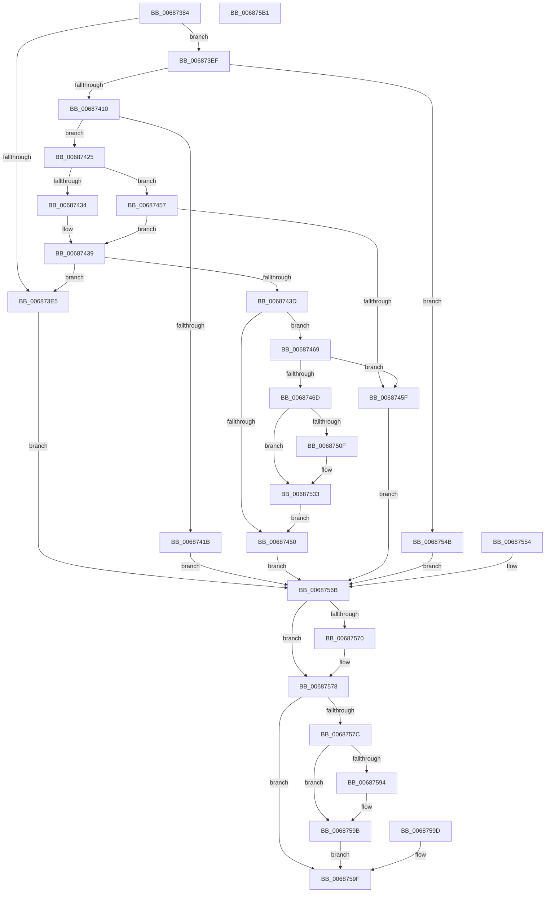

# MiQueryImageExtensionInformationOld

- RVA: `0x00687384`–`0x006875B2` (길이 `558` bytes)
- VA: `0x0000000140687384`
- 실행 섹션: `.text`
- PDB 이름 있음: `예`; PDB Function 태그: `아니요`
- unwind 정보 RVA: `0x000D8A60`
- 디코드: `150`개 명령, `558/558` bytes 표시
- 미해석 바이트: `0` (있으면 어셈블리에 `.byte`로 보존)

> 이 문서는 커널 이미지의 기계어와 PDB 기호를 분석해 생성했습니다. 4번과 5번은 함수 원형과 자료형을 바이너리 사용 방식에서 추정한 C 해석이며 원본 소스 복구 결과는 아닙니다.

## 1. Dependencies

- 직접 호출 지점: **7**; 고유 호출 대상: **7**
- 직접 호출자로 확인된 함수: **1**
- RIP 상대 이미지 참조: **1**

### Outgoing calls
- `0x006873FF` → [MiObtainReferencedVadEx](../31/MiObtainReferencedVadEx_function_00316690.md) (function, `0x00316690`)
- `0x00687470` → [MiGetImageExtensionBaseAddress](../../page/A3/MiGetImageExtensionBaseAddress_function_00A3559C.md) (function, `0x00A3559C`)
- `0x006874C4` → [MiLockWorkingSetShared](../27/MiLockWorkingSetShared_function_0027CBF0.md) (function, `0x0027CBF0`)
- `0x006874DE` → [MiMakeSystemAddressValid](../27/MiMakeSystemAddressValid_function_0027FF70.md) (function, `0x0027FF70`)
- `0x00687536` → [MiUnlockPageTable](../21/MiUnlockPageTable_function_00216EC0.md) (function, `0x00216EC0`)
- `0x00687541` → [MiUnlockWorkingSetShared](../27/MiUnlockWorkingSetShared_function_0027D690.md) (function, `0x0027D690`)
- `0x00687573` → [MiUnlockAndDereferenceVadShared](../2A/MiUnlockAndDereferenceVadShared_function_002AEF10.md) (function, `0x002AEF10`)

### Direct callers
- [MmQueryVirtualMemory](../../page/9D/MmQueryVirtualMemory_function_009D9280.md) at `0x009D98EB`

### Static image references
- `0x00687478` → RVA `0x00E2D8A0` (`.data`; read)

## 2. Other-region calls and transfers

- 다른 실행 섹션으로 향하는 call: **1**
  - `0x00687470` → [MiGetImageExtensionBaseAddress](../../page/A3/MiGetImageExtensionBaseAddress_function_00A3559C.md) (`.text` → `PAGE`)
- 별도 외부 분기/꼬리 이동을 확인하지 못했습니다.

## 3. Assembly (complete function range)

```asm
00687384  48 8B C4                        mov rax, rsp
00687387  4C 89 48 20                     mov qword ptr [rax + 0x20], r9
0068738B  48 89 50 10                     mov qword ptr [rax + 0x10], rdx
0068738F  48 89 48 08                     mov qword ptr [rax + 8], rcx
00687393  53                              push rbx
00687394  56                              push rsi
00687395  57                              push rdi
00687396  41 54                           push r12
00687398  41 55                           push r13
0068739A  41 56                           push r14
0068739C  41 57                           push r15
0068739E  48 83 EC 40                     sub rsp, 0x40
006873A2  4D 8B F1                        mov r14, r9
006873A5  4D 8B C8                        mov r9, r8
006873A8  48 8B F1                        mov rsi, rcx
006873AB  83 60 10 00                     and dword ptr [rax + 0x10], 0
006873AF  0F 57 C0                        xorps xmm0, xmm0
006873B2  33 C0                           xor eax, eax
006873B4  0F 11 44 24 28                  movups xmmword ptr [rsp + 0x28], xmm0
006873B9  48 89 44 24 38                  mov qword ptr [rsp + 0x38], rax
006873BE  33 FF                           xor edi, edi
006873C0  48 89 7C 24 20                  mov qword ptr [rsp + 0x20], rdi
006873C5  0F 10 01                        movups xmm0, xmmword ptr [rcx]
006873C8  0F 11 44 24 28                  movups xmmword ptr [rsp + 0x28], xmm0
006873CD  F2 0F 10 49 10                  movsd xmm1, qword ptr [rcx + 0x10]
006873D2  F2 0F 11 4C 24 38               movsd qword ptr [rsp + 0x38], xmm1
006873D8  48 8B 44 24 28                  mov rax, qword ptr [rsp + 0x28]
006873DD  48 C1 E8 20                     shr rax, 0x20
006873E1  85 C0                           test eax, eax
006873E3  74 0A                           je 0x1406873ef
006873E5  BB 0D 00 00 C0                  mov ebx, 0xc000000d
006873EA  E9 7C 01 00 00                  jmp 0x14068756b
006873EF  4C 8D 84 24 88 00 00 00         lea r8, [rsp + 0x88]
006873F7  BA 02 00 00 00                  mov edx, 2
006873FC  49 8B C9                        mov rcx, r9
006873FF  E8 8C F2 C8 FF                  call 0x140316690
00687404  48 8B F8                        mov rdi, rax
00687407  48 85 C0                        test rax, rax
0068740A  0F 84 3B 01 00 00               je 0x14068754b
00687410  8B 48 30                        mov ecx, dword ptr [rax + 0x30]
00687413  80 E1 70                        and cl, 0x70
00687416  80 F9 20                        cmp cl, 0x20
00687419  74 0A                           je 0x140687425
0068741B  BB 41 01 00 C0                  mov ebx, 0xc0000141
00687420  E9 46 01 00 00                  jmp 0x14068756b
00687425  BA 03 00 00 00                  mov edx, 3
0068742A  8B CA                           mov ecx, edx
0068742C  8B 44 24 28                     mov eax, dword ptr [rsp + 0x28]
00687430  85 C0                           test eax, eax
00687432  75 23                           jne 0x140687457
00687434  33 C9                           xor ecx, ecx
00687436  45 33 C0                        xor r8d, r8d
00687439  3B CA                           cmp ecx, edx
0068743B  74 A8                           je 0x1406873e5
0068743D  48 83 64 24 30 00               and qword ptr [rsp + 0x30], 0
00687443  48 83 64 24 38 00               and qword ptr [rsp + 0x38], 0
00687449  8B 47 40                        mov eax, dword ptr [rdi + 0x40]
0068744C  A8 20                           test al, 0x20
0068744E  75 19                           jne 0x140687469
00687450  33 DB                           xor ebx, ebx
00687452  E9 14 01 00 00                  jmp 0x14068756b
00687457  4C 8B C2                        mov r8, rdx
0068745A  83 F8 01                        cmp eax, 1
0068745D  75 DA                           jne 0x140687439
0068745F  BB BB 00 00 C0                  mov ebx, 0xc00000bb
00687464  E9 02 01 00 00                  jmp 0x14068756b
00687469  85 C9                           test ecx, ecx
0068746B  75 F2                           jne 0x14068745f
0068746D  48 8B CF                        mov rcx, rdi
00687470  E8 27 E1 3A 00                  call 0x140a3559c
00687475  4C 8B F8                        mov r15, rax
00687478  48 8D 05 21 64 7A 00            lea rax, [rip + 0x7a6421]
0068747F  42 8B 0C 80                     mov ecx, dword ptr [rax + r8*4]
00687483  4C 03 F9                        add r15, rcx
00687486  49 8B DF                        mov rbx, r15
00687489  48 C1 EB 09                     shr rbx, 9
0068748D  48 B8 F8 FF FF FF 7F 00 00 00   movabs rax, 0x7ffffffff8
00687497  48 23 D8                        and rbx, rax
0068749A  48 B8 00 00 00 00 80 F6 FF FF   movabs rax, 0xfffff68000000000
006874A4  48 8B C8                        mov rcx, rax
006874A7  48 03 D9                        add rbx, rcx
006874AA  65 48 8B 04 25 88 01 00 00      mov rax, qword ptr gs:[0x188]
006874B3  4C 8B A0 B8 00 00 00            mov r12, qword ptr [rax + 0xb8]
006874BA  49 81 C4 00 04 00 00            add r12, 0x400
006874C1  49 8B CC                        mov rcx, r12
006874C4  E8 27 57 BF FF                  call 0x14027cbf0
006874C9  44 8A E8                        mov r13b, al
006874CC  8B 57 30                        mov edx, dword ptr [rdi + 0x30]
006874CF  C1 EA 0C                        shr edx, 0xc
006874D2  83 E2 7F                        and edx, 0x7f
006874D5  45 33 C9                        xor r9d, r9d
006874D8  44 8A C0                        mov r8b, al
006874DB  48 8B CB                        mov rcx, rbx
006874DE  E8 8D 8A BF FF                  call 0x14027ff70
006874E3  48 8B D3                        mov rdx, rbx
006874E6  48 C1 EA 09                     shr rdx, 9
006874EA  48 B8 F8 FF FF FF 7F 00 00 00   movabs rax, 0x7ffffffff8
006874F4  48 23 D0                        and rdx, rax
006874F7  48 B8 00 00 00 00 80 F6 FF FF   movabs rax, 0xfffff68000000000
00687501  48 8B C0                        mov rax, rax
00687504  48 03 D0                        add rdx, rax
00687507  48 8B 03                        mov rax, qword ptr [rbx]
0068750A  48 85 C0                        test rax, rax
0068750D  74 24                           je 0x140687533
0068750F  44 0F B6 47 20                  movzx r8d, byte ptr [rdi + 0x20]
00687514  49 C1 E0 20                     shl r8, 0x20
00687518  8B 47 18                        mov eax, dword ptr [rdi + 0x18]
0068751B  4C 0B C0                        or r8, rax
0068751E  49 C1 E0 0C                     shl r8, 0xc
00687522  4D 2B F8                        sub r15, r8
00687525  4C 89 7C 24 30                  mov qword ptr [rsp + 0x30], r15
0068752A  48 C7 44 24 38 00 10 00 00      mov qword ptr [rsp + 0x38], 0x1000
00687533  49 8B CC                        mov rcx, r12
00687536  E8 85 F9 B8 FF                  call 0x140216ec0
0068753B  41 8A D5                        mov dl, r13b
0068753E  49 8B CC                        mov rcx, r12
00687541  E8 4A 61 BF FF                  call 0x14027d690
00687546  E9 05 FF FF FF                  jmp 0x140687450
0068754B  8B 9C 24 88 00 00 00            mov ebx, dword ptr [rsp + 0x88]
00687552  EB 17                           jmp 0x14068756b
00687554  8B D8                           mov ebx, eax
00687556  4C 8B B4 24 98 00 00 00         mov r14, qword ptr [rsp + 0x98]
0068755E  48 8B B4 24 80 00 00 00         mov rsi, qword ptr [rsp + 0x80]
00687566  48 8B 7C 24 20                  mov rdi, qword ptr [rsp + 0x20]
0068756B  48 85 FF                        test rdi, rdi
0068756E  74 08                           je 0x140687578
00687570  48 8B CF                        mov rcx, rdi
00687573  E8 98 79 C2 FF                  call 0x1402aef10
00687578  85 DB                           test ebx, ebx
0068757A  78 23                           js 0x14068759f
0068757C  0F 10 44 24 28                  movups xmm0, xmmword ptr [rsp + 0x28]
00687581  0F 11 06                        movups xmmword ptr [rsi], xmm0
00687584  F2 0F 10 4C 24 38               movsd xmm1, qword ptr [rsp + 0x38]
0068758A  F2 0F 11 4E 10                  movsd qword ptr [rsi + 0x10], xmm1
0068758F  4D 85 F6                        test r14, r14
00687592  74 07                           je 0x14068759b
00687594  49 C7 06 18 00 00 00            mov qword ptr [r14], 0x18
0068759B  EB 02                           jmp 0x14068759f
0068759D  8B D8                           mov ebx, eax
0068759F  8B C3                           mov eax, ebx
006875A1  48 83 C4 40                     add rsp, 0x40
006875A5  41 5F                           pop r15
006875A7  41 5E                           pop r14
006875A9  41 5D                           pop r13
006875AB  41 5C                           pop r12
006875AD  5F                              pop rdi
006875AE  5E                              pop rsi
006875AF  5B                              pop rbx
006875B0  C3                              ret
006875B1  CC                              int3
```

## 4. C-style interpretation (structured pseudocode)

```c
__int64 __fastcall MiQueryImageExtensionInformationOld(__int64 a1, __int64 a2, __int64 a3, __int64 a4)
{
    __int64 result;
    __int64 v_r12;
    __int64 v_r15;
    __int64 v_rbx;
    __int64 v_rdi;
    __int64 v_rsp;
    unsigned __int64 v_stack_m40;
    unsigned __int64 v_stack_m48;
    unsigned __int64 v_stack_m50;
    unsigned __int64 v_stack_m58;
    unsigned __int64 v_stack_p10;
    unsigned __int64 v_stack_p20;
    unsigned __int64 v_stack_p8;

    *(unsigned __int64 *)(v_rsp + 32) = a4;
    *(unsigned __int64 *)(v_rsp + 16) = a2;
    *(unsigned __int64 *)(v_rsp + 8) = a1;
    v_rsp = (v_rsp) - (64);
    result = 0;
    v_stack_m50 = v_xmm0;
    v_stack_m40 = 0;
    v_rdi = 0;
    v_stack_m58 = 0;
    v_stack_m50 = v_xmm0;
    v_stack_m40 = v_xmm1;
    result = (v_stack_m50) >> (32);
    if ((unsigned int)(result) == 0) goto loc_006873EF;
loc_006873E5:
    goto loc_0068756B;
loc_006873EF:
    result = MiObtainReferencedVadEx(a3, 2, v_stack_p10, a3);
    if (result == 0) goto loc_0068754B;
    a1 = (unsigned __int8)(((unsigned int)(*(unsigned int *)(result + 48))) & (112));
    if (((unsigned __int8)(a1)) == 32) goto loc_00687425;
    goto loc_0068756B;
loc_00687425:
    if ((unsigned int)((unsigned int)(v_stack_m50)) != 0) goto loc_00687457;
    a1 = 0;
    a3 = 0;
loc_00687439:
    if (0 == 3) goto loc_006873E5;
    if ((((unsigned __int8)((unsigned int)(*(unsigned int *)(result + 64)))) & (32)) != 0) goto loc_00687469;
loc_00687450:
    v_rbx = 0;
    goto loc_0068756B;
loc_00687457:
    if (((unsigned int)((unsigned int)(*(unsigned int *)(result + 64)))) != 1) goto loc_00687439;
loc_0068745F:
    goto loc_0068756B;
loc_00687469:
    if (0 != 0) goto loc_0068745F;
    result = MiGetImageExtensionBaseAddress(result, 3, 3, a3);
    v_r15 = (result) + ((unsigned int)(*(unsigned int *)(v_rip + 8021025 + 3 * 4)));
    v_rbx = (v_r15) >> (9);
    v_rbx = (v_rbx) & (v_rip + 8021025);
    v_rbx = (v_rbx) + (v_rip + 8021025);
    v_r12 = (*(unsigned __int64 *)(*(unsigned __int64 *)(gs_base + (0 + 392)) + 184)) + (0x400ULL);
    result = MiLockWorkingSetShared(v_r12, 3, 3, a3);
    a2 = (unsigned int)(((unsigned int)(*(unsigned int *)(result + 48))) >> (12));
    a2 = (unsigned int)((a2) & (127));
    a4 = 0;
    result = MiMakeSystemAddressValid(v_rbx, a2, (unsigned __int8)(result), a4);
    a2 = (v_rbx) >> (9);
    a2 = (a2) & (result);
    a2 = (a2) + (result);
    result = *(unsigned __int64 *)(v_rbx);
    if (*(unsigned __int64 *)(v_rbx) != 0) {
        a3 = *(unsigned __int8 *)(result + 32);
        a3 = (a3) << (32);
        result = *(unsigned int *)(result + 24);
        a3 = (a3) | (result);
        a3 = (a3) << (12);
        v_r15 = (v_r15) - (a3);
        v_stack_m48 = v_r15;
        v_stack_m40 = 0x1000ULL;
    }
    result = MiUnlockPageTable(v_r12, a2, a3, a4);
    result = MiUnlockWorkingSetShared(v_r12, (unsigned __int8)((unsigned __int8)(result)), a3, a4);
    goto loc_00687450;
loc_0068754B:
    goto loc_0068756B;
loc_0068756B:
    if (result != 0) {
        a1 = result;
        result = MiUnlockAndDereferenceVadShared(a1, (unsigned __int8)((unsigned __int8)(result)), a3, a4);
    }
    if (sign_flag) goto loc_0068759F;
    *(unsigned __int64 *)(a1) = v_xmm0;
    *(unsigned __int64 *)(a1 + 16) = v_xmm1;
    if (0 != 0) {
        *(unsigned __int64 *)(a4) = 24;
    }
    goto loc_0068759F;
loc_0068759F:
    v_rsp = (v_rsp) + (64);
    return (unsigned int)((unsigned int)((unsigned int)(v_stack_p10)));
}
```

## 5. (Beta) C Style

```c
int64_t MiQueryImageExtensionInformationOld(void *Arg1, int64_t Arg2, int64_t Arg3, int64_t Arg4)
{
    uint8_t *arg1 = (uint8_t *)Arg1;

    int64_t result;
    int64_t local_r12;
    int64_t local_r15;
    int64_t local_rbx;
    int64_t local_rdi;
    int64_t local_rsp;
    uint64_t v_stack_m40;
    uint64_t v_stack_m48;
    uint64_t v_stack_m50;
    uint64_t v_stack_m58;
    uint64_t v_stack_p10;
    uint64_t v_stack_p20;
    uint64_t v_stack_p8;

    *(uint64_t *)(local_rsp + 0x20) = Arg4;
    *(uint64_t *)(local_rsp + 0x10) = Arg2;
    *(void **)(local_rsp + 0x8) = Arg1;
    local_rsp = (local_rsp) - (64);
    result = 0;
    v_stack_m50 = v_xmm0;
    v_stack_m40 = 0;
    local_rdi = 0;
    v_stack_m58 = 0;
    v_stack_m50 = v_xmm0;
    v_stack_m40 = v_xmm1;
    result = (v_stack_m50) >> (32);
    if ((uint32_t)(result) == 0) goto loc_006873EF;
loc_006873E5:
    goto loc_0068756B;
loc_006873EF:
    result = MiObtainReferencedVadEx(Arg3, 2, v_stack_p10, Arg3);
    if (result == 0) goto loc_0068754B;
    Arg1 = (uint8_t)(((uint32_t)(*(uint32_t *)(result + 0x30))) & (112));
    if (((uint8_t)(Arg1)) == 32) goto loc_00687425;
    goto loc_0068756B;
loc_00687425:
    if ((uint32_t)((uint32_t)(v_stack_m50)) != 0) goto loc_00687457;
    Arg1 = 0;
    Arg3 = 0;
loc_00687439:
    if (0 == 3) goto loc_006873E5;
    if ((((uint8_t)((uint32_t)(*(uint32_t *)(result + 0x40)))) & (32)) != 0) goto loc_00687469;
loc_00687450:
    local_rbx = 0;
    goto loc_0068756B;
loc_00687457:
    if (((uint32_t)((uint32_t)(*(uint32_t *)(result + 0x40)))) != 1) goto loc_00687439;
loc_0068745F:
    goto loc_0068756B;
loc_00687469:
    if (0 != 0) goto loc_0068745F;
    result = MiGetImageExtensionBaseAddress(result, 3, 3, Arg3);
    local_r15 = (result) + ((uint32_t)(*(uint32_t *)(v_rip + 0x7A6421 + 0x3 * 4)));
    local_rbx = (local_r15) >> (9);
    local_rbx = (local_rbx) & (v_rip + 8021025);
    local_rbx = (local_rbx) + (v_rip + 8021025);
    local_r12 = (*(uint64_t *)(*(uint64_t *)(gs_base + (0 + 0x188)) + 0xB8)) + (0x400ULL);
    result = MiLockWorkingSetShared(local_r12, 3, 3, Arg3);
    Arg2 = (uint32_t)(((uint32_t)(*(uint32_t *)(result + 0x30))) >> (12));
    Arg2 = (uint32_t)((Arg2) & (127));
    Arg4 = 0;
    result = MiMakeSystemAddressValid(local_rbx, Arg2, (uint8_t)(result), Arg4);
    Arg2 = (local_rbx) >> (9);
    Arg2 = (Arg2) & (result);
    Arg2 = (Arg2) + (result);
    result = *(uint64_t *)(local_rbx);
    if (*(uint64_t *)(local_rbx) != 0) {
        Arg3 = *(uint8_t *)(result + 0x20);
        Arg3 = (Arg3) << (32);
        result = *(uint32_t *)(result + 0x18);
        Arg3 = (Arg3) | (result);
        Arg3 = (Arg3) << (12);
        local_r15 = (local_r15) - (Arg3);
        v_stack_m48 = local_r15;
        v_stack_m40 = 0x1000ULL;
    }
    result = MiUnlockPageTable(local_r12, Arg2, Arg3, Arg4);
    result = MiUnlockWorkingSetShared(local_r12, (uint8_t)((uint8_t)(result)), Arg3, Arg4);
    goto loc_00687450;
loc_0068754B:
    goto loc_0068756B;
loc_0068756B:
    if (result != 0) {
        Arg1 = result;
        result = MiUnlockAndDereferenceVadShared(Arg1, (uint8_t)((uint8_t)(result)), Arg3, Arg4);
    }
    if (sign_flag) goto loc_0068759F;
    *(uint64_t *)(arg1) = v_xmm0;
    *(uint64_t *)(arg1 + 0x10) = v_xmm1;
    if (0 != 0) {
        *(uint64_t *)(Arg4) = 24;
    }
    goto loc_0068759F;
loc_0068759F:
    local_rsp = (local_rsp) + (64);
    return (uint32_t)((uint32_t)((uint32_t)(v_stack_p10)));
}
```

### 관측된 메모리 오프셋

구조체 형식이 확인되지 않은 접근은 인자 기준의 오프셋으로만 기록했습니다.

| 기준 인자 | 오프셋 표현 | 폭 (bit) | 접근 |
|---|---:|---:|---|
| `Arg1` | `+ 0x0` | `128` | `R` |
| `Arg1` | `+ 0x10` | `64` | `R` |
| `Arg1` | `+ 0x10` | `64` | `W` |

## 6. Execution-region graph

[열기: 2D/3D 그래프와 함수 탐색 컨트롤 패널](../../../control-panel.html?section=text&rva=0x00687384&view=graph)

- 2D 그래프는 위에서 아래로 흐르고, 3D 그래프는 빈 공간을 드래그해 회전합니다. Shift+드래그는 이동, 휠은 확대·축소, 함수 노드 선택은 대상 보고서 이동입니다.

### Static fallback


