# MiQueryVaPhysicalContiguity

- RVA: `0x006875B8`–`0x0068796E` (길이 `950` bytes)
- VA: `0x00000001406875B8`
- 실행 섹션: `.text`
- PDB 이름 있음: `예`; PDB Function 태그: `아니요`
- unwind 정보 RVA: `0x000D8AE8`
- 디코드: `250`개 명령, `950/950` bytes 표시
- 미해석 바이트: `0` (있으면 어셈블리에 `.byte`로 보존)

> 이 문서는 커널 이미지의 기계어와 PDB 기호를 분석해 생성했습니다. 4번과 5번은 함수 원형과 자료형을 바이너리 사용 방식에서 추정한 C 해석이며 원본 소스 복구 결과는 아닙니다.

## 1. Dependencies

- 직접 호출 지점: **12**; 고유 호출 대상: **8**
- 직접 호출자로 확인된 함수: **2**
- RIP 상대 이미지 참조: **1**

### Outgoing calls
- `0x00687658` → [MiLockWorkingSetShared](../27/MiLockWorkingSetShared_function_0027CBF0.md) (function, `0x0027CBF0`)
- `0x0068769C` → [MiUnlockPageTable](../21/MiUnlockPageTable_function_00216EC0.md) (function, `0x00216EC0`)
- `0x006876C3` → [MiGetNextPageTable](../2C/MiGetNextPageTable_function_002C2EE0.md) (function, `0x002C2EE0`)
- `0x0068781B` → [MiLockTransitionLeafPageEx](../40/MiLockTransitionLeafPageEx_function_00405884.md) (function, `0x00405884`)
- `0x00687858` → [MiCheckContiguityTradeEligible](MiCheckContiguityTradeEligible_function_00687300.md) (function, `0x00687300`)
- `0x006878C2` → [MiWorkingSetIsContended](../2A/MiWorkingSetIsContended_function_002AE520.md) (function, `0x002AE520`)
- `0x006878CB` → [KeShouldYieldProcessor](../27/KeShouldYieldProcessor_function_002773E0.md) (function, `0x002773E0`)
- `0x006878DF` → [MiUnlockPageTable](../21/MiUnlockPageTable_function_00216EC0.md) (function, `0x00216EC0`)
- `0x006878F0` → [MiUnlockWorkingSetShared](../27/MiUnlockWorkingSetShared_function_0027D690.md) (function, `0x0027D690`)
- `0x006878F8` → [MiLockWorkingSetShared](../27/MiLockWorkingSetShared_function_0027CBF0.md) (function, `0x0027CBF0`)
- `0x00687921` → [MiUnlockPageTable](../21/MiUnlockPageTable_function_00216EC0.md) (function, `0x00216EC0`)
- `0x00687930` → [MiUnlockWorkingSetShared](../27/MiUnlockWorkingSetShared_function_0027D690.md) (function, `0x0027D690`)

### Direct callers
- [MiProcessVaContiguityInformation](../69/MiProcessVaContiguityInformation_function_006939C0.md) at `0x00693BD9`
- [MiQueryMemoryPhysicalContiguity](../../page/AD/MiQueryMemoryPhysicalContiguity_function_00AD5B98.md) at `0x00AD5F9F`

### Static image references
- `0x006875DD` → RVA `0x00011C60` (`.rdata`; read)

## 2. Other-region calls and transfers

- 다른 실행 섹션으로 향하는 call: **0**
- 별도 외부 분기/꼬리 이동을 확인하지 못했습니다.

## 3. Assembly (complete function range)

```asm
006875B8  48 8B C4                        mov rax, rsp
006875BB  44 89 48 20                     mov dword ptr [rax + 0x20], r9d
006875BF  48 89 48 08                     mov qword ptr [rax + 8], rcx
006875C3  53                              push rbx
006875C4  55                              push rbp
006875C5  56                              push rsi
006875C6  57                              push rdi
006875C7  41 54                           push r12
006875C9  41 55                           push r13
006875CB  41 56                           push r14
006875CD  41 57                           push r15
006875CF  48 83 EC 68                     sub rsp, 0x68
006875D3  83 60 10 00                     and dword ptr [rax + 0x10], 0
006875D7  48 8B F9                        mov rdi, rcx
006875DA  41 8B C0                        mov eax, r8d
006875DD  48 8D 0D 7C A6 98 FF            lea rcx, [rip - 0x675984]
006875E4  4C 8B FA                        mov r15, rdx
006875E7  49 B8 00 00 00 00 80 F6 FF FF   movabs r8, 0xfffff68000000000
006875F1  49 C1 EF 09                     shr r15, 9
006875F5  49 BA F8 FF FF FF 7F 00 00 00   movabs r10, 0x7ffffffff8
006875FF  4D 23 FA                        and r15, r10
00687602  48 8B 0C C1                     mov rcx, qword ptr [rcx + rax*8]
00687606  48 89 4C 24 58                  mov qword ptr [rsp + 0x58], rcx
0068760B  49 8B C0                        mov rax, r8
0068760E  4C 8B E9                        mov r13, rcx
00687611  48 FF CA                        dec rdx
00687614  49 C1 E5 0C                     shl r13, 0xc
00687618  4C 03 F8                        add r15, rax
0068761B  4C 03 EA                        add r13, rdx
0068761E  49 C1 ED 09                     shr r13, 9
00687622  4D 23 EA                        and r13, r10
00687625  49 8B C0                        mov rax, r8
00687628  48 83 4C 24 48 FF               or qword ptr [rsp + 0x48], 0xffffffffffffffff
0068762E  4C 03 E8                        add r13, rax
00687631  33 F6                           xor esi, esi
00687633  4C 89 6C 24 50                  mov qword ptr [rsp + 0x50], r13
00687638  21 74 24 30                     and dword ptr [rsp + 0x30], esi
0068763C  41 8B C1                        mov eax, r9d
0068763F  33 ED                           xor ebp, ebp
00687641  45 33 E4                        xor r12d, r12d
00687644  45 33 F6                        xor r14d, r14d
00687647  48 89 6C 24 40                  mov qword ptr [rsp + 0x40], rbp
0068764C  8D 5E 01                        lea ebx, [rsi + 1]
0068764F  48 8B CF                        mov rcx, rdi
00687652  23 C3                           and eax, ebx
00687654  89 44 24 38                     mov dword ptr [rsp + 0x38], eax
00687658  E8 93 55 BF FF                  call 0x14027cbf0
0068765D  88 84 24 C0 00 00 00            mov byte ptr [rsp + 0xc0], al
00687664  48 B8 00 00 00 00 00 DE FF FF   movabs rax, 0xffffde0000000000
0068766E  48 B9 FF FF FF FF FF 00 00 00   movabs rcx, 0xffffffffff
00687678  4D 3B FD                        cmp r15, r13
0068767B  0F 87 95 02 00 00               ja 0x140687916
00687681  4C 8B EB                        mov r13, rbx
00687684  48 85 F6                        test rsi, rsi
00687687  74 1A                           je 0x1406876a3
00687689  49 F7 C7 FF 0F 00 00            test r15, 0xfff
00687690  0F 85 38 01 00 00               jne 0x1406877ce
00687696  48 8B D6                        mov rdx, rsi
00687699  48 8B CF                        mov rcx, rdi
0068769C  E8 1F F8 B8 FF                  call 0x140216ec0
006876A1  33 F6                           xor esi, esi
006876A3  44 8A 84 24 C0 00 00 00         mov r8b, byte ptr [rsp + 0xc0]
006876AB  48 8D 84 24 B8 00 00 00         lea rax, [rsp + 0xb8]
006876B3  48 8B 54 24 50                  mov rdx, qword ptr [rsp + 0x50]
006876B8  44 8B CB                        mov r9d, ebx
006876BB  49 8B CF                        mov rcx, r15
006876BE  48 89 44 24 20                  mov qword ptr [rsp + 0x20], rax
006876C3  E8 18 B8 C3 FF                  call 0x1402c2ee0
006876C8  48 8B D0                        mov rdx, rax
006876CB  48 85 C0                        test rax, rax
006876CE  0F 84 72 02 00 00               je 0x140687946
006876D4  48 8B F0                        mov rsi, rax
006876D7  49 B9 00 00 00 00 80 F6 FF FF   movabs r9, 0xfffff68000000000
006876E1  48 C1 EE 09                     shr rsi, 9
006876E5  49 BA F8 FF FF FF 7F 00 00 00   movabs r10, 0x7ffffffff8
006876EF  49 23 F2                        and rsi, r10
006876F2  49 8B C1                        mov rax, r9
006876F5  8B 8C 24 B8 00 00 00            mov ecx, dword ptr [rsp + 0xb8]
006876FC  48 03 F0                        add rsi, rax
006876FF  85 C9                           test ecx, ecx
00687701  74 41                           je 0x140687744
00687703  48 89 74 24 40                  mov qword ptr [rsp + 0x40], rsi
00687708  48 8B EE                        mov rbp, rsi
0068770B  3B CB                           cmp ecx, ebx
0068770D  76 28                           jbe 0x140687737
0068770F  44 8D 41 FF                     lea r8d, [rcx - 1]
00687713  48 C1 EE 09                     shr rsi, 9
00687717  49 23 F2                        and rsi, r10
0068771A  49 8B C1                        mov rax, r9
0068771D  48 C1 ED 09                     shr rbp, 9
00687721  48 03 F0                        add rsi, rax
00687724  49 23 EA                        and rbp, r10
00687727  49 8B C1                        mov rax, r9
0068772A  48 03 E8                        add rbp, rax
0068772D  4C 2B C3                        sub r8, rbx
00687730  75 E1                           jne 0x140687713
00687732  48 89 6C 24 40                  mov qword ptr [rsp + 0x40], rbp
00687737  48 C1 EE 09                     shr rsi, 9
0068773B  49 23 F2                        and rsi, r10
0068773E  49 8B C1                        mov rax, r9
00687741  48 03 F0                        add rsi, rax
00687744  49 3B D7                        cmp rdx, r15
00687747  0F 85 F9 01 00 00               jne 0x140687946
0068774D  85 C9                           test ecx, ecx
0068774F  74 69                           je 0x1406877ba
00687751  48 8B 7D 00                     mov rdi, qword ptr [rbp]
00687755  48 B8 FF FF FF FF FF 00 00 00   movabs rax, 0xffffffffff
0068775F  48 C1 EF 0C                     shr rdi, 0xc
00687763  49 8B CF                        mov rcx, r15
00687766  48 23 F8                        and rdi, rax
00687769  48 C1 E1 19                     shl rcx, 0x19
0068776D  49 8B C1                        mov rax, r9
00687770  48 C1 E0 19                     shl rax, 0x19
00687774  48 2B C8                        sub rcx, rax
00687777  8B 84 24 B8 00 00 00            mov eax, dword ptr [rsp + 0xb8]
0068777E  48 C1 F9 10                     sar rcx, 0x10
00687782  48 C1 E9 0C                     shr rcx, 0xc
00687786  85 C0                           test eax, eax
00687788  74 1E                           je 0x1406877a8
0068778A  8B D0                           mov edx, eax
0068778C  48 8B C1                        mov rax, rcx
0068778F  48 C1 E9 09                     shr rcx, 9
00687793  25 FF 01 00 00                  and eax, 0x1ff
00687798  49 0F AF C5                     imul rax, r13
0068779C  49 C1 E5 09                     shl r13, 9
006877A0  48 03 F8                        add rdi, rax
006877A3  48 2B D3                        sub rdx, rbx
006877A6  75 E4                           jne 0x14068778c
006877A8  49 8D 45 FF                     lea rax, [r13 - 1]
006877AC  44 8B F3                        mov r14d, ebx
006877AF  48 23 C7                        and rax, rdi
006877B2  4C 2B E8                        sub r13, rax
006877B5  E9 C4 00 00 00                  jmp 0x14068787e
006877BA  48 B8 00 00 00 00 00 DE FF FF   movabs rax, 0xffffde0000000000
006877C4  48 B9 FF FF FF FF FF 00 00 00   movabs rcx, 0xffffffffff
006877CE  44 21 64 24 34                  and dword ptr [rsp + 0x34], r12d
006877D3  49 8B 3F                        mov rdi, qword ptr [r15]
006877D6  40 84 FB                        test bl, dil
006877D9  74 17                           je 0x1406877f2
006877DB  48 C1 EF 0C                     shr rdi, 0xc
006877DF  48 23 F9                        and rdi, rcx
006877E2  48 8D 2C 7F                     lea rbp, [rdi + rdi*2]
006877E6  48 C1 E5 04                     shl rbp, 4
006877EA  48 8B C0                        mov rax, rax
006877ED  48 03 E8                        add rbp, rax
006877F0  EB 63                           jmp 0x140687855
006877F2  81 E7 00 0C 00 00               and edi, 0xc00
006877F8  48 81 FF 00 08 00 00            cmp rdi, 0x800
006877FF  0F 85 06 01 00 00               jne 0x14068790b
00687805  F6 84 24 C8 00 00 00 02         test byte ptr [rsp + 0xc8], 2
0068780D  0F 85 F8 00 00 00               jne 0x14068790b
00687813  45 33 C0                        xor r8d, r8d
00687816  33 D2                           xor edx, edx
00687818  49 8B CF                        mov rcx, r15
0068781B  E8 64 E0 D7 FF                  call 0x140405884
00687820  48 8B E8                        mov rbp, rax
00687823  48 85 C0                        test rax, rax
00687826  0F 84 DF 00 00 00               je 0x14068790b
0068782C  89 5C 24 34                     mov dword ptr [rsp + 0x34], ebx
00687830  48 B8 00 00 00 00 00 DE FF FF   movabs rax, 0xffffde0000000000
0068783A  48 8B C0                        mov rax, rax
0068783D  48 8B FD                        mov rdi, rbp
00687840  48 2B F8                        sub rdi, rax
00687843  48 B8 AB AA AA AA AA AA AA AA   movabs rax, 0xaaaaaaaaaaaaaaab
0068784D  48 C1 FF 04                     sar rdi, 4
00687851  48 0F AF F8                     imul rdi, rax
00687855  48 8B CD                        mov rcx, rbp
00687858  E8 A3 FA FF FF                  call 0x140687300
0068785D  85 C0                           test eax, eax
0068785F  44 0F 44 F3                     cmove r14d, ebx
00687863  44 39 64 24 34                  cmp dword ptr [rsp + 0x34], r12d
00687868  74 0F                           je 0x140687879
0068786A  48 B8 FF FF FF FF FF FF FF 7F   movabs rax, 0x7fffffffffffffff
00687874  F0 48 21 45 18                  lock and qword ptr [rbp + 0x18], rax
00687879  48 8B 6C 24 40                  mov rbp, qword ptr [rsp + 0x40]
0068787E  48 8B 44 24 48                  mov rax, qword ptr [rsp + 0x48]
00687883  48 83 F8 FF                     cmp rax, -1
00687887  75 0D                           jne 0x140687896
00687889  48 8B 44 24 58                  mov rax, qword ptr [rsp + 0x58]
0068788E  48 FF C8                        dec rax
00687891  48 85 C7                        test rdi, rax
00687894  EB 03                           jmp 0x140687899
00687896  48 3B C7                        cmp rax, rdi
00687899  74 0B                           je 0x1406878a6
0068789B  89 5C 24 30                     mov dword ptr [rsp + 0x30], ebx
0068789F  44 39 64 24 38                  cmp dword ptr [rsp + 0x38], r12d
006878A4  74 68                           je 0x14068790e
006878A6  4A 8D 04 2F                     lea rax, [rdi + r13]
006878AA  48 8B BC 24 B0 00 00 00         mov rdi, qword ptr [rsp + 0xb0]
006878B2  48 89 44 24 48                  mov qword ptr [rsp + 0x48], rax
006878B7  41 F6 C7 78                     test r15b, 0x78
006878BB  75 0E                           jne 0x1406878cb
006878BD  33 D2                           xor edx, edx
006878BF  48 8B CF                        mov rcx, rdi
006878C2  E8 59 6C C2 FF                  call 0x1402ae520
006878C7  85 C0                           test eax, eax
006878C9  75 09                           jne 0x1406878d4
006878CB  E8 10 FB BE FF                  call 0x1402773e0
006878D0  85 C0                           test eax, eax
006878D2  74 29                           je 0x1406878fd
006878D4  48 85 F6                        test rsi, rsi
006878D7  74 0D                           je 0x1406878e6
006878D9  48 8B D6                        mov rdx, rsi
006878DC  48 8B CF                        mov rcx, rdi
006878DF  E8 DC F5 B8 FF                  call 0x140216ec0
006878E4  33 F6                           xor esi, esi
006878E6  8A 94 24 C0 00 00 00            mov dl, byte ptr [rsp + 0xc0]
006878ED  48 8B CF                        mov rcx, rdi
006878F0  E8 9B 5D BF FF                  call 0x14027d690
006878F5  48 8B CF                        mov rcx, rdi
006878F8  E8 F3 52 BF FF                  call 0x14027cbf0
006878FD  4F 8D 3C EF                     lea r15, [r15 + r13*8]
00687901  4C 8B 6C 24 50                  mov r13, qword ptr [rsp + 0x50]
00687906  E9 59 FD FF FF                  jmp 0x140687664
0068790B  44 8B E3                        mov r12d, ebx
0068790E  48 8B BC 24 B0 00 00 00         mov rdi, qword ptr [rsp + 0xb0]
00687916  48 85 F6                        test rsi, rsi
00687919  74 0B                           je 0x140687926
0068791B  48 8B D6                        mov rdx, rsi
0068791E  48 8B CF                        mov rcx, rdi
00687921  E8 9A F5 B8 FF                  call 0x140216ec0
00687926  8A 94 24 C0 00 00 00            mov dl, byte ptr [rsp + 0xc0]
0068792D  48 8B CF                        mov rcx, rdi
00687930  E8 5B 5D BF FF                  call 0x14027d690
00687935  45 85 E4                        test r12d, r12d
00687938  74 11                           je 0x14068794b
0068793A  41 F7 DE                        neg r14d
0068793D  1B DB                           sbb ebx, ebx
0068793F  F7 DB                           neg ebx
00687941  83 C3 02                        add ebx, 2
00687944  EB 14                           jmp 0x14068795a
00687946  44 8B E3                        mov r12d, ebx
00687949  EB CB                           jmp 0x140687916
0068794B  83 7C 24 30 00                  cmp dword ptr [rsp + 0x30], 0
00687950  74 08                           je 0x14068795a
00687952  41 F7 DE                        neg r14d
00687955  1B DB                           sbb ebx, ebx
00687957  83 E3 03                        and ebx, 3
0068795A  8B C3                           mov eax, ebx
0068795C  48 83 C4 68                     add rsp, 0x68
00687960  41 5F                           pop r15
00687962  41 5E                           pop r14
00687964  41 5D                           pop r13
00687966  41 5C                           pop r12
00687968  5F                              pop rdi
00687969  5E                              pop rsi
0068796A  5D                              pop rbp
0068796B  5B                              pop rbx
0068796C  C3                              ret
0068796D  CC                              int3
```

## 4. C-style interpretation (structured pseudocode)

```c
__int64 __fastcall MiQueryVaPhysicalContiguity(__int64 a1, __int64 a2, int a3, int a4)
{
    __int64 result;
    __int64 v_r12;
    __int64 v_r13;
    __int64 v_r14;
    __int64 v_r15;
    __int64 v_rbp;
    __int64 v_rbx;
    __int64 v_rdi;
    __int64 v_rsi;
    __int64 v_rsp;
    unsigned __int64 v_stack_m50;
    unsigned __int64 v_stack_m58;
    unsigned __int64 v_stack_m60;
    unsigned __int64 v_stack_m68;
    unsigned int v_stack_m70;
    unsigned int v_stack_m74;
    unsigned int v_stack_m78;
    unsigned __int64 v_stack_m88;
    unsigned __int64 v_stack_p10;
    unsigned __int8 v_stack_p18;
    unsigned __int8 v_stack_p20;
    unsigned __int64 v_stack_p8;

    *(unsigned int *)(v_rsp + 32) = a4;
    *(unsigned __int64 *)(v_rsp + 8) = a1;
    v_rsp = (v_rsp) - (104);
    v_r15 = (a2) >> (9);
    v_r15 = (v_r15) & (v_r10);
    v_stack_m50 = *(unsigned __int64 *)(v_rip - 6773124 + (unsigned int)(a3) * 8);
    a2 = (a2) - 1;
    v_r13 = (*(unsigned __int64 *)(v_rip - 6773124 + (unsigned int)(a3) * 8)) << (12);
    v_r15 = (v_r15) + (a3);
    v_r13 = (v_r13) + (a2);
    v_r13 = (v_r13) >> (9);
    v_r13 = (v_r13) & (v_r10);
    v_r13 = (v_r13) + (a3);
    v_rsi = 0;
    v_stack_m58 = v_r13;
    v_rbp = 0;
    v_r12 = 0;
    v_r14 = 0;
    v_stack_m68 = 0;
    result = (unsigned int)(((unsigned int)(a4)) & ((unsigned int)(v_rsi + 1)));
    v_stack_m70 = (unsigned int)(result);
    result = MiLockWorkingSetShared(a1, a2, a3, a4);
    v_stack_p18 = (unsigned __int8)(result);
loc_00687664:
    if (v_r15 > v_r13) goto loc_00687916;
    if (0 == 0) goto loc_006876A3;
    if (((v_r15) & (0xFFFULL)) != 0) goto loc_006877CE;
    result = MiUnlockPageTable(a1, 0, a3, a4);
    v_rsi = 0;
loc_006876A3:
    v_stack_m88 = v_stack_p10;
    result = MiGetNextPageTable(v_r15, v_stack_m58, v_stack_p18, (unsigned int)((unsigned int)(v_rsi + 1)));
    if (result == 0) goto loc_00687946;
    v_rsi = (result) >> (9);
    v_rsi = (v_rsi) & (v_r10);
    v_rsi = (v_rsi) + ((unsigned int)((unsigned int)(v_rsi + 1)));
    if ((unsigned int)((unsigned int)(v_stack_p10)) == 0) goto loc_00687744;
    v_stack_m68 = v_rsi;
    if (((unsigned int)((unsigned int)(v_stack_p10))) <= ((unsigned int)(v_rsi + 1))) goto loc_00687737;
loc_00687713:
    v_rsi = (v_rsi) >> (9);
    v_rsi = (v_rsi) & (v_r10);
    v_rbp = (v_rsi) >> (9);
    v_rsi = (v_rsi) + ((unsigned int)((unsigned int)(v_rsi + 1)));
    v_rbp = (v_rbp) & (v_r10);
    v_rbp = (v_rbp) + ((unsigned int)((unsigned int)(v_rsi + 1)));
    a3 = ((unsigned int)(v_stack_p10) - 1) - (v_rsi + 1);
    if (condition_is_not_equal) goto loc_00687713;
    v_stack_m68 = v_rbp;
loc_00687737:
    v_rsi = (v_rsi) >> (9);
    v_rsi = (v_rsi) & (v_r10);
    v_rsi = (v_rsi) + ((unsigned int)((unsigned int)(v_rsi + 1)));
loc_00687744:
    if (result != v_r15) goto loc_00687946;
    if ((unsigned int)((unsigned int)(v_stack_p10)) == 0) goto loc_006877BA;
    v_rdi = (*(unsigned __int64 *)(v_rbp)) >> (12);
    v_rdi = (v_rdi) & ((unsigned int)((unsigned int)(v_rsi + 1)));
    a1 = (v_r15) << (25);
    result = ((unsigned int)((unsigned int)(v_rsi + 1))) << (25);
    a1 = (a1) - (result);
    a1 = (a1) >> (16);
    a1 = (a1) >> (12);
    if ((unsigned int)((unsigned int)(v_stack_p10)) == 0) goto loc_006877A8;
loc_0068778C:
    a1 = (a1) >> (9);
    result = (unsigned int)((a1) & (511));
    result = (result) * (v_rsi + 1);
    v_r13 = (v_rsi + 1) << (9);
    v_rdi = (v_rdi) + (result);
    a2 = ((unsigned int)((unsigned int)((unsigned int)(v_stack_p10)))) - (v_rsi + 1);
    if (condition_is_not_equal) goto loc_0068778C;
loc_006877A8:
    result = (v_r13 - 1) & (v_rdi);
    v_r13 = (v_r13) - (result);
    goto loc_0068787E;
loc_006877BA:
loc_006877CE:
    if ((((unsigned __int8)(v_rsi + 1)) & ((unsigned __int8)(*(unsigned __int64 *)(v_r15)))) == 0) goto loc_006877F2;
    v_rdi = (*(unsigned __int64 *)(v_r15)) >> (12);
    v_rdi = (v_rdi) & (a1);
    v_rbp = (v_rdi + v_rdi * 2) << (4);
    v_rbp = (v_rbp) + (result);
    goto loc_00687855;
loc_006877F2:
    v_rdi = (unsigned int)((v_rdi) & (0xC00ULL));
    if (v_rdi != 0x800ULL) goto loc_0068790B;
    if (((v_stack_p20) & (2)) != 0) goto loc_0068790B;
    a3 = 0;
    a2 = 0;
    result = MiLockTransitionLeafPageEx(v_r15, a2, a3, (unsigned int)((unsigned int)(v_rsi + 1)));
    if (result == 0) goto loc_0068790B;
    v_stack_m74 = (unsigned int)(v_rsi + 1);
    v_rdi = (result) - (result);
    v_rdi = (v_rdi) >> (4);
    v_rdi = (v_rdi) * (result);
loc_00687855:
    result = MiCheckContiguityTradeEligible(result, a2, a3, (unsigned int)((unsigned int)(v_rsi + 1)));
    v_r14 = (unsigned int)((unsigned int)(v_rsi + 1));
    if ((unsigned int)(result) == 0) { v_r14 = (unsigned int)(v_rsi + 1); }
    if (v_stack_m74 != 0) {
    }
loc_0068787E:
    if (v_stack_m60 != -1) goto loc_00687896;
    result = (v_stack_m50) - 1;
    goto loc_00687899;
loc_00687896:
loc_00687899:
    if (result == v_rdi) goto loc_006878A6;
    v_stack_m78 = (unsigned int)(v_rsi + 1);
    if (v_stack_m70 == 0) goto loc_0068790E;
loc_006878A6:
    v_stack_m60 = v_rdi + v_r13 * 1;
    if ((((unsigned __int8)(v_r15)) & (120)) != 0) goto loc_006878CB;
    a2 = 0;
    result = MiWorkingSetIsContended(v_stack_p8, a2, a3, (unsigned int)((unsigned int)(v_rsi + 1)));
    if ((unsigned int)(result) != 0) goto loc_006878D4;
loc_006878CB:
    result = KeShouldYieldProcessor(v_stack_p8, a2, a3, (unsigned int)((unsigned int)(v_rsi + 1)));
    if ((unsigned int)(result) == 0) goto loc_006878FD;
loc_006878D4:
    if (v_rsi != 0) {
        a2 = v_rsi;
        a1 = v_stack_p8;
        result = MiUnlockPageTable(a1, a2, a3, (unsigned int)((unsigned int)(v_rsi + 1)));
        v_rsi = 0;
    }
    result = MiUnlockWorkingSetShared(v_stack_p8, v_stack_p18, a3, (unsigned int)((unsigned int)(v_rsi + 1)));
    result = MiLockWorkingSetShared(v_stack_p8, v_stack_p18, a3, (unsigned int)((unsigned int)(v_rsi + 1)));
loc_006878FD:
    goto loc_00687664;
loc_0068790B:
loc_0068790E:
loc_00687916:
    if (0 != 0) {
        a2 = 0;
        a1 = v_stack_p8;
        result = MiUnlockPageTable(a1, a2, a3, (unsigned int)((unsigned int)(v_rsi + 1)));
    }
    result = MiUnlockWorkingSetShared(v_stack_p8, v_stack_p18, a3, (unsigned int)((unsigned int)(v_rsi + 1)));
    if ((unsigned int)((unsigned int)((unsigned int)(v_rsi + 1))) == 0) goto loc_0068794B;
    v_r14 = (unsigned int)(-(v_r14));
    v_rbx = (unsigned int)(-(v_rsi + 1));
    v_rbx = (unsigned int)((v_rbx) + (2));
    goto loc_0068795A;
loc_00687946:
    goto loc_00687916;
loc_0068794B:
    if (v_stack_m78 != 0) {
        v_r14 = (unsigned int)(-(v_r14));
        v_rbx = (unsigned int)((v_rbx) & (3));
    }
    v_rsp = (v_rsp) + (104);
    return (unsigned int)((unsigned int)(v_rbx));
}
```

## 5. (Beta) C Style

```c
int64_t MiQueryVaPhysicalContiguity(int64_t Arg1, int64_t Arg2, int32_t Arg3, int32_t Arg4)
{
    int64_t result;
    int64_t local_r12;
    int64_t local_r13;
    int64_t local_r14;
    int64_t local_r15;
    int64_t local_rbp;
    int64_t local_rbx;
    int64_t local_rdi;
    int64_t local_rsi;
    int64_t local_rsp;
    uint64_t v_stack_m50;
    uint64_t v_stack_m58;
    uint64_t v_stack_m60;
    uint64_t v_stack_m68;
    uint32_t v_stack_m70;
    uint32_t v_stack_m74;
    uint32_t v_stack_m78;
    uint64_t v_stack_m88;
    uint64_t v_stack_p10;
    uint8_t v_stack_p18;
    uint8_t v_stack_p20;
    uint64_t v_stack_p8;

    *(uint32_t *)(local_rsp + 0x20) = Arg4;
    *(uint64_t *)(local_rsp + 0x8) = Arg1;
    local_rsp = (local_rsp) - (104);
    local_r15 = (Arg2) >> (9);
    local_r15 = (local_r15) & (local_r10);
    v_stack_m50 = *(uint64_t *)(v_rip - 0x675984 + (uint32_t)(Arg3) * 8);
    Arg2 = (Arg2) - 1;
    local_r13 = (*(uint64_t *)(v_rip - 0x675984 + (uint32_t)(Arg3) * 8)) << (12);
    local_r15 = (local_r15) + (Arg3);
    local_r13 = (local_r13) + (Arg2);
    local_r13 = (local_r13) >> (9);
    local_r13 = (local_r13) & (local_r10);
    local_r13 = (local_r13) + (Arg3);
    local_rsi = 0;
    v_stack_m58 = local_r13;
    local_rbp = 0;
    local_r12 = 0;
    local_r14 = 0;
    v_stack_m68 = 0;
    result = (uint32_t)(((uint32_t)(Arg4)) & ((uint32_t)(local_rsi + 1)));
    v_stack_m70 = (uint32_t)(result);
    result = MiLockWorkingSetShared(Arg1, Arg2, Arg3, Arg4);
    v_stack_p18 = (uint8_t)(result);
loc_00687664:
    if (local_r15 > local_r13) goto loc_00687916;
    if (0 == 0) goto loc_006876A3;
    if (((local_r15) & (0xFFFULL)) != 0) goto loc_006877CE;
    result = MiUnlockPageTable(Arg1, 0, Arg3, Arg4);
    local_rsi = 0;
loc_006876A3:
    v_stack_m88 = v_stack_p10;
    result = MiGetNextPageTable(local_r15, v_stack_m58, v_stack_p18, (uint32_t)((uint32_t)(local_rsi + 1)));
    if (result == 0) goto loc_00687946;
    local_rsi = (result) >> (9);
    local_rsi = (local_rsi) & (local_r10);
    local_rsi = (local_rsi) + ((uint32_t)((uint32_t)(local_rsi + 1)));
    if ((uint32_t)((uint32_t)(v_stack_p10)) == 0) goto loc_00687744;
    v_stack_m68 = local_rsi;
    if (((uint32_t)((uint32_t)(v_stack_p10))) <= ((uint32_t)(local_rsi + 1))) goto loc_00687737;
loc_00687713:
    local_rsi = (local_rsi) >> (9);
    local_rsi = (local_rsi) & (local_r10);
    local_rbp = (local_rsi) >> (9);
    local_rsi = (local_rsi) + ((uint32_t)((uint32_t)(local_rsi + 1)));
    local_rbp = (local_rbp) & (local_r10);
    local_rbp = (local_rbp) + ((uint32_t)((uint32_t)(local_rsi + 1)));
    Arg3 = ((uint32_t)(v_stack_p10) - 1) - (local_rsi + 1);
    if (condition_is_not_equal) goto loc_00687713;
    v_stack_m68 = local_rbp;
loc_00687737:
    local_rsi = (local_rsi) >> (9);
    local_rsi = (local_rsi) & (local_r10);
    local_rsi = (local_rsi) + ((uint32_t)((uint32_t)(local_rsi + 1)));
loc_00687744:
    if (result != local_r15) goto loc_00687946;
    if ((uint32_t)((uint32_t)(v_stack_p10)) == 0) goto loc_006877BA;
    local_rdi = (*(uint64_t *)(local_rbp)) >> (12);
    local_rdi = (local_rdi) & ((uint32_t)((uint32_t)(local_rsi + 1)));
    Arg1 = (local_r15) << (25);
    result = ((uint32_t)((uint32_t)(local_rsi + 1))) << (25);
    Arg1 = (Arg1) - (result);
    Arg1 = (Arg1) >> (16);
    Arg1 = (Arg1) >> (12);
    if ((uint32_t)((uint32_t)(v_stack_p10)) == 0) goto loc_006877A8;
loc_0068778C:
    Arg1 = (Arg1) >> (9);
    result = (uint32_t)((Arg1) & (511));
    result = (result) * (local_rsi + 1);
    local_r13 = (local_rsi + 1) << (9);
    local_rdi = (local_rdi) + (result);
    Arg2 = ((uint32_t)((uint32_t)((uint32_t)(v_stack_p10)))) - (local_rsi + 1);
    if (condition_is_not_equal) goto loc_0068778C;
loc_006877A8:
    result = (local_r13 - 1) & (local_rdi);
    local_r13 = (local_r13) - (result);
    goto loc_0068787E;
loc_006877BA:
loc_006877CE:
    if ((((uint8_t)(local_rsi + 1)) & ((uint8_t)(*(uint64_t *)(local_r15)))) == 0) goto loc_006877F2;
    local_rdi = (*(uint64_t *)(local_r15)) >> (12);
    local_rdi = (local_rdi) & (Arg1);
    local_rbp = (local_rdi + local_rdi * 2) << (4);
    local_rbp = (local_rbp) + (result);
    goto loc_00687855;
loc_006877F2:
    local_rdi = (uint32_t)((local_rdi) & (0xC00ULL));
    if (local_rdi != 0x800ULL) goto loc_0068790B;
    if (((v_stack_p20) & (2)) != 0) goto loc_0068790B;
    Arg3 = 0;
    Arg2 = 0;
    result = MiLockTransitionLeafPageEx(local_r15, Arg2, Arg3, (uint32_t)((uint32_t)(local_rsi + 1)));
    if (result == 0) goto loc_0068790B;
    v_stack_m74 = (uint32_t)(local_rsi + 1);
    local_rdi = (result) - (result);
    local_rdi = (local_rdi) >> (4);
    local_rdi = (local_rdi) * (result);
loc_00687855:
    result = MiCheckContiguityTradeEligible(result, Arg2, Arg3, (uint32_t)((uint32_t)(local_rsi + 1)));
    local_r14 = (uint32_t)((uint32_t)(local_rsi + 1));
    if ((uint32_t)(result) == 0) { local_r14 = (uint32_t)(local_rsi + 1); }
    if (v_stack_m74 != 0) {
    }
loc_0068787E:
    if (v_stack_m60 != -1) goto loc_00687896;
    result = (v_stack_m50) - 1;
    goto loc_00687899;
loc_00687896:
loc_00687899:
    if (result == local_rdi) goto loc_006878A6;
    v_stack_m78 = (uint32_t)(local_rsi + 1);
    if (v_stack_m70 == 0) goto loc_0068790E;
loc_006878A6:
    v_stack_m60 = local_rdi + local_r13 * 1;
    if ((((uint8_t)(local_r15)) & (120)) != 0) goto loc_006878CB;
    Arg2 = 0;
    result = MiWorkingSetIsContended(v_stack_p8, Arg2, Arg3, (uint32_t)((uint32_t)(local_rsi + 1)));
    if ((uint32_t)(result) != 0) goto loc_006878D4;
loc_006878CB:
    result = KeShouldYieldProcessor(v_stack_p8, Arg2, Arg3, (uint32_t)((uint32_t)(local_rsi + 1)));
    if ((uint32_t)(result) == 0) goto loc_006878FD;
loc_006878D4:
    if (local_rsi != 0) {
        Arg2 = local_rsi;
        Arg1 = v_stack_p8;
        result = MiUnlockPageTable(Arg1, Arg2, Arg3, (uint32_t)((uint32_t)(local_rsi + 1)));
        local_rsi = 0;
    }
    result = MiUnlockWorkingSetShared(v_stack_p8, v_stack_p18, Arg3, (uint32_t)((uint32_t)(local_rsi + 1)));
    result = MiLockWorkingSetShared(v_stack_p8, v_stack_p18, Arg3, (uint32_t)((uint32_t)(local_rsi + 1)));
loc_006878FD:
    goto loc_00687664;
loc_0068790B:
loc_0068790E:
loc_00687916:
    if (0 != 0) {
        Arg2 = 0;
        Arg1 = v_stack_p8;
        result = MiUnlockPageTable(Arg1, Arg2, Arg3, (uint32_t)((uint32_t)(local_rsi + 1)));
    }
    result = MiUnlockWorkingSetShared(v_stack_p8, v_stack_p18, Arg3, (uint32_t)((uint32_t)(local_rsi + 1)));
    if ((uint32_t)((uint32_t)((uint32_t)(local_rsi + 1))) == 0) goto loc_0068794B;
    local_r14 = (uint32_t)(-(local_r14));
    local_rbx = (uint32_t)(-(local_rsi + 1));
    local_rbx = (uint32_t)((local_rbx) + (2));
    goto loc_0068795A;
loc_00687946:
    goto loc_00687916;
loc_0068794B:
    if (v_stack_m78 != 0) {
        local_r14 = (uint32_t)(-(local_r14));
        local_rbx = (uint32_t)((local_rbx) & (3));
    }
    local_rsp = (local_rsp) + (104);
    return (uint32_t)((uint32_t)(local_rbx));
}
```

## 6. Execution-region graph

[열기: 2D/3D 그래프와 함수 탐색 컨트롤 패널](../../../control-panel.html?section=text&rva=0x006875B8&view=graph)

- 2D 그래프는 위에서 아래로 흐르고, 3D 그래프는 빈 공간을 드래그해 회전합니다. Shift+드래그는 이동, 휠은 확대·축소, 함수 노드 선택은 대상 보고서 이동입니다.

### Static fallback

```mermaid
flowchart TD
  bb_006875B8[BB_006875B8]
  bb_00687664[BB_00687664]
  bb_00687681[BB_00687681]
  bb_00687689[BB_00687689]
  bb_00687696[BB_00687696]
  bb_006876A3[BB_006876A3]
  bb_006876D4[BB_006876D4]
  bb_00687703[BB_00687703]
  bb_0068770F[BB_0068770F]
  bb_00687713[BB_00687713]
  bb_00687732[BB_00687732]
  bb_00687737[BB_00687737]
  bb_00687744[BB_00687744]
  bb_0068774D[BB_0068774D]
  bb_00687751[BB_00687751]
  bb_0068778A[BB_0068778A]
  bb_0068778C[BB_0068778C]
  bb_006877A8[BB_006877A8]
  bb_006877BA[BB_006877BA]
  bb_006877CE[BB_006877CE]
  bb_006877DB[BB_006877DB]
  bb_006877F2[BB_006877F2]
  bb_00687805[BB_00687805]
  bb_00687813[BB_00687813]
  bb_0068782C[BB_0068782C]
  bb_00687855[BB_00687855]
  bb_0068786A[BB_0068786A]
  bb_00687879[BB_00687879]
  bb_0068787E[BB_0068787E]
  bb_00687889[BB_00687889]
  bb_00687896[BB_00687896]
  bb_00687899[BB_00687899]
  bb_0068789B[BB_0068789B]
  bb_006878A6[BB_006878A6]
  bb_006878BD[BB_006878BD]
  bb_006878CB[BB_006878CB]
  bb_006878D4[BB_006878D4]
  bb_006878D9[BB_006878D9]
  bb_006878E6[BB_006878E6]
  bb_006878FD[BB_006878FD]
  bb_0068790B[BB_0068790B]
  bb_0068790E[BB_0068790E]
  bb_00687916[BB_00687916]
  bb_0068791B[BB_0068791B]
  bb_00687926[BB_00687926]
  bb_0068793A[BB_0068793A]
  bb_00687946[BB_00687946]
  bb_0068794B[BB_0068794B]
  bb_00687952[BB_00687952]
  bb_0068795A[BB_0068795A]
  bb_0068796D[BB_0068796D]
  bb_006875B8 -->|flow| bb_00687664
  bb_00687664 -->|branch| bb_00687916
  bb_00687664 -->|fallthrough| bb_00687681
  bb_00687681 -->|branch| bb_006876A3
  bb_00687681 -->|fallthrough| bb_00687689
  bb_00687689 -->|branch| bb_006877CE
  bb_00687689 -->|fallthrough| bb_00687696
  bb_00687696 -->|flow| bb_006876A3
  bb_006876A3 -->|branch| bb_00687946
  bb_006876A3 -->|fallthrough| bb_006876D4
  bb_006876D4 -->|branch| bb_00687744
  bb_006876D4 -->|fallthrough| bb_00687703
  bb_00687703 -->|branch| bb_00687737
  bb_00687703 -->|fallthrough| bb_0068770F
  bb_0068770F -->|flow| bb_00687713
  bb_00687713 -->|branch| bb_00687713
  bb_00687713 -->|fallthrough| bb_00687732
  bb_00687732 -->|flow| bb_00687737
  bb_00687737 -->|flow| bb_00687744
  bb_00687744 -->|branch| bb_00687946
  bb_00687744 -->|fallthrough| bb_0068774D
  bb_0068774D -->|branch| bb_006877BA
  bb_0068774D -->|fallthrough| bb_00687751
  bb_00687751 -->|branch| bb_006877A8
  bb_00687751 -->|fallthrough| bb_0068778A
  bb_0068778A -->|flow| bb_0068778C
  bb_0068778C -->|branch| bb_0068778C
  bb_0068778C -->|fallthrough| bb_006877A8
  bb_006877A8 -->|branch| bb_0068787E
  bb_006877BA -->|flow| bb_006877CE
  bb_006877CE -->|branch| bb_006877F2
  bb_006877CE -->|fallthrough| bb_006877DB
  bb_006877DB -->|branch| bb_00687855
  bb_006877F2 -->|branch| bb_0068790B
  bb_006877F2 -->|fallthrough| bb_00687805
  bb_00687805 -->|branch| bb_0068790B
  bb_00687805 -->|fallthrough| bb_00687813
  bb_00687813 -->|branch| bb_0068790B
  bb_00687813 -->|fallthrough| bb_0068782C
  bb_0068782C -->|flow| bb_00687855
  bb_00687855 -->|branch| bb_00687879
  bb_00687855 -->|fallthrough| bb_0068786A
  bb_0068786A -->|flow| bb_00687879
  bb_00687879 -->|flow| bb_0068787E
  bb_0068787E -->|branch| bb_00687896
  bb_0068787E -->|fallthrough| bb_00687889
  bb_00687889 -->|branch| bb_00687899
  bb_00687896 -->|flow| bb_00687899
  bb_00687899 -->|branch| bb_006878A6
  bb_00687899 -->|fallthrough| bb_0068789B
  bb_0068789B -->|branch| bb_0068790E
  bb_0068789B -->|fallthrough| bb_006878A6
  bb_006878A6 -->|branch| bb_006878CB
  bb_006878A6 -->|fallthrough| bb_006878BD
  bb_006878BD -->|branch| bb_006878D4
  bb_006878BD -->|fallthrough| bb_006878CB
  bb_006878CB -->|branch| bb_006878FD
  bb_006878CB -->|fallthrough| bb_006878D4
  bb_006878D4 -->|branch| bb_006878E6
  bb_006878D4 -->|fallthrough| bb_006878D9
  bb_006878D9 -->|flow| bb_006878E6
  bb_006878E6 -->|flow| bb_006878FD
  bb_006878FD -->|branch| bb_00687664
  bb_0068790B -->|flow| bb_0068790E
  bb_0068790E -->|flow| bb_00687916
  bb_00687916 -->|branch| bb_00687926
  bb_00687916 -->|fallthrough| bb_0068791B
  bb_0068791B -->|flow| bb_00687926
  bb_00687926 -->|branch| bb_0068794B
  bb_00687926 -->|fallthrough| bb_0068793A
  bb_0068793A -->|branch| bb_0068795A
  bb_00687946 -->|branch| bb_00687916
  bb_0068794B -->|branch| bb_0068795A
  bb_0068794B -->|fallthrough| bb_00687952
  bb_00687952 -->|flow| bb_0068795A
```


