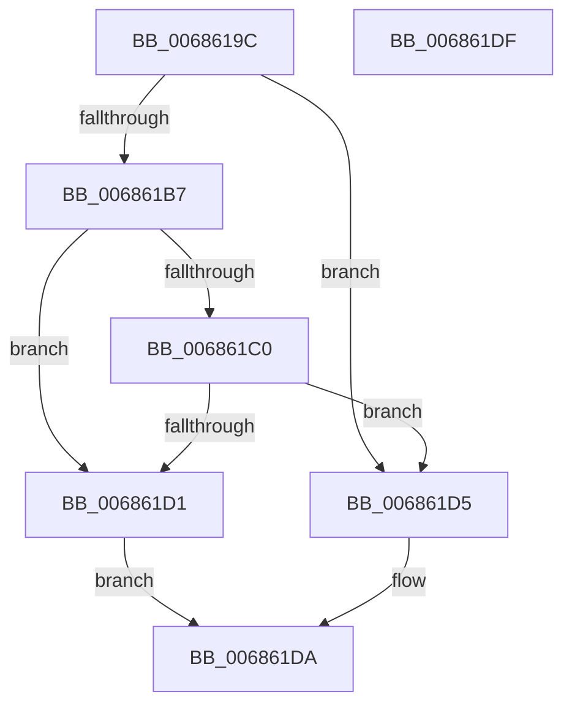

# MiRealVaToFlushType

- RVA: `0x0068619C`–`0x006861E0` (길이 `68` bytes)
- VA: `0x000000014068619C`
- 실행 섹션: `.text`
- PDB 이름 있음: `예`; PDB Function 태그: `아니요`
- unwind 정보 RVA: `0x0005C788`
- 디코드: `18`개 명령, `68/68` bytes 표시
- 미해석 바이트: `0` (있으면 어셈블리에 `.byte`로 보존)

> 이 문서는 커널 이미지의 기계어와 PDB 기호를 분석해 생성했습니다. 4번과 5번은 함수 원형과 자료형을 바이너리 사용 방식에서 추정한 C 해석이며 원본 소스 복구 결과는 아닙니다.

## 1. Dependencies

- 직접 호출 지점: **2**; 고유 호출 대상: **2**
- 직접 호출자로 확인된 함수: **3**
- RIP 상대 이미지 참조: **1**

### Outgoing calls
- `0x006861A0` → [MiGetLeafVa](../27/MiGetLeafVa_function_0027C0A0.md) (function, `0x0027C0A0`)
- `0x006861C0` → [MiHyperSpaceSize](../2C/MiHyperSpaceSize_function_002C2DFC.md) (function, `0x002C2DFC`)

### Direct callers
- [MiDbgCopyMemoryTarget](MiDbgCopyMemoryTarget_function_00684E70.md) at `0x00684F51`
- [MiDbgReleaseAddress](MiDbgReleaseAddress_function_00685630.md) at `0x0068571D`
- [MiDbgWriteCheck](MiDbgWriteCheck_function_00685BE4.md) at `0x00685F0A`

### Static image references
- `0x006861B7` → RVA `0x00E2F388` (`.data`; read)

## 2. Other-region calls and transfers

- 다른 실행 섹션으로 향하는 call: **0**
- 별도 외부 분기/꼬리 이동을 확인하지 못했습니다.

## 3. Assembly (complete function range)

```asm
0068619C  48 83 EC 28                     sub rsp, 0x28
006861A0  E8 FB 5E BF FF                  call 0x14027c0a0
006861A5  4C 8B D0                        mov r10, rax
006861A8  48 B8 00 00 00 00 00 80 FF FF   movabs rax, 0xffff800000000000
006861B2  4C 3B D0                        cmp r10, rax
006861B5  72 1E                           jb 0x1406861d5
006861B7  4C 3B 15 CA 91 7A 00            cmp r10, qword ptr [rip + 0x7a91ca]
006861BE  72 11                           jb 0x1406861d1
006861C0  E8 37 CC C3 FF                  call 0x1402c2dfc
006861C5  48 03 05 BC 91 7A 00            add rax, qword ptr [rip + 0x7a91bc]
006861CC  4C 3B D0                        cmp r10, rax
006861CF  72 04                           jb 0x1406861d5
006861D1  33 C0                           xor eax, eax
006861D3  EB 05                           jmp 0x1406861da
006861D5  B8 01 00 00 00                  mov eax, 1
006861DA  48 83 C4 28                     add rsp, 0x28
006861DE  C3                              ret
006861DF  CC                              int3
```

## 4. C-style interpretation (structured pseudocode)

```c
__int64 __fastcall MiRealVaToFlushType(void)
{
    __int64 result;
    __int64 v_rsp;

    v_rsp = (v_rsp) - (40);
    result = MiGetLeafVa(a1, a2, a3, a4);
    if (result < result) goto loc_006861D5;
    if (result < (*(unsigned __int64 *)(v_rip + 8032714))) goto loc_006861D1;
    result = MiHyperSpaceSize(a1, a2, a3, a4);
    result = (result) + (*(unsigned __int64 *)(v_rip + 8032700));
    if (result < result) goto loc_006861D5;
loc_006861D1:
    result = 0;
    goto loc_006861DA;
loc_006861D5:
loc_006861DA:
    v_rsp = (v_rsp) + (40);
    return 1;
}
```

## 5. (Beta) C Style

```c
void MiRealVaToFlushType(void)
{
    int64_t result;
    int64_t local_rsp;

    local_rsp = (local_rsp) - (40);
    result = MiGetLeafVa(a1, a2, a3, a4);
    if (result < result) goto loc_006861D5;
    if (result < (*(uint64_t *)(v_rip + 0x7A91CA))) goto loc_006861D1;
    result = MiHyperSpaceSize(a1, a2, a3, a4);
    result = (result) + (*(uint64_t *)(v_rip + 0x7A91BC));
    if (result < result) goto loc_006861D5;
loc_006861D1:
    result = 0;
    goto loc_006861DA;
loc_006861D5:
loc_006861DA:
    local_rsp = (local_rsp) + (40);
    return 1;
}
```

## 6. Execution-region graph

[열기: 2D/3D 그래프와 함수 탐색 컨트롤 패널](../../../control-panel.html?section=text&rva=0x0068619C&view=graph)

- 2D 그래프는 위에서 아래로 흐르고, 3D 그래프는 빈 공간을 드래그해 회전합니다. Shift+드래그는 이동, 휠은 확대·축소, 함수 노드 선택은 대상 보고서 이동입니다.

### Static fallback


