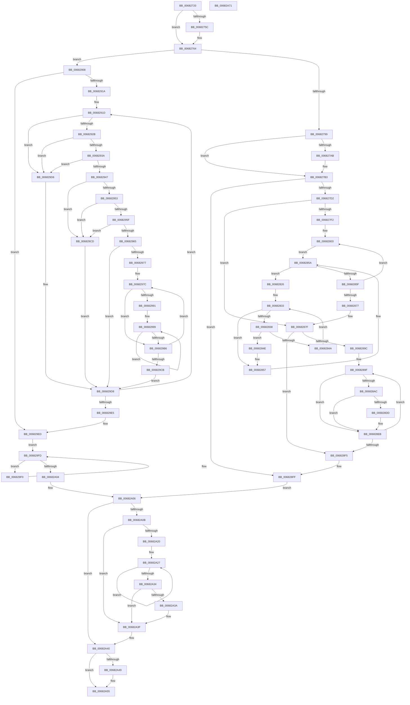

# MiReapplyImportOptimizationWorker

- RVA: `0x00682720`–`0x00682A72` (길이 `850` bytes)
- VA: `0x0000000140682720`
- 실행 섹션: `.text`
- PDB 이름 있음: `예`; PDB Function 태그: `아니요`
- unwind 정보 RVA: `0x000D82B8`
- 디코드: `236`개 명령, `850/850` bytes 표시
- 미해석 바이트: `0` (있으면 어셈블리에 `.byte`로 보존)

> 이 문서는 커널 이미지의 기계어와 PDB 기호를 분석해 생성했습니다. 4번과 5번은 함수 원형과 자료형을 바이너리 사용 방식에서 추정한 C 해석이며 원본 소스 복구 결과는 아닙니다.

## 1. Dependencies

- 직접 호출 지점: **12**; 고유 호출 대상: **12**
- 직접 호출자로 확인된 함수: **0**
- RIP 상대 이미지 참조: **4**

### Outgoing calls
- `0x0068275F` → [KiRaiseIrqlProcessIrqlFlags](../4F/KiRaiseIrqlProcessIrqlFlags_function_004F56FC.md) (function, `0x004F56FC`)
- `0x00682764` → [KeDisableInterrupts](../21/KeDisableInterrupts_function_00217BE0.md) (function, `0x00217BE0`)
- `0x006827AE` → [KeWakeAddressAll](../21/KeWakeAddressAll_function_00217C20.md) (function, `0x00217C20`)
- `0x006827C3` → [MmIsVerifierApplicableToImage](../67/MmIsVerifierApplicableToImage_function_0067B5AC.md) (function, `0x0067B5AC`)
- `0x006828E6` → [MiApplyDynamicRelocationFixups](../44/MiApplyDynamicRelocationFixups_function_0044A1CC.md) (function, `0x0044A1CC`)
- `0x0068293A` → [KiCheckVpBackingLongSpinWaitHypercall](../30/KiCheckVpBackingLongSpinWaitHypercall_function_0030F490.md) (function, `0x0030F490`)
- `0x0068294A` → [KeCanUseHaltOnAddress](../4F/KeCanUseHaltOnAddress_function_004FC22C.md) (function, `0x004FC22C`)
- `0x006829AA` → [KiHaltOnAddress](../4F/KiHaltOnAddress_function_004FBA3C.md) (function, `0x004FBA3C`)
- `0x006829CF` → [HvlNotifyLongSpinWait](../30/HvlNotifyLongSpinWait_function_0030F460.md) (function, `0x0030F460`)
- `0x006829F8` → [KeYieldProcessorEx](../3F/KeYieldProcessorEx_function_003FBD00.md) (function, `0x003FBD00`)
- `0x00682A3A` → [KiRemoveSystemWorkPriorityKick](../26/KiRemoveSystemWorkPriorityKick_function_002631D0.md) (function, `0x002631D0`)
- `0x00682A50` → [KiLowerIrqlProcessIrqlFlags](../4F/KiLowerIrqlProcessIrqlFlags_function_004F5698.md) (function, `0x004F5698`)

### Direct callers
- 이 함수 시작 RVA로 연결되는 직접 call은 확인되지 않았습니다. 간접 호출은 완전히 역산할 수 없습니다.

### Static image references
- `0x00682753` → RVA `0x00FC6D20` (`ALMOSTRO`; read)
- `0x0068291F` → RVA `0x00FC52AC` (`ALMOSTRO`; reference)
- `0x0068292B` → RVA `0x00FC6AB8` (`ALMOSTRO`; read)
- `0x00682953` → RVA `0x00FC6B38` (`ALMOSTRO`; read)

## 2. Other-region calls and transfers

- 다른 실행 섹션으로 향하는 call: **0**
- 별도 외부 분기/꼬리 이동을 확인하지 못했습니다.

## 3. Assembly (complete function range)

```asm
00682720  48 8B C4                        mov rax, rsp
00682723  53                              push rbx
00682724  55                              push rbp
00682725  56                              push rsi
00682726  57                              push rdi
00682727  41 54                           push r12
00682729  41 55                           push r13
0068272B  41 56                           push r14
0068272D  41 57                           push r15
0068272F  48 83 EC 38                     sub rsp, 0x38
00682733  83 60 18 00                     and dword ptr [rax + 0x18], 0
00682737  48 8B D9                        mov rbx, rcx
0068273A  44 0F 20 C0                     mov rax, cr8
0068273E  45 0F 20 C4                     mov r12, cr8
00682742  4C 89 A4 24 98 00 00 00         mov qword ptr [rsp + 0x98], r12
0068274A  BA 0F 00 00 00                  mov edx, 0xf
0068274F  44 0F 22 C2                     mov cr8, rdx
00682753  83 3D C6 45 94 00 00            cmp dword ptr [rip + 0x9445c6], 0
0068275A  74 08                           je 0x140682764
0068275C  41 8A CC                        mov cl, r12b
0068275F  E8 98 2F E7 FF                  call 0x1404f56fc
00682764  E8 77 54 B9 FF                  call 0x140217be0
00682769  48 8B 6B 18                     mov rbp, qword ptr [rbx + 0x18]
0068276D  40 8A F0                        mov sil, al
00682770  88 84 24 80 00 00 00            mov byte ptr [rsp + 0x80], al
00682777  83 C9 FF                        or ecx, 0xffffffff
0068277A  F0 0F C1 0B                     lock xadd dword ptr [rbx], ecx
0068277E  FF C9                           dec ecx
00682780  41 BD 00 00 00 80               mov r13d, 0x80000000
00682786  8B F9                           mov edi, ecx
00682788  F7 D7                           not edi
0068278A  41 23 FD                        and edi, r13d
0068278D  F7 C1 FF FF FF 3F               test ecx, 0x3fffffff
00682793  0F 85 6F 01 00 00               jne 0x140682908
00682799  0B 7B 04                        or edi, dword ptr [rbx + 4]
0068279C  87 3B                           xchg dword ptr [rbx], edi
0068279E  89 BC 24 88 00 00 00            mov dword ptr [rsp + 0x88], edi
006827A5  0F BA E7 1E                     bt edi, 0x1e
006827A9  73 08                           jae 0x1406827b3
006827AB  48 8B CB                        mov rcx, rbx
006827AE  E8 6D 54 B9 FF                  call 0x140217c20
006827B3  48 8B 43 20                     mov rax, qword ptr [rbx + 0x20]
006827B7  48 8B 4B 10                     mov rcx, qword ptr [rbx + 0x10]
006827BB  4C 8B 6D 18                     mov r13, qword ptr [rbp + 0x18]
006827BF  4C 8B 78 18                     mov r15, qword ptr [rax + 0x18]
006827C3  E8 E4 8D FF FF                  call 0x14067b5ac
006827C8  8B F8                           mov edi, eax
006827CA  85 C0                           test eax, eax
006827CC  0F 88 2D 01 00 00               js 0x1406828ff
006827D2  8B 4B 30                        mov ecx, dword ptr [rbx + 0x30]
006827D5  48 B8 AB AA AA AA AA AA AA AA   movabs rax, 0xaaaaaaaaaaaaaaab
006827DF  48 F7 E1                        mul rcx
006827E2  45 33 DB                        xor r11d, r11d
006827E5  48 C1 EA 04                     shr rdx, 4
006827E9  48 85 D2                        test rdx, rdx
006827EC  0F 84 8D 00 00 00               je 0x14068287f
006827F2  45 33 C0                        xor r8d, r8d
006827F5  4C 8D 73 38                     lea r14, [rbx + 0x38]
006827F9  49 BC AB AA AA AA AA AA AA AA   movabs r12, 0xaaaaaaaaaaaaaaab
00682803  48 8B 73 28                     mov rsi, qword ptr [rbx + 0x28]
00682807  4B 8D 3C 40                     lea rdi, [r8 + r8*2]
0068280B  48 63 0C FE                     movsxd rcx, dword ptr [rsi + rdi*8]
0068280F  49 8B 04 CF                     mov rax, qword ptr [r15 + rcx*8]
00682813  48 89 44 FE 10                  mov qword ptr [rsi + rdi*8 + 0x10], rax
00682818  48 8B 44 FE 08                  mov rax, qword ptr [rsi + rdi*8 + 8]
0068281D  49 89 04 CF                     mov qword ptr [r15 + rcx*8], rax
00682821  49 8B 0E                        mov rcx, qword ptr [r14]
00682824  EB 34                           jmp 0x14068285a
00682826  44 8B 81 88 00 00 00            mov r8d, dword ptr [rcx + 0x88]
0068282D  41 C1 E8 03                     shr r8d, 3
00682831  33 D2                           xor edx, edx
00682833  41 3B D0                        cmp edx, r8d
00682836  73 1F                           jae 0x140682857
00682838  4C 8B 91 80 00 00 00            mov r10, qword ptr [rcx + 0x80]
0068283F  48 8B 44 FE 10                  mov rax, qword ptr [rsi + rdi*8 + 0x10]
00682844  49 39 04 D2                     cmp qword ptr [r10 + rdx*8], rax
00682848  74 04                           je 0x14068284e
0068284A  FF C2                           inc edx
0068284C  EB E5                           jmp 0x140682833
0068284E  48 8B 44 FE 08                  mov rax, qword ptr [rsi + rdi*8 + 8]
00682853  49 89 04 D2                     mov qword ptr [r10 + rdx*8], rax
00682857  48 8B 09                        mov rcx, qword ptr [rcx]
0068285A  49 3B CE                        cmp rcx, r14
0068285D  75 C7                           jne 0x140682826
0068285F  8B 4B 30                        mov ecx, dword ptr [rbx + 0x30]
00682862  41 FF C3                        inc r11d
00682865  49 8B C4                        mov rax, r12
00682868  45 8B C3                        mov r8d, r11d
0068286B  48 F7 E1                        mul rcx
0068286E  48 C1 EA 04                     shr rdx, 4
00682872  4C 3B C2                        cmp r8, rdx
00682875  72 8C                           jb 0x140682803
00682877  4C 8B A4 24 98 00 00 00         mov r12, qword ptr [rsp + 0x98]
0068287F  8B 45 28                        mov eax, dword ptr [rbp + 0x28]
00682882  BF 00 00 00 00                  mov edi, 0
00682887  A9 FF 0F 00 00                  test eax, 0xfff
0068288C  BD 00 00 00 00                  mov ebp, 0
00682891  40 0F 95 C5                     setne bpl
00682895  C1 E8 0C                        shr eax, 0xc
00682898  03 E8                           add ebp, eax
0068289A  74 59                           je 0x1406828f5
0068289C  8D 77 40                        lea esi, [rdi + 0x40]
0068289F  48 8B 43 20                     mov rax, qword ptr [rbx + 0x20]
006828A3  4C 8B 0C 06                     mov r9, qword ptr [rsi + rax]
006828A7  4D 85 C9                        test r9, r9
006828AA  74 3F                           je 0x1406828eb
006828AC  8B C7                           mov eax, edi
006828AE  49 B8 F8 FF FF FF 7F 00 00 00   movabs r8, 0x7ffffffff8
006828B8  C1 E0 0C                        shl eax, 0xc
006828BB  8B D0                           mov edx, eax
006828BD  4A 8D 0C 28                     lea rcx, [rax + r13]
006828C1  48 8B C1                        mov rax, rcx
006828C4  48 C1 E8 09                     shr rax, 9
006828C8  49 23 C0                        and rax, r8
006828CB  49 B8 00 00 00 00 80 F6 FF FF   movabs r8, 0xfffff68000000000
006828D5  4A 8B 04 00                     mov rax, qword ptr [rax + r8]
006828D9  A8 01                           test al, 1
006828DB  74 0E                           je 0x1406828eb
006828DD  83 64 24 20 00                  and dword ptr [rsp + 0x20], 0
006828E2  4C 8B 43 20                     mov r8, qword ptr [rbx + 0x20]
006828E6  E8 E1 78 DC FF                  call 0x14044a1cc
006828EB  FF C7                           inc edi
006828ED  48 83 C6 08                     add rsi, 8
006828F1  3B FD                           cmp edi, ebp
006828F3  72 AA                           jb 0x14068289f
006828F5  40 8A B4 24 80 00 00 00         mov sil, byte ptr [rsp + 0x80]
006828FD  33 FF                           xor edi, edi
006828FF  F0 FF 43 08                     lock inc dword ptr [rbx + 8]
00682903  E9 FE 00 00 00                  jmp 0x140682a06
00682908  8B 03                           mov eax, dword ptr [rbx]
0068290A  33 ED                           xor ebp, ebp
0068290C  41 23 C5                        and eax, r13d
0068290F  45 33 FF                        xor r15d, r15d
00682912  3B C7                           cmp eax, edi
00682914  0F 84 D3 00 00 00               je 0x1406829ed
0068291A  8D 75 40                        lea esi, [rbp + 0x40]
0068291D  FF C5                           inc ebp
0068291F  85 2D 87 29 94 00               test dword ptr [rip + 0x942987], ebp
00682925  0F 85 AB 00 00 00               jne 0x1406829d6
0068292B  8B 05 87 41 94 00               mov eax, dword ptr [rip + 0x944187]
00682931  40 84 C6                        test sil, al
00682934  0F 84 9C 00 00 00               je 0x1406829d6
0068293A  E8 51 CB C8 FF                  call 0x14030f490
0068293F  84 C0                           test al, al
00682941  0F 84 8F 00 00 00               je 0x1406829d6
00682947  41 FF C7                        inc r15d
0068294A  E8 DD 98 E7 FF                  call 0x1404fc22c
0068294F  84 C0                           test al, al
00682951  74 7A                           je 0x1406829cd
00682953  F7 05 DB 41 94 00 00 00 02 00   test dword ptr [rip + 0x9441db], 0x20000
0068295D  74 6E                           je 0x1406829cd
0068295F  41 F6 C7 07                     test r15b, 7
00682963  75 68                           jne 0x1406829cd
00682965  8B 0B                           mov ecx, dword ptr [rbx]
00682967  8B C1                           mov eax, ecx
00682969  41 23 C5                        and eax, r13d
0068296C  89 8C 24 88 00 00 00            mov dword ptr [rsp + 0x88], ecx
00682973  3B C7                           cmp eax, edi
00682975  74 61                           je 0x1406829d8
00682977  8B D1                           mov edx, ecx
00682979  44 8B C1                        mov r8d, ecx
0068297C  0F BA E9 1E                     bts ecx, 0x1e
00682980  8B C2                           mov eax, edx
00682982  44 8B F1                        mov r14d, ecx
00682985  F0 44 0F B1 33                  lock cmpxchg dword ptr [rbx], r14d
0068298A  8B C8                           mov ecx, eax
0068298C  41 3B C0                        cmp eax, r8d
0068298F  75 25                           jne 0x1406829b6
00682991  44 89 B4 24 88 00 00 00         mov dword ptr [rsp + 0x88], r14d
00682999  41 B8 04 00 00 00               mov r8d, 4
0068299F  48 8D 94 24 88 00 00 00         lea rdx, [rsp + 0x88]
006829A7  48 8B CB                        mov rcx, rbx
006829AA  E8 8D 90 E7 FF                  call 0x1404fba3c
006829AF  8B 0B                           mov ecx, dword ptr [rbx]
006829B1  41 3B CE                        cmp ecx, r14d
006829B4  74 E3                           je 0x140682999
006829B6  8B C1                           mov eax, ecx
006829B8  89 8C 24 88 00 00 00            mov dword ptr [rsp + 0x88], ecx
006829BF  41 23 C5                        and eax, r13d
006829C2  8B D1                           mov edx, ecx
006829C4  44 8B C1                        mov r8d, ecx
006829C7  3B C7                           cmp eax, edi
006829C9  75 B1                           jne 0x14068297c
006829CB  EB 0B                           jmp 0x1406829d8
006829CD  8B CD                           mov ecx, ebp
006829CF  E8 8C CA C8 FF                  call 0x14030f460
006829D4  EB 02                           jmp 0x1406829d8
006829D6  F3 90                           pause
006829D8  8B 03                           mov eax, dword ptr [rbx]
006829DA  41 23 C5                        and eax, r13d
006829DD  3B C7                           cmp eax, edi
006829DF  0F 85 38 FF FF FF               jne 0x14068291d
006829E5  40 8A B4 24 80 00 00 00         mov sil, byte ptr [rsp + 0x80]
006829ED  90                              nop
006829EE  EB 0D                           jmp 0x1406829fd
006829F0  48 8D 8C 24 90 00 00 00         lea rcx, [rsp + 0x90]
006829F8  E8 03 93 D7 FF                  call 0x1403fbd00
006829FD  8B 43 08                        mov eax, dword ptr [rbx + 8]
00682A00  85 C0                           test eax, eax
00682A02  74 EC                           je 0x1406829f0
00682A04  33 FF                           xor edi, edi
00682A06  40 84 F6                        test sil, sil
00682A09  74 35                           je 0x140682a40
00682A0B  65 48 8B 0C 25 20 00 00 00      mov rcx, qword ptr gs:[0x20]
00682A14  4C 8B 81 B8 8E 00 00            mov r8, qword ptr [rcx + 0x8eb8]
00682A1B  4D 85 C0                        test r8, r8
00682A1E  74 1F                           je 0x140682a3f
00682A20  41 0F 0D 08                     prefetchw byte ptr [r8]
00682A24  41 8B 00                        mov eax, dword ptr [r8]
00682A27  8B D0                           mov edx, eax
00682A29  0F BA F2 15                     btr edx, 0x15
00682A2D  F0 41 0F B1 10                  lock cmpxchg dword ptr [r8], edx
00682A32  75 F3                           jne 0x140682a27
00682A34  0F BA E0 15                     bt eax, 0x15
00682A38  73 05                           jae 0x140682a3f
00682A3A  E8 91 07 BE FF                  call 0x1402631d0
00682A3F  FB                              sti
00682A40  83 3D D9 42 94 00 00            cmp dword ptr [rip + 0x9442d9], 0
00682A47  74 0C                           je 0x140682a55
00682A49  44 0F 20 C1                     mov rcx, cr8
00682A4D  41 8A D4                        mov dl, r12b
00682A50  E8 43 2C E7 FF                  call 0x1404f5698
00682A55  41 0F B6 C4                     movzx eax, r12b
00682A59  44 0F 22 C0                     mov cr8, rax
00682A5D  48 63 C7                        movsxd rax, edi
00682A60  48 83 C4 38                     add rsp, 0x38
00682A64  41 5F                           pop r15
00682A66  41 5E                           pop r14
00682A68  41 5D                           pop r13
00682A6A  41 5C                           pop r12
00682A6C  5F                              pop rdi
00682A6D  5E                              pop rsi
00682A6E  5D                              pop rbp
00682A6F  5B                              pop rbx
00682A70  C3                              ret
00682A71  CC                              int3
```

## 4. C-style interpretation (structured pseudocode)

```c
__int64 __fastcall MiReapplyImportOptimizationWorker(__int64 a1, __int64 a2, int a3)
{
    __int64 result;
    __int64 v_r11;
    __int64 v_r15;
    __int64 v_rbp;
    __int64 v_rdi;
    __int64 v_rsi;
    __int64 v_rsp;
    unsigned int v_stack_m58;
    unsigned int v_stack_p10;
    unsigned __int64 v_stack_p18;
    unsigned __int64 v_stack_p20;
    unsigned __int8 v_stack_p8;

    v_rsp = (v_rsp) - (56);
    v_stack_p20 = v_cr8;
    result = v_cr8;
    if ((*(unsigned int *)(v_rip + 9717190)) != 0) {
        a1 = (unsigned __int8)(v_cr8);
        result = KiRaiseIrqlProcessIrqlFlags(a1, 15, a3, a4);
    }
    result = KeDisableInterrupts(a1, 15, a3, a4);
    v_stack_p8 = (unsigned __int8)(result);
    a1 = (unsigned int)((a1) | (0xFFFFFFFFULL));
    a1 = (unsigned int)((a1) - 1);
    v_rdi = (unsigned int)(~((unsigned int)((unsigned int)(a1))));
    v_rdi = (unsigned int)((v_rdi) & ((unsigned int)((unsigned int)(0x80000000ULL))));
    if ((((unsigned int)(a1)) & (0x3FFFFFFFULL)) != 0) goto loc_00682908;
    v_rdi = (unsigned int)((v_rdi) | (*(unsigned int *)(a1 + 4)));
    v_stack_p10 = (unsigned int)(v_rdi);
    if (!(condition_is_above_or_equal)) {
        a1 = a1;
        result = KeWakeAddressAll(a1, 15, a3, a4);
    }
    result = MmIsVerifierApplicableToImage(*(unsigned __int64 *)(a1 + 16), 15, a3, a4);
    if (sign_flag) goto loc_006828FF;
    v_r11 = 0;
    a2 = (15) >> (4);
    if (a2 == 0) goto loc_0068287F;
    a3 = 0;
loc_00682803:
    *(unsigned __int64 *)(*(unsigned __int64 *)(a1 + 40) + a3 + a3 * 2 * 8 + 16) = *(unsigned __int64 *)(*(unsigned __int64 *)(*(unsigned __int64 *)(a1 + 32) + 24) + (int)(*(unsigned int *)(*(unsigned __int64 *)(a1 + 40) + a3 + a3 * 2 * 8)) * 8);
    *(unsigned __int64 *)(*(unsigned __int64 *)(*(unsigned __int64 *)(a1 + 32) + 24) + (int)(*(unsigned int *)(*(unsigned __int64 *)(a1 + 40) + a3 + a3 * 2 * 8)) * 8) = *(unsigned __int64 *)(*(unsigned __int64 *)(a1 + 40) + a3 + a3 * 2 * 8 + 8);
    goto loc_0068285A;
loc_00682826:
    a3 = (unsigned int)(((unsigned int)(*(unsigned int *)(*(unsigned __int64 *)(a1 + 56) + 136))) >> (3));
    a2 = 0;
loc_00682833:
    if (0 >= a3) goto loc_00682857;
    if ((*(unsigned __int64 *)(*(unsigned __int64 *)(*(unsigned __int64 *)(a1 + 56) + 128) + a2 * 8)) == (*(unsigned __int64 *)(*(unsigned __int64 *)(a1 + 40) + a3 + a3 * 2 * 8 + 16))) goto loc_0068284E;
    a2 = (unsigned int)((a2) + 1);
    goto loc_00682833;
loc_0068284E:
    *(unsigned __int64 *)(*(unsigned __int64 *)(*(unsigned __int64 *)(a1 + 56) + 128) + a2 * 8) = *(unsigned __int64 *)(*(unsigned __int64 *)(a1 + 40) + a3 + a3 * 2 * 8 + 8);
loc_00682857:
loc_0068285A:
    if ((*(unsigned __int64 *)(*(unsigned __int64 *)(a1 + 56))) != (a1 + 56)) goto loc_00682826;
    v_r11 = (unsigned int)((v_r11) + 1);
    a2 = (a2) >> (4);
    if (((unsigned int)((unsigned int)(v_r11))) < a2) goto loc_00682803;
loc_0068287F:
    v_rbp = ((((unsigned int)((unsigned int)(*(unsigned int *)(*(unsigned __int64 *)(a1 + 24) + 40)))) & (0xFFFULL)) != 0) ? 1 : 0;
    result = (unsigned int)(((unsigned int)(*(unsigned int *)(*(unsigned __int64 *)(a1 + 24) + 40))) >> (12));
    v_rbp = (unsigned int)((v_rbp) + ((unsigned int)(result)));
    if (condition_is_equal) goto loc_006828F5;
loc_0068289F:
    if (*(unsigned __int64 *)(0 + 64 + *(unsigned __int64 *)(a1 + 32) * 1) == 0) goto loc_006828EB;
    result = (unsigned int)((0) << (12));
    result = (result + *(unsigned __int64 *)(*(unsigned __int64 *)(a1 + 24) + 24) * 1) >> (9);
    result = (result) & ((unsigned int)((unsigned int)(v_r11)));
    result = *(unsigned __int64 *)(result + (unsigned int)((unsigned int)(v_r11)) * 1);
    if ((((unsigned __int8)(*(unsigned __int64 *)(result + (unsigned int)((unsigned int)(v_r11)) * 1))) & (1)) != 0) {
        a3 = *(unsigned __int64 *)(a1 + 32);
        result = MiApplyDynamicRelocationFixups(result + *(unsigned __int64 *)(*(unsigned __int64 *)(a1 + 24) + 24) * 1, (unsigned int)((unsigned int)(result)), a3, *(unsigned __int64 *)(0 + 64 + *(unsigned __int64 *)(a1 + 32) * 1));
    }
    v_rdi = (unsigned int)((0) + 1);
    v_rsi = (0 + 64) + (8);
    if (((unsigned int)(v_rdi)) < ((unsigned int)(v_rbp))) goto loc_0068289F;
loc_006828F5:
    v_rdi = 0;
loc_006828FF:
    goto loc_00682A06;
loc_00682908:
    v_rbp = 0;
    result = (unsigned int)(((unsigned int)(*(unsigned int *)(a1))) & ((unsigned int)(*(unsigned __int64 *)(*(unsigned __int64 *)(a1 + 24) + 24))));
    v_r15 = 0;
    if (((unsigned int)(result)) == 0) goto loc_006829ED;
loc_0068291D:
    v_rbp = (unsigned int)((v_rbp) + 1);
    if (((*(unsigned int *)(v_rip + 9709959)) & ((unsigned int)(v_rbp))) != 0) goto loc_006829D6;
    if ((((unsigned __int8)(v_rbp + 64)) & ((unsigned __int8)((unsigned int)(*(unsigned int *)(v_rip + 9716103))))) == 0) goto loc_006829D6;
    result = KiCheckVpBackingLongSpinWaitHypercall(result + *(unsigned __int64 *)(*(unsigned __int64 *)(a1 + 24) + 24) * 1, (unsigned int)((unsigned int)(result)), a3, *(unsigned __int64 *)(0 + 64 + *(unsigned __int64 *)(a1 + 32) * 1));
    if ((unsigned __int8)(result) == 0) goto loc_006829D6;
    v_r15 = (unsigned int)((v_r15) + 1);
    result = KeCanUseHaltOnAddress(result + *(unsigned __int64 *)(*(unsigned __int64 *)(a1 + 24) + 24) * 1, (unsigned int)((unsigned int)(result)), a3, *(unsigned __int64 *)(0 + 64 + *(unsigned __int64 *)(a1 + 32) * 1));
    if ((unsigned __int8)(result) == 0) goto loc_006829CD;
    if (((*(unsigned int *)(v_rip + 9716187)) & (0x20000ULL)) == 0) goto loc_006829CD;
    if ((((unsigned __int8)(v_r15)) & (7)) != 0) goto loc_006829CD;
    result = (unsigned int)(((unsigned int)((unsigned int)((unsigned int)(*(unsigned int *)(a1))))) & ((unsigned int)(*(unsigned __int64 *)(*(unsigned __int64 *)(a1 + 24) + 24))));
    v_stack_p10 = (unsigned int)((unsigned int)(*(unsigned int *)(a1)));
    if (((unsigned int)(result)) == 0) goto loc_006829D8;
loc_0068297C:
    if (((unsigned int)((unsigned int)((unsigned int)((unsigned int)((unsigned int)((unsigned int)(*(unsigned int *)(a1)))))))) != ((unsigned int)((unsigned int)((unsigned int)((unsigned int)(*(unsigned int *)(a1))))))) goto loc_006829B6;
    v_stack_p10 = (unsigned int)((unsigned int)((unsigned int)((unsigned int)(*(unsigned int *)(a1)))));
loc_00682999:
    result = KiHaltOnAddress(a1, v_stack_p10, 4, *(unsigned __int64 *)(0 + 64 + *(unsigned __int64 *)(a1 + 32) * 1));
    if (((unsigned int)((unsigned int)(*(unsigned int *)(a1)))) == ((unsigned int)((unsigned int)((unsigned int)((unsigned int)(*(unsigned int *)(a1))))))) goto loc_00682999;
loc_006829B6:
    v_stack_p10 = (unsigned int)((unsigned int)(*(unsigned int *)(a1)));
    result = (unsigned int)(((unsigned int)((unsigned int)((unsigned int)(*(unsigned int *)(a1))))) & ((unsigned int)(*(unsigned __int64 *)(*(unsigned __int64 *)(a1 + 24) + 24))));
    if (((unsigned int)(result)) != 0) goto loc_0068297C;
    goto loc_006829D8;
loc_006829CD:
    result = HvlNotifyLongSpinWait((unsigned int)((unsigned int)(v_rbp)), (unsigned int)((unsigned int)((unsigned int)(*(unsigned int *)(a1)))), (unsigned int)((unsigned int)((unsigned int)(*(unsigned int *)(a1)))), *(unsigned __int64 *)(0 + 64 + *(unsigned __int64 *)(a1 + 32) * 1));
    goto loc_006829D8;
loc_006829D6:
loc_006829D8:
    result = (unsigned int)(((unsigned int)(*(unsigned int *)(a1))) & ((unsigned int)(*(unsigned __int64 *)(*(unsigned __int64 *)(a1 + 24) + 24))));
    if (((unsigned int)(result)) != 0) goto loc_0068291D;
loc_006829ED:
    goto loc_006829FD;
loc_006829F0:
    result = KeYieldProcessorEx(v_stack_p18, (unsigned int)((unsigned int)((unsigned int)(*(unsigned int *)(a1)))), (unsigned int)((unsigned int)((unsigned int)(*(unsigned int *)(a1)))), *(unsigned __int64 *)(0 + 64 + *(unsigned __int64 *)(a1 + 32) * 1));
loc_006829FD:
    if ((unsigned int)((unsigned int)(*(unsigned int *)(a1 + 8))) == 0) goto loc_006829F0;
    v_rdi = 0;
loc_00682A06:
    if ((unsigned __int8)(v_stack_p8) == 0) goto loc_00682A40;
    if (*(unsigned __int64 *)(*(unsigned __int64 *)(gs_base + (0 + 32)) + 36536) == 0) goto loc_00682A3F;
loc_00682A27:
    if (*(unsigned __int64 *)(*(unsigned __int64 *)(gs_base + (0 + 32)) + 36536) != 0) goto loc_00682A27;
    result = (unsigned int)(*(unsigned int *)(*(unsigned __int64 *)(*(unsigned __int64 *)(gs_base + (0 + 32)) + 36536)));
    if (!(condition_is_above_or_equal)) {
        result = KiRemoveSystemWorkPriorityKick(*(unsigned __int64 *)(gs_base + (0 + 32)), (unsigned int)((unsigned int)((unsigned int)(*(unsigned int *)(*(unsigned __int64 *)(*(unsigned __int64 *)(gs_base + (0 + 32)) + 36536))))), *(unsigned __int64 *)(*(unsigned __int64 *)(gs_base + (0 + 32)) + 36536), *(unsigned __int64 *)(0 + 64 + *(unsigned __int64 *)(a1 + 32) * 1));
    }
loc_00682A40:
    if ((*(unsigned int *)(v_rip + 9716441)) != 0) {
        a1 = 15;
        a2 = (unsigned __int8)(v_stack_p20);
        result = KiLowerIrqlProcessIrqlFlags(a1, a2, *(unsigned __int64 *)(*(unsigned __int64 *)(gs_base + (0 + 32)) + 36536), *(unsigned __int64 *)(0 + 64 + *(unsigned __int64 *)(a1 + 32) * 1));
    }
    v_rsp = (v_rsp) + (56);
    return (int)(0);
}
```

## 5. (Beta) C Style

```c
int64_t MiReapplyImportOptimizationWorker(void *Arg1, int64_t Arg2, int32_t Arg3)
{
    uint8_t *arg1 = (uint8_t *)Arg1;

    int64_t result;
    int64_t local_r11;
    int64_t local_r15;
    int64_t local_rbp;
    int64_t local_rdi;
    int64_t local_rsi;
    int64_t local_rsp;
    uint32_t v_stack_m58;
    uint32_t v_stack_p10;
    uint64_t v_stack_p18;
    uint64_t v_stack_p20;
    uint8_t v_stack_p8;

    local_rsp = (local_rsp) - (56);
    v_stack_p20 = v_cr8;
    result = v_cr8;
    if ((*(uint32_t *)(v_rip + 0x9445C6)) != 0) {
        Arg1 = (uint8_t)(v_cr8);
        result = KiRaiseIrqlProcessIrqlFlags(Arg1, 15, Arg3, a4);
    }
    result = KeDisableInterrupts(Arg1, 15, Arg3, a4);
    v_stack_p8 = (uint8_t)(result);
    Arg1 = (uint32_t)((Arg1) | (0xFFFFFFFFULL));
    Arg1 = (uint32_t)((Arg1) - 1);
    local_rdi = (uint32_t)(~((uint32_t)((uint32_t)(Arg1))));
    local_rdi = (uint32_t)((local_rdi) & ((uint32_t)((uint32_t)(0x80000000ULL))));
    if ((((uint32_t)(Arg1)) & (0x3FFFFFFFULL)) != 0) goto loc_00682908;
    local_rdi = (uint32_t)((local_rdi) | (*(uint32_t *)(arg1 + 0x4)));
    v_stack_p10 = (uint32_t)(local_rdi);
    if (!(condition_is_above_or_equal)) {
        Arg1 = Arg1;
        result = KeWakeAddressAll(Arg1, 15, Arg3, a4);
    }
    result = MmIsVerifierApplicableToImage(*(uint64_t *)(arg1 + 0x10), 15, Arg3, a4);
    if (sign_flag) goto loc_006828FF;
    local_r11 = 0;
    Arg2 = (15) >> (4);
    if (Arg2 == 0) goto loc_0068287F;
    Arg3 = 0;
loc_00682803:
    *(uint64_t *)(*(uint64_t *)(arg1 + 0x28) + Arg3 + Arg3 * 2 * 8 + 0x10) = *(uint64_t *)(*(uint64_t *)(*(uint64_t *)(arg1 + 0x20) + 0x18) + (int32_t)(*(uint32_t *)(*(uint64_t *)(arg1 + 0x28) + Arg3 + Arg3 * 2 * 8)) * 8);
    *(uint64_t *)(*(uint64_t *)(*(uint64_t *)(arg1 + 0x20) + 0x18) + (int32_t)(*(uint32_t *)(*(uint64_t *)(arg1 + 0x28) + Arg3 + Arg3 * 2 * 8)) * 8) = *(uint64_t *)(*(uint64_t *)(arg1 + 0x28) + Arg3 + Arg3 * 2 * 8 + 0x8);
    goto loc_0068285A;
loc_00682826:
    Arg3 = (uint32_t)(((uint32_t)(*(uint32_t *)(*(uint64_t *)(arg1 + 0x38) + 0x88))) >> (3));
    Arg2 = 0;
loc_00682833:
    if (0 >= Arg3) goto loc_00682857;
    if ((*(uint64_t *)(*(uint64_t *)(*(uint64_t *)(arg1 + 0x38) + 0x80) + Arg2 * 8)) == (*(uint64_t *)(*(uint64_t *)(arg1 + 0x28) + Arg3 + Arg3 * 2 * 8 + 0x10))) goto loc_0068284E;
    Arg2 = (uint32_t)((Arg2) + 1);
    goto loc_00682833;
loc_0068284E:
    *(uint64_t *)(*(uint64_t *)(*(uint64_t *)(arg1 + 0x38) + 0x80) + Arg2 * 8) = *(uint64_t *)(*(uint64_t *)(arg1 + 0x28) + Arg3 + Arg3 * 2 * 8 + 0x8);
loc_00682857:
loc_0068285A:
    if ((*(uint64_t *)(*(uint64_t *)(arg1 + 0x38))) != (Arg1 + 56)) goto loc_00682826;
    local_r11 = (uint32_t)((local_r11) + 1);
    Arg2 = (Arg2) >> (4);
    if (((uint32_t)((uint32_t)(local_r11))) < Arg2) goto loc_00682803;
loc_0068287F:
    local_rbp = ((((uint32_t)((uint32_t)(*(uint32_t *)(*(uint64_t *)(arg1 + 0x18) + 0x28)))) & (0xFFFULL)) != 0) ? 1 : 0;
    result = (uint32_t)(((uint32_t)(*(uint32_t *)(*(uint64_t *)(arg1 + 0x18) + 0x28))) >> (12));
    local_rbp = (uint32_t)((local_rbp) + ((uint32_t)(result)));
    if (condition_is_equal) goto loc_006828F5;
loc_0068289F:
    if (*(uint64_t *)(0 + 0x40 + *(uint64_t *)(arg1 + 0x20) * 1) == 0) goto loc_006828EB;
    result = (uint32_t)((0) << (12));
    result = (result + *(uint64_t *)(*(uint64_t *)(arg1 + 0x18) + 0x18) * 1) >> (9);
    result = (result) & ((uint32_t)((uint32_t)(local_r11)));
    result = *(uint64_t *)(result + (uint32_t)((uint32_t)(local_r11)) * 1);
    if ((((uint8_t)(*(uint64_t *)(result + (uint32_t)((uint32_t)(local_r11)) * 1))) & (1)) != 0) {
        Arg3 = *(uint64_t *)(arg1 + 0x20);
        result = MiApplyDynamicRelocationFixups(result + *(uint64_t *)(*(uint64_t *)(arg1 + 0x18) + 0x18) * 1, (uint32_t)((uint32_t)(result)), Arg3, *(uint64_t *)(0 + 0x40 + *(uint64_t *)(arg1 + 0x20) * 1));
    }
    local_rdi = (uint32_t)((0) + 1);
    local_rsi = (0 + 64) + (8);
    if (((uint32_t)(local_rdi)) < ((uint32_t)(local_rbp))) goto loc_0068289F;
loc_006828F5:
    local_rdi = 0;
loc_006828FF:
    goto loc_00682A06;
loc_00682908:
    local_rbp = 0;
    result = (uint32_t)(((uint32_t)(*(uint32_t *)(arg1))) & ((uint32_t)(*(uint64_t *)(*(uint64_t *)(arg1 + 0x18) + 0x18))));
    local_r15 = 0;
    if (((uint32_t)(result)) == 0) goto loc_006829ED;
loc_0068291D:
    local_rbp = (uint32_t)((local_rbp) + 1);
    if (((*(uint32_t *)(v_rip + 0x942987)) & ((uint32_t)(local_rbp))) != 0) goto loc_006829D6;
    if ((((uint8_t)(local_rbp + 64)) & ((uint8_t)((uint32_t)(*(uint32_t *)(v_rip + 0x944187))))) == 0) goto loc_006829D6;
    result = KiCheckVpBackingLongSpinWaitHypercall(result + *(uint64_t *)(*(uint64_t *)(arg1 + 0x18) + 0x18) * 1, (uint32_t)((uint32_t)(result)), Arg3, *(uint64_t *)(0 + 0x40 + *(uint64_t *)(arg1 + 0x20) * 1));
    if ((uint8_t)(result) == 0) goto loc_006829D6;
    local_r15 = (uint32_t)((local_r15) + 1);
    result = KeCanUseHaltOnAddress(result + *(uint64_t *)(*(uint64_t *)(arg1 + 0x18) + 0x18) * 1, (uint32_t)((uint32_t)(result)), Arg3, *(uint64_t *)(0 + 0x40 + *(uint64_t *)(arg1 + 0x20) * 1));
    if ((uint8_t)(result) == 0) goto loc_006829CD;
    if (((*(uint32_t *)(v_rip + 0x9441DB)) & (0x20000ULL)) == 0) goto loc_006829CD;
    if ((((uint8_t)(local_r15)) & (7)) != 0) goto loc_006829CD;
    result = (uint32_t)(((uint32_t)((uint32_t)((uint32_t)(*(uint32_t *)(arg1))))) & ((uint32_t)(*(uint64_t *)(*(uint64_t *)(arg1 + 0x18) + 0x18))));
    v_stack_p10 = (uint32_t)((uint32_t)(*(uint32_t *)(arg1)));
    if (((uint32_t)(result)) == 0) goto loc_006829D8;
loc_0068297C:
    if (((uint32_t)((uint32_t)((uint32_t)((uint32_t)((uint32_t)((uint32_t)(*(uint32_t *)(arg1)))))))) != ((uint32_t)((uint32_t)((uint32_t)((uint32_t)(*(uint32_t *)(arg1))))))) goto loc_006829B6;
    v_stack_p10 = (uint32_t)((uint32_t)((uint32_t)((uint32_t)(*(uint32_t *)(arg1)))));
loc_00682999:
    result = KiHaltOnAddress(Arg1, v_stack_p10, 4, *(uint64_t *)(0 + 0x40 + *(uint64_t *)(arg1 + 0x20) * 1));
    if (((uint32_t)((uint32_t)(*(uint32_t *)(arg1)))) == ((uint32_t)((uint32_t)((uint32_t)((uint32_t)(*(uint32_t *)(arg1))))))) goto loc_00682999;
loc_006829B6:
    v_stack_p10 = (uint32_t)((uint32_t)(*(uint32_t *)(arg1)));
    result = (uint32_t)(((uint32_t)((uint32_t)((uint32_t)(*(uint32_t *)(arg1))))) & ((uint32_t)(*(uint64_t *)(*(uint64_t *)(arg1 + 0x18) + 0x18))));
    if (((uint32_t)(result)) != 0) goto loc_0068297C;
    goto loc_006829D8;
loc_006829CD:
    result = HvlNotifyLongSpinWait((uint32_t)((uint32_t)(local_rbp)), (uint32_t)((uint32_t)((uint32_t)(*(uint32_t *)(arg1)))), (uint32_t)((uint32_t)((uint32_t)(*(uint32_t *)(arg1)))), *(uint64_t *)(0 + 0x40 + *(uint64_t *)(arg1 + 0x20) * 1));
    goto loc_006829D8;
loc_006829D6:
loc_006829D8:
    result = (uint32_t)(((uint32_t)(*(uint32_t *)(arg1))) & ((uint32_t)(*(uint64_t *)(*(uint64_t *)(arg1 + 0x18) + 0x18))));
    if (((uint32_t)(result)) != 0) goto loc_0068291D;
loc_006829ED:
    goto loc_006829FD;
loc_006829F0:
    result = KeYieldProcessorEx(v_stack_p18, (uint32_t)((uint32_t)((uint32_t)(*(uint32_t *)(arg1)))), (uint32_t)((uint32_t)((uint32_t)(*(uint32_t *)(arg1)))), *(uint64_t *)(0 + 0x40 + *(uint64_t *)(arg1 + 0x20) * 1));
loc_006829FD:
    if ((uint32_t)((uint32_t)(*(uint32_t *)(arg1 + 0x8))) == 0) goto loc_006829F0;
    local_rdi = 0;
loc_00682A06:
    if ((uint8_t)(v_stack_p8) == 0) goto loc_00682A40;
    if (*(uint64_t *)(*(uint64_t *)(gs_base + (0 + 0x20)) + 0x8EB8) == 0) goto loc_00682A3F;
loc_00682A27:
    if (*(uint64_t *)(*(uint64_t *)(gs_base + (0 + 0x20)) + 0x8EB8) != 0) goto loc_00682A27;
    result = (uint32_t)(*(uint32_t *)(*(uint64_t *)(*(uint64_t *)(gs_base + (0 + 0x20)) + 0x8EB8)));
    if (!(condition_is_above_or_equal)) {
        result = KiRemoveSystemWorkPriorityKick(*(uint64_t *)(gs_base + (0 + 0x20)), (uint32_t)((uint32_t)((uint32_t)(*(uint32_t *)(*(uint64_t *)(*(uint64_t *)(gs_base + (0 + 0x20)) + 0x8EB8))))), *(uint64_t *)(*(uint64_t *)(gs_base + (0 + 0x20)) + 0x8EB8), *(uint64_t *)(0 + 0x40 + *(uint64_t *)(arg1 + 0x20) * 1));
    }
loc_00682A40:
    if ((*(uint32_t *)(v_rip + 0x9442D9)) != 0) {
        Arg1 = 15;
        Arg2 = (uint8_t)(v_stack_p20);
        result = KiLowerIrqlProcessIrqlFlags(Arg1, Arg2, *(uint64_t *)(*(uint64_t *)(gs_base + (0 + 0x20)) + 0x8EB8), *(uint64_t *)(0 + 0x40 + *(uint64_t *)(arg1 + 0x20) * 1));
    }
    local_rsp = (local_rsp) + (56);
    return (int32_t)(0);
}
```

### 관측된 메모리 오프셋

구조체 형식이 확인되지 않은 접근은 인자 기준의 오프셋으로만 기록했습니다.

| 기준 인자 | 오프셋 표현 | 폭 (bit) | 접근 |
|---|---:|---:|---|
| `Arg1` | `+ 0x0` | `32` | `R` |
| `Arg1` | `+ 0x0` | `32` | `R/W` |
| `Arg1` | `+ 0x0` | `64` | `R` |
| `Arg1` | `+ 0x4` | `32` | `R` |
| `Arg1` | `+ 0x8` | `32` | `R` |
| `Arg1` | `+ 0x8` | `32` | `R/W` |
| `Arg1` | `+ 0x10` | `64` | `R` |
| `Arg1` | `+ 0x18` | `64` | `R` |
| `Arg1` | `+ 0x20` | `64` | `R` |
| `Arg1` | `+ 0x28` | `64` | `R` |
| `Arg1` | `+ 0x30` | `32` | `R` |
| `Arg1` | `+ 0x38` | `64` | `R` |

## 6. Execution-region graph

[열기: 2D/3D 그래프와 함수 탐색 컨트롤 패널](../../../control-panel.html?section=text&rva=0x00682720&view=graph)

- 2D 그래프는 위에서 아래로 흐르고, 3D 그래프는 빈 공간을 드래그해 회전합니다. Shift+드래그는 이동, 휠은 확대·축소, 함수 노드 선택은 대상 보고서 이동입니다.

### Static fallback


