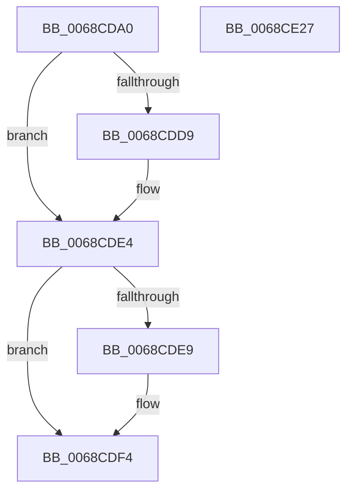

# MiReduceCommitLimits

- RVA: `0x0068CDA0`–`0x0068CE28` (길이 `136` bytes)
- VA: `0x000000014068CDA0`
- 실행 섹션: `.text`
- PDB 이름 있음: `예`; PDB Function 태그: `아니요`
- unwind 정보 RVA: `0x0005E6B4`
- 디코드: `36`개 명령, `136/136` bytes 표시
- 미해석 바이트: `0` (있으면 어셈블리에 `.byte`로 보존)

> 이 문서는 커널 이미지의 기계어와 PDB 기호를 분석해 생성했습니다. 4번과 5번은 함수 원형과 자료형을 바이너리 사용 방식에서 추정한 C 해석이며 원본 소스 복구 결과는 아닙니다.

## 1. Dependencies

- 직접 호출 지점: **3**; 고유 호출 대상: **3**
- 직접 호출자로 확인된 함수: **4**
- RIP 상대 이미지 참조: **0**

### Outgoing calls
- `0x0068CDCC` → [ExAcquireSpinLockExclusive](../24/ExAcquireSpinLockExclusive_function_00248690.md) (function, `0x00248690`)
- `0x0068CDFC` → [MiComputeCommitThresholds](../47/MiComputeCommitThresholds_function_0047C904.md) (function, `0x0047C904`)
- `0x0068CE07` → [MiReleaseSpinLockExclusive](../24/MiReleaseSpinLockExclusive_function_002482C0.md) (function, `0x002482C0`)

### Direct callers
- [MiInsertPartitionPages](../69/MiInsertPartitionPages_function_006911A0.md) at `0x00691384`
- [sub_006F503A](../6F/Unknown_function_006F503A.md) at `0x006F51A1`
- [MiRemovePhysicalMemory](../../page/7F/MiRemovePhysicalMemory_function_007FAD3C.md) at `0x007FAF56`
- [MiCreatePagingFile](../../page/7F/MiCreatePagingFile_function_007FEFF4.md) at `0x007FF9D2`

### Static image references
- 디코드된 RIP-relative 메모리 참조가 없습니다.

## 2. Other-region calls and transfers

- 다른 실행 섹션으로 향하는 call: **0**
- 별도 외부 분기/꼬리 이동을 확인하지 못했습니다.

## 3. Assembly (complete function range)

```asm
0068CDA0  48 8B C4                        mov rax, rsp
0068CDA3  48 89 58 08                     mov qword ptr [rax + 8], rbx
0068CDA7  48 89 68 10                     mov qword ptr [rax + 0x10], rbp
0068CDAB  48 89 70 18                     mov qword ptr [rax + 0x18], rsi
0068CDAF  48 89 78 20                     mov qword ptr [rax + 0x20], rdi
0068CDB3  41 56                           push r14
0068CDB5  48 83 EC 20                     sub rsp, 0x20
0068CDB9  48 8D A9 F8 41 00 00            lea rbp, [rcx + 0x41f8]
0068CDC0  48 8B D9                        mov rbx, rcx
0068CDC3  48 8B CD                        mov rcx, rbp
0068CDC6  49 8B F0                        mov rsi, r8
0068CDC9  48 8B FA                        mov rdi, rdx
0068CDCC  E8 BF B8 BB FF                  call 0x140248690
0068CDD1  44 8A F0                        mov r14b, al
0068CDD4  48 85 F6                        test rsi, rsi
0068CDD7  74 0B                           je 0x14068cde4
0068CDD9  48 F7 DE                        neg rsi
0068CDDC  F0 48 01 B3 C8 41 00 00         lock add qword ptr [rbx + 0x41c8], rsi
0068CDE4  48 85 FF                        test rdi, rdi
0068CDE7  74 0B                           je 0x14068cdf4
0068CDE9  48 F7 DF                        neg rdi
0068CDEC  F0 48 01 BB 98 4C 00 00         lock add qword ptr [rbx + 0x4c98], rdi
0068CDF4  BA 01 00 00 00                  mov edx, 1
0068CDF9  48 8B CB                        mov rcx, rbx
0068CDFC  E8 03 FB DE FF                  call 0x14047c904
0068CE01  41 8A D6                        mov dl, r14b
0068CE04  48 8B CD                        mov rcx, rbp
0068CE07  E8 B4 B4 BB FF                  call 0x1402482c0
0068CE0C  48 8B 5C 24 30                  mov rbx, qword ptr [rsp + 0x30]
0068CE11  48 8B 6C 24 38                  mov rbp, qword ptr [rsp + 0x38]
0068CE16  48 8B 74 24 40                  mov rsi, qword ptr [rsp + 0x40]
0068CE1B  48 8B 7C 24 48                  mov rdi, qword ptr [rsp + 0x48]
0068CE20  48 83 C4 20                     add rsp, 0x20
0068CE24  41 5E                           pop r14
0068CE26  C3                              ret
0068CE27  CC                              int3
```

## 4. C-style interpretation (structured pseudocode)

```c
__int64 __fastcall MiReduceCommitLimits(__int64 a1, __int64 a2, __int64 a3)
{
    __int64 result;
    __int64 v_rdi;
    __int64 v_rsi;
    __int64 v_rsp;
    unsigned __int64 v_stack_p10;
    unsigned __int64 v_stack_p18;
    unsigned __int64 v_stack_p20;
    unsigned __int64 v_stack_p8;

    *(unsigned __int64 *)(v_rsp + 8) = v_rbx;
    *(unsigned __int64 *)(v_rsp + 16) = v_rbp;
    *(unsigned __int64 *)(v_rsp + 24) = v_rsi;
    *(unsigned __int64 *)(v_rsp + 32) = v_rdi;
    v_rsp = (v_rsp) - (32);
    result = ExAcquireSpinLockExclusive(a1 + 16888, a2, a3, a4);
    v_rsi = a3;
    if (a3 != 0) {
        v_rsi = -(a3);
    }
    v_rdi = a2;
    if (a2 != 0) {
        v_rdi = -(a2);
    }
    result = MiComputeCommitThresholds(a1, 1, a3, a4);
    result = MiReleaseSpinLockExclusive(a1 + 16888, (unsigned __int8)((unsigned __int8)(result)), a3, a4);
    v_rsp = (v_rsp) + (32);
    return result;
}
```

## 5. (Beta) C Style

```c
int64_t MiReduceCommitLimits(void *Arg1, int64_t Arg2, int64_t Arg3)
{
    uint8_t *arg1 = (uint8_t *)Arg1;

    int64_t result;
    int64_t local_rdi;
    int64_t local_rsi;
    int64_t local_rsp;
    uint64_t v_stack_p10;
    uint64_t v_stack_p18;
    uint64_t v_stack_p20;
    uint64_t v_stack_p8;

    *(uint64_t *)(local_rsp + 0x8) = local_rbx;
    *(uint64_t *)(local_rsp + 0x10) = local_rbp;
    *(uint64_t *)(local_rsp + 0x18) = local_rsi;
    *(uint64_t *)(local_rsp + 0x20) = local_rdi;
    local_rsp = (local_rsp) - (32);
    result = ExAcquireSpinLockExclusive(Arg1 + 16888, Arg2, Arg3, a4);
    local_rsi = Arg3;
    if (Arg3 != 0) {
        local_rsi = -(Arg3);
    }
    local_rdi = Arg2;
    if (Arg2 != 0) {
        local_rdi = -(Arg2);
    }
    result = MiComputeCommitThresholds(Arg1, 1, Arg3, a4);
    result = MiReleaseSpinLockExclusive(Arg1 + 16888, (uint8_t)((uint8_t)(result)), Arg3, a4);
    local_rsp = (local_rsp) + (32);
    return result;
}
```

### 관측된 메모리 오프셋

구조체 형식이 확인되지 않은 접근은 인자 기준의 오프셋으로만 기록했습니다.

| 기준 인자 | 오프셋 표현 | 폭 (bit) | 접근 |
|---|---:|---:|---|
| `Arg1` | `+ 0x41C8` | `64` | `R/W` |
| `Arg1` | `+ 0x41F8` | `64` | `R` |
| `Arg1` | `+ 0x4C98` | `64` | `R/W` |

## 6. Execution-region graph

[열기: 2D/3D 그래프와 함수 탐색 컨트롤 패널](../../../control-panel.html?section=text&rva=0x0068CDA0&view=graph)

- 2D 그래프는 위에서 아래로 흐르고, 3D 그래프는 빈 공간을 드래그해 회전합니다. Shift+드래그는 이동, 휠은 확대·축소, 함수 노드 선택은 대상 보고서 이동입니다.

### Static fallback


