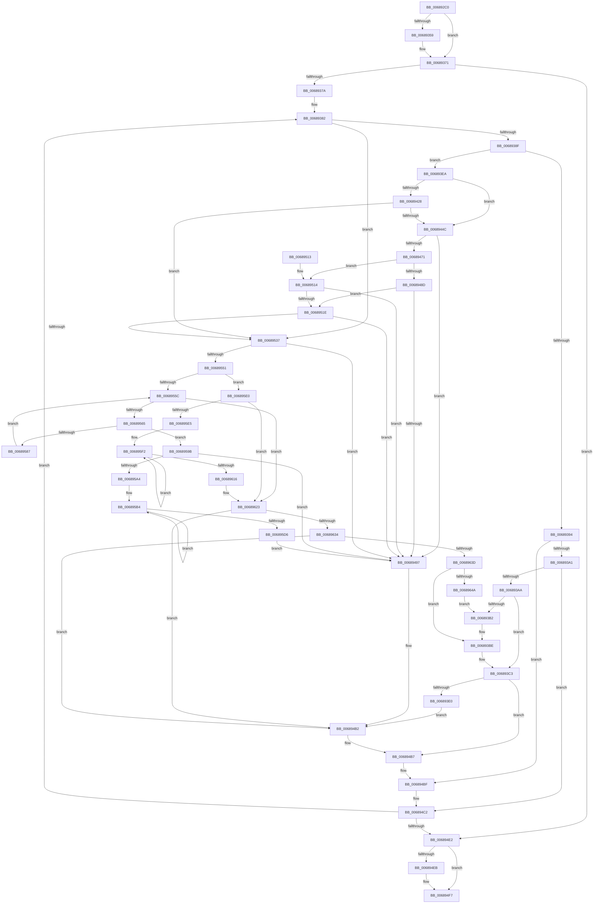

# MiReferenceIncomingPhysicalPages

- RVA: `0x006892C0`–`0x0068964F` (길이 `911` bytes)
- VA: `0x00000001406892C0`
- 실행 섹션: `.text`
- PDB 이름 있음: `예`; PDB Function 태그: `아니요`
- unwind 정보 RVA: `0x000D8BD0`
- 디코드: `217`개 명령, `911/911` bytes 표시
- 미해석 바이트: `0` (있으면 어셈블리에 `.byte`로 보존)

> 이 문서는 커널 이미지의 기계어와 PDB 기호를 분석해 생성했습니다. 4번과 5번은 함수 원형과 자료형을 바이너리 사용 방식에서 추정한 C 해석이며 원본 소스 복구 결과는 아닙니다.

## 1. Dependencies

- 직접 호출 지점: **12**; 고유 호출 대상: **7**
- 직접 호출자로 확인된 함수: **2**
- RIP 상대 이미지 참조: **1**

### Outgoing calls
- `0x00689311` → [MiGetVadCacheAttribute](../4A/MiGetVadCacheAttribute_function_004AF624.md) (function, `0x004AF624`)
- `0x00689328` → [MiGetAweViewPageSize](../4C/MiGetAweViewPageSize_function_004C51AC.md) (function, `0x004C51AC`)
- `0x0068935C` → [KiRaiseIrqlProcessIrqlFlags](../4F/KiRaiseIrqlProcessIrqlFlags_function_004F56FC.md) (function, `0x004F56FC`)
- `0x006893B9` → [KiLowerIrqlProcessIrqlFlags](../4F/KiLowerIrqlProcessIrqlFlags_function_004F5698.md) (function, `0x004F5698`)
- `0x006893E0` → [KiRaiseIrqlProcessIrqlFlags](../4F/KiRaiseIrqlProcessIrqlFlags_function_004F56FC.md) (function, `0x004F56FC`)
- `0x0068944F` → [MiGetAweNode](../4F/MiGetAweNode_function_004F600C.md) (function, `0x004F600C`)
- `0x0068945A` → [MiGetAweViewPageSize](../4C/MiGetAweViewPageSize_function_004C51AC.md) (function, `0x004C51AC`)
- `0x006894F2` → [KiLowerIrqlProcessIrqlFlags](../4F/KiLowerIrqlProcessIrqlFlags_function_004F5698.md) (function, `0x004F5698`)
- `0x00689521` → [MiGetVadCacheAttribute](../4A/MiGetVadCacheAttribute_function_004AF624.md) (function, `0x004AF624`)
- `0x0068957B` → [MiIncrementAweMapCount](MiIncrementAweMapCount_function_00688DB0.md) (function, `0x00688DB0`)
- `0x006895CC` → [MiDecrementAweMapCount](MiDecrementAweMapCount_function_00688158.md) (function, `0x00688158`)
- `0x00689606` → [MiDecrementAweMapCount](MiDecrementAweMapCount_function_00688158.md) (function, `0x00688158`)

### Direct callers
- [NtMapUserPhysicalPages](../../page/80/NtMapUserPhysicalPages_function_0080B460.md) at `0x0080B671`
- [NtMapUserPhysicalPagesScatter](../../page/80/NtMapUserPhysicalPagesScatter_function_0080B750.md) at `0x0080BA6B`

### Static image references
- `0x00689351` → RVA `0x00FC6D20` (`ALMOSTRO`; read)

## 2. Other-region calls and transfers

- 다른 실행 섹션으로 향하는 call: **0**
- 별도 외부 분기/꼬리 이동을 확인하지 못했습니다.

## 3. Assembly (complete function range)

```asm
006892C0  48 8B C4                        mov rax, rsp
006892C3  4C 89 48 20                     mov qword ptr [rax + 0x20], r9
006892C7  4C 89 40 18                     mov qword ptr [rax + 0x18], r8
006892CB  48 89 50 10                     mov qword ptr [rax + 0x10], rdx
006892CF  48 89 48 08                     mov qword ptr [rax + 8], rcx
006892D3  53                              push rbx
006892D4  55                              push rbp
006892D5  56                              push rsi
006892D6  57                              push rdi
006892D7  41 54                           push r12
006892D9  41 55                           push r13
006892DB  41 56                           push r14
006892DD  41 57                           push r15
006892DF  48 83 EC 58                     sub rsp, 0x58
006892E3  48 8B 79 10                     mov rdi, qword ptr [rcx + 0x10]
006892E7  4D 8B F8                        mov r15, r8
006892EA  4C 8B 94 24 C8 00 00 00         mov r10, qword ptr [rsp + 0xc8]
006892F2  48 8B DA                        mov rbx, rdx
006892F5  45 33 E4                        xor r12d, r12d
006892F8  4D 8B 4A 18                     mov r9, qword ptr [r10 + 0x18]
006892FC  49 8B C9                        mov rcx, r9
006892FF  4C 89 4C 24 40                  mov qword ptr [rsp + 0x40], r9
00689304  41 8B 41 30                     mov eax, dword ptr [r9 + 0x30]
00689308  25 00 00 20 04                  and eax, 0x4200000
0068930D  89 44 24 30                     mov dword ptr [rsp + 0x30], eax
00689311  E8 0E 63 E2 FF                  call 0x1404af624
00689316  49 8B CA                        mov rcx, r10
00689319  89 84 24 C8 00 00 00            mov dword ptr [rsp + 0xc8], eax
00689320  44 8B D8                        mov r11d, eax
00689323  48 89 7C 24 38                  mov qword ptr [rsp + 0x38], rdi
00689328  E8 7F BE E3 FF                  call 0x1404c51ac
0068932D  4C 8B B4 24 D0 00 00 00         mov r14, qword ptr [rsp + 0xd0]
00689335  48 85 C0                        test rax, rax
00689338  4C 8B EF                        mov r13, rdi
0068933B  4C 0F 45 E8                     cmovne r13, rax
0068933F  33 F6                           xor esi, esi
00689341  44 0F 20 C5                     mov rbp, cr8
00689345  48 89 6C 24 48                  mov qword ptr [rsp + 0x48], rbp
0068934A  8D 56 02                        lea edx, [rsi + 2]
0068934D  44 0F 22 C2                     mov cr8, rdx
00689351  39 35 C9 D9 93 00               cmp dword ptr [rip + 0x93d9c9], esi
00689357  74 18                           je 0x140689371
00689359  40 8A CD                        mov cl, bpl
0068935C  E8 9B C3 E6 FF                  call 0x1404f56fc
00689361  4C 8B 4C 24 40                  mov r9, qword ptr [rsp + 0x40]
00689366  8D 56 02                        lea edx, [rsi + 2]
00689369  44 8B 9C 24 C8 00 00 00         mov r11d, dword ptr [rsp + 0xc8]
00689371  4D 85 FF                        test r15, r15
00689374  0F 84 68 01 00 00               je 0x1406894e2
0068937A  48 8B 84 24 B8 00 00 00         mov rax, qword ptr [rsp + 0xb8]
00689382  48 8B 1C F3                     mov rbx, qword ptr [rbx + rsi*8]
00689386  48 85 C0                        test rax, rax
00689389  0F 84 A8 01 00 00               je 0x140689537
0068938F  48 85 DB                        test rbx, rbx
00689392  75 56                           jne 0x1406893ea
00689394  48 FF C6                        inc rsi
00689397  40 F6 C6 3F                     test sil, 0x3f
0068939B  0F 85 1E 01 00 00               jne 0x1406894bf
006893A1  49 3B F7                        cmp rsi, r15
006893A4  0F 84 18 01 00 00               je 0x1406894c2
006893AA  39 1D 70 D9 93 00               cmp dword ptr [rip + 0x93d970], ebx
006893B0  74 11                           je 0x1406893c3
006893B2  40 8A D5                        mov dl, bpl
006893B5  44 0F 20 C1                     mov rcx, cr8
006893B9  E8 DA C2 E6 FF                  call 0x1404f5698
006893BE  BA 02 00 00 00                  mov edx, 2
006893C3  40 0F B6 C5                     movzx eax, bpl
006893C7  44 0F 22 C0                     mov cr8, rax
006893CB  44 0F 20 C1                     mov rcx, cr8
006893CF  44 0F 22 C2                     mov cr8, rdx
006893D3  83 3D 46 D9 93 00 00            cmp dword ptr [rip + 0x93d946], 0
006893DA  0F 84 D7 00 00 00               je 0x1406894b7
006893E0  E8 17 C3 E6 FF                  call 0x1404f56fc
006893E5  E9 C8 00 00 00                  jmp 0x1406894b2
006893EA  4C 8B 04 F0                     mov r8, qword ptr [rax + rsi*8]
006893EE  48 B8 F8 FF FF FF 7F 00 00 00   movabs rax, 0x7ffffffff8
006893F8  4D 8B F0                        mov r14, r8
006893FB  49 C1 EE 09                     shr r14, 9
006893FF  4C 23 F0                        and r14, rax
00689402  48 B8 00 00 00 00 80 F6 FF FF   movabs rax, 0xfffff68000000000
0068940C  41 0F B6 49 20                  movzx ecx, byte ptr [r9 + 0x20]
00689411  4C 03 F0                        add r14, rax
00689414  41 8B 41 18                     mov eax, dword ptr [r9 + 0x18]
00689418  48 C1 E1 20                     shl rcx, 0x20
0068941C  48 0B C8                        or rcx, rax
0068941F  48 C1 E1 0C                     shl rcx, 0xc
00689423  4C 3B C1                        cmp r8, rcx
00689426  72 24                           jb 0x14068944c
00689428  41 0F B6 51 21                  movzx edx, byte ptr [r9 + 0x21]
0068942D  41 8B 41 1C                     mov eax, dword ptr [r9 + 0x1c]
00689431  48 C1 E2 20                     shl rdx, 0x20
00689435  48 0B D0                        or rdx, rax
00689438  48 C1 E2 0C                     shl rdx, 0xc
0068943C  48 81 CA FF 0F 00 00            or rdx, 0xfff
00689443  4C 3B C2                        cmp r8, rdx
00689446  0F 86 EB 00 00 00               jbe 0x140689537
0068944C  49 8B C8                        mov rcx, r8
0068944F  E8 B8 CB E6 FF                  call 0x1404f600c
00689454  48 8B C8                        mov rcx, rax
00689457  4C 8B D8                        mov r11, rax
0068945A  E8 4D BD E3 FF                  call 0x1404c51ac
0068945F  4C 8B C0                        mov r8, rax
00689462  48 8B C7                        mov rax, rdi
00689465  4D 85 C0                        test r8, r8
00689468  49 0F 45 C0                     cmovne rax, r8
0068946C  49 3B C5                        cmp rax, r13
0068946F  75 26                           jne 0x140689497
00689471  4D 8B 4B 18                     mov r9, qword ptr [r11 + 0x18]
00689475  B9 00 00 20 04                  mov ecx, 0x4200000
0068947A  4C 89 4C 24 40                  mov qword ptr [rsp + 0x40], r9
0068947F  41 8B 41 30                     mov eax, dword ptr [r9 + 0x30]
00689483  23 C1                           and eax, ecx
00689485  3B C1                           cmp eax, ecx
00689487  0F 85 87 00 00 00               jne 0x140689514
0068948D  39 4C 24 30                     cmp dword ptr [rsp + 0x30], ecx
00689491  0F 84 87 00 00 00               je 0x14068951e
00689497  4C 8B B4 24 D0 00 00 00         mov r14, qword ptr [rsp + 0xd0]
0068949F  4C 8B FE                        mov r15, rsi
006894A2  48 89 B4 24 B0 00 00 00         mov qword ptr [rsp + 0xb0], rsi
006894AA  41 BC 18 00 00 C0               mov r12d, 0xc0000018
006894B0  33 F6                           xor esi, esi
006894B2  BA 02 00 00 00                  mov edx, 2
006894B7  48 8B 84 24 B8 00 00 00         mov rax, qword ptr [rsp + 0xb8]
006894BF  49 3B F7                        cmp rsi, r15
006894C2  4C 8B 4C 24 40                  mov r9, qword ptr [rsp + 0x40]
006894C7  48 8B 7C 24 38                  mov rdi, qword ptr [rsp + 0x38]
006894CC  44 8B 9C 24 C8 00 00 00         mov r11d, dword ptr [rsp + 0xc8]
006894D4  48 8B 9C 24 A8 00 00 00         mov rbx, qword ptr [rsp + 0xa8]
006894DC  0F 82 A0 FE FF FF               jb 0x140689382
006894E2  83 3D 37 D8 93 00 00            cmp dword ptr [rip + 0x93d837], 0
006894E9  74 0C                           je 0x1406894f7
006894EB  44 0F 20 C1                     mov rcx, cr8
006894EF  40 8A D5                        mov dl, bpl
006894F2  E8 A1 C1 E6 FF                  call 0x1404f5698
006894F7  40 0F B6 C5                     movzx eax, bpl
006894FB  44 0F 22 C0                     mov cr8, rax
006894FF  41 8B C4                        mov eax, r12d
00689502  48 83 C4 58                     add rsp, 0x58
00689506  41 5F                           pop r15
00689508  41 5E                           pop r14
0068950A  41 5D                           pop r13
0068950C  41 5C                           pop r12
0068950E  5F                              pop rdi
0068950F  5E                              pop rsi
00689510  5D                              pop rbp
00689511  5B                              pop rbx
00689512  C3                              ret
00689513  CC                              int3
00689514  39 4C 24 30                     cmp dword ptr [rsp + 0x30], ecx
00689518  0F 84 79 FF FF FF               je 0x140689497
0068951E  49 8B C9                        mov rcx, r9
00689521  E8 FE 60 E2 FF                  call 0x1404af624
00689526  44 8B 9C 24 C8 00 00 00         mov r11d, dword ptr [rsp + 0xc8]
0068952E  44 3B D8                        cmp r11d, eax
00689531  0F 85 60 FF FF FF               jne 0x140689497
00689537  48 B8 FF FF FF FF FF FF FF 7F   movabs rax, 0x7fffffffffffffff
00689541  48 23 D8                        and rbx, rax
00689544  49 8D 45 FF                     lea rax, [r13 - 1]
00689548  48 85 C3                        test rbx, rax
0068954B  0F 85 46 FF FF FF               jne 0x140689497
00689551  33 FF                           xor edi, edi
00689553  45 85 E4                        test r12d, r12d
00689556  0F 88 84 00 00 00               js 0x1406895e0
0068955C  49 3B FD                        cmp rdi, r13
0068955F  0F 83 BE 00 00 00               jae 0x140689623
00689565  48 8B 8C 24 A0 00 00 00         mov rcx, qword ptr [rsp + 0xa0]
0068956D  45 8B CB                        mov r9d, r11d
00689570  44 8A C5                        mov r8b, bpl
00689573  4C 89 74 24 20                  mov qword ptr [rsp + 0x20], r14
00689578  48 8B D3                        mov rdx, rbx
0068957B  E8 30 F8 FF FF                  call 0x140688db0
00689580  44 8B E0                        mov r12d, eax
00689583  85 C0                           test eax, eax
00689585  78 14                           js 0x14068959b
00689587  48 03 5C 24 38                  add rbx, qword ptr [rsp + 0x38]
0068958C  48 03 7C 24 38                  add rdi, qword ptr [rsp + 0x38]
00689591  44 8B 9C 24 C8 00 00 00         mov r11d, dword ptr [rsp + 0xc8]
00689599  EB C1                           jmp 0x14068955c
0068959B  48 85 FF                        test rdi, rdi
0068959E  0F 84 F3 FE FF FF               je 0x140689497
006895A4  4C 8B 74 24 38                  mov r14, qword ptr [rsp + 0x38]
006895A9  48 2B DF                        sub rbx, rdi
006895AC  48 8B AC 24 A0 00 00 00         mov rbp, qword ptr [rsp + 0xa0]
006895B4  4C 8B 8C 24 C0 00 00 00         mov r9, qword ptr [rsp + 0xc0]
006895BC  49 2B FE                        sub rdi, r14
006895BF  41 B8 02 00 00 00               mov r8d, 2
006895C5  48 8B CD                        mov rcx, rbp
006895C8  48 8D 14 3B                     lea rdx, [rbx + rdi]
006895CC  E8 87 EB FF FF                  call 0x140688158
006895D1  48 85 FF                        test rdi, rdi
006895D4  75 DE                           jne 0x1406895b4
006895D6  48 8B 6C 24 48                  mov rbp, qword ptr [rsp + 0x48]
006895DB  E9 B7 FE FF FF                  jmp 0x140689497
006895E0  4D 85 ED                        test r13, r13
006895E3  74 3E                           je 0x140689623
006895E5  48 8B 6C 24 38                  mov rbp, qword ptr [rsp + 0x38]
006895EA  4C 8B BC 24 A0 00 00 00         mov r15, qword ptr [rsp + 0xa0]
006895F2  4C 8B 8C 24 C0 00 00 00         mov r9, qword ptr [rsp + 0xc0]
006895FA  41 B8 02 00 00 00               mov r8d, 2
00689600  48 8B D3                        mov rdx, rbx
00689603  49 8B CF                        mov rcx, r15
00689606  E8 4D EB FF FF                  call 0x140688158
0068960B  48 03 DD                        add rbx, rbp
0068960E  48 03 FD                        add rdi, rbp
00689611  49 3B FD                        cmp rdi, r13
00689614  72 DC                           jb 0x1406895f2
00689616  48 8B 6C 24 48                  mov rbp, qword ptr [rsp + 0x48]
0068961B  4C 8B BC 24 B0 00 00 00         mov r15, qword ptr [rsp + 0xb0]
00689623  48 FF C6                        inc rsi
00689626  4F 8D 34 EE                     lea r14, [r14 + r13*8]
0068962A  40 F6 C6 3F                     test sil, 0x3f
0068962E  0F 85 7E FE FF FF               jne 0x1406894b2
00689634  49 3B F7                        cmp rsi, r15
00689637  0F 84 75 FE FF FF               je 0x1406894b2
0068963D  83 3D DC D6 93 00 00            cmp dword ptr [rip + 0x93d6dc], 0
00689644  0F 84 74 FD FF FF               je 0x1406893be
0068964A  E9 63 FD FF FF                  jmp 0x1406893b2
```

## 4. C-style interpretation (structured pseudocode)

```c
__int64 __fastcall MiReferenceIncomingPhysicalPages(__int64 a1, __int64 a2, __int64 a3, __int64 a4, __int64 a5, unsigned int a6, __int64 a7)
{
    __int64 result;
    __int64 v_r11;
    __int64 v_r12;
    __int64 v_r13;
    __int64 v_r14;
    __int64 v_rbx;
    __int64 v_rdi;
    __int64 v_rsi;
    __int64 v_rsp;
    unsigned __int64 v_stack_m50;
    unsigned __int64 v_stack_m58;
    unsigned __int64 v_stack_m60;
    unsigned int v_stack_m68;
    unsigned __int64 v_stack_p10;
    unsigned __int64 v_stack_p18;
    unsigned __int64 v_stack_p20;
    unsigned int v_stack_p30;
    unsigned __int64 v_stack_p38;
    unsigned __int64 v_stack_p48;
    unsigned __int64 v_stack_pA0;
    unsigned __int64 v_stack_pB0;

    *(unsigned __int64 *)(v_rsp + 32) = a4;
    *(unsigned __int64 *)(v_rsp + 24) = a3;
    *(unsigned __int64 *)(v_rsp + 16) = a2;
    *(unsigned __int64 *)(v_rsp + 8) = a1;
    v_rsp = (v_rsp) - (88);
    v_r12 = 0;
    v_stack_m58 = *(unsigned __int64 *)(a6 + 24);
    result = (unsigned int)(((unsigned int)(*(unsigned int *)(*(unsigned __int64 *)(a6 + 24) + 48))) & (0x4200000ULL));
    v_stack_m68 = (unsigned int)(result);
    result = MiGetVadCacheAttribute(*(unsigned __int64 *)(a6 + 24), a2, a3, *(unsigned __int64 *)(a6 + 24));
    v_stack_p30 = (unsigned int)(result);
    v_stack_m60 = *(unsigned __int64 *)(a1 + 16);
    result = MiGetAweViewPageSize(a6, a2, a3, *(unsigned __int64 *)(a6 + 24));
    v_r13 = *(unsigned __int64 *)(a1 + 16);
    if (result != 0) { v_r13 = result; }
    v_rsi = 0;
    v_stack_m50 = v_cr8;
    v_r11 = (unsigned int)((unsigned int)(result));
    if ((*(unsigned int *)(v_rip + 9689545)) != 0) {
        a1 = (unsigned __int8)(v_cr8);
        result = KiRaiseIrqlProcessIrqlFlags(a1, v_rsi + 2, a3, *(unsigned __int64 *)(a6 + 24));
        a4 = v_stack_m58;
        a2 = v_rsi + 2;
        v_r11 = a6;
    }
    if (a3 == 0) goto loc_006894E2;
loc_00689382:
    if (v_stack_p20 == 0) goto loc_00689537;
    if (*(unsigned __int64 *)(a2 + v_rsi * 8) != 0) goto loc_006893EA;
    v_rsi = (v_rsi) + 1;
    if ((((unsigned __int8)(v_rsi)) & (63)) != 0) goto loc_006894BF;
    if (v_rsi == a3) goto loc_006894C2;
    if ((*(unsigned int *)(v_rip + 9689456)) == ((unsigned int)(*(unsigned __int64 *)(a2 + v_rsi * 8)))) goto loc_006893C3;
loc_006893B2:
    result = KiLowerIrqlProcessIrqlFlags(v_rsi + 2, (unsigned __int8)(v_cr8), a3, a4);
loc_006893BE:
loc_006893C3:
    if ((*(unsigned int *)(v_rip + 9689414)) == 0) goto loc_006894B7;
    result = KiRaiseIrqlProcessIrqlFlags((unsigned __int8)(v_cr8), 2, a3, a4);
    goto loc_006894B2;
loc_006893EA:
    v_r14 = (*(unsigned __int64 *)(result + v_rsi * 8)) >> (9);
    v_r14 = (v_r14) & (result);
    v_r14 = (v_r14) + (result);
    a1 = (*(unsigned __int8 *)(a4 + 32)) << (32);
    a1 = (a1) | ((unsigned int)(*(unsigned int *)(a4 + 24)));
    a1 = (a1) << (12);
    if ((*(unsigned __int64 *)(result + v_rsi * 8)) < a1) goto loc_0068944C;
    a2 = (*(unsigned __int8 *)(a4 + 33)) << (32);
    a2 = (a2) | ((unsigned int)(*(unsigned int *)(a4 + 28)));
    a2 = (a2) << (12);
    a2 = (a2) | (0xFFFULL);
    if ((*(unsigned __int64 *)(result + v_rsi * 8)) <= a2) goto loc_00689537;
loc_0068944C:
    result = MiGetAweNode(*(unsigned __int64 *)(result + v_rsi * 8), a2, *(unsigned __int64 *)(result + v_rsi * 8), a4);
    result = MiGetAweViewPageSize(result, a2, *(unsigned __int64 *)(result + v_rsi * 8), a4);
    result = *(unsigned __int64 *)(a1 + 16);
    if (result != 0) { result = result; }
    if (result != v_r13) goto loc_00689497;
    v_stack_m58 = *(unsigned __int64 *)(result + 24);
    result = (unsigned int)(((unsigned int)(*(unsigned int *)(*(unsigned __int64 *)(result + 24) + 48))) & ((unsigned int)((unsigned int)(0x4200000ULL))));
    if (((unsigned int)(result)) != ((unsigned int)((unsigned int)(0x4200000ULL)))) goto loc_00689514;
    if (v_stack_m68 == ((unsigned int)((unsigned int)(0x4200000ULL)))) goto loc_0068951E;
loc_00689497:
    v_stack_p18 = v_rsi;
    v_rsi = 0;
loc_006894B2:
loc_006894B7:
loc_006894BF:
loc_006894C2:
    if (0 < 0) goto loc_00689382;
loc_006894E2:
    result = v_stack_p20;
    if ((*(unsigned int *)(v_rip + 9689143)) != 0) {
        a1 = 2;
        a2 = (unsigned __int8)(v_cr8);
        result = KiLowerIrqlProcessIrqlFlags(a1, a2, result, v_stack_m58);
    }
    v_rsp = (v_rsp) + (88);
    return (unsigned int)((unsigned int)((unsigned int)(0xC0000018ULL)));
loc_00689514:
    if (v_stack_p30 == ((unsigned int)(a1))) goto loc_00689497;
loc_0068951E:
    result = MiGetVadCacheAttribute(v_stack_m58, a2, result, v_stack_m58);
    if (((unsigned int)((unsigned int)(a6))) != ((unsigned int)(result))) goto loc_00689497;
loc_00689537:
    v_rbx = (v_stack_p10) & (result);
    if (((v_rbx) & (v_r13 - 1)) != 0) goto loc_00689497;
    v_rdi = 0;
    if (sign_flag) goto loc_006895E0;
loc_0068955C:
    if (0 >= v_r13) goto loc_00689623;
    v_stack_p20 = a7;
    result = MiIncrementAweMapCount(v_stack_pA0, v_rbx, (unsigned __int8)(v_cr8), (unsigned int)((unsigned int)((unsigned int)(a6))));
    if (sign_flag) goto loc_0068959B;
    v_rbx = (v_rbx) + (v_stack_p38);
    v_rdi = (v_rdi) + (v_stack_p38);
    goto loc_0068955C;
loc_0068959B:
    if (v_rdi == 0) goto loc_00689497;
    v_rbx = (v_rbx) - (v_rdi);
loc_006895B4:
    v_rdi = (v_rdi) - (v_stack_p38);
    result = MiDecrementAweMapCount(v_stack_pA0, v_rbx + v_rdi * 1, 2, a5);
    if (v_rdi != 0) goto loc_006895B4;
    goto loc_00689497;
loc_006895E0:
    if (v_r13 == 0) goto loc_00689623;
loc_006895F2:
    result = MiDecrementAweMapCount(v_stack_pA0, v_rbx, 2, a5);
    v_rbx = (v_rbx) + (v_stack_p38);
    v_rdi = (v_rdi) + (v_stack_p38);
    if (v_rdi < v_r13) goto loc_006895F2;
loc_00689623:
    v_rsi = (v_rsi) + 1;
    if ((((unsigned __int8)(v_rsi)) & (63)) != 0) goto loc_006894B2;
    if (v_rsi == v_stack_pB0) goto loc_006894B2;
    if ((*(unsigned int *)(v_rip + 9688796)) == 0) goto loc_006893BE;
    goto loc_006893B2;
}
```

## 5. (Beta) C Style

```c
int64_t MiReferenceIncomingPhysicalPages(void *Arg1, int64_t Arg2, int64_t Arg3, int64_t Arg4, int64_t Arg5, void *Arg6, int64_t Arg7)
{
    uint8_t *arg1 = (uint8_t *)Arg1;
    uint8_t *arg6 = (uint8_t *)Arg6;

    int64_t result;
    int64_t local_r11;
    int64_t local_r12;
    int64_t local_r13;
    int64_t local_r14;
    int64_t local_rbx;
    int64_t local_rdi;
    int64_t local_rsi;
    int64_t local_rsp;
    uint64_t v_stack_m50;
    uint64_t v_stack_m58;
    uint64_t v_stack_m60;
    uint32_t v_stack_m68;
    uint64_t v_stack_p10;
    uint64_t v_stack_p18;
    uint64_t v_stack_p20;
    uint32_t v_stack_p30;
    uint64_t v_stack_p38;
    uint64_t v_stack_p48;
    uint64_t v_stack_pA0;
    uint64_t v_stack_pB0;

    *(uint64_t *)(local_rsp + 0x20) = Arg4;
    *(uint64_t *)(local_rsp + 0x18) = Arg3;
    *(uint64_t *)(local_rsp + 0x10) = Arg2;
    *(void **)(local_rsp + 0x8) = Arg1;
    local_rsp = (local_rsp) - (88);
    local_r12 = 0;
    v_stack_m58 = *(uint64_t *)(arg6 + 0x18);
    result = (uint32_t)(((uint32_t)(*(uint32_t *)(*(uint64_t *)(arg6 + 0x18) + 0x30))) & (0x4200000ULL));
    v_stack_m68 = (uint32_t)(result);
    result = MiGetVadCacheAttribute(*(uint64_t *)(arg6 + 0x18), Arg2, Arg3, *(uint64_t *)(arg6 + 0x18));
    v_stack_p30 = (uint32_t)(result);
    v_stack_m60 = *(uint64_t *)(arg1 + 0x10);
    result = MiGetAweViewPageSize(Arg6, Arg2, Arg3, *(uint64_t *)(arg6 + 0x18));
    local_r13 = *(uint64_t *)(arg1 + 0x10);
    if (result != 0) { local_r13 = result; }
    local_rsi = 0;
    v_stack_m50 = v_cr8;
    local_r11 = (uint32_t)((uint32_t)(result));
    if ((*(uint32_t *)(v_rip + 0x93D9C9)) != 0) {
        Arg1 = (uint8_t)(v_cr8);
        result = KiRaiseIrqlProcessIrqlFlags(Arg1, local_rsi + 2, Arg3, *(uint64_t *)(arg6 + 0x18));
        Arg4 = v_stack_m58;
        Arg2 = local_rsi + 2;
        local_r11 = Arg6;
    }
    if (Arg3 == 0) goto loc_006894E2;
loc_00689382:
    if (v_stack_p20 == 0) goto loc_00689537;
    if (*(uint64_t *)(Arg2 + local_rsi * 8) != 0) goto loc_006893EA;
    local_rsi = (local_rsi) + 1;
    if ((((uint8_t)(local_rsi)) & (63)) != 0) goto loc_006894BF;
    if (local_rsi == Arg3) goto loc_006894C2;
    if ((*(uint32_t *)(v_rip + 0x93D970)) == ((uint32_t)(*(uint64_t *)(Arg2 + local_rsi * 8)))) goto loc_006893C3;
loc_006893B2:
    result = KiLowerIrqlProcessIrqlFlags(local_rsi + 2, (uint8_t)(v_cr8), Arg3, Arg4);
loc_006893BE:
loc_006893C3:
    if ((*(uint32_t *)(v_rip + 0x93D946)) == 0) goto loc_006894B7;
    result = KiRaiseIrqlProcessIrqlFlags((uint8_t)(v_cr8), 2, Arg3, Arg4);
    goto loc_006894B2;
loc_006893EA:
    local_r14 = (*(uint64_t *)(result + local_rsi * 8)) >> (9);
    local_r14 = (local_r14) & (result);
    local_r14 = (local_r14) + (result);
    Arg1 = (*(uint8_t *)(Arg4 + 0x20)) << (32);
    Arg1 = (Arg1) | ((uint32_t)(*(uint32_t *)(Arg4 + 0x18)));
    Arg1 = (Arg1) << (12);
    if ((*(uint64_t *)(result + local_rsi * 8)) < Arg1) goto loc_0068944C;
    Arg2 = (*(uint8_t *)(Arg4 + 0x21)) << (32);
    Arg2 = (Arg2) | ((uint32_t)(*(uint32_t *)(Arg4 + 0x1C)));
    Arg2 = (Arg2) << (12);
    Arg2 = (Arg2) | (0xFFFULL);
    if ((*(uint64_t *)(result + local_rsi * 8)) <= Arg2) goto loc_00689537;
loc_0068944C:
    result = MiGetAweNode(*(uint64_t *)(result + local_rsi * 8), Arg2, *(uint64_t *)(result + local_rsi * 8), Arg4);
    result = MiGetAweViewPageSize(result, Arg2, *(uint64_t *)(result + local_rsi * 8), Arg4);
    result = *(uint64_t *)(arg1 + 0x10);
    if (result != 0) { result = result; }
    if (result != local_r13) goto loc_00689497;
    v_stack_m58 = *(uint64_t *)(result + 0x18);
    result = (uint32_t)(((uint32_t)(*(uint32_t *)(*(uint64_t *)(result + 0x18) + 0x30))) & ((uint32_t)((uint32_t)(0x4200000ULL))));
    if (((uint32_t)(result)) != ((uint32_t)((uint32_t)(0x4200000ULL)))) goto loc_00689514;
    if (v_stack_m68 == ((uint32_t)((uint32_t)(0x4200000ULL)))) goto loc_0068951E;
loc_00689497:
    v_stack_p18 = local_rsi;
    local_rsi = 0;
loc_006894B2:
loc_006894B7:
loc_006894BF:
loc_006894C2:
    if (0 < 0) goto loc_00689382;
loc_006894E2:
    result = v_stack_p20;
    if ((*(uint32_t *)(v_rip + 0x93D837)) != 0) {
        Arg1 = 2;
        Arg2 = (uint8_t)(v_cr8);
        result = KiLowerIrqlProcessIrqlFlags(Arg1, Arg2, result, v_stack_m58);
    }
    local_rsp = (local_rsp) + (88);
    return (uint32_t)((uint32_t)((uint32_t)(0xC0000018ULL)));
loc_00689514:
    if (v_stack_p30 == ((uint32_t)(Arg1))) goto loc_00689497;
loc_0068951E:
    result = MiGetVadCacheAttribute(v_stack_m58, Arg2, result, v_stack_m58);
    if (((uint32_t)((uint32_t)(Arg6))) != ((uint32_t)(result))) goto loc_00689497;
loc_00689537:
    local_rbx = (v_stack_p10) & (result);
    if (((local_rbx) & (local_r13 - 1)) != 0) goto loc_00689497;
    local_rdi = 0;
    if (sign_flag) goto loc_006895E0;
loc_0068955C:
    if (0 >= local_r13) goto loc_00689623;
    v_stack_p20 = Arg7;
    result = MiIncrementAweMapCount(v_stack_pA0, local_rbx, (uint8_t)(v_cr8), (uint32_t)((uint32_t)((uint32_t)(Arg6))));
    if (sign_flag) goto loc_0068959B;
    local_rbx = (local_rbx) + (v_stack_p38);
    local_rdi = (local_rdi) + (v_stack_p38);
    goto loc_0068955C;
loc_0068959B:
    if (local_rdi == 0) goto loc_00689497;
    local_rbx = (local_rbx) - (local_rdi);
loc_006895B4:
    local_rdi = (local_rdi) - (v_stack_p38);
    result = MiDecrementAweMapCount(v_stack_pA0, local_rbx + local_rdi * 1, 2, Arg5);
    if (local_rdi != 0) goto loc_006895B4;
    goto loc_00689497;
loc_006895E0:
    if (local_r13 == 0) goto loc_00689623;
loc_006895F2:
    result = MiDecrementAweMapCount(v_stack_pA0, local_rbx, 2, Arg5);
    local_rbx = (local_rbx) + (v_stack_p38);
    local_rdi = (local_rdi) + (v_stack_p38);
    if (local_rdi < local_r13) goto loc_006895F2;
loc_00689623:
    local_rsi = (local_rsi) + 1;
    if ((((uint8_t)(local_rsi)) & (63)) != 0) goto loc_006894B2;
    if (local_rsi == v_stack_pB0) goto loc_006894B2;
    if ((*(uint32_t *)(v_rip + 0x93D6DC)) == 0) goto loc_006893BE;
    goto loc_006893B2;
}
```

### 관측된 메모리 오프셋

구조체 형식이 확인되지 않은 접근은 인자 기준의 오프셋으로만 기록했습니다.

| 기준 인자 | 오프셋 표현 | 폭 (bit) | 접근 |
|---|---:|---:|---|
| `Arg1` | `+ 0x10` | `64` | `R` |
| `Arg6` | `+ 0x18` | `64` | `R` |

## 6. Execution-region graph

[열기: 2D/3D 그래프와 함수 탐색 컨트롤 패널](../../../control-panel.html?section=text&rva=0x006892C0&view=graph)

- 2D 그래프는 위에서 아래로 흐르고, 3D 그래프는 빈 공간을 드래그해 회전합니다. Shift+드래그는 이동, 휠은 확대·축소, 함수 노드 선택은 대상 보고서 이동입니다.

### Static fallback


