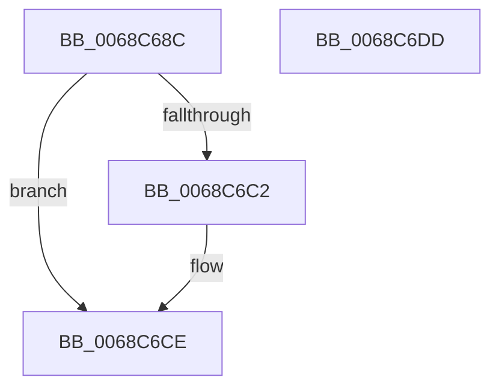

# MiReleaseProcessorHugeMappingAtDpc

- RVA: `0x0068C68C`–`0x0068C6DE` (길이 `82` bytes)
- VA: `0x000000014068C68C`
- 실행 섹션: `.text`
- PDB 이름 있음: `예`; PDB Function 태그: `아니요`
- unwind 정보 RVA: `0x0005CAAC`
- 디코드: `21`개 명령, `82/82` bytes 표시
- 미해석 바이트: `0` (있으면 어셈블리에 `.byte`로 보존)

> 이 문서는 커널 이미지의 기계어와 PDB 기호를 분석해 생성했습니다. 4번과 5번은 함수 원형과 자료형을 바이너리 사용 방식에서 추정한 C 해석이며 원본 소스 복구 결과는 아닙니다.

## 1. Dependencies

- 직접 호출 지점: **2**; 고유 호출 대상: **2**
- 직접 호출자로 확인된 함수: **1**
- RIP 상대 이미지 참조: **1**

### Outgoing calls
- `0x0068C6B0` → [MiWriteLargePte](../2C/MiWriteLargePte_function_002C6DE0.md) (function, `0x002C6DE0`)
- `0x0068C6C9` → [KiLowerIrqlProcessIrqlFlags](../4F/KiLowerIrqlProcessIrqlFlags_function_004F5698.md) (function, `0x004F5698`)

### Direct callers
- [MiSoloZeroHugeRange](MiSoloZeroHugeRange_function_0068C6E4.md) at `0x0068C807`
- [MiSoloZeroHugeRange](MiSoloZeroHugeRange_function_0068C6E4.md) at `0x0068C84B`

### Static image references
- `0x0068C6B9` → RVA `0x00FC6D20` (`ALMOSTRO`; read)

## 2. Other-region calls and transfers

- 다른 실행 섹션으로 향하는 call: **0**
- 별도 외부 분기/꼬리 이동을 확인하지 못했습니다.

## 3. Assembly (complete function range)

```asm
0068C68C  48 89 5C 24 08                  mov qword ptr [rsp + 8], rbx
0068C691  57                              push rdi
0068C692  48 83 EC 20                     sub rsp, 0x20
0068C696  65 48 8B 04 25 20 00 00 00      mov rax, qword ptr gs:[0x20]
0068C69F  45 33 C9                        xor r9d, r9d
0068C6A2  41 0F B6 F8                     movzx edi, r8b
0068C6A6  45 33 C0                        xor r8d, r8d
0068C6A9  48 8B 98 38 88 00 00            mov rbx, qword ptr [rax + 0x8838]
0068C6B0  E8 2B A7 C3 FF                  call 0x1402c6de0
0068C6B5  48 83 23 00                     and qword ptr [rbx], 0
0068C6B9  83 3D 60 A6 93 00 00            cmp dword ptr [rip + 0x93a660], 0
0068C6C0  74 0C                           je 0x14068c6ce
0068C6C2  44 0F 20 C1                     mov rcx, cr8
0068C6C6  40 8A D7                        mov dl, dil
0068C6C9  E8 CA 8F E6 FF                  call 0x1404f5698
0068C6CE  44 0F 22 C7                     mov cr8, rdi
0068C6D2  48 8B 5C 24 30                  mov rbx, qword ptr [rsp + 0x30]
0068C6D7  48 83 C4 20                     add rsp, 0x20
0068C6DB  5F                              pop rdi
0068C6DC  C3                              ret
0068C6DD  CC                              int3
```

## 4. C-style interpretation (structured pseudocode)

```c
__int64 __fastcall MiReleaseProcessorHugeMappingAtDpc(__int64 a1, __int64 a2, int a3, int a4)
{
    __int64 result;
    __int64 v_rsp;
    unsigned __int64 v_stack_p8;

    v_stack_p8 = v_rbx;
    v_rsp = (v_rsp) - (32);
    a4 = 0;
    a3 = 0;
    result = MiWriteLargePte(a1, a2, a3, a4);
    if ((*(unsigned int *)(v_rip + 9676384)) != 0) {
        a1 = v_cr8;
        a2 = (unsigned __int8)((unsigned __int8)(a3));
        result = KiLowerIrqlProcessIrqlFlags(a1, a2, a3, a4);
    }
    v_rsp = (v_rsp) + (32);
    return result;
}
```

## 5. (Beta) C Style

```c
int64_t MiReleaseProcessorHugeMappingAtDpc(int64_t Arg1, int64_t Arg2, int32_t Arg3, int32_t Arg4)
{
    int64_t result;
    int64_t local_rsp;
    uint64_t v_stack_p8;

    v_stack_p8 = local_rbx;
    local_rsp = (local_rsp) - (32);
    Arg4 = 0;
    Arg3 = 0;
    result = MiWriteLargePte(Arg1, Arg2, Arg3, Arg4);
    if ((*(uint32_t *)(v_rip + 0x93A660)) != 0) {
        Arg1 = v_cr8;
        Arg2 = (uint8_t)((uint8_t)(Arg3));
        result = KiLowerIrqlProcessIrqlFlags(Arg1, Arg2, Arg3, Arg4);
    }
    local_rsp = (local_rsp) + (32);
    return result;
}
```

## 6. Execution-region graph

[열기: 2D/3D 그래프와 함수 탐색 컨트롤 패널](../../../control-panel.html?section=text&rva=0x0068C68C&view=graph)

- 2D 그래프는 위에서 아래로 흐르고, 3D 그래프는 빈 공간을 드래그해 회전합니다. Shift+드래그는 이동, 휠은 확대·축소, 함수 노드 선택은 대상 보고서 이동입니다.

### Static fallback


