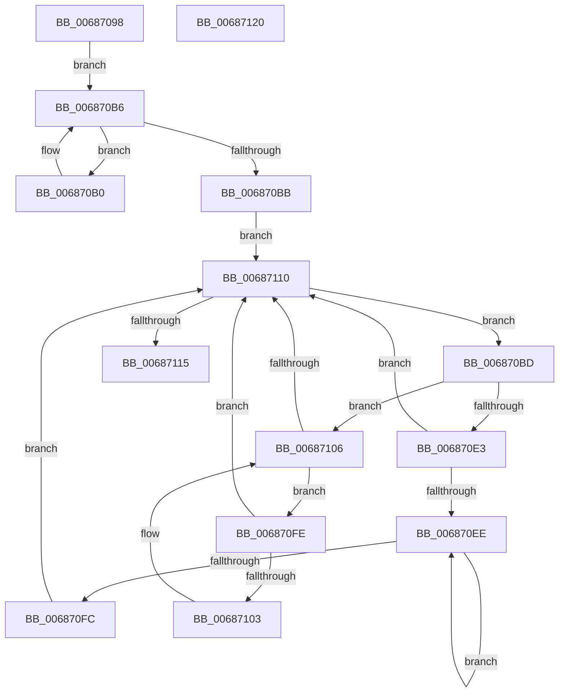

# MiRemoveEnclavePagesFromDump

- RVA: `0x00687098`–`0x00687121` (길이 `137` bytes)
- VA: `0x0000000140687098`
- 실행 섹션: `.text`
- PDB 이름 있음: `예`; PDB Function 태그: `아니요`
- unwind 정보 RVA: `0x0006E5F8`
- 디코드: `45`개 명령, `137/137` bytes 표시
- 미해석 바이트: `0` (있으면 어셈블리에 `.byte`로 보존)

> 이 문서는 커널 이미지의 기계어와 PDB 기호를 분석해 생성했습니다. 4번과 5번은 함수 원형과 자료형을 바이너리 사용 방식에서 추정한 C 해석이며 원본 소스 복구 결과는 아닙니다.

## 1. Dependencies

- 직접 호출 지점: **1**; 고유 호출 대상: **1**
- 직접 호출자로 확인된 함수: **1**
- RIP 상대 이미지 참조: **1**

### Outgoing calls
- `0x006870D2` → [guard_dispatch_icall](../6B/guard_dispatch_icall_function_006BAAD0.md) (function, `0x006BAAD0`)

### Direct callers
- [MmGetDumpRange](../67/MmGetDumpRange_function_0067DA68.md) at `0x0067DD05`

### Static image references
- `0x006870A2` → RVA `0x00E375B8` (`.data`; read)

## 2. Other-region calls and transfers

- 다른 실행 섹션으로 향하는 call: **0**
- 별도 외부 분기/꼬리 이동을 확인하지 못했습니다.

## 3. Assembly (complete function range)

```asm
00687098  48 89 5C 24 08                  mov qword ptr [rsp + 8], rbx
0068709D  57                              push rdi
0068709E  48 83 EC 30                     sub rsp, 0x30
006870A2  48 8B 05 0F 05 7B 00            mov rax, qword ptr [rip + 0x7b050f]
006870A9  48 8B F9                        mov rdi, rcx
006870AC  33 DB                           xor ebx, ebx
006870AE  EB 06                           jmp 0x1406870b6
006870B0  48 8B D8                        mov rbx, rax
006870B3  48 8B 00                        mov rax, qword ptr [rax]
006870B6  48 85 C0                        test rax, rax
006870B9  75 F5                           jne 0x1406870b0
006870BB  EB 53                           jmp 0x140687110
006870BD  48 8B 47 08                     mov rax, qword ptr [rdi + 8]
006870C1  41 B9 02 00 00 00               mov r9d, 2
006870C7  4C 8B 43 20                     mov r8, qword ptr [rbx + 0x20]
006870CB  48 8B CF                        mov rcx, rdi
006870CE  48 8B 53 18                     mov rdx, qword ptr [rbx + 0x18]
006870D2  E8 F9 39 03 00                  call 0x1406baad0
006870D7  48 8B 43 08                     mov rax, qword ptr [rbx + 8]
006870DB  48 8B CB                        mov rcx, rbx
006870DE  48 85 C0                        test rax, rax
006870E1  74 23                           je 0x140687106
006870E3  48 8B 08                        mov rcx, qword ptr [rax]
006870E6  48 8B D8                        mov rbx, rax
006870E9  48 85 C9                        test rcx, rcx
006870EC  74 22                           je 0x140687110
006870EE  48 8B 01                        mov rax, qword ptr [rcx]
006870F1  48 8B D9                        mov rbx, rcx
006870F4  48 8B C8                        mov rcx, rax
006870F7  48 85 C0                        test rax, rax
006870FA  75 F2                           jne 0x1406870ee
006870FC  EB 12                           jmp 0x140687110
006870FE  48 39 0B                        cmp qword ptr [rbx], rcx
00687101  74 0D                           je 0x140687110
00687103  48 8B CB                        mov rcx, rbx
00687106  48 8B 5B 10                     mov rbx, qword ptr [rbx + 0x10]
0068710A  48 83 E3 FC                     and rbx, 0xfffffffffffffffc
0068710E  75 EE                           jne 0x1406870fe
00687110  48 85 DB                        test rbx, rbx
00687113  75 A8                           jne 0x1406870bd
00687115  48 8B 5C 24 40                  mov rbx, qword ptr [rsp + 0x40]
0068711A  48 83 C4 30                     add rsp, 0x30
0068711E  5F                              pop rdi
0068711F  C3                              ret
00687120  CC                              int3
```

## 4. C-style interpretation (structured pseudocode)

```c
__int64 __fastcall MiRemoveEnclavePagesFromDump(__int64 a1)
{
    __int64 result;
    __int64 v_rbx;
    __int64 v_rsp;
    unsigned __int64 v_stack_p8;

    v_stack_p8 = v_rbx;
    v_rsp = (v_rsp) - (48);
    v_rbx = 0;
    goto loc_006870B6;
loc_006870B0:
loc_006870B6:
    if (*(unsigned __int64 *)(*(unsigned __int64 *)(v_rip + 8062223)) != 0) goto loc_006870B0;
    goto loc_00687110;
loc_006870BD:
    result = guard_dispatch_icall(a1, *(unsigned __int64 *)(*(unsigned __int64 *)(v_rip + 8062223) + 24), *(unsigned __int64 *)(*(unsigned __int64 *)(v_rip + 8062223) + 32), 2);
    if (*(unsigned __int64 *)(*(unsigned __int64 *)(v_rip + 8062223) + 8) == 0) goto loc_00687106;
    if (*(unsigned __int64 *)(*(unsigned __int64 *)(*(unsigned __int64 *)(v_rip + 8062223) + 8)) == 0) goto loc_00687110;
loc_006870EE:
    if (*(unsigned __int64 *)(*(unsigned __int64 *)(*(unsigned __int64 *)(*(unsigned __int64 *)(v_rip + 8062223) + 8))) != 0) goto loc_006870EE;
    goto loc_00687110;
loc_006870FE:
    if ((*(unsigned __int64 *)(*(unsigned __int64 *)(*(unsigned __int64 *)(*(unsigned __int64 *)(v_rip + 8062223) + 8)))) == (*(unsigned __int64 *)(*(unsigned __int64 *)(*(unsigned __int64 *)(*(unsigned __int64 *)(v_rip + 8062223) + 8))))) goto loc_00687110;
loc_00687106:
    v_rbx = (*(unsigned __int64 *)(*(unsigned __int64 *)(*(unsigned __int64 *)(*(unsigned __int64 *)(v_rip + 8062223) + 8)) + 16)) & (-4);
    if (condition_is_not_equal) goto loc_006870FE;
loc_00687110:
    if (v_rbx != 0) goto loc_006870BD;
    v_rsp = (v_rsp) + (48);
    return *(unsigned __int64 *)(*(unsigned __int64 *)(*(unsigned __int64 *)(*(unsigned __int64 *)(v_rip + 8062223) + 8)));
}
```

## 5. (Beta) C Style

```c
int64_t MiRemoveEnclavePagesFromDump(void *Arg1)
{
    uint8_t *arg1 = (uint8_t *)Arg1;

    int64_t result;
    int64_t local_rbx;
    int64_t local_rsp;
    uint64_t v_stack_p8;

    v_stack_p8 = local_rbx;
    local_rsp = (local_rsp) - (48);
    local_rbx = 0;
    goto loc_006870B6;
loc_006870B0:
loc_006870B6:
    if (*(uint64_t *)(*(uint64_t *)(v_rip + 0x7B050F)) != 0) goto loc_006870B0;
    goto loc_00687110;
loc_006870BD:
    result = guard_dispatch_icall(Arg1, *(uint64_t *)(*(uint64_t *)(v_rip + 0x7B050F) + 0x18), *(uint64_t *)(*(uint64_t *)(v_rip + 0x7B050F) + 0x20), 2);
    if (*(uint64_t *)(*(uint64_t *)(v_rip + 0x7B050F) + 0x8) == 0) goto loc_00687106;
    if (*(uint64_t *)(*(uint64_t *)(*(uint64_t *)(v_rip + 0x7B050F) + 0x8)) == 0) goto loc_00687110;
loc_006870EE:
    if (*(uint64_t *)(*(uint64_t *)(*(uint64_t *)(*(uint64_t *)(v_rip + 0x7B050F) + 0x8))) != 0) goto loc_006870EE;
    goto loc_00687110;
loc_006870FE:
    if ((*(uint64_t *)(*(uint64_t *)(*(uint64_t *)(*(uint64_t *)(v_rip + 0x7B050F) + 0x8)))) == (*(uint64_t *)(*(uint64_t *)(*(uint64_t *)(*(uint64_t *)(v_rip + 0x7B050F) + 0x8))))) goto loc_00687110;
loc_00687106:
    local_rbx = (*(uint64_t *)(*(uint64_t *)(*(uint64_t *)(*(uint64_t *)(v_rip + 0x7B050F) + 0x8)) + 0x10)) & (-4);
    if (condition_is_not_equal) goto loc_006870FE;
loc_00687110:
    if (local_rbx != 0) goto loc_006870BD;
    local_rsp = (local_rsp) + (48);
    return *(uint64_t *)(*(uint64_t *)(*(uint64_t *)(*(uint64_t *)(v_rip + 0x7B050F) + 0x8)));
}
```

### 관측된 메모리 오프셋

구조체 형식이 확인되지 않은 접근은 인자 기준의 오프셋으로만 기록했습니다.

| 기준 인자 | 오프셋 표현 | 폭 (bit) | 접근 |
|---|---:|---:|---|
| `Arg1` | `+ 0x8` | `64` | `R` |

## 6. Execution-region graph

[열기: 2D/3D 그래프와 함수 탐색 컨트롤 패널](../../../control-panel.html?section=text&rva=0x00687098&view=graph)

- 2D 그래프는 위에서 아래로 흐르고, 3D 그래프는 빈 공간을 드래그해 회전합니다. Shift+드래그는 이동, 휠은 확대·축소, 함수 노드 선택은 대상 보고서 이동입니다.

### Static fallback


