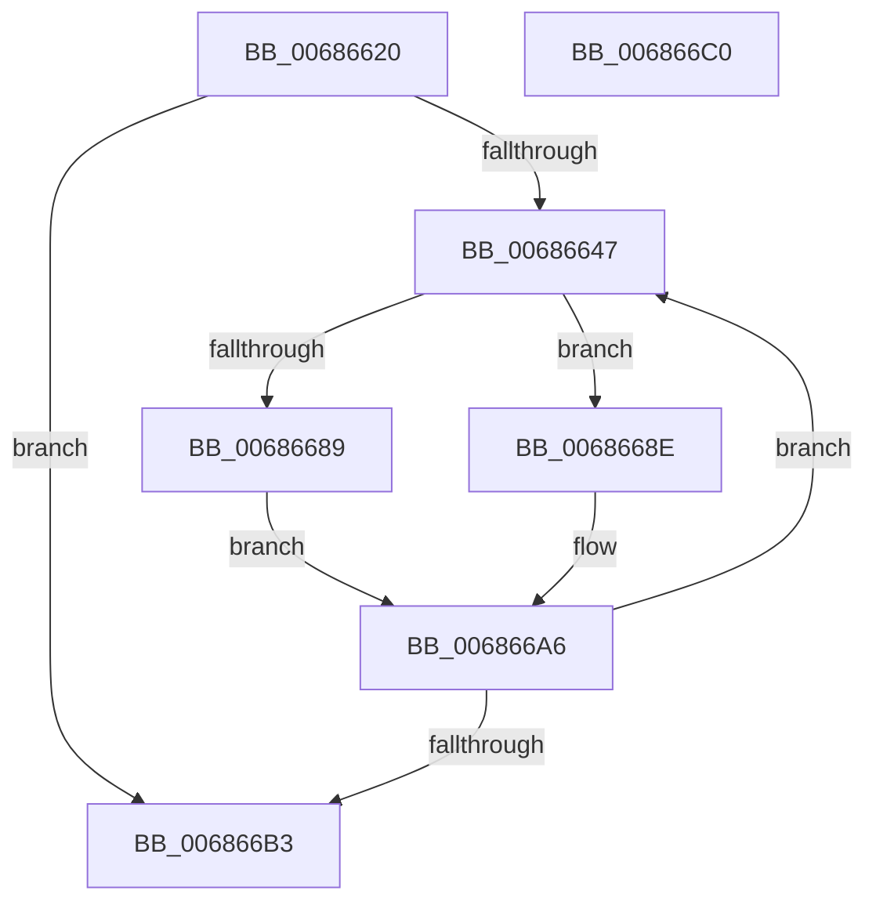

# MiRemoveNonIdealCachedStacks

- RVA: `0x00686620`–`0x006866C1` (길이 `161` bytes)
- VA: `0x0000000140686620`
- 실행 섹션: `.text`
- PDB 이름 있음: `예`; PDB Function 태그: `아니요`
- unwind 정보 RVA: `0x000C7F20`
- 디코드: `45`개 명령, `161/161` bytes 표시
- 미해석 바이트: `0` (있으면 어셈블리에 `.byte`로 보존)

> 이 문서는 커널 이미지의 기계어와 PDB 기호를 분석해 생성했습니다. 4번과 5번은 함수 원형과 자료형을 바이너리 사용 방식에서 추정한 C 해석이며 원본 소스 복구 결과는 아닙니다.

## 1. Dependencies

- 직접 호출 지점: **4**; 고유 호출 대상: **4**
- 직접 호출자로 확인된 함수: **1**
- RIP 상대 이미지 참조: **0**

### Outgoing calls
- `0x0068663A` → [ExpInterlockedFlushSList](../6B/ExpInterlockedFlushSList_function_006BA5F0.md) (function, `0x006BA5F0`)
- `0x00686680` → [MiKernelShadowStackIdealForCaching](../48/MiKernelShadowStackIdealForCaching_function_00484330.md) (function, `0x00484330`)
- `0x0068669A` → [MiDeleteCachedKernelShadowStack](../49/MiDeleteCachedKernelShadowStack_function_004956CC.md) (function, `0x004956CC`)
- `0x006866A9` → [ExpInterlockedPushEntrySList](../6B/ExpInterlockedPushEntrySList_function_006BA5B0.md) (function, `0x006BA5B0`)

### Direct callers
- [MiAdjustCachedStackList](../2D/MiAdjustCachedStackList_function_002D8C10.md) at `0x002D8CCE`

### Static image references
- 디코드된 RIP-relative 메모리 참조가 없습니다.

## 2. Other-region calls and transfers

- 다른 실행 섹션으로 향하는 call: **0**
- 별도 외부 분기/꼬리 이동을 확인하지 못했습니다.

## 3. Assembly (complete function range)

```asm
00686620  48 89 5C 24 18                  mov qword ptr [rsp + 0x18], rbx
00686625  55                              push rbp
00686626  56                              push rsi
00686627  57                              push rdi
00686628  48 83 EC 20                     sub rsp, 0x20
0068662C  48 83 64 24 48 00               and qword ptr [rsp + 0x48], 0
00686632  48 8B F1                        mov rsi, rcx
00686635  83 64 24 40 00                  and dword ptr [rsp + 0x40], 0
0068663A  E8 B1 3F 03 00                  call 0x1406ba5f0
0068663F  48 8B F8                        mov rdi, rax
00686642  48 85 C0                        test rax, rax
00686645  74 6C                           je 0x1406866b3
00686647  48 8B DF                        mov rbx, rdi
0068664A  48 B8 F8 FF FF FF 7F 00 00 00   movabs rax, 0x7ffffffff8
00686654  48 8B EF                        mov rbp, rdi
00686657  48 8B 3F                        mov rdi, qword ptr [rdi]
0068665A  48 8B 53 10                     mov rdx, qword ptr [rbx + 0x10]
0068665E  48 C1 EA 09                     shr rdx, 9
00686662  48 23 D0                        and rdx, rax
00686665  48 B8 08 00 00 00 80 F6 FF FF   movabs rax, 0xfffff68000000008
0068666F  48 03 D0                        add rdx, rax
00686672  4C 8D 4C 24 40                  lea r9, [rsp + 0x40]
00686677  4C 8D 44 24 48                  lea r8, [rsp + 0x48]
0068667C  48 8D 4A F8                     lea rcx, [rdx - 8]
00686680  E8 AB DC DF FF                  call 0x140484330
00686685  85 C0                           test eax, eax
00686687  75 05                           jne 0x14068668e
00686689  48 8B CE                        mov rcx, rsi
0068668C  EB 18                           jmp 0x1406866a6
0068668E  48 8B 53 10                     mov rdx, qword ptr [rbx + 0x10]
00686692  48 8B 5C 24 48                  mov rbx, qword ptr [rsp + 0x48]
00686697  48 8B CB                        mov rcx, rbx
0068669A  E8 2D F0 E0 FF                  call 0x1404956cc
0068669F  48 8D 8B C0 01 00 00            lea rcx, [rbx + 0x1c0]
006866A6  48 8B D5                        mov rdx, rbp
006866A9  E8 02 3F 03 00                  call 0x1406ba5b0
006866AE  48 85 FF                        test rdi, rdi
006866B1  75 94                           jne 0x140686647
006866B3  48 8B 5C 24 50                  mov rbx, qword ptr [rsp + 0x50]
006866B8  48 83 C4 20                     add rsp, 0x20
006866BC  5F                              pop rdi
006866BD  5E                              pop rsi
006866BE  5D                              pop rbp
006866BF  C3                              ret
006866C0  CC                              int3
```

## 4. C-style interpretation (structured pseudocode)

```c
__int64 __fastcall MiRemoveNonIdealCachedStacks(__int64 a1)
{
    __int64 result;
    __int64 v_rsp;
    unsigned __int64 v_stack_p10;
    unsigned __int64 v_stack_p18;
    unsigned int v_stack_p8;

    v_stack_p18 = v_rbx;
    v_rsp = (v_rsp) - (32);
    result = ExpInterlockedFlushSList(a1, a2, a3, a4);
    if (result == 0) goto loc_006866B3;
loc_00686647:
    a2 = (*(unsigned __int64 *)(result + 16)) >> (9);
    a2 = (a2) & (result);
    a2 = (a2) + (result);
    result = MiKernelShadowStackIdealForCaching(a2 - 8, a2, v_stack_p10, v_stack_p8);
    if ((unsigned int)(result) != 0) goto loc_0068668E;
    goto loc_006866A6;
loc_0068668E:
    result = MiDeleteCachedKernelShadowStack(v_stack_p10, *(unsigned __int64 *)(result + 16), v_stack_p10, v_stack_p8);
loc_006866A6:
    result = ExpInterlockedPushEntrySList(v_stack_p10 + 448, result, v_stack_p10, v_stack_p8);
    if (*(unsigned __int64 *)(result) != 0) goto loc_00686647;
loc_006866B3:
    v_rsp = (v_rsp) + (32);
    return result;
}
```

## 5. (Beta) C Style

```c
int64_t MiRemoveNonIdealCachedStacks(int64_t Arg1)
{
    int64_t result;
    int64_t local_rsp;
    uint64_t v_stack_p10;
    uint64_t v_stack_p18;
    uint32_t v_stack_p8;

    v_stack_p18 = local_rbx;
    local_rsp = (local_rsp) - (32);
    result = ExpInterlockedFlushSList(Arg1, a2, a3, a4);
    if (result == 0) goto loc_006866B3;
loc_00686647:
    a2 = (*(uint64_t *)(result + 0x10)) >> (9);
    a2 = (a2) & (result);
    a2 = (a2) + (result);
    result = MiKernelShadowStackIdealForCaching(a2 - 8, a2, v_stack_p10, v_stack_p8);
    if ((uint32_t)(result) != 0) goto loc_0068668E;
    goto loc_006866A6;
loc_0068668E:
    result = MiDeleteCachedKernelShadowStack(v_stack_p10, *(uint64_t *)(result + 0x10), v_stack_p10, v_stack_p8);
loc_006866A6:
    result = ExpInterlockedPushEntrySList(v_stack_p10 + 448, result, v_stack_p10, v_stack_p8);
    if (*(uint64_t *)(result) != 0) goto loc_00686647;
loc_006866B3:
    local_rsp = (local_rsp) + (32);
    return result;
}
```

## 6. Execution-region graph

[열기: 2D/3D 그래프와 함수 탐색 컨트롤 패널](../../../control-panel.html?section=text&rva=0x00686620&view=graph)

- 2D 그래프는 위에서 아래로 흐르고, 3D 그래프는 빈 공간을 드래그해 회전합니다. Shift+드래그는 이동, 휠은 확대·축소, 함수 노드 선택은 대상 보고서 이동입니다.

### Static fallback


