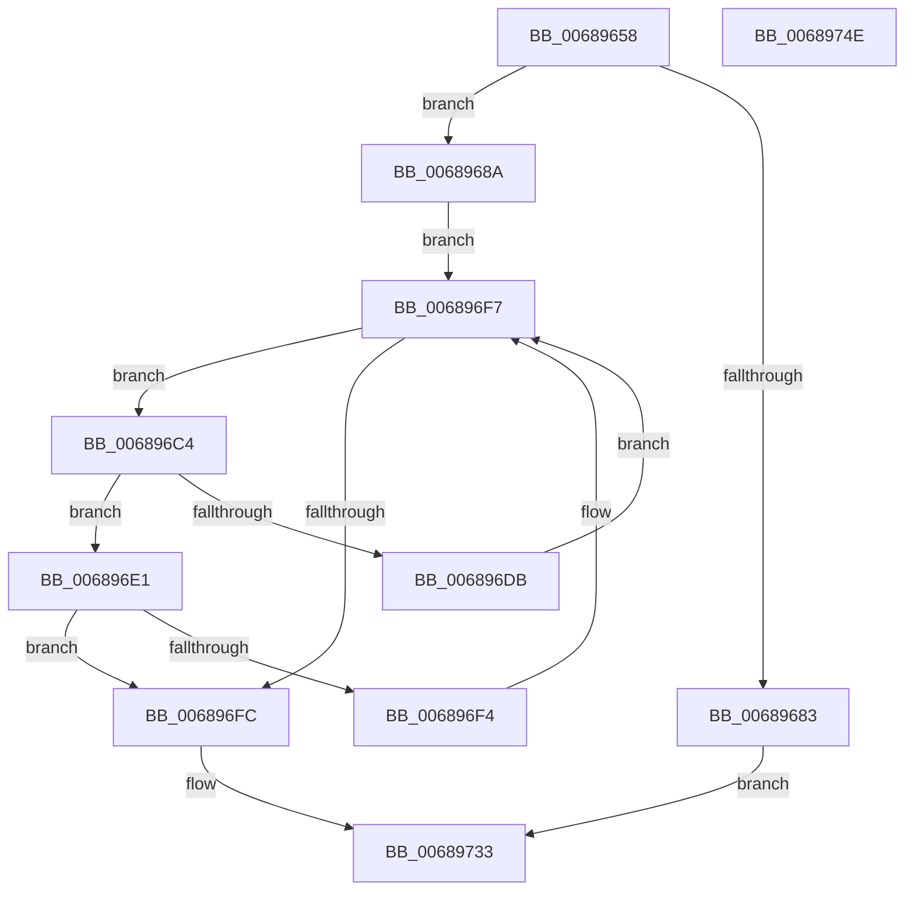

# MiRemoveUserPhysicalPagesView

- RVA: `0x00689658`–`0x0068974F` (길이 `247` bytes)
- VA: `0x0000000140689658`
- 실행 섹션: `.text`
- PDB 이름 있음: `예`; PDB Function 태그: `아니요`
- unwind 정보 RVA: `0x0005E6B4`
- 디코드: `65`개 명령, `247/247` bytes 표시
- 미해석 바이트: `0` (있으면 어셈블리에 `.byte`로 보존)

> 이 문서는 커널 이미지의 기계어와 PDB 기호를 분석해 생성했습니다. 4번과 5번은 함수 원형과 자료형을 바이너리 사용 방식에서 추정한 C 해석이며 원본 소스 복구 결과는 아닙니다.

## 1. Dependencies

- 직접 호출 지점: **5**; 고유 호출 대상: **5**
- 직접 호출자로 확인된 함수: **1**
- RIP 상대 이미지 참조: **0**

### Outgoing calls
- `0x006896A4` → [MiLockAweVadsExclusive](../4B/MiLockAweVadsExclusive_function_004BDEE4.md) (function, `0x004BDEE4`)
- `0x00689703` → [ExAcquireSpinLockExclusive](../24/ExAcquireSpinLockExclusive_function_00248690.md) (function, `0x00248690`)
- `0x00689710` → [RtlAvlRemoveNode](../29/RtlAvlRemoveNode_function_00296650.md) (function, `0x00296650`)
- `0x0068971E` → [MiReleaseSpinLockExclusive](../24/MiReleaseSpinLockExclusive_function_002482C0.md) (function, `0x002482C0`)
- `0x00689726` → [MiUnlockAweVadsExclusive](../4B/MiUnlockAweVadsExclusive_function_004BDF1C.md) (function, `0x004BDF1C`)

### Direct callers
- [MiDeleteVad](../../page/88/MiDeleteVad_function_00888C80.md) at `0x0088917A`

### Static image references
- 디코드된 RIP-relative 메모리 참조가 없습니다.

## 2. Other-region calls and transfers

- 다른 실행 섹션으로 향하는 call: **0**
- 별도 외부 분기/꼬리 이동을 확인하지 못했습니다.

## 3. Assembly (complete function range)

```asm
00689658  48 8B C4                        mov rax, rsp
0068965B  48 89 58 08                     mov qword ptr [rax + 8], rbx
0068965F  48 89 68 10                     mov qword ptr [rax + 0x10], rbp
00689663  48 89 70 18                     mov qword ptr [rax + 0x18], rsi
00689667  48 89 78 20                     mov qword ptr [rax + 0x20], rdi
0068966B  41 56                           push r14
0068966D  48 83 EC 20                     sub rsp, 0x20
00689671  8B 41 30                        mov eax, dword ptr [rcx + 0x30]
00689674  48 8B D9                        mov rbx, rcx
00689677  25 00 00 20 0C                  and eax, 0xc200000
0068967C  3D 00 00 20 08                  cmp eax, 0x8200000
00689681  75 07                           jne 0x14068968a
00689683  33 C0                           xor eax, eax
00689685  E9 A9 00 00 00                  jmp 0x140689733
0068968A  65 48 8B 2C 25 88 01 00 00      mov rbp, qword ptr gs:[0x188]
00689693  48 8B CD                        mov rcx, rbp
00689696  48 8B 85 B8 00 00 00            mov rax, qword ptr [rbp + 0xb8]
0068969D  48 8B B8 10 04 00 00            mov rdi, qword ptr [rax + 0x410]
006896A4  E8 3B 48 E3 FF                  call 0x1404bdee4
006896A9  44 0F B6 43 20                  movzx r8d, byte ptr [rbx + 0x20]
006896AE  4C 8D B7 50 04 00 00            lea r14, [rdi + 0x450]
006896B5  8B 43 18                        mov eax, dword ptr [rbx + 0x18]
006896B8  49 8B 36                        mov rsi, qword ptr [r14]
006896BB  49 C1 E0 20                     shl r8, 0x20
006896BF  4C 0B C0                        or r8, rax
006896C2  EB 33                           jmp 0x1406896f7
006896C4  48 8B 56 18                     mov rdx, qword ptr [rsi + 0x18]
006896C8  0F B6 4A 21                     movzx ecx, byte ptr [rdx + 0x21]
006896CC  8B 42 1C                        mov eax, dword ptr [rdx + 0x1c]
006896CF  48 C1 E1 20                     shl rcx, 0x20
006896D3  48 0B C8                        or rcx, rax
006896D6  4C 3B C1                        cmp r8, rcx
006896D9  76 06                           jbe 0x1406896e1
006896DB  48 8B 76 08                     mov rsi, qword ptr [rsi + 8]
006896DF  EB 16                           jmp 0x1406896f7
006896E1  0F B6 4A 20                     movzx ecx, byte ptr [rdx + 0x20]
006896E5  8B 42 18                        mov eax, dword ptr [rdx + 0x18]
006896E8  48 C1 E1 20                     shl rcx, 0x20
006896EC  48 0B C8                        or rcx, rax
006896EF  4C 3B C1                        cmp r8, rcx
006896F2  73 08                           jae 0x1406896fc
006896F4  48 8B 36                        mov rsi, qword ptr [rsi]
006896F7  48 85 F6                        test rsi, rsi
006896FA  75 C8                           jne 0x1406896c4
006896FC  48 8D 8F 68 04 00 00            lea rcx, [rdi + 0x468]
00689703  E8 88 EF BB FF                  call 0x140248690
00689708  48 8B D6                        mov rdx, rsi
0068970B  49 8B CE                        mov rcx, r14
0068970E  8A D8                           mov bl, al
00689710  E8 3B CF C0 FF                  call 0x140296650
00689715  8A D3                           mov dl, bl
00689717  48 8D 8F 68 04 00 00            lea rcx, [rdi + 0x468]
0068971E  E8 9D EB BB FF                  call 0x1402482c0
00689723  48 8B CD                        mov rcx, rbp
00689726  E8 F1 47 E3 FF                  call 0x1404bdf1c
0068972B  48 83 66 10 00                  and qword ptr [rsi + 0x10], 0
00689730  48 8B C6                        mov rax, rsi
00689733  48 8B 5C 24 30                  mov rbx, qword ptr [rsp + 0x30]
00689738  48 8B 6C 24 38                  mov rbp, qword ptr [rsp + 0x38]
0068973D  48 8B 74 24 40                  mov rsi, qword ptr [rsp + 0x40]
00689742  48 8B 7C 24 48                  mov rdi, qword ptr [rsp + 0x48]
00689747  48 83 C4 20                     add rsp, 0x20
0068974B  41 5E                           pop r14
0068974D  C3                              ret
0068974E  CC                              int3
```

## 4. C-style interpretation (structured pseudocode)

```c
__int64 __fastcall MiRemoveUserPhysicalPagesView(__int64 a1)
{
    __int64 result;
    __int64 v_rsp;
    unsigned __int64 v_stack_p10;
    unsigned __int64 v_stack_p18;
    unsigned __int64 v_stack_p20;
    unsigned __int64 v_stack_p8;

    *(unsigned __int64 *)(v_rsp + 8) = v_rbx;
    *(unsigned __int64 *)(v_rsp + 16) = v_rbp;
    *(unsigned __int64 *)(v_rsp + 24) = v_rsi;
    *(unsigned __int64 *)(v_rsp + 32) = v_rdi;
    v_rsp = (v_rsp) - (32);
    result = (unsigned int)(((unsigned int)(*(unsigned int *)(a1 + 48))) & (0xC200000ULL));
    if (((unsigned int)(result)) != 0x8200000ULL) goto loc_0068968A;
    result = 0;
    goto loc_00689733;
loc_0068968A:
    result = MiLockAweVadsExclusive(*(unsigned __int64 *)(gs_base + (0 + 392)), a2, a3, a4);
    a3 = (*(unsigned __int8 *)(a1 + 32)) << (32);
    a3 = (a3) | ((unsigned int)(*(unsigned int *)(a1 + 24)));
    goto loc_006896F7;
loc_006896C4:
    a1 = (*(unsigned __int8 *)(*(unsigned __int64 *)(*(unsigned __int64 *)(*(unsigned __int64 *)(*(unsigned __int64 *)(*(unsigned __int64 *)(gs_base + (0 + 392)) + 184) + 1040) + 1104) + 24) + 33)) << (32);
    a1 = (a1) | ((unsigned int)(*(unsigned int *)(*(unsigned __int64 *)(*(unsigned __int64 *)(*(unsigned __int64 *)(*(unsigned __int64 *)(*(unsigned __int64 *)(gs_base + (0 + 392)) + 184) + 1040) + 1104) + 24) + 28)));
    if (a3 <= a1) goto loc_006896E1;
    goto loc_006896F7;
loc_006896E1:
    a1 = (*(unsigned __int8 *)(*(unsigned __int64 *)(*(unsigned __int64 *)(*(unsigned __int64 *)(*(unsigned __int64 *)(*(unsigned __int64 *)(gs_base + (0 + 392)) + 184) + 1040) + 1104) + 24) + 32)) << (32);
    a1 = (a1) | ((unsigned int)(*(unsigned int *)(*(unsigned __int64 *)(*(unsigned __int64 *)(*(unsigned __int64 *)(*(unsigned __int64 *)(*(unsigned __int64 *)(gs_base + (0 + 392)) + 184) + 1040) + 1104) + 24) + 24)));
    if (a3 >= a1) goto loc_006896FC;
loc_006896F7:
    if (*(unsigned __int64 *)(*(unsigned __int64 *)(*(unsigned __int64 *)(*(unsigned __int64 *)(*(unsigned __int64 *)(*(unsigned __int64 *)(gs_base + (0 + 392)) + 184) + 1040) + 1104) + 8)) != 0) goto loc_006896C4;
loc_006896FC:
    result = ExAcquireSpinLockExclusive(*(unsigned __int64 *)(*(unsigned __int64 *)(*(unsigned __int64 *)(gs_base + (0 + 392)) + 184) + 1040) + 1128, *(unsigned __int64 *)(*(unsigned __int64 *)(*(unsigned __int64 *)(*(unsigned __int64 *)(*(unsigned __int64 *)(gs_base + (0 + 392)) + 184) + 1040) + 1104) + 24), a3, a4);
    result = RtlAvlRemoveNode(*(unsigned __int64 *)(*(unsigned __int64 *)(*(unsigned __int64 *)(gs_base + (0 + 392)) + 184) + 1040) + 1104, *(unsigned __int64 *)(*(unsigned __int64 *)(*(unsigned __int64 *)(*(unsigned __int64 *)(*(unsigned __int64 *)(*(unsigned __int64 *)(gs_base + (0 + 392)) + 184) + 1040) + 1104) + 8)), a3, a4);
    result = MiReleaseSpinLockExclusive(*(unsigned __int64 *)(*(unsigned __int64 *)(*(unsigned __int64 *)(gs_base + (0 + 392)) + 184) + 1040) + 1128, (unsigned __int8)((unsigned __int8)(result)), a3, a4);
    result = MiUnlockAweVadsExclusive(*(unsigned __int64 *)(gs_base + (0 + 392)), (unsigned __int8)((unsigned __int8)(result)), a3, a4);
loc_00689733:
    v_rsp = (v_rsp) + (32);
    return *(unsigned __int64 *)(*(unsigned __int64 *)(*(unsigned __int64 *)(*(unsigned __int64 *)(*(unsigned __int64 *)(*(unsigned __int64 *)(gs_base + (0 + 392)) + 184) + 1040) + 1104) + 8));
}
```

## 5. (Beta) C Style

```c
int64_t MiRemoveUserPhysicalPagesView(void *Arg1)
{
    uint8_t *arg1 = (uint8_t *)Arg1;

    int64_t result;
    int64_t local_rsp;
    uint64_t v_stack_p10;
    uint64_t v_stack_p18;
    uint64_t v_stack_p20;
    uint64_t v_stack_p8;

    *(uint64_t *)(local_rsp + 0x8) = local_rbx;
    *(uint64_t *)(local_rsp + 0x10) = local_rbp;
    *(uint64_t *)(local_rsp + 0x18) = local_rsi;
    *(uint64_t *)(local_rsp + 0x20) = local_rdi;
    local_rsp = (local_rsp) - (32);
    result = (uint32_t)(((uint32_t)(*(uint32_t *)(arg1 + 0x30))) & (0xC200000ULL));
    if (((uint32_t)(result)) != 0x8200000ULL) goto loc_0068968A;
    result = 0;
    goto loc_00689733;
loc_0068968A:
    result = MiLockAweVadsExclusive(*(uint64_t *)(gs_base + (0 + 0x188)), a2, a3, a4);
    a3 = (*(uint8_t *)(arg1 + 0x20)) << (32);
    a3 = (a3) | ((uint32_t)(*(uint32_t *)(arg1 + 0x18)));
    goto loc_006896F7;
loc_006896C4:
    Arg1 = (*(uint8_t *)(*(uint64_t *)(*(uint64_t *)(*(uint64_t *)(*(uint64_t *)(*(uint64_t *)(gs_base + (0 + 0x188)) + 0xB8) + 0x410) + 0x450) + 0x18) + 0x21)) << (32);
    Arg1 = (Arg1) | ((uint32_t)(*(uint32_t *)(*(uint64_t *)(*(uint64_t *)(*(uint64_t *)(*(uint64_t *)(*(uint64_t *)(gs_base + (0 + 0x188)) + 0xB8) + 0x410) + 0x450) + 0x18) + 0x1C)));
    if (a3 <= Arg1) goto loc_006896E1;
    goto loc_006896F7;
loc_006896E1:
    Arg1 = (*(uint8_t *)(*(uint64_t *)(*(uint64_t *)(*(uint64_t *)(*(uint64_t *)(*(uint64_t *)(gs_base + (0 + 0x188)) + 0xB8) + 0x410) + 0x450) + 0x18) + 0x20)) << (32);
    Arg1 = (Arg1) | ((uint32_t)(*(uint32_t *)(*(uint64_t *)(*(uint64_t *)(*(uint64_t *)(*(uint64_t *)(*(uint64_t *)(gs_base + (0 + 0x188)) + 0xB8) + 0x410) + 0x450) + 0x18) + 0x18)));
    if (a3 >= Arg1) goto loc_006896FC;
loc_006896F7:
    if (*(uint64_t *)(*(uint64_t *)(*(uint64_t *)(*(uint64_t *)(*(uint64_t *)(*(uint64_t *)(gs_base + (0 + 0x188)) + 0xB8) + 0x410) + 0x450) + 0x8)) != 0) goto loc_006896C4;
loc_006896FC:
    result = ExAcquireSpinLockExclusive(*(uint64_t *)(*(uint64_t *)(*(uint64_t *)(gs_base + (0 + 0x188)) + 0xB8) + 0x410) + 1128, *(uint64_t *)(*(uint64_t *)(*(uint64_t *)(*(uint64_t *)(*(uint64_t *)(gs_base + (0 + 0x188)) + 0xB8) + 0x410) + 0x450) + 0x18), a3, a4);
    result = RtlAvlRemoveNode(*(uint64_t *)(*(uint64_t *)(*(uint64_t *)(gs_base + (0 + 0x188)) + 0xB8) + 0x410) + 1104, *(uint64_t *)(*(uint64_t *)(*(uint64_t *)(*(uint64_t *)(*(uint64_t *)(*(uint64_t *)(gs_base + (0 + 0x188)) + 0xB8) + 0x410) + 0x450) + 0x8)), a3, a4);
    result = MiReleaseSpinLockExclusive(*(uint64_t *)(*(uint64_t *)(*(uint64_t *)(gs_base + (0 + 0x188)) + 0xB8) + 0x410) + 1128, (uint8_t)((uint8_t)(result)), a3, a4);
    result = MiUnlockAweVadsExclusive(*(uint64_t *)(gs_base + (0 + 0x188)), (uint8_t)((uint8_t)(result)), a3, a4);
loc_00689733:
    local_rsp = (local_rsp) + (32);
    return *(uint64_t *)(*(uint64_t *)(*(uint64_t *)(*(uint64_t *)(*(uint64_t *)(*(uint64_t *)(gs_base + (0 + 0x188)) + 0xB8) + 0x410) + 0x450) + 0x8));
}
```

### 관측된 메모리 오프셋

구조체 형식이 확인되지 않은 접근은 인자 기준의 오프셋으로만 기록했습니다.

| 기준 인자 | 오프셋 표현 | 폭 (bit) | 접근 |
|---|---:|---:|---|
| `Arg1` | `+ 0x18` | `32` | `R` |
| `Arg1` | `+ 0x20` | `8` | `R` |
| `Arg1` | `+ 0x30` | `32` | `R` |

## 6. Execution-region graph

[열기: 2D/3D 그래프와 함수 탐색 컨트롤 패널](../../../control-panel.html?section=text&rva=0x00689658&view=graph)

- 2D 그래프는 위에서 아래로 흐르고, 3D 그래프는 빈 공간을 드래그해 회전합니다. Shift+드래그는 이동, 휠은 확대·축소, 함수 노드 선택은 대상 보고서 이동입니다.

### Static fallback


