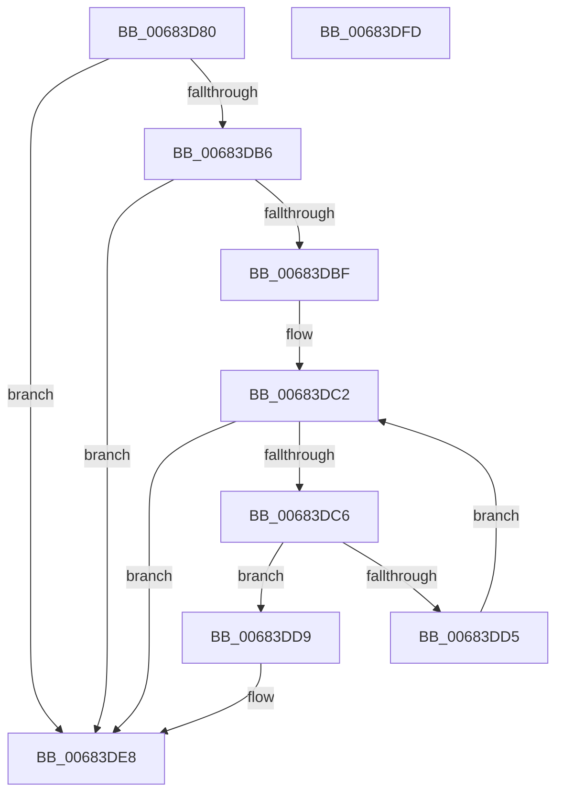

# MiReplacePatchImportEntry

- RVA: `0x00683D80`–`0x00683DFE` (길이 `126` bytes)
- VA: `0x0000000140683D80`
- 실행 섹션: `.text`
- PDB 이름 있음: `예`; PDB Function 태그: `아니요`
- unwind 정보 RVA: `0x000A9ACC`
- 디코드: `41`개 명령, `126/126` bytes 표시
- 미해석 바이트: `0` (있으면 어셈블리에 `.byte`로 보존)

> 이 문서는 커널 이미지의 기계어와 PDB 기호를 분석해 생성했습니다. 4번과 5번은 함수 원형과 자료형을 바이너리 사용 방식에서 추정한 C 해석이며 원본 소스 복구 결과는 아닙니다.

## 1. Dependencies

- 직접 호출 지점: **2**; 고유 호출 대상: **2**
- 직접 호출자로 확인된 함수: **0**
- RIP 상대 이미지 참조: **0**

### Outgoing calls
- `0x00683DA9` → [RtlImageDirectoryEntryToData](../43/RtlImageDirectoryEntryToData_function_004328D0.md) (function, `0x004328D0`)
- `0x00683DE3` → [MiReplaceImportEntry](../67/MiReplaceImportEntry_function_00671440.md) (function, `0x00671440`)

### Direct callers
- 이 함수 시작 RVA로 연결되는 직접 call은 확인되지 않았습니다. 간접 호출은 완전히 역산할 수 없습니다.

### Static image references
- 디코드된 RIP-relative 메모리 참조가 없습니다.

## 2. Other-region calls and transfers

- 다른 실행 섹션으로 향하는 call: **0**
- 별도 외부 분기/꼬리 이동을 확인하지 못했습니다.

## 3. Assembly (complete function range)

```asm
00683D80  48 8B C4                        mov rax, rsp
00683D83  48 89 58 10                     mov qword ptr [rax + 0x10], rbx
00683D87  48 89 70 18                     mov qword ptr [rax + 0x18], rsi
00683D8B  57                              push rdi
00683D8C  48 83 EC 20                     sub rsp, 0x20
00683D90  33 DB                           xor ebx, ebx
00683D92  4C 8D 48 08                     lea r9, [rax + 8]
00683D96  48 8B FA                        mov rdi, rdx
00683D99  89 58 08                        mov dword ptr [rax + 8], ebx
00683D9C  48 8B F1                        mov rsi, rcx
00683D9F  B2 01                           mov dl, 1
00683DA1  48 8B 49 30                     mov rcx, qword ptr [rcx + 0x30]
00683DA5  44 8D 43 0C                     lea r8d, [rbx + 0xc]
00683DA9  E8 22 EB DA FF                  call 0x1404328d0
00683DAE  4C 8B C0                        mov r8, rax
00683DB1  48 85 C0                        test rax, rax
00683DB4  74 32                           je 0x140683de8
00683DB6  8B 54 24 30                     mov edx, dword ptr [rsp + 0x30]
00683DBA  83 FA 08                        cmp edx, 8
00683DBD  72 29                           jb 0x140683de8
00683DBF  C1 EA 03                        shr edx, 3
00683DC2  3B DA                           cmp ebx, edx
00683DC4  73 22                           jae 0x140683de8
00683DC6  8B C3                           mov eax, ebx
00683DC8  49 8D 0C C0                     lea rcx, [r8 + rax*8]
00683DCC  48 8B 47 10                     mov rax, qword ptr [rdi + 0x10]
00683DD0  48 39 01                        cmp qword ptr [rcx], rax
00683DD3  74 04                           je 0x140683dd9
00683DD5  FF C3                           inc ebx
00683DD7  EB E9                           jmp 0x140683dc2
00683DD9  4C 8B 47 08                     mov r8, qword ptr [rdi + 8]
00683DDD  48 8B D1                        mov rdx, rcx
00683DE0  48 8B CE                        mov rcx, rsi
00683DE3  E8 58 D6 FE FF                  call 0x140671440
00683DE8  48 8B 5C 24 38                  mov rbx, qword ptr [rsp + 0x38]
00683DED  B8 01 00 00 00                  mov eax, 1
00683DF2  48 8B 74 24 40                  mov rsi, qword ptr [rsp + 0x40]
00683DF7  48 83 C4 20                     add rsp, 0x20
00683DFB  5F                              pop rdi
00683DFC  C3                              ret
00683DFD  CC                              int3
```

## 4. C-style interpretation (structured pseudocode)

```c
__int64 __fastcall MiReplacePatchImportEntry(__int64 a1, __int64 a2)
{
    __int64 result;
    __int64 v_rbx;
    __int64 v_rsp;
    unsigned __int64 v_stack_p10;
    unsigned __int64 v_stack_p18;
    unsigned int v_stack_p8;

    *(unsigned __int64 *)(v_rsp + 16) = v_rbx;
    *(unsigned __int64 *)(v_rsp + 24) = v_rsi;
    v_rsp = (v_rsp) - (32);
    v_rbx = 0;
    *(unsigned int *)(v_rsp + 8) = 0;
    result = RtlImageDirectoryEntryToData(*(unsigned __int64 *)(a1 + 48), 1, v_rbx + 12, v_rsp + 8);
    if (result == 0) goto loc_00683DE8;
    if (((unsigned int)((unsigned int)(v_stack_p8))) < 8) goto loc_00683DE8;
    a2 = (unsigned int)(((unsigned int)(v_stack_p8)) >> (3));
loc_00683DC2:
    if (0 >= ((unsigned int)(a2))) goto loc_00683DE8;
    if ((*(unsigned __int64 *)(result + 0 * 8)) == (*(unsigned __int64 *)(a2 + 16))) goto loc_00683DD9;
    v_rbx = (unsigned int)((v_rbx) + 1);
    goto loc_00683DC2;
loc_00683DD9:
    result = MiReplaceImportEntry(a1, result + 0 * 8, *(unsigned __int64 *)(a2 + 8), v_rsp + 8);
loc_00683DE8:
    v_rsp = (v_rsp) + (32);
    return 1;
}
```

## 5. (Beta) C Style

```c
int64_t MiReplacePatchImportEntry(void *Arg1, void *Arg2)
{
    uint8_t *arg1 = (uint8_t *)Arg1;
    uint8_t *arg2 = (uint8_t *)Arg2;

    int64_t result;
    int64_t local_rbx;
    int64_t local_rsp;
    uint64_t v_stack_p10;
    uint64_t v_stack_p18;
    uint32_t v_stack_p8;

    *(uint64_t *)(local_rsp + 0x10) = local_rbx;
    *(uint64_t *)(local_rsp + 0x18) = local_rsi;
    local_rsp = (local_rsp) - (32);
    local_rbx = 0;
    *(uint32_t *)(local_rsp + 0x8) = 0;
    result = RtlImageDirectoryEntryToData(*(uint64_t *)(arg1 + 0x30), 1, local_rbx + 12, local_rsp + 8);
    if (result == 0) goto loc_00683DE8;
    if (((uint32_t)((uint32_t)(v_stack_p8))) < 8) goto loc_00683DE8;
    Arg2 = (uint32_t)(((uint32_t)(v_stack_p8)) >> (3));
loc_00683DC2:
    if (0 >= ((uint32_t)(Arg2))) goto loc_00683DE8;
    if ((*(uint64_t *)(result + 0x0 * 8)) == (*(uint64_t *)(arg2 + 0x10))) goto loc_00683DD9;
    local_rbx = (uint32_t)((local_rbx) + 1);
    goto loc_00683DC2;
loc_00683DD9:
    result = MiReplaceImportEntry(Arg1, result + 0 * 8, *(uint64_t *)(arg2 + 0x8), local_rsp + 8);
loc_00683DE8:
    local_rsp = (local_rsp) + (32);
    return 1;
}
```

### 관측된 메모리 오프셋

구조체 형식이 확인되지 않은 접근은 인자 기준의 오프셋으로만 기록했습니다.

| 기준 인자 | 오프셋 표현 | 폭 (bit) | 접근 |
|---|---:|---:|---|
| `Arg1` | `+ 0x30` | `64` | `R` |
| `Arg2` | `+ 0x8` | `64` | `R` |
| `Arg2` | `+ 0x10` | `64` | `R` |

## 6. Execution-region graph

[열기: 2D/3D 그래프와 함수 탐색 컨트롤 패널](../../../control-panel.html?section=text&rva=0x00683D80&view=graph)

- 2D 그래프는 위에서 아래로 흐르고, 3D 그래프는 빈 공간을 드래그해 회전합니다. Shift+드래그는 이동, 휠은 확대·축소, 함수 노드 선택은 대상 보고서 이동입니다.

### Static fallback


