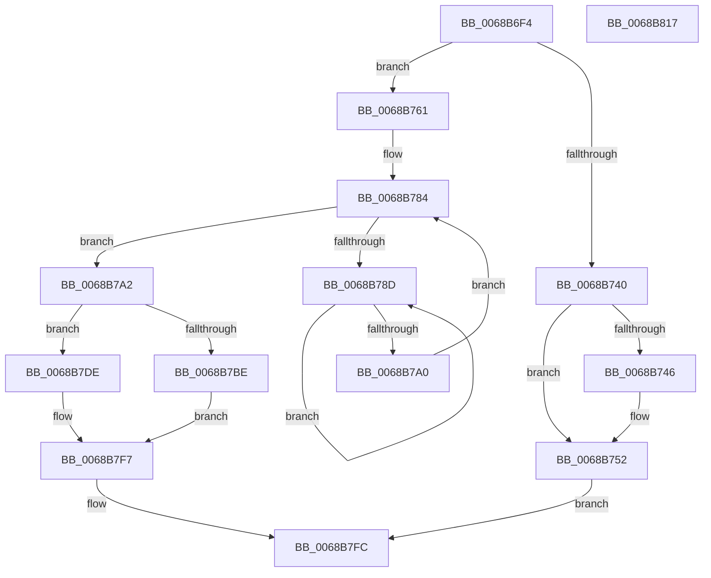

# MiRepointPteAtExtendedStandby

- RVA: `0x0068B6F4`–`0x0068B818` (길이 `292` bytes)
- VA: `0x000000014068B6F4`
- 실행 섹션: `.text`
- PDB 이름 있음: `예`; PDB Function 태그: `아니요`
- unwind 정보 RVA: `0x00060300`
- 디코드: `79`개 명령, `292/292` bytes 표시
- 미해석 바이트: `0` (있으면 어셈블리에 `.byte`로 보존)

> 이 문서는 커널 이미지의 기계어와 PDB 기호를 분석해 생성했습니다. 4번과 5번은 함수 원형과 자료형을 바이너리 사용 방식에서 추정한 C 해석이며 원본 소스 복구 결과는 아닙니다.

## 1. Dependencies

- 직접 호출 지점: **8**; 고유 호출 대상: **7**
- 직접 호출자로 확인된 함수: **1**
- RIP 상대 이미지 참조: **0**

### Outgoing calls
- `0x0068B727` → [MiUnlinkPageFromListEx](../28/MiUnlinkPageFromListEx_function_00287590.md) (function, `0x00287590`)
- `0x0068B735` → [MiReleasePageListLock](../2B/MiReleasePageListLock_function_002B1050.md) (function, `0x002B1050`)
- `0x0068B757` → [MiRestoreTransitionPte](../33/MiRestoreTransitionPte_function_0033DD90.md) (function, `0x0033DD90`)
- `0x0068B792` → [KeYieldProcessorEx](../3F/KeYieldProcessorEx_function_003FBD00.md) (function, `0x003FBD00`)
- `0x0068B7B2` → [MiReplaceTransitionPage](../2B/MiReplaceTransitionPage_function_002B1120.md) (function, `0x002B1120`)
- `0x0068B7BE` → [MiReleaseFreshPageLocked](../44/MiReleaseFreshPageLocked_function_0044CDD8.md) (function, `0x0044CDD8`)
- `0x0068B7D7` → [MiRestoreTransitionPte](../33/MiRestoreTransitionPte_function_0033DD90.md) (function, `0x0033DD90`)
- `0x0068B7E3` → [MiInsertPageInList](../2B/MiInsertPageInList_function_002BA000.md) (function, `0x002BA000`)

### Direct callers
- [MiRemoveLowestPriorityStandbyPage](../33/MiRemoveLowestPriorityStandbyPage_function_00334600.md) at `0x00334AB8`

### Static image references
- 디코드된 RIP-relative 메모리 참조가 없습니다.

## 2. Other-region calls and transfers

- 다른 실행 섹션으로 향하는 call: **0**
- 별도 외부 분기/꼬리 이동을 확인하지 못했습니다.

## 3. Assembly (complete function range)

```asm
0068B6F4  48 89 5C 24 08                  mov qword ptr [rsp + 8], rbx
0068B6F9  48 89 6C 24 10                  mov qword ptr [rsp + 0x10], rbp
0068B6FE  48 89 74 24 18                  mov qword ptr [rsp + 0x18], rsi
0068B703  57                              push rdi
0068B704  41 56                           push r14
0068B706  41 57                           push r15
0068B708  48 83 EC 20                     sub rsp, 0x20
0068B70C  41 8A 01                        mov al, byte ptr [r9]
0068B70F  8B DA                           mov ebx, edx
0068B711  F6 D8                           neg al
0068B713  BD 01 00 00 00                  mov ebp, 1
0068B718  49 8B F9                        mov rdi, r9
0068B71B  49 8B F0                        mov rsi, r8
0068B71E  1B D2                           sbb edx, edx
0068B720  4C 8B F1                        mov r14, rcx
0068B723  F7 DA                           neg edx
0068B725  03 D5                           add edx, ebp
0068B727  E8 64 BE BF FF                  call 0x140287590
0068B72C  48 8B D7                        mov rdx, rdi
0068B72F  48 8B CE                        mov rcx, rsi
0068B732  44 8B F8                        mov r15d, eax
0068B735  E8 16 59 C2 FF                  call 0x1402b1050
0068B73A  41 F6 C7 03                     test r15b, 3
0068B73E  74 21                           je 0x14068b761
0068B740  41 F6 C7 02                     test r15b, 2
0068B744  74 0C                           je 0x14068b752
0068B746  81 E3 00 02 00 00               and ebx, 0x200
0068B74C  F7 DB                           neg ebx
0068B74E  1B C0                           sbb eax, eax
0068B750  23 E8                           and ebp, eax
0068B752  33 D2                           xor edx, edx
0068B754  49 8B CE                        mov rcx, r14
0068B757  E8 34 26 CB FF                  call 0x14033dd90
0068B75C  E9 9B 00 00 00                  jmp 0x14068b7fc
0068B761  48 8B 7C 24 60                  mov rdi, qword ptr [rsp + 0x60]
0068B766  48 8B 47 08                     mov rax, qword ptr [rdi + 8]
0068B76A  48 8D 1C 40                     lea rbx, [rax + rax*2]
0068B76E  48 C1 E3 04                     shl rbx, 4
0068B772  48 B8 00 00 00 00 00 DE FF FF   movabs rax, 0xffffde0000000000
0068B77C  48 03 D8                        add rbx, rax
0068B77F  83 64 24 58 00                  and dword ptr [rsp + 0x58], 0
0068B784  F0 48 0F BA 6B 18 3F            lock bts qword ptr [rbx + 0x18], 0x3f
0068B78B  73 15                           jae 0x14068b7a2
0068B78D  48 8D 4C 24 58                  lea rcx, [rsp + 0x58]
0068B792  E8 69 05 D7 FF                  call 0x1403fbd00
0068B797  48 8B 43 18                     mov rax, qword ptr [rbx + 0x18]
0068B79B  48 85 C0                        test rax, rax
0068B79E  78 ED                           js 0x14068b78d
0068B7A0  EB E2                           jmp 0x14068b784
0068B7A2  41 B9 03 00 00 00               mov r9d, 3
0068B7A8  48 8B D3                        mov rdx, rbx
0068B7AB  49 8B CE                        mov rcx, r14
0068B7AE  45 8D 41 06                     lea r8d, [r9 + 6]
0068B7B2  E8 69 59 C2 FF                  call 0x1402b1120
0068B7B7  48 8B CB                        mov rcx, rbx
0068B7BA  85 C0                           test eax, eax
0068B7BC  75 20                           jne 0x14068b7de
0068B7BE  E8 15 16 DC FF                  call 0x14044cdd8
0068B7C3  48 B8 FF FF FF FF FF FF FF 7F   movabs rax, 0x7fffffffffffffff
0068B7CD  F0 48 21 43 18                  lock and qword ptr [rbx + 0x18], rax
0068B7D2  33 D2                           xor edx, edx
0068B7D4  49 8B CE                        mov rcx, r14
0068B7D7  E8 B4 25 CB FF                  call 0x14033dd90
0068B7DC  EB 19                           jmp 0x14068b7f7
0068B7DE  BA 04 00 00 00                  mov edx, 4
0068B7E3  E8 18 E8 C2 FF                  call 0x1402ba000
0068B7E8  48 B8 FF FF FF FF FF FF FF 7F   movabs rax, 0x7fffffffffffffff
0068B7F2  F0 48 21 43 18                  lock and qword ptr [rbx + 0x18], rax
0068B7F7  48 83 4F 08 FF                  or qword ptr [rdi + 8], 0xffffffffffffffff
0068B7FC  48 8B 5C 24 40                  mov rbx, qword ptr [rsp + 0x40]
0068B801  8B C5                           mov eax, ebp
0068B803  48 8B 6C 24 48                  mov rbp, qword ptr [rsp + 0x48]
0068B808  48 8B 74 24 50                  mov rsi, qword ptr [rsp + 0x50]
0068B80D  48 83 C4 20                     add rsp, 0x20
0068B811  41 5F                           pop r15
0068B813  41 5E                           pop r14
0068B815  5F                              pop rdi
0068B816  C3                              ret
0068B817  CC                              int3
```

## 4. C-style interpretation (structured pseudocode)

```c
__int64 __fastcall MiRepointPteAtExtendedStandby(__int64 a1, int a2, __int64 a3, __int64 a4, __int64 a5)
{
    __int64 result;
    __int64 v_rbp;
    __int64 v_rbx;
    __int64 v_rsp;
    unsigned __int64 v_stack_p10;
    unsigned __int64 v_stack_p18;
    unsigned int v_stack_p20;
    unsigned __int64 v_stack_p8;

    v_stack_p8 = v_rbx;
    v_stack_p10 = v_rbp;
    v_stack_p18 = v_rsi;
    v_rsp = (v_rsp) - (32);
    result = (unsigned __int8)(-(*(unsigned __int8 *)(a4)));
    a2 = (unsigned int)(-(a2));
    a2 = (unsigned int)((a2) + (1));
    result = MiUnlinkPageFromListEx(a1, a2, a3, a4);
    result = MiReleasePageListLock(a3, a4, a3, a4);
    if ((((unsigned __int8)((unsigned int)((unsigned int)(result)))) & (3)) == 0) goto loc_0068B761;
    v_rbx = (unsigned int)(a2);
    v_rbp = 1;
    if ((((unsigned __int8)((unsigned int)((unsigned int)(result)))) & (2)) != 0) {
        v_rbx = (unsigned int)(((unsigned int)(a2)) & (512));
        v_rbx = (unsigned int)(-(v_rbx));
        v_rbp = (unsigned int)((1) & ((unsigned int)(result)));
    }
    a2 = 0;
    result = MiRestoreTransitionPte(a1, a2, a3, a4);
    goto loc_0068B7FC;
loc_0068B761:
    v_rbx = (*(unsigned __int64 *)(a5 + 8) + *(unsigned __int64 *)(a5 + 8) * 2) << (4);
    v_rbx = (v_rbx) + (*(unsigned __int64 *)(a5 + 8));
loc_0068B784:
    if (condition_is_above_or_equal) goto loc_0068B7A2;
loc_0068B78D:
    result = KeYieldProcessorEx(v_stack_p20, a2, a3, a4);
    if (sign_flag) goto loc_0068B78D;
    goto loc_0068B784;
loc_0068B7A2:
    result = MiReplaceTransitionPage(a1, v_rbx, 3 + 6, 3);
    if ((unsigned int)(result) != 0) goto loc_0068B7DE;
    result = MiReleaseFreshPageLocked(v_rbx, v_rbx, 3 + 6, 3);
    a2 = 0;
    result = MiRestoreTransitionPte(a1, a2, 3 + 6, 3);
    goto loc_0068B7F7;
loc_0068B7DE:
    result = MiInsertPageInList(a1, 4, 3 + 6, 3);
loc_0068B7F7:
loc_0068B7FC:
    v_rsp = (v_rsp) + (32);
    return (unsigned int)((unsigned int)(v_rbp));
}
```

## 5. (Beta) C Style

```c
int64_t MiRepointPteAtExtendedStandby(int64_t Arg1, int32_t Arg2, int64_t Arg3, void *Arg4, void *Arg5)
{
    uint8_t *arg4 = (uint8_t *)Arg4;
    uint8_t *arg5 = (uint8_t *)Arg5;

    int64_t result;
    int64_t local_rbp;
    int64_t local_rbx;
    int64_t local_rsp;
    uint64_t v_stack_p10;
    uint64_t v_stack_p18;
    uint32_t v_stack_p20;
    uint64_t v_stack_p8;

    v_stack_p8 = local_rbx;
    v_stack_p10 = local_rbp;
    v_stack_p18 = local_rsi;
    local_rsp = (local_rsp) - (32);
    result = (uint8_t)(-(*(uint8_t *)(arg4)));
    Arg2 = (uint32_t)(-(Arg2));
    Arg2 = (uint32_t)((Arg2) + (1));
    result = MiUnlinkPageFromListEx(Arg1, Arg2, Arg3, Arg4);
    result = MiReleasePageListLock(Arg3, Arg4, Arg3, Arg4);
    if ((((uint8_t)((uint32_t)((uint32_t)(result)))) & (3)) == 0) goto loc_0068B761;
    local_rbx = (uint32_t)(Arg2);
    local_rbp = 1;
    if ((((uint8_t)((uint32_t)((uint32_t)(result)))) & (2)) != 0) {
        local_rbx = (uint32_t)(((uint32_t)(Arg2)) & (512));
        local_rbx = (uint32_t)(-(local_rbx));
        local_rbp = (uint32_t)((1) & ((uint32_t)(result)));
    }
    Arg2 = 0;
    result = MiRestoreTransitionPte(Arg1, Arg2, Arg3, Arg4);
    goto loc_0068B7FC;
loc_0068B761:
    local_rbx = (*(uint64_t *)(arg5 + 0x8) + *(uint64_t *)(arg5 + 0x8) * 2) << (4);
    local_rbx = (local_rbx) + (*(uint64_t *)(arg5 + 0x8));
loc_0068B784:
    if (condition_is_above_or_equal) goto loc_0068B7A2;
loc_0068B78D:
    result = KeYieldProcessorEx(v_stack_p20, Arg2, Arg3, Arg4);
    if (sign_flag) goto loc_0068B78D;
    goto loc_0068B784;
loc_0068B7A2:
    result = MiReplaceTransitionPage(Arg1, local_rbx, 3 + 6, 3);
    if ((uint32_t)(result) != 0) goto loc_0068B7DE;
    result = MiReleaseFreshPageLocked(local_rbx, local_rbx, 3 + 6, 3);
    Arg2 = 0;
    result = MiRestoreTransitionPte(Arg1, Arg2, 3 + 6, 3);
    goto loc_0068B7F7;
loc_0068B7DE:
    result = MiInsertPageInList(Arg1, 4, 3 + 6, 3);
loc_0068B7F7:
loc_0068B7FC:
    local_rsp = (local_rsp) + (32);
    return (uint32_t)((uint32_t)(local_rbp));
}
```

### 관측된 메모리 오프셋

구조체 형식이 확인되지 않은 접근은 인자 기준의 오프셋으로만 기록했습니다.

| 기준 인자 | 오프셋 표현 | 폭 (bit) | 접근 |
|---|---:|---:|---|
| `Arg4` | `+ 0x0` | `8` | `R` |
| `Arg5` | `+ 0x8` | `64` | `R` |
| `Arg5` | `+ 0x8` | `64` | `R/W` |

## 6. Execution-region graph

[열기: 2D/3D 그래프와 함수 탐색 컨트롤 패널](../../../control-panel.html?section=text&rva=0x0068B6F4&view=graph)

- 2D 그래프는 위에서 아래로 흐르고, 3D 그래프는 빈 공간을 드래그해 회전합니다. Shift+드래그는 이동, 휠은 확대·축소, 함수 노드 선택은 대상 보고서 이동입니다.

### Static fallback


