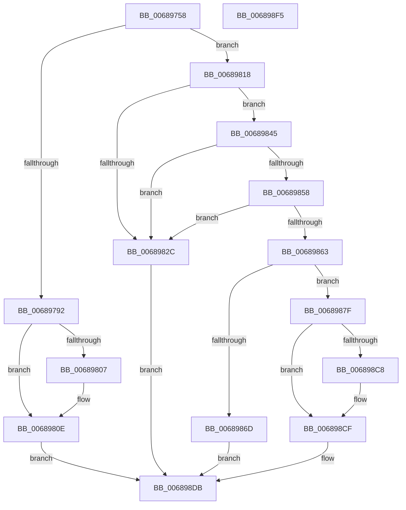

# MiResolveAwePageConflict

- RVA: `0x00689758`–`0x006898F6` (길이 `414` bytes)
- VA: `0x0000000140689758`
- 실행 섹션: `.text`
- PDB 이름 있음: `예`; PDB Function 태그: `아니요`
- unwind 정보 RVA: `0x000D8C28`
- 디코드: `109`개 명령, `414/414` bytes 표시
- 미해석 바이트: `0` (있으면 어셈블리에 `.byte`로 보존)

> 이 문서는 커널 이미지의 기계어와 PDB 기호를 분석해 생성했습니다. 4번과 5번은 함수 원형과 자료형을 바이너리 사용 방식에서 추정한 C 해석이며 원본 소스 복구 결과는 아닙니다.

## 1. Dependencies

- 직접 호출 지점: **10**; 고유 호출 대상: **8**
- 직접 호출자로 확인된 함수: **1**
- RIP 상대 이미지 참조: **1**

### Outgoing calls
- `0x006897B8` → [ExAcquireSpinLockExclusiveAtDpcLevel](../24/ExAcquireSpinLockExclusiveAtDpcLevel_function_00248E80.md) (function, `0x00248E80`)
- `0x006897D1` → [ExReleaseSpinLockExclusiveFromDpcLevel](../24/ExReleaseSpinLockExclusiveFromDpcLevel_function_002497E0.md) (function, `0x002497E0`)
- `0x006897DC` → [MiUnlockPage](../31/MiUnlockPage_function_0031A3E0.md) (function, `0x0031A3E0`)
- `0x006897EC` → [KeWaitForGate](../2C/KeWaitForGate_function_002CA794.md) (function, `0x002CA794`)
- `0x00689809` → [KiRaiseIrqlProcessIrqlFlags](../4F/KiRaiseIrqlProcessIrqlFlags_function_004F56FC.md) (function, `0x004F56FC`)
- `0x00689876` → [MiChangePageAttribute](../33/MiChangePageAttribute_function_00332ECC.md) (function, `0x00332ECC`)
- `0x00689896` → [MiUnlockPage](../31/MiUnlockPage_function_0031A3E0.md) (function, `0x0031A3E0`)
- `0x006898A4` → [MiChangeAwePageAttributes](MiChangeAwePageAttributes_function_00687FB4.md) (function, `0x00687FB4`)
- `0x006898B2` → [MiWakeWaitersForAweCacheAttributeChange](MiWakeWaitersForAweCacheAttributeChange_function_00689A58.md) (function, `0x00689A58`)
- `0x006898CA` → [KiRaiseIrqlProcessIrqlFlags](../4F/KiRaiseIrqlProcessIrqlFlags_function_004F56FC.md) (function, `0x004F56FC`)

### Direct callers
- [MiIncrementAweMapCount](MiIncrementAweMapCount_function_00688DB0.md) at `0x00688E50`

### Static image references
- `0x006897FE` → RVA `0x00FC6D20` (`ALMOSTRO`; read)

## 2. Other-region calls and transfers

- 다른 실행 섹션으로 향하는 call: **0**
- 별도 외부 분기/꼬리 이동을 확인하지 못했습니다.

## 3. Assembly (complete function range)

```asm
00689758  48 89 5C 24 08                  mov qword ptr [rsp + 8], rbx
0068975D  48 89 74 24 18                  mov qword ptr [rsp + 0x18], rsi
00689762  48 89 7C 24 20                  mov qword ptr [rsp + 0x20], rdi
00689767  55                              push rbp
00689768  41 56                           push r14
0068976A  41 57                           push r15
0068976C  48 8B EC                        mov rbp, rsp
0068976F  48 83 EC 50                     sub rsp, 0x50
00689773  48 83 65 D0 00                  and qword ptr [rbp - 0x30], 0
00689778  45 8A F9                        mov r15b, r9b
0068977B  F6 42 22 20                     test byte ptr [rdx + 0x22], 0x20
0068977F  45 8B F0                        mov r14d, r8d
00689782  48 8B FA                        mov rdi, rdx
00689785  C6 45 E3 00                     mov byte ptr [rbp - 0x1d], 0
00689789  48 8B F1                        mov rsi, rcx
0068978C  0F 84 86 00 00 00               je 0x140689818
00689792  83 65 E4 00                     and dword ptr [rbp - 0x1c], 0
00689796  48 8D 45 E8                     lea rax, [rbp - 0x18]
0068979A  48 89 45 F0                     mov qword ptr [rbp - 0x10], rax
0068979E  48 83 C1 30                     add rcx, 0x30
006897A2  48 8D 45 E8                     lea rax, [rbp - 0x18]
006897A6  48 89 55 D8                     mov qword ptr [rbp - 0x28], rdx
006897AA  48 89 45 E8                     mov qword ptr [rbp - 0x18], rax
006897AE  66 C7 45 E0 07 01               mov word ptr [rbp - 0x20], 0x107
006897B4  C6 45 E2 06                     mov byte ptr [rbp - 0x1e], 6
006897B8  E8 C3 F6 BB FF                  call 0x140248e80
006897BD  48 8B 46 50                     mov rax, qword ptr [rsi + 0x50]
006897C1  48 8D 4E 30                     lea rcx, [rsi + 0x30]
006897C5  48 89 45 D0                     mov qword ptr [rbp - 0x30], rax
006897C9  48 8D 45 D0                     lea rax, [rbp - 0x30]
006897CD  48 89 46 50                     mov qword ptr [rsi + 0x50], rax
006897D1  E8 0A 00 BC FF                  call 0x1402497e0
006897D6  41 8A D7                        mov dl, r15b
006897D9  48 8B CF                        mov rcx, rdi
006897DC  E8 FF 0B C9 FF                  call 0x14031a3e0
006897E1  45 33 C0                        xor r8d, r8d
006897E4  48 8D 4D E0                     lea rcx, [rbp - 0x20]
006897E8  41 8D 50 12                     lea edx, [r8 + 0x12]
006897EC  E8 A3 0F C4 FF                  call 0x1402ca794
006897F1  44 0F 20 C1                     mov rcx, cr8
006897F5  BB 02 00 00 00                  mov ebx, 2
006897FA  44 0F 22 C3                     mov cr8, rbx
006897FE  83 3D 1B D5 93 00 00            cmp dword ptr [rip + 0x93d51b], 0
00689805  74 07                           je 0x14068980e
00689807  8A D3                           mov dl, bl
00689809  E8 EE BE E6 FF                  call 0x1404f56fc
0068980E  B8 2D 02 00 C0                  mov eax, 0xc000022d
00689813  E9 C3 00 00 00                  jmp 0x1406898db
00689818  8B 42 20                        mov eax, dword ptr [rdx + 0x20]
0068981B  BB 02 00 00 00                  mov ebx, 2
00689820  48 8B 4A 18                     mov rcx, qword ptr [rdx + 0x18]
00689824  8B 42 20                        mov eax, dword ptr [rdx + 0x20]
00689827  66 3B C3                        cmp ax, bx
0068982A  76 19                           jbe 0x140689845
0068982C  48 B8 FF FF FF FF FF FF FF 7F   movabs rax, 0x7fffffffffffffff
00689836  F0 48 21 42 18                  lock and qword ptr [rdx + 0x18], rax
0068983B  B8 18 00 00 C0                  mov eax, 0xc0000018
00689840  E9 96 00 00 00                  jmp 0x1406898db
00689845  48 B8 FF FF FF FF FF FF FF 3F   movabs rax, 0x3fffffffffffffff
0068984F  48 23 C8                        and rcx, rax
00689852  48 83 F9 01                     cmp rcx, 1
00689856  75 D4                           jne 0x14068982c
00689858  48 8B 42 18                     mov rax, qword ptr [rdx + 0x18]
0068985C  48 0F BA E0 3E                  bt rax, 0x3e
00689861  72 C9                           jb 0x14068982c
00689863  48 83 7E 10 01                  cmp qword ptr [rsi + 0x10], 1
00689868  48 8B CF                        mov rcx, rdi
0068986B  75 12                           jne 0x14068987f
0068986D  41 B8 01 00 00 00               mov r8d, 1
00689873  41 8B D6                        mov edx, r14d
00689876  E8 51 96 CA FF                  call 0x140332ecc
0068987B  33 C0                           xor eax, eax
0068987D  EB 5C                           jmp 0x1406898db
0068987F  8B 42 20                        mov eax, dword ptr [rdx + 0x20]
00689882  89 45 28                        mov dword ptr [rbp + 0x28], eax
00689885  C1 E8 10                        shr eax, 0x10
00689888  0C 20                           or al, 0x20
0068988A  88 45 2A                        mov byte ptr [rbp + 0x2a], al
0068988D  8B 45 28                        mov eax, dword ptr [rbp + 0x28]
00689890  89 42 20                        mov dword ptr [rdx + 0x20], eax
00689893  41 8A D7                        mov dl, r15b
00689896  E8 45 0B C9 FF                  call 0x14031a3e0
0068989B  45 8B C6                        mov r8d, r14d
0068989E  48 8B D7                        mov rdx, rdi
006898A1  48 8B CE                        mov rcx, rsi
006898A4  E8 0B E7 FF FF                  call 0x140687fb4
006898A9  48 8B D7                        mov rdx, rdi
006898AC  48 8B CE                        mov rcx, rsi
006898AF  44 8B F0                        mov r14d, eax
006898B2  E8 A1 01 00 00                  call 0x140689a58
006898B7  44 0F 20 C1                     mov rcx, cr8
006898BB  44 0F 22 C3                     mov cr8, rbx
006898BF  83 3D 5A D4 93 00 00            cmp dword ptr [rip + 0x93d45a], 0
006898C6  74 07                           je 0x1406898cf
006898C8  8A D3                           mov dl, bl
006898CA  E8 2D BE E6 FF                  call 0x1404f56fc
006898CF  45 85 F6                        test r14d, r14d
006898D2  B8 2D 02 00 C0                  mov eax, 0xc000022d
006898D7  41 0F 48 C6                     cmovs eax, r14d
006898DB  4C 8D 5C 24 50                  lea r11, [rsp + 0x50]
006898E0  49 8B 5B 20                     mov rbx, qword ptr [r11 + 0x20]
006898E4  49 8B 73 30                     mov rsi, qword ptr [r11 + 0x30]
006898E8  49 8B 7B 38                     mov rdi, qword ptr [r11 + 0x38]
006898EC  49 8B E3                        mov rsp, r11
006898EF  41 5F                           pop r15
006898F1  41 5E                           pop r14
006898F3  5D                              pop rbp
006898F4  C3                              ret
006898F5  CC                              int3
```

## 4. C-style interpretation (structured pseudocode)

```c
__int64 __fastcall MiResolveAwePageConflict(__int64 a1, __int64 a2, int a3, unsigned __int8 a4)
{
    __int64 result;
    __int64 v_rsp;
    unsigned __int64 v_stack_m18;
    unsigned __int64 v_stack_m28;
    unsigned __int64 v_stack_m30;
    unsigned int v_stack_m34;
    unsigned __int8 v_stack_m35;
    unsigned __int8 v_stack_m36;
    unsigned __int16 v_stack_m38;
    unsigned __int64 v_stack_m40;
    unsigned __int64 v_stack_m48;
    unsigned int v_stack_p10;
    unsigned __int8 v_stack_p12;
    unsigned __int64 v_stack_p18;
    unsigned __int64 v_stack_p20;
    unsigned __int64 v_stack_p8;

    v_stack_p8 = v_rbx;
    v_stack_p18 = v_rsi;
    v_stack_p20 = v_rdi;
    v_rsp = (v_rsp) - (80);
    v_stack_m35 = 0;
    if (((*(unsigned __int8 *)(a2 + 34)) & (32)) == 0) goto loc_00689818;
    v_stack_m28 = v_stack_m30;
    a1 = (a1) + (48);
    v_stack_m40 = a2;
    v_stack_m30 = v_stack_m30;
    v_stack_m38 = 263;
    v_stack_m36 = 6;
    result = ExAcquireSpinLockExclusiveAtDpcLevel(a1, a2, a3, a4);
    v_stack_m48 = *(unsigned __int64 *)(a1 + 80);
    *(unsigned __int64 *)(a1 + 80) = v_stack_m48;
    result = ExReleaseSpinLockExclusiveFromDpcLevel(a1 + 48, a2, a3, a4);
    result = MiUnlockPage(a2, a4, a3, a4);
    a3 = 0;
    result = KeWaitForGate(v_stack_m38, a3 + 18, a3, a4);
    if ((*(unsigned int *)(v_rip + 9688347)) != 0) {
        a2 = 2;
        result = KiRaiseIrqlProcessIrqlFlags(v_cr8, a2, a3, a4);
    }
    goto loc_006898DB;
loc_00689818:
    if (((unsigned __int16)((unsigned int)(*(unsigned int *)(a2 + 32)))) <= 2) goto loc_00689845;
loc_0068982C:
    goto loc_006898DB;
loc_00689845:
    a1 = (*(unsigned __int64 *)(a2 + 24)) & ((unsigned int)(0xC0000018ULL));
    if (a1 != 1) goto loc_0068982C;
    if (a1 < 1) goto loc_0068982C;
    if ((*(unsigned __int64 *)(a1 + 16)) != 1) goto loc_0068987F;
    result = MiChangePageAttribute(a2, (unsigned int)((unsigned int)((unsigned int)(a3))), 1, a4);
    result = 0;
    goto loc_006898DB;
loc_0068987F:
    v_stack_p10 = (unsigned int)((unsigned int)(*(unsigned int *)((unsigned int)((unsigned int)((unsigned int)(a3))) + 32)));
    result = (unsigned int)(((unsigned int)(*(unsigned int *)((unsigned int)((unsigned int)((unsigned int)(a3))) + 32))) >> (16));
    result = (unsigned __int8)((result) | (32));
    v_stack_p12 = (unsigned __int8)(result);
    *(unsigned int *)((unsigned int)((unsigned int)((unsigned int)(a3))) + 32) = (unsigned int)((unsigned int)(v_stack_p10));
    result = MiUnlockPage(a2, a4, 1, a4);
    result = MiChangeAwePageAttributes(a1, a2, (unsigned int)((unsigned int)((unsigned int)(a3))), a4);
    result = MiWakeWaitersForAweCacheAttributeChange(a1, a2, (unsigned int)((unsigned int)((unsigned int)(a3))), a4);
    if ((*(unsigned int *)(v_rip + 9688154)) != 0) {
        a2 = 2;
        result = KiRaiseIrqlProcessIrqlFlags(2, a2, (unsigned int)((unsigned int)((unsigned int)(a3))), a4);
    }
    result = (unsigned int)(0xC000022DULL);
    if (sign_flag) { result = (unsigned int)((unsigned int)((unsigned int)(result))); }
loc_006898DB:
    return result;
}
```

## 5. (Beta) C Style

```c
int64_t MiResolveAwePageConflict(void *Arg1, void *Arg2, int32_t Arg3, uint8_t Arg4)
{
    uint8_t *arg1 = (uint8_t *)Arg1;
    uint8_t *arg2 = (uint8_t *)Arg2;

    int64_t result;
    int64_t local_rsp;
    uint64_t v_stack_m18;
    uint64_t v_stack_m28;
    uint64_t v_stack_m30;
    uint32_t v_stack_m34;
    uint8_t v_stack_m35;
    uint8_t v_stack_m36;
    uint16_t v_stack_m38;
    uint64_t v_stack_m40;
    uint64_t v_stack_m48;
    uint32_t v_stack_p10;
    uint8_t v_stack_p12;
    uint64_t v_stack_p18;
    uint64_t v_stack_p20;
    uint64_t v_stack_p8;

    v_stack_p8 = local_rbx;
    v_stack_p18 = local_rsi;
    v_stack_p20 = local_rdi;
    local_rsp = (local_rsp) - (80);
    v_stack_m35 = 0;
    if (((*(uint8_t *)(arg2 + 0x22)) & (32)) == 0) goto loc_00689818;
    v_stack_m28 = v_stack_m30;
    Arg1 = (Arg1) + (48);
    v_stack_m40 = Arg2;
    v_stack_m30 = v_stack_m30;
    v_stack_m38 = 263;
    v_stack_m36 = 6;
    result = ExAcquireSpinLockExclusiveAtDpcLevel(Arg1, Arg2, Arg3, Arg4);
    v_stack_m48 = *(uint64_t *)(arg1 + 0x50);
    *(uint64_t *)(arg1 + 0x50) = v_stack_m48;
    result = ExReleaseSpinLockExclusiveFromDpcLevel(Arg1 + 48, Arg2, Arg3, Arg4);
    result = MiUnlockPage(Arg2, Arg4, Arg3, Arg4);
    Arg3 = 0;
    result = KeWaitForGate(v_stack_m38, Arg3 + 18, Arg3, Arg4);
    if ((*(uint32_t *)(v_rip + 0x93D51B)) != 0) {
        Arg2 = 2;
        result = KiRaiseIrqlProcessIrqlFlags(v_cr8, Arg2, Arg3, Arg4);
    }
    goto loc_006898DB;
loc_00689818:
    if (((uint16_t)((uint32_t)(*(uint32_t *)(arg2 + 0x20)))) <= 2) goto loc_00689845;
loc_0068982C:
    goto loc_006898DB;
loc_00689845:
    Arg1 = (*(uint64_t *)(arg2 + 0x18)) & ((uint32_t)(0xC0000018ULL));
    if (Arg1 != 1) goto loc_0068982C;
    if (Arg1 < 1) goto loc_0068982C;
    if ((*(uint64_t *)(arg1 + 0x10)) != 1) goto loc_0068987F;
    result = MiChangePageAttribute(Arg2, (uint32_t)((uint32_t)((uint32_t)(Arg3))), 1, Arg4);
    result = 0;
    goto loc_006898DB;
loc_0068987F:
    v_stack_p10 = (uint32_t)((uint32_t)(*(uint32_t *)((uint32_t)((uint32_t)((uint32_t)(Arg3))) + 0x20)));
    result = (uint32_t)(((uint32_t)(*(uint32_t *)((uint32_t)((uint32_t)((uint32_t)(Arg3))) + 0x20))) >> (16));
    result = (uint8_t)((result) | (32));
    v_stack_p12 = (uint8_t)(result);
    *(uint32_t *)((uint32_t)((uint32_t)((uint32_t)(Arg3))) + 0x20) = (uint32_t)((uint32_t)(v_stack_p10));
    result = MiUnlockPage(Arg2, Arg4, 1, Arg4);
    result = MiChangeAwePageAttributes(Arg1, Arg2, (uint32_t)((uint32_t)((uint32_t)(Arg3))), Arg4);
    result = MiWakeWaitersForAweCacheAttributeChange(Arg1, Arg2, (uint32_t)((uint32_t)((uint32_t)(Arg3))), Arg4);
    if ((*(uint32_t *)(v_rip + 0x93D45A)) != 0) {
        Arg2 = 2;
        result = KiRaiseIrqlProcessIrqlFlags(2, Arg2, (uint32_t)((uint32_t)((uint32_t)(Arg3))), Arg4);
    }
    result = (uint32_t)(0xC000022DULL);
    if (sign_flag) { result = (uint32_t)((uint32_t)((uint32_t)(result))); }
loc_006898DB:
    return result;
}
```

### 관측된 메모리 오프셋

구조체 형식이 확인되지 않은 접근은 인자 기준의 오프셋으로만 기록했습니다.

| 기준 인자 | 오프셋 표현 | 폭 (bit) | 접근 |
|---|---:|---:|---|
| `Arg1` | `+ 0x10` | `64` | `R` |
| `Arg1` | `+ 0x30` | `64` | `R` |
| `Arg1` | `+ 0x50` | `64` | `R` |
| `Arg1` | `+ 0x50` | `64` | `W` |
| `Arg2` | `+ 0x18` | `64` | `R` |
| `Arg2` | `+ 0x18` | `64` | `R/W` |
| `Arg2` | `+ 0x20` | `32` | `R` |
| `Arg2` | `+ 0x20` | `32` | `W` |
| `Arg2` | `+ 0x22` | `8` | `R` |

## 6. Execution-region graph

[열기: 2D/3D 그래프와 함수 탐색 컨트롤 패널](../../../control-panel.html?section=text&rva=0x00689758&view=graph)

- 2D 그래프는 위에서 아래로 흐르고, 3D 그래프는 빈 공간을 드래그해 회전합니다. Shift+드래그는 이동, 휠은 확대·축소, 함수 노드 선택은 대상 보고서 이동입니다.

### Static fallback


