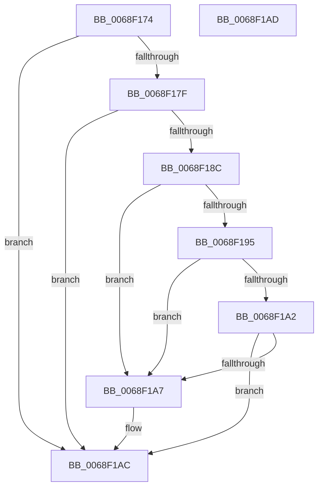

# MiSetSlabAllocatorPolicy

- RVA: `0x0068F174`–`0x0068F1AE` (길이 `58` bytes)
- VA: `0x000000014068F174`
- 실행 섹션: `.text`
- PDB 이름 있음: `예`; PDB Function 태그: `아니요`
- unwind 정보 RVA: `0x000DB714`
- 디코드: `14`개 명령, `58/58` bytes 표시
- 미해석 바이트: `0` (있으면 어셈블리에 `.byte`로 보존)

> 이 문서는 커널 이미지의 기계어와 PDB 기호를 분석해 생성했습니다. 4번과 5번은 함수 원형과 자료형을 바이너리 사용 방식에서 추정한 C 해석이며 원본 소스 복구 결과는 아닙니다.

## 1. Dependencies

- 직접 호출 지점: **0**; 고유 호출 대상: **0**
- 직접 호출자로 확인된 함수: **2**
- RIP 상대 이미지 참조: **2**

### Outgoing calls
- 직접 디코드된 call 명령이 없습니다.

### Direct callers
- [sub_006F7544](../6F/Unknown_function_006F7544.md) at `0x006F7570`
- [MiInitSystem](../../init/C5/MiInitSystem_function_00C5E6C0.md) at `0x00C5E84C`

### Static image references
- `0x0068F174` → RVA `0x00FC5254` (`ALMOSTRO`; read)
- `0x0068F17F` → RVA `0x00FC6A88` (`ALMOSTRO`; read)

## 2. Other-region calls and transfers

- 다른 실행 섹션으로 향하는 call: **0**
- 별도 외부 분기/꼬리 이동을 확인하지 못했습니다.

## 3. Assembly (complete function range)

```asm
0068F174  8B 15 DA 60 93 00               mov edx, dword ptr [rip + 0x9360da]
0068F17A  83 FA 01                        cmp edx, 1
0068F17D  74 2D                           je 0x14068f1ac
0068F17F  48 F7 05 FE 78 93 00 00 40 00 00  test qword ptr [rip + 0x9378fe], 0x4000
0068F18A  74 20                           je 0x14068f1ac
0068F18C  83 B9 54 45 00 00 00            cmp dword ptr [rcx + 0x4554], 0
0068F193  74 12                           je 0x14068f1a7
0068F195  48 81 B9 50 48 00 00 00 D8 0E 00  cmp qword ptr [rcx + 0x4850], 0xed800
0068F1A0  73 05                           jae 0x14068f1a7
0068F1A2  83 FA 02                        cmp edx, 2
0068F1A5  75 05                           jne 0x14068f1ac
0068F1A7  F0 83 49 04 08                  lock or dword ptr [rcx + 4], 8
0068F1AC  C3                              ret
0068F1AD  CC                              int3
```

## 4. C-style interpretation (structured pseudocode)

```c
void __fastcall MiSetSlabAllocatorPolicy(__int64 a1)
{
    if (((unsigned int)((unsigned int)(*(unsigned int *)(v_rip + 9658586)))) == 1) goto loc_0068F1AC;
    if (((*(unsigned __int64 *)(v_rip + 9664766)) & (0x4000ULL)) == 0) goto loc_0068F1AC;
    if ((*(unsigned int *)(a1 + 17748)) == 0) goto loc_0068F1A7;
    if ((*(unsigned __int64 *)(a1 + 18512)) >= 0xED800ULL) goto loc_0068F1A7;
    if (((unsigned int)((unsigned int)(*(unsigned int *)(v_rip + 9658586)))) == 2) {
    }
    return;
}
```

## 5. (Beta) C Style

```c
void MiSetSlabAllocatorPolicy(void *Arg1)
{
    uint8_t *arg1 = (uint8_t *)Arg1;

    if (((uint32_t)((uint32_t)(*(uint32_t *)(v_rip + 0x9360DA)))) == 1) goto loc_0068F1AC;
    if (((*(uint64_t *)(v_rip + 0x9378FE)) & (0x4000ULL)) == 0) goto loc_0068F1AC;
    if ((*(uint32_t *)(arg1 + 0x4554)) == 0) goto loc_0068F1A7;
    if ((*(uint64_t *)(arg1 + 0x4850)) >= 0xED800ULL) goto loc_0068F1A7;
    if (((uint32_t)((uint32_t)(*(uint32_t *)(v_rip + 0x9360DA)))) == 2) {
    }
    return;
}
```

### 관측된 메모리 오프셋

구조체 형식이 확인되지 않은 접근은 인자 기준의 오프셋으로만 기록했습니다.

| 기준 인자 | 오프셋 표현 | 폭 (bit) | 접근 |
|---|---:|---:|---|
| `Arg1` | `+ 0x4` | `32` | `R/W` |
| `Arg1` | `+ 0x4554` | `32` | `R` |
| `Arg1` | `+ 0x4850` | `64` | `R` |

## 6. Execution-region graph

[열기: 2D/3D 그래프와 함수 탐색 컨트롤 패널](../../../control-panel.html?section=text&rva=0x0068F174&view=graph)

- 2D 그래프는 위에서 아래로 흐르고, 3D 그래프는 빈 공간을 드래그해 회전합니다. Shift+드래그는 이동, 휠은 확대·축소, 함수 노드 선택은 대상 보고서 이동입니다.

### Static fallback


