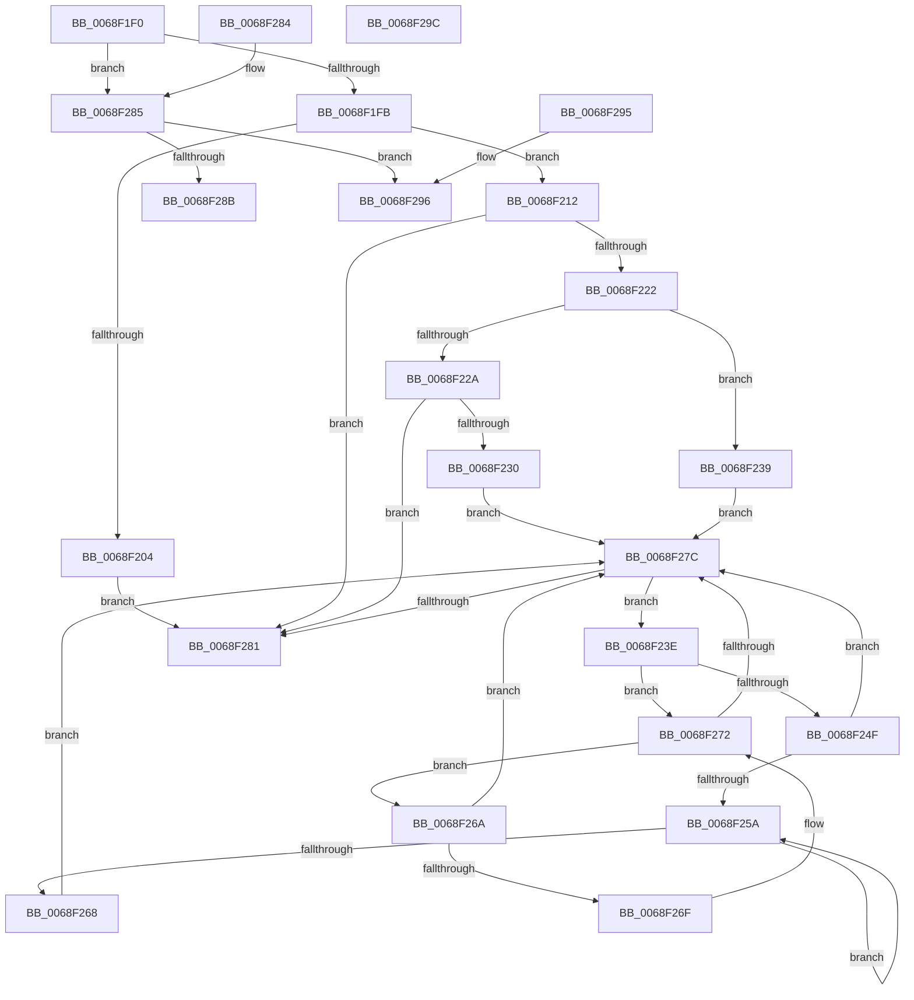

# MiSlabContextDefragInProgress

- RVA: `0x0068F1F0`–`0x0068F29D` (길이 `173` bytes)
- VA: `0x000000014068F1F0`
- 실행 섹션: `.text`
- PDB 이름 있음: `예`; PDB Function 태그: `아니요`
- unwind 정보 RVA: `0x000DB714`
- 디코드: `61`개 명령, `173/173` bytes 표시
- 미해석 바이트: `0` (있으면 어셈블리에 `.byte`로 보존)

> 이 문서는 커널 이미지의 기계어와 PDB 기호를 분석해 생성했습니다. 4번과 5번은 함수 원형과 자료형을 바이너리 사용 방식에서 추정한 C 해석이며 원본 소스 복구 결과는 아닙니다.

## 1. Dependencies

- 직접 호출 지점: **0**; 고유 호출 대상: **0**
- 직접 호출자로 확인된 함수: **0**
- RIP 상대 이미지 참조: **0**

### Outgoing calls
- 직접 디코드된 call 명령이 없습니다.

### Direct callers
- 이 함수 시작 RVA로 연결되는 직접 call은 확인되지 않았습니다. 간접 호출은 완전히 역산할 수 없습니다.

### Static image references
- 디코드된 RIP-relative 메모리 참조가 없습니다.

## 2. Other-region calls and transfers

- 다른 실행 섹션으로 향하는 call: **0**
- 별도 외부 분기/꼬리 이동을 확인하지 못했습니다.

## 3. Assembly (complete function range)

```asm
0068F1F0  33 C9                           xor ecx, ecx
0068F1F2  4D 85 C0                        test r8, r8
0068F1F5  0F 84 8A 00 00 00               je 0x14068f285
0068F1FB  49 8B 40 28                     mov rax, qword ptr [r8 + 0x28]
0068F1FF  48 85 C0                        test rax, rax
0068F202  74 0E                           je 0x14068f212
0068F204  48 89 42 30                     mov qword ptr [rdx + 0x30], rax
0068F208  49 8B 40 30                     mov rax, qword ptr [r8 + 0x30]
0068F20C  48 89 42 38                     mov qword ptr [rdx + 0x38], rax
0068F210  EB 6F                           jmp 0x14068f281
0068F212  48 89 4A 30                     mov qword ptr [rdx + 0x30], rcx
0068F216  48 89 4A 38                     mov qword ptr [rdx + 0x38], rcx
0068F21A  41 8B 40 54                     mov eax, dword ptr [r8 + 0x54]
0068F21E  A8 01                           test al, 1
0068F220  74 5F                           je 0x14068f281
0068F222  48 8B 42 08                     mov rax, qword ptr [rdx + 8]
0068F226  A8 01                           test al, 1
0068F228  74 0F                           je 0x14068f239
0068F22A  48 83 F8 01                     cmp rax, 1
0068F22E  74 51                           je 0x14068f281
0068F230  48 83 CA 01                     or rdx, 1
0068F234  48 33 D0                        xor rdx, rax
0068F237  EB 43                           jmp 0x14068f27c
0068F239  48 8B D0                        mov rdx, rax
0068F23C  EB 3E                           jmp 0x14068f27c
0068F23E  0F BA 72 5C 09                  btr dword ptr [rdx + 0x5c], 9
0068F243  4C 8B C2                        mov r8, rdx
0068F246  48 8B 42 08                     mov rax, qword ptr [rdx + 8]
0068F24A  48 85 C0                        test rax, rax
0068F24D  74 23                           je 0x14068f272
0068F24F  4C 8B 00                        mov r8, qword ptr [rax]
0068F252  48 8B D0                        mov rdx, rax
0068F255  4D 85 C0                        test r8, r8
0068F258  74 22                           je 0x14068f27c
0068F25A  49 8B 00                        mov rax, qword ptr [r8]
0068F25D  49 8B D0                        mov rdx, r8
0068F260  4C 8B C0                        mov r8, rax
0068F263  48 85 C0                        test rax, rax
0068F266  75 F2                           jne 0x14068f25a
0068F268  EB 12                           jmp 0x14068f27c
0068F26A  4C 39 02                        cmp qword ptr [rdx], r8
0068F26D  74 0D                           je 0x14068f27c
0068F26F  4C 8B C2                        mov r8, rdx
0068F272  48 8B 52 10                     mov rdx, qword ptr [rdx + 0x10]
0068F276  48 83 E2 FC                     and rdx, 0xfffffffffffffffc
0068F27A  75 EE                           jne 0x14068f26a
0068F27C  48 85 D2                        test rdx, rdx
0068F27F  75 BD                           jne 0x14068f23e
0068F281  33 C0                           xor eax, eax
0068F283  C3                              ret
0068F284  CC                              int3
0068F285  48 39 4A 30                     cmp qword ptr [rdx + 0x30], rcx
0068F289  75 0B                           jne 0x14068f296
0068F28B  48 39 4A 38                     cmp qword ptr [rdx + 0x38], rcx
0068F28F  0F 95 C1                        setne cl
0068F292  8B C1                           mov eax, ecx
0068F294  C3                              ret
0068F295  CC                              int3
0068F296  B8 01 00 00 00                  mov eax, 1
0068F29B  C3                              ret
0068F29C  CC                              int3
```

## 4. C-style interpretation (structured pseudocode)

```c
__int64 __fastcall MiSlabContextDefragInProgress(int a1, __int64 a2, __int64 a3)
{
    __int64 result;

    a1 = 0;
    if (a3 == 0) goto loc_0068F285;
    if (*(unsigned __int64 *)(a3 + 40) == 0) goto loc_0068F212;
    *(unsigned __int64 *)(a2 + 48) = *(unsigned __int64 *)(a3 + 40);
    *(unsigned __int64 *)(a2 + 56) = *(unsigned __int64 *)(a3 + 48);
    goto loc_0068F281;
loc_0068F212:
    *(unsigned __int64 *)(a2 + 48) = 0;
    *(unsigned __int64 *)(a2 + 56) = 0;
    if ((((unsigned __int8)((unsigned int)(*(unsigned int *)(a3 + 84)))) & (1)) == 0) goto loc_0068F281;
    if ((((unsigned __int8)(*(unsigned __int64 *)(a2 + 8))) & (1)) == 0) goto loc_0068F239;
    if ((*(unsigned __int64 *)(a2 + 8)) == 1) goto loc_0068F281;
    a2 = (a2) | (1);
    a2 = (a2) ^ (*(unsigned __int64 *)(a2 + 8));
    goto loc_0068F27C;
loc_0068F239:
    goto loc_0068F27C;
loc_0068F23E:
    if (*(unsigned __int64 *)(*(unsigned __int64 *)(a2 + 8) + 8) == 0) goto loc_0068F272;
    if (*(unsigned __int64 *)(*(unsigned __int64 *)(*(unsigned __int64 *)(a2 + 8) + 8)) == 0) goto loc_0068F27C;
loc_0068F25A:
    if (*(unsigned __int64 *)(*(unsigned __int64 *)(*(unsigned __int64 *)(*(unsigned __int64 *)(a2 + 8) + 8))) != 0) goto loc_0068F25A;
    goto loc_0068F27C;
loc_0068F26A:
    if ((*(unsigned __int64 *)(*(unsigned __int64 *)(*(unsigned __int64 *)(*(unsigned __int64 *)(a2 + 8) + 8)))) == (*(unsigned __int64 *)(*(unsigned __int64 *)(*(unsigned __int64 *)(*(unsigned __int64 *)(a2 + 8) + 8))))) goto loc_0068F27C;
loc_0068F272:
    a2 = (*(unsigned __int64 *)(*(unsigned __int64 *)(*(unsigned __int64 *)(*(unsigned __int64 *)(a2 + 8) + 8)) + 16)) & (-4);
    if (condition_is_not_equal) goto loc_0068F26A;
loc_0068F27C:
    if (a2 != 0) goto loc_0068F23E;
loc_0068F281:
    result = 0;
    return result;
loc_0068F285:
    if ((*(unsigned __int64 *)(a2 + 48)) != 0) goto loc_0068F296;
    a1 = ((*(unsigned __int64 *)(a2 + 56)) != 0) ? 1 : 0;
    return (unsigned int)(a1);
loc_0068F296:
    return 1;
}
```

## 5. (Beta) C Style

```c
int64_t MiSlabContextDefragInProgress(int32_t Arg1, void *Arg2, int64_t Arg3)
{
    uint8_t *arg2 = (uint8_t *)Arg2;

    int64_t result;

    Arg1 = 0;
    if (Arg3 == 0) goto loc_0068F285;
    if (*(uint64_t *)(Arg3 + 0x28) == 0) goto loc_0068F212;
    *(uint64_t *)(arg2 + 0x30) = *(uint64_t *)(Arg3 + 0x28);
    *(uint64_t *)(arg2 + 0x38) = *(uint64_t *)(Arg3 + 0x30);
    goto loc_0068F281;
loc_0068F212:
    *(uint64_t *)(arg2 + 0x30) = 0;
    *(uint64_t *)(arg2 + 0x38) = 0;
    if ((((uint8_t)((uint32_t)(*(uint32_t *)(Arg3 + 0x54)))) & (1)) == 0) goto loc_0068F281;
    if ((((uint8_t)(*(uint64_t *)(arg2 + 0x8))) & (1)) == 0) goto loc_0068F239;
    if ((*(uint64_t *)(arg2 + 0x8)) == 1) goto loc_0068F281;
    Arg2 = (Arg2) | (1);
    Arg2 = (Arg2) ^ (*(uint64_t *)(arg2 + 0x8));
    goto loc_0068F27C;
loc_0068F239:
    goto loc_0068F27C;
loc_0068F23E:
    if (*(uint64_t *)(*(uint64_t *)(arg2 + 0x8) + 0x8) == 0) goto loc_0068F272;
    if (*(uint64_t *)(*(uint64_t *)(*(uint64_t *)(arg2 + 0x8) + 0x8)) == 0) goto loc_0068F27C;
loc_0068F25A:
    if (*(uint64_t *)(*(uint64_t *)(*(uint64_t *)(*(uint64_t *)(arg2 + 0x8) + 0x8))) != 0) goto loc_0068F25A;
    goto loc_0068F27C;
loc_0068F26A:
    if ((*(uint64_t *)(*(uint64_t *)(*(uint64_t *)(*(uint64_t *)(arg2 + 0x8) + 0x8)))) == (*(uint64_t *)(*(uint64_t *)(*(uint64_t *)(*(uint64_t *)(arg2 + 0x8) + 0x8))))) goto loc_0068F27C;
loc_0068F272:
    Arg2 = (*(uint64_t *)(*(uint64_t *)(*(uint64_t *)(*(uint64_t *)(arg2 + 0x8) + 0x8)) + 0x10)) & (-4);
    if (condition_is_not_equal) goto loc_0068F26A;
loc_0068F27C:
    if (Arg2 != NULL) goto loc_0068F23E;
loc_0068F281:
    result = 0;
    return result;
loc_0068F285:
    if ((*(uint64_t *)(arg2 + 0x30)) != 0) goto loc_0068F296;
    Arg1 = ((*(uint64_t *)(arg2 + 0x38)) != 0) ? 1 : 0;
    return (uint32_t)(Arg1);
loc_0068F296:
    return 1;
}
```

### 관측된 메모리 오프셋

구조체 형식이 확인되지 않은 접근은 인자 기준의 오프셋으로만 기록했습니다.

| 기준 인자 | 오프셋 표현 | 폭 (bit) | 접근 |
|---|---:|---:|---|
| `Arg2` | `+ 0x8` | `64` | `R` |
| `Arg2` | `+ 0x30` | `64` | `R` |
| `Arg2` | `+ 0x30` | `64` | `W` |
| `Arg2` | `+ 0x38` | `64` | `R` |
| `Arg2` | `+ 0x38` | `64` | `W` |

## 6. Execution-region graph

[열기: 2D/3D 그래프와 함수 탐색 컨트롤 패널](../../../control-panel.html?section=text&rva=0x0068F1F0&view=graph)

- 2D 그래프는 위에서 아래로 흐르고, 3D 그래프는 빈 공간을 드래그해 회전합니다. Shift+드래그는 이동, 휠은 확대·축소, 함수 노드 선택은 대상 보고서 이동입니다.

### Static fallback


