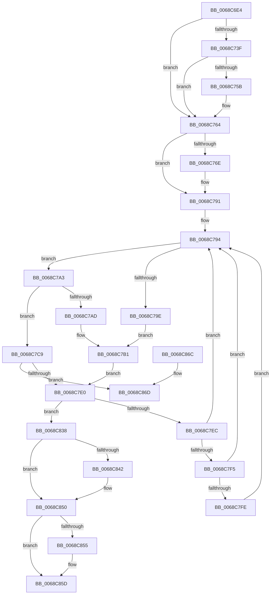

# MiSoloZeroHugeRange

- RVA: `0x0068C6E4`–`0x0068C88E` (길이 `426` bytes)
- VA: `0x000000014068C6E4`
- 실행 섹션: `.text`
- PDB 이름 있음: `예`; PDB Function 태그: `아니요`
- unwind 정보 RVA: `0x000D8E50`
- 디코드: `115`개 명령, `426/426` bytes 표시
- 미해석 바이트: `0` (있으면 어셈블리에 `.byte`로 보존)

> 이 문서는 커널 이미지의 기계어와 PDB 기호를 분석해 생성했습니다. 4번과 5번은 함수 원형과 자료형을 바이너리 사용 방식에서 추정한 C 해석이며 원본 소스 복구 결과는 아닙니다.

## 1. Dependencies

- 직접 호출 지점: **10**; 고유 호출 대상: **8**
- 직접 호출자로 확인된 함수: **1**
- RIP 상대 이미지 참조: **1**

### Outgoing calls
- `0x0068C74A` → [MiAllocateAcceleratorDescriptor](../69/MiAllocateAcceleratorDescriptor_function_00697124.md) (function, `0x00697124`)
- `0x0068C781` → [MiUseProcessorHugeMappingAtDpc](MiUseProcessorHugeMappingAtDpc_function_0068C894.md) (function, `0x0068C894`)
- `0x0068C7C2` → [MiFillMemory](../2C/MiFillMemory_function_002C7BD0.md) (function, `0x002C7BD0`)
- `0x0068C7D2` → [RtlCompareMemoryUlong](../6B/RtlCompareMemoryUlong_function_006BA6F0.md) (function, `0x006BA6F0`)
- `0x0068C7F5` → [KeShouldYieldProcessor](../27/KeShouldYieldProcessor_function_002773E0.md) (function, `0x002773E0`)
- `0x0068C807` → [MiReleaseProcessorHugeMappingAtDpc](MiReleaseProcessorHugeMappingAtDpc_function_0068C68C.md) (function, `0x0068C68C`)
- `0x0068C81F` → [MiUseProcessorHugeMappingAtDpc](MiUseProcessorHugeMappingAtDpc_function_0068C894.md) (function, `0x0068C894`)
- `0x0068C84B` → [MiReleaseProcessorHugeMappingAtDpc](MiReleaseProcessorHugeMappingAtDpc_function_0068C68C.md) (function, `0x0068C68C`)
- `0x0068C858` → [MiDeleteAcceleratorDescriptor](../2C/MiDeleteAcceleratorDescriptor_function_002CA560.md) (function, `0x002CA560`)
- `0x0068C888` → [KeBugCheckEx](../4F/KeBugCheckEx_function_004FD660.md) (function, `0x004FD660`)

### Direct callers
- [MiHugePageOperation](MiHugePageOperation_function_0068C490.md) at `0x0068C61B`

### Static image references
- `0x0068C6FD` → RVA `0x00E2DBF8` (`.data`; read)

## 2. Other-region calls and transfers

- 다른 실행 섹션으로 향하는 call: **0**
- 별도 외부 분기/꼬리 이동을 확인하지 못했습니다.

## 3. Assembly (complete function range)

```asm
0068C6E4  4C 8B DC                        mov r11, rsp
0068C6E7  45 89 4B 20                     mov dword ptr [r11 + 0x20], r9d
0068C6EB  45 89 43 18                     mov dword ptr [r11 + 0x18], r8d
0068C6EF  53                              push rbx
0068C6F0  55                              push rbp
0068C6F1  56                              push rsi
0068C6F2  57                              push rdi
0068C6F3  41 54                           push r12
0068C6F5  41 56                           push r14
0068C6F7  41 57                           push r15
0068C6F9  48 83 EC 40                     sub rsp, 0x40
0068C6FD  48 8B 05 F4 14 7A 00            mov rax, qword ptr [rip + 0x7a14f4]
0068C704  45 8B D1                        mov r10d, r9d
0068C707  45 33 E4                        xor r12d, r12d
0068C70A  4C 8B FA                        mov r15, rdx
0068C70D  8B 94 24 A0 00 00 00            mov edx, dword ptr [rsp + 0xa0]
0068C714  41 B6 11                        mov r14b, 0x11
0068C717  41 8B D8                        mov ebx, r8d
0068C71A  4D 89 63 B8                     mov qword ptr [r11 - 0x48], r12
0068C71E  48 8B F1                        mov rsi, rcx
0068C721  45 88 73 08                     mov byte ptr [r11 + 8], r14b
0068C725  41 8B EC                        mov ebp, r12d
0068C728  4C 8D 0C 52                     lea r9, [rdx + rdx*2]
0068C72C  49 C1 E1 07                     shl r9, 7
0068C730  4D 8B 8C 01 78 01 00 00         mov r9, qword ptr [r9 + rax + 0x178]
0068C738  66 45 39 61 18                  cmp word ptr [r9 + 0x18], r12w
0068C73D  74 25                           je 0x14068c764
0068C73F  4D 8D 4B B8                     lea r9, [r11 - 0x48]
0068C743  33 C9                           xor ecx, ecx
0068C745  45 8D 44 24 01                  lea r8d, [r12 + 1]
0068C74A  E8 D5 A9 00 00                  call 0x140697124
0068C74F  44 8B 94 24 98 00 00 00         mov r10d, dword ptr [rsp + 0x98]
0068C757  85 C0                           test eax, eax
0068C759  74 09                           je 0x14068c764
0068C75B  48 8B 6C 24 30                  mov rbp, qword ptr [rsp + 0x30]
0068C760  48 83 C5 20                     add rbp, 0x20
0068C764  BF 00 00 00 40                  mov edi, 0x40000000
0068C769  83 FB 02                        cmp ebx, 2
0068C76C  75 23                           jne 0x14068c791
0068C76E  4C 8D 8C 24 80 00 00 00         lea r9, [rsp + 0x80]
0068C776  45 8B C2                        mov r8d, r10d
0068C779  49 8B CF                        mov rcx, r15
0068C77C  BF 00 00 20 00                  mov edi, 0x200000
0068C781  E8 0E 01 00 00                  call 0x14068c894
0068C786  44 8A B4 24 80 00 00 00         mov r14b, byte ptr [rsp + 0x80]
0068C78E  48 8B F0                        mov rsi, rax
0068C791  48 8B DE                        mov rbx, rsi
0068C794  83 BC 24 A8 00 00 00 00         cmp dword ptr [rsp + 0xa8], 0
0068C79C  75 05                           jne 0x14068c7a3
0068C79E  45 33 C9                        xor r9d, r9d
0068C7A1  EB 0E                           jmp 0x14068c7b1
0068C7A3  83 BC 24 A8 00 00 00 01         cmp dword ptr [rsp + 0xa8], 1
0068C7AB  75 1C                           jne 0x14068c7c9
0068C7AD  49 83 C9 FF                     or r9, 0xffffffffffffffff
0068C7B1  4C 8B C7                        mov r8, rdi
0068C7B4  C7 44 24 20 01 00 00 00         mov dword ptr [rsp + 0x20], 1
0068C7BC  48 8B D3                        mov rdx, rbx
0068C7BF  48 8B CD                        mov rcx, rbp
0068C7C2  E8 09 B4 C3 FF                  call 0x1402c7bd0
0068C7C7  EB 17                           jmp 0x14068c7e0
0068C7C9  45 33 C0                        xor r8d, r8d
0068C7CC  48 8B D7                        mov rdx, rdi
0068C7CF  48 8B CB                        mov rcx, rbx
0068C7D2  E8 19 DF 02 00                  call 0x1406ba6f0
0068C7D7  48 3B C7                        cmp rax, rdi
0068C7DA  0F 85 8D 00 00 00               jne 0x14068c86d
0068C7E0  4C 03 E7                        add r12, rdi
0068C7E3  49 81 FC 00 00 00 40            cmp r12, 0x40000000
0068C7EA  74 4C                           je 0x14068c838
0068C7EC  48 03 DF                        add rbx, rdi
0068C7EF  41 80 FE 02                     cmp r14b, 2
0068C7F3  73 9F                           jae 0x14068c794
0068C7F5  E8 E6 AB BE FF                  call 0x1402773e0
0068C7FA  85 C0                           test eax, eax
0068C7FC  74 96                           je 0x14068c794
0068C7FE  45 8A C6                        mov r8b, r14b
0068C801  49 8B D7                        mov rdx, r15
0068C804  48 8B CE                        mov rcx, rsi
0068C807  E8 80 FE FF FF                  call 0x14068c68c
0068C80C  44 8B 84 24 98 00 00 00         mov r8d, dword ptr [rsp + 0x98]
0068C814  4C 8D 8C 24 80 00 00 00         lea r9, [rsp + 0x80]
0068C81C  49 8B CF                        mov rcx, r15
0068C81F  E8 70 00 00 00                  call 0x14068c894
0068C824  44 8A B4 24 80 00 00 00         mov r14b, byte ptr [rsp + 0x80]
0068C82C  48 8B F0                        mov rsi, rax
0068C82F  49 8D 1C 04                     lea rbx, [r12 + rax]
0068C833  E9 5C FF FF FF                  jmp 0x14068c794
0068C838  83 BC 24 90 00 00 00 02         cmp dword ptr [rsp + 0x90], 2
0068C840  75 0E                           jne 0x14068c850
0068C842  45 8A C6                        mov r8b, r14b
0068C845  49 8B D7                        mov rdx, r15
0068C848  48 8B CE                        mov rcx, rsi
0068C84B  E8 3C FE FF FF                  call 0x14068c68c
0068C850  48 85 ED                        test rbp, rbp
0068C853  74 08                           je 0x14068c85d
0068C855  48 8B CD                        mov rcx, rbp
0068C858  E8 03 DD C3 FF                  call 0x1402ca560
0068C85D  48 83 C4 40                     add rsp, 0x40
0068C861  41 5F                           pop r15
0068C863  41 5E                           pop r14
0068C865  41 5C                           pop r12
0068C867  5F                              pop rdi
0068C868  5E                              pop rsi
0068C869  5D                              pop rbp
0068C86A  5B                              pop rbx
0068C86B  C3                              ret
0068C86C  CC                              int3
0068C86D  48 2B C6                        sub rax, rsi
0068C870  48 C7 44 24 20 00 00 00 40      mov qword ptr [rsp + 0x20], 0x40000000
0068C879  4D 8B C7                        mov r8, r15
0068C87C  48 8B D6                        mov rdx, rsi
0068C87F  B9 27 01 00 00                  mov ecx, 0x127
0068C884  4C 8D 0C 03                     lea r9, [rbx + rax]
0068C888  E8 D3 0D E7 FF                  call 0x1404fd660
0068C88D  CC                              int3
```

## 4. C-style interpretation (structured pseudocode)

```c
__int64 __fastcall MiSoloZeroHugeRange(__int64 a1, __int64 a2, int a3, int a4, unsigned int a5, unsigned int a6)
{
    __int64 result;
    __int64 v_r12;
    __int64 v_r14;
    __int64 v_rbp;
    __int64 v_rbx;
    __int64 v_rdi;
    __int64 v_rsi;
    __int64 v_rsp;
    unsigned __int64 v_stack_m48;
    unsigned int v_stack_m58;
    unsigned int v_stack_p18;
    unsigned int v_stack_p20;
    unsigned __int64 v_stack_p8;

    *(unsigned int *)(v_rsp + 32) = a4;
    *(unsigned int *)(v_rsp + 24) = a3;
    v_rsp = (v_rsp) - (64);
    v_r12 = 0;
    *(unsigned __int64 *)(v_rsp - 72) = 0;
    *(unsigned __int8 *)(v_rsp + 8) = 17;
    a4 = ((unsigned int)(a5) + (unsigned int)(a5) * 2) << (7);
    if ((*(unsigned __int16 *)(*(unsigned __int64 *)(a4 + *(unsigned __int64 *)(v_rip + 8000756) * 1 + 376) + 24)) == 0) goto loc_0068C764;
    a1 = 0;
    result = MiAllocateAcceleratorDescriptor(a1, (unsigned int)(a5), v_r12 + 1, v_rsp - 72);
    v_rbp = 0;
    if ((unsigned int)(result) != 0) {
        v_rbp = v_stack_m48;
        v_rbp = (v_rbp) + (32);
    }
    v_rsi = a1;
    v_rdi = (unsigned int)(0x40000000ULL);
    v_r14 = 17;
    if (((unsigned int)((unsigned int)(a3))) == 2) {
        a4 = v_stack_p8;
        a3 = (unsigned int)((unsigned int)(v_stack_p20));
        a1 = a2;
        v_rdi = 0x200000ULL;
        result = MiUseProcessorHugeMappingAtDpc(a1, (unsigned int)(a5), a3, a4);
        v_r14 = v_stack_p8;
        v_rsi = result;
    }
loc_0068C794:
    if (a6 != 0) goto loc_0068C7A3;
    a4 = 0;
    goto loc_0068C7B1;
loc_0068C7A3:
    if (a6 != 1) goto loc_0068C7C9;
    a4 = (a4) | (-1);
loc_0068C7B1:
    v_stack_m58 = 1;
    result = MiFillMemory(v_rbp, v_rsi, v_rdi, a4);
    goto loc_0068C7E0;
loc_0068C7C9:
    a3 = 0;
    result = RtlCompareMemoryUlong(v_rsi, v_rdi, a3, a4);
    if (result != v_rdi) goto loc_0068C86D;
loc_0068C7E0:
    v_r12 = (v_r12) + (v_rdi);
    if (v_r12 == 0x40000000ULL) goto loc_0068C838;
    v_rbx = (v_rsi) + (v_rdi);
    if (((unsigned __int8)(v_r14)) >= 2) goto loc_0068C794;
    result = KeShouldYieldProcessor(v_rsi, v_rdi, a3, a4);
    if ((unsigned int)(result) == 0) goto loc_0068C794;
    result = MiReleaseProcessorHugeMappingAtDpc(v_rsi, a2, (unsigned __int8)(v_r14), a4);
    result = MiUseProcessorHugeMappingAtDpc(a2, a2, (unsigned int)(v_stack_p20), v_stack_p8);
    goto loc_0068C794;
loc_0068C838:
    if (v_stack_p18 == 2) {
        a3 = (unsigned __int8)(v_stack_p8);
        a2 = a2;
        a1 = result;
        result = MiReleaseProcessorHugeMappingAtDpc(a1, a2, a3, v_stack_p8);
    }
    if (v_rbp != 0) {
        a1 = v_rbp;
        result = MiDeleteAcceleratorDescriptor(a1, a2, a3, v_stack_p8);
    }
    v_rsp = (v_rsp) + (64);
    return result;
loc_0068C86D:
    result = (result) - (result);
    v_stack_p20 = 0x40000000ULL;
    result = KeBugCheckEx(295, result, a2, v_r12 + result * 1 + result * 1);
    return result;
}
```

## 5. (Beta) C Style

```c
int64_t MiSoloZeroHugeRange(int64_t Arg1, int64_t Arg2, int32_t Arg3, int32_t Arg4, void *Arg5, uint32_t Arg6)
{
    uint8_t *arg5 = (uint8_t *)Arg5;

    int64_t result;
    int64_t local_r12;
    int64_t local_r14;
    int64_t local_rbp;
    int64_t local_rbx;
    int64_t local_rdi;
    int64_t local_rsi;
    int64_t local_rsp;
    uint64_t v_stack_m48;
    uint32_t v_stack_m58;
    uint32_t v_stack_p18;
    uint32_t v_stack_p20;
    uint64_t v_stack_p8;

    *(uint32_t *)(local_rsp + 0x20) = Arg4;
    *(uint32_t *)(local_rsp + 0x18) = Arg3;
    local_rsp = (local_rsp) - (64);
    local_r12 = 0;
    *(uint64_t *)(local_rsp - 0x48) = 0;
    *(uint8_t *)(local_rsp + 0x8) = 17;
    Arg4 = ((uint32_t)(Arg5) + (uint32_t)(Arg5) * 2) << (7);
    if ((*(uint16_t *)(*(uint64_t *)(Arg4 + *(uint64_t *)(v_rip + 0x7A14F4) * 1 + 0x178) + 0x18)) == 0) goto loc_0068C764;
    Arg1 = 0;
    result = MiAllocateAcceleratorDescriptor(Arg1, (uint32_t)(Arg5), local_r12 + 1, local_rsp - 72);
    local_rbp = 0;
    if ((uint32_t)(result) != 0) {
        local_rbp = v_stack_m48;
        local_rbp = (local_rbp) + (32);
    }
    local_rsi = Arg1;
    local_rdi = (uint32_t)(0x40000000ULL);
    local_r14 = 17;
    if (((uint32_t)((uint32_t)(Arg3))) == 2) {
        Arg4 = v_stack_p8;
        Arg3 = (uint32_t)((uint32_t)(v_stack_p20));
        Arg1 = Arg2;
        local_rdi = 0x200000ULL;
        result = MiUseProcessorHugeMappingAtDpc(Arg1, (uint32_t)(Arg5), Arg3, Arg4);
        local_r14 = v_stack_p8;
        local_rsi = result;
    }
loc_0068C794:
    if (Arg6 != 0) goto loc_0068C7A3;
    Arg4 = 0;
    goto loc_0068C7B1;
loc_0068C7A3:
    if (Arg6 != 1) goto loc_0068C7C9;
    Arg4 = (Arg4) | (-1);
loc_0068C7B1:
    v_stack_m58 = 1;
    result = MiFillMemory(local_rbp, local_rsi, local_rdi, Arg4);
    goto loc_0068C7E0;
loc_0068C7C9:
    Arg3 = 0;
    result = RtlCompareMemoryUlong(local_rsi, local_rdi, Arg3, Arg4);
    if (result != local_rdi) goto loc_0068C86D;
loc_0068C7E0:
    local_r12 = (local_r12) + (local_rdi);
    if (local_r12 == 0x40000000ULL) goto loc_0068C838;
    local_rbx = (local_rsi) + (local_rdi);
    if (((uint8_t)(local_r14)) >= 2) goto loc_0068C794;
    result = KeShouldYieldProcessor(local_rsi, local_rdi, Arg3, Arg4);
    if ((uint32_t)(result) == 0) goto loc_0068C794;
    result = MiReleaseProcessorHugeMappingAtDpc(local_rsi, Arg2, (uint8_t)(local_r14), Arg4);
    result = MiUseProcessorHugeMappingAtDpc(Arg2, Arg2, (uint32_t)(v_stack_p20), v_stack_p8);
    goto loc_0068C794;
loc_0068C838:
    if (v_stack_p18 == 2) {
        Arg3 = (uint8_t)(v_stack_p8);
        Arg2 = Arg2;
        Arg1 = result;
        result = MiReleaseProcessorHugeMappingAtDpc(Arg1, Arg2, Arg3, v_stack_p8);
    }
    if (local_rbp != 0) {
        Arg1 = local_rbp;
        result = MiDeleteAcceleratorDescriptor(Arg1, Arg2, Arg3, v_stack_p8);
    }
    local_rsp = (local_rsp) + (64);
    return result;
loc_0068C86D:
    result = (result) - (result);
    v_stack_p20 = 0x40000000ULL;
    result = KeBugCheckEx(295, result, Arg2, local_r12 + result * 1 + result * 1);
    return result;
}
```

### 관측된 메모리 오프셋

구조체 형식이 확인되지 않은 접근은 인자 기준의 오프셋으로만 기록했습니다.

| 기준 인자 | 오프셋 표현 | 폭 (bit) | 접근 |
|---|---:|---:|---|
| `Arg5` | `+ 0x0 + rdx*2` | `64` | `R` |

## 6. Execution-region graph

[열기: 2D/3D 그래프와 함수 탐색 컨트롤 패널](../../../control-panel.html?section=text&rva=0x0068C6E4&view=graph)

- 2D 그래프는 위에서 아래로 흐르고, 3D 그래프는 빈 공간을 드래그해 회전합니다. Shift+드래그는 이동, 휠은 확대·축소, 함수 노드 선택은 대상 보고서 이동입니다.

### Static fallback


