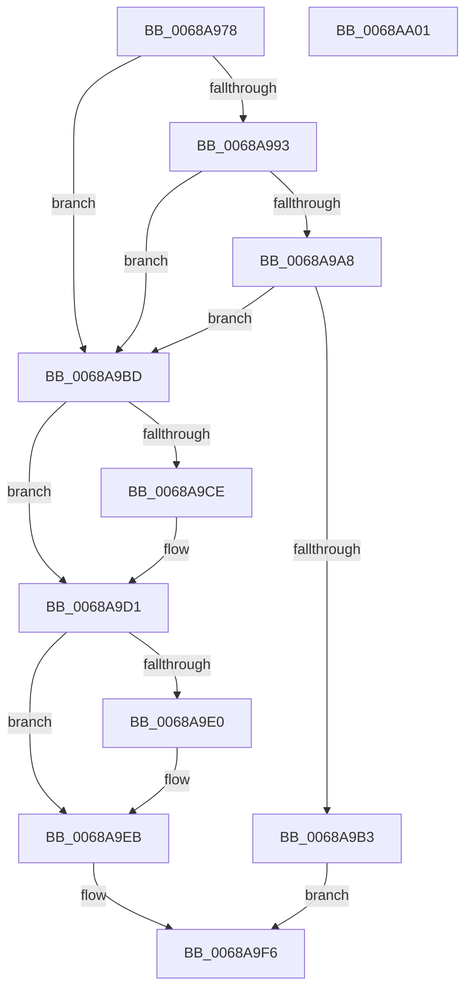

# MiTransformValidPteViaIpi

- RVA: `0x0068A978`–`0x0068AA02` (길이 `138` bytes)
- VA: `0x000000014068A978`
- 실행 섹션: `.text`
- PDB 이름 있음: `예`; PDB Function 태그: `아니요`
- unwind 정보 RVA: `0x0005CAAC`
- 디코드: `36`개 명령, `138/138` bytes 표시
- 미해석 바이트: `0` (있으면 어셈블리에 `.byte`로 보존)

> 이 문서는 커널 이미지의 기계어와 PDB 기호를 분석해 생성했습니다. 4번과 5번은 함수 원형과 자료형을 바이너리 사용 방식에서 추정한 C 해석이며 원본 소스 복구 결과는 아닙니다.

## 1. Dependencies

- 직접 호출 지점: **4**; 고유 호출 대상: **4**
- 직접 호출자로 확인된 함수: **1**
- RIP 상대 이미지 참조: **2**

### Outgoing calls
- `0x0068A9B6` → [MiWritePteHighLevel](MiWritePteHighLevel_function_0068AA08.md) (function, `0x0068AA08`)
- `0x0068A9D7` → [MiPteInShadowRange](../23/MiPteInShadowRange_function_0023FB00.md) (function, `0x0023FB00`)
- `0x0068A9E6` → [MiWritePteShadow](../29/MiWritePteShadow_function_00294EAC.md) (function, `0x00294EAC`)
- `0x0068A9F1` → [MI_FLUSH_ENTIRE_TB](../31/MI_FLUSH_ENTIRE_TB_function_00314110.md) (function, `0x00314110`)

### Direct callers
- [MiTransformValidPteInPlace](../37/MiTransformValidPteInPlace_function_003765E0.md) at `0x00376633`

### Static image references
- `0x0068A982` → RVA `0x00FC6A88` (`ALMOSTRO`; read)
- `0x0068A99C` → RVA `0x00FC6A80` (`ALMOSTRO`; read)

## 2. Other-region calls and transfers

- 다른 실행 섹션으로 향하는 call: **0**
- 별도 외부 분기/꼬리 이동을 확인하지 못했습니다.

## 3. Assembly (complete function range)

```asm
0068A978  48 89 5C 24 08                  mov qword ptr [rsp + 8], rbx
0068A97D  57                              push rdi
0068A97E  48 83 EC 20                     sub rsp, 0x20
0068A982  48 0F BA 25 FD C0 93 00 27      bt qword ptr [rip + 0x93c0fd], 0x27
0068A98B  49 8B D8                        mov rbx, r8
0068A98E  48 8B F9                        mov rdi, rcx
0068A991  73 2A                           jae 0x14068a9bd
0068A993  65 4C 8B 04 25 20 00 00 00      mov r8, qword ptr gs:[0x20]
0068A99C  8B 05 DE C0 93 00               mov eax, dword ptr [rip + 0x93c0de]
0068A9A2  41 39 40 24                     cmp dword ptr [r8 + 0x24], eax
0068A9A6  73 15                           jae 0x14068a9bd
0068A9A8  48 0F BA 25 D7 C0 93 00 28      bt qword ptr [rip + 0x93c0d7], 0x28
0068A9B1  72 0A                           jb 0x14068a9bd
0068A9B3  4C 8B C3                        mov r8, rbx
0068A9B6  E8 4D 00 00 00                  call 0x14068aa08
0068A9BB  EB 39                           jmp 0x14068a9f6
0068A9BD  48 83 CB 20                     or rbx, 0x20
0068A9C1  48 F7 05 BC C0 93 00 00 00 00 02  test qword ptr [rip + 0x93c0bc], 0x2000000
0068A9CC  74 03                           je 0x14068a9d1
0068A9CE  0F AE E8                        lfence
0068A9D1  48 8B C3                        mov rax, rbx
0068A9D4  48 87 01                        xchg qword ptr [rcx], rax
0068A9D7  E8 24 51 BB FF                  call 0x14023fb00
0068A9DC  85 C0                           test eax, eax
0068A9DE  74 0B                           je 0x14068a9eb
0068A9E0  48 8B D3                        mov rdx, rbx
0068A9E3  48 8B CF                        mov rcx, rdi
0068A9E6  E8 C1 A4 C0 FF                  call 0x140294eac
0068A9EB  83 CA FF                        or edx, 0xffffffff
0068A9EE  8D 4A 03                        lea ecx, [rdx + 3]
0068A9F1  E8 1A 97 C8 FF                  call 0x140314110
0068A9F6  48 8B 5C 24 30                  mov rbx, qword ptr [rsp + 0x30]
0068A9FB  48 83 C4 20                     add rsp, 0x20
0068A9FF  5F                              pop rdi
0068AA00  C3                              ret
0068AA01  CC                              int3
```

## 4. C-style interpretation (structured pseudocode)

```c
__int64 __fastcall MiTransformValidPteViaIpi(__int64 a1, __int64 a2, __int64 a3)
{
    __int64 result;
    __int64 v_rbx;
    __int64 v_rsp;
    unsigned __int64 v_stack_p8;

    v_stack_p8 = v_rbx;
    v_rsp = (v_rsp) - (32);
    if (condition_is_above_or_equal) goto loc_0068A9BD;
    if ((*(unsigned int *)(*(unsigned __int64 *)(gs_base + (0 + 32)) + 36)) >= ((unsigned int)((unsigned int)(*(unsigned int *)(v_rip + 9683166))))) goto loc_0068A9BD;
    if ((*(unsigned int *)(*(unsigned __int64 *)(gs_base + (0 + 32)) + 36)) < ((unsigned int)((unsigned int)(*(unsigned int *)(v_rip + 9683166))))) goto loc_0068A9BD;
    result = MiWritePteHighLevel(a1, a2, a3, a4);
    goto loc_0068A9F6;
loc_0068A9BD:
    v_rbx = (a3) | (32);
    if (((*(unsigned __int64 *)(v_rip + 9683132)) & (0x2000000ULL)) != 0) {
    }
    result = MiPteInShadowRange(a1, a2, a3, a4);
    if ((unsigned int)(result) != 0) {
        a2 = v_rbx;
        a1 = a1;
        result = MiWritePteShadow(a1, a2, a3, a4);
    }
    a2 = (unsigned int)((a2) | (0xFFFFFFFFULL));
    result = MI_FLUSH_ENTIRE_TB(a2 + 3, a2, a3, a4);
loc_0068A9F6:
    v_rsp = (v_rsp) + (32);
    return result;
}
```

## 5. (Beta) C Style

```c
int64_t MiTransformValidPteViaIpi(void *Arg1, int64_t Arg2, int64_t Arg3)
{
    uint8_t *arg1 = (uint8_t *)Arg1;

    int64_t result;
    int64_t local_rbx;
    int64_t local_rsp;
    uint64_t v_stack_p8;

    v_stack_p8 = local_rbx;
    local_rsp = (local_rsp) - (32);
    if (condition_is_above_or_equal) goto loc_0068A9BD;
    if ((*(uint32_t *)(*(uint64_t *)(gs_base + (0 + 0x20)) + 0x24)) >= ((uint32_t)((uint32_t)(*(uint32_t *)(v_rip + 0x93C0DE))))) goto loc_0068A9BD;
    if ((*(uint32_t *)(*(uint64_t *)(gs_base + (0 + 0x20)) + 0x24)) < ((uint32_t)((uint32_t)(*(uint32_t *)(v_rip + 0x93C0DE))))) goto loc_0068A9BD;
    result = MiWritePteHighLevel(Arg1, Arg2, Arg3, a4);
    goto loc_0068A9F6;
loc_0068A9BD:
    local_rbx = (Arg3) | (32);
    if (((*(uint64_t *)(v_rip + 0x93C0BC)) & (0x2000000ULL)) != 0) {
    }
    result = MiPteInShadowRange(Arg1, Arg2, Arg3, a4);
    if ((uint32_t)(result) != 0) {
        Arg2 = local_rbx;
        Arg1 = Arg1;
        result = MiWritePteShadow(Arg1, Arg2, Arg3, a4);
    }
    Arg2 = (uint32_t)((Arg2) | (0xFFFFFFFFULL));
    result = MI_FLUSH_ENTIRE_TB(Arg2 + 3, Arg2, Arg3, a4);
loc_0068A9F6:
    local_rsp = (local_rsp) + (32);
    return result;
}
```

### 관측된 메모리 오프셋

구조체 형식이 확인되지 않은 접근은 인자 기준의 오프셋으로만 기록했습니다.

| 기준 인자 | 오프셋 표현 | 폭 (bit) | 접근 |
|---|---:|---:|---|
| `Arg1` | `+ 0x0` | `64` | `R/W` |

## 6. Execution-region graph

[열기: 2D/3D 그래프와 함수 탐색 컨트롤 패널](../../../control-panel.html?section=text&rva=0x0068A978&view=graph)

- 2D 그래프는 위에서 아래로 흐르고, 3D 그래프는 빈 공간을 드래그해 회전합니다. Shift+드래그는 이동, 휠은 확대·축소, 함수 노드 선택은 대상 보고서 이동입니다.

### Static fallback


