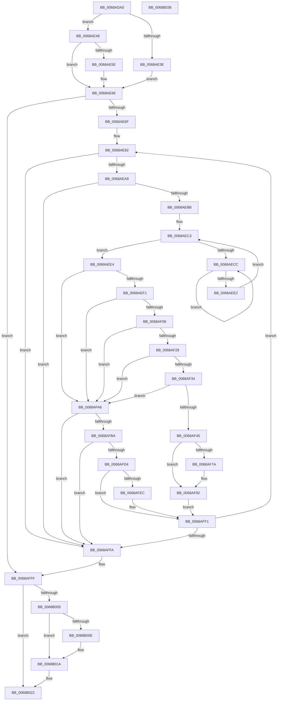

# MiTryUnlinkNodeLargePages

- RVA: `0x0068ADA0`–`0x0068B037` (길이 `663` bytes)
- VA: `0x000000014068ADA0`
- 실행 섹션: `.text`
- PDB 이름 있음: `예`; PDB Function 태그: `아니요`
- unwind 정보 RVA: `0x000BECA4`
- 디코드: `163`개 명령, `663/663` bytes 표시
- 미해석 바이트: `0` (있으면 어셈블리에 `.byte`로 보존)

> 이 문서는 커널 이미지의 기계어와 PDB 기호를 분석해 생성했습니다. 4번과 5번은 함수 원형과 자료형을 바이너리 사용 방식에서 추정한 C 해석이며 원본 소스 복구 결과는 아닙니다.

## 1. Dependencies

- 직접 호출 지점: **13**; 고유 호출 대상: **10**
- 직접 호출자로 확인된 함수: **1**
- RIP 상대 이미지 참조: **4**

### Outgoing calls
- `0x0068ADE6` → [MiPageToNode](../33/MiPageToNode_function_00338CD0.md) (function, `0x00338CD0`)
- `0x0068AE05` → [MiGetPfnChannel](../33/MiGetPfnChannel_function_0033BA90.md) (function, `0x0033BA90`)
- `0x0068AE28` → [MiSnapPageMoveInProgress](../3B/MiSnapPageMoveInProgress_function_003B8C04.md) (function, `0x003B8C04`)
- `0x0068AE61` → [KiRaiseIrqlProcessIrqlFlags](../4F/KiRaiseIrqlProcessIrqlFlags_function_004F56FC.md) (function, `0x004F56FC`)
- `0x0068AED4` → [KeYieldProcessorEx](../3F/KeYieldProcessorEx_function_003FBD00.md) (function, `0x003FBD00`)
- `0x0068AEF4` → [MiGetPfnPageSizeIndex](../31/MiGetPfnPageSizeIndex_function_0031C710.md) (function, `0x0031C710`)
- `0x0068AF2B` → [MiPageToNode](../33/MiPageToNode_function_00338CD0.md) (function, `0x00338CD0`)
- `0x0068AF37` → [MiGetPfnChannel](../33/MiGetPfnChannel_function_0033BA90.md) (function, `0x0033BA90`)
- `0x0068AF4D` → [MiUnlinkFreeOrZeroedPage](../33/MiUnlinkFreeOrZeroedPage_function_00336C40.md) (function, `0x00336C40`)
- `0x0068AF5A` → [MiConvertBaseLargePage](../46/MiConvertBaseLargePage_function_00462294.md) (function, `0x00462294`)
- `0x0068AFC3` → [MiWaitForPageMoveComplete](../3B/MiWaitForPageMoveComplete_function_003B8C30.md) (function, `0x003B8C30`)
- `0x0068AFEC` → [KiRaiseIrqlProcessIrqlFlags](../4F/KiRaiseIrqlProcessIrqlFlags_function_004F56FC.md) (function, `0x004F56FC`)
- `0x0068B015` → [KiLowerIrqlProcessIrqlFlags](../4F/KiLowerIrqlProcessIrqlFlags_function_004F5698.md) (function, `0x004F5698`)

### Direct callers
- [sub_006E7724](../6E/Unknown_function_006E7724.md) at `0x006E77CC`

### Static image references
- `0x0068ADC5` → RVA `0x00011C60` (`.rdata`; read)
- `0x0068AE55` → RVA `0x00FC6D20` (`ALMOSTRO`; read)
- `0x0068AE92` → RVA `0x00E2DCE0` (`.data`; read)
- `0x0068AF0A` → RVA `0x00E30088` (`.data`; read)

## 2. Other-region calls and transfers

- 다른 실행 섹션으로 향하는 call: **0**
- 별도 외부 분기/꼬리 이동을 확인하지 못했습니다.

## 3. Assembly (complete function range)

```asm
0068ADA0  4C 89 4C 24 20                  mov qword ptr [rsp + 0x20], r9
0068ADA5  44 89 44 24 18                  mov dword ptr [rsp + 0x18], r8d
0068ADAA  48 89 4C 24 08                  mov qword ptr [rsp + 8], rcx
0068ADAF  53                              push rbx
0068ADB0  55                              push rbp
0068ADB1  56                              push rsi
0068ADB2  57                              push rdi
0068ADB3  41 54                           push r12
0068ADB5  41 55                           push r13
0068ADB7  41 56                           push r14
0068ADB9  41 57                           push r15
0068ADBB  48 83 EC 58                     sub rsp, 0x58
0068ADBF  48 8B D9                        mov rbx, rcx
0068ADC2  41 8B C0                        mov eax, r8d
0068ADC5  48 8D 0D 94 6E 98 FF            lea rcx, [rip - 0x67916c]
0068ADCC  45 33 F6                        xor r14d, r14d
0068ADCF  4C 21 74 24 20                  and qword ptr [rsp + 0x20], r14
0068ADD4  4D 8B E9                        mov r13, r9
0068ADD7  4C 8B E2                        mov r12, rdx
0068ADDA  48 8B 04 C1                     mov rax, qword ptr [rcx + rax*8]
0068ADDE  48 8B CA                        mov rcx, rdx
0068ADE1  48 89 44 24 28                  mov qword ptr [rsp + 0x28], rax
0068ADE6  E8 E5 DE CA FF                  call 0x140338cd0
0068ADEB  4F 8D 3C 64                     lea r15, [r12 + r12*2]
0068ADEF  8B F8                           mov edi, eax
0068ADF1  4D 03 FF                        add r15, r15
0068ADF4  48 B8 00 00 00 00 00 DE FF FF   movabs rax, 0xffffde0000000000
0068ADFE  4A 8D 34 F8                     lea rsi, [rax + r15*8]
0068AE02  48 8B CE                        mov rcx, rsi
0068AE05  E8 86 0C CB FF                  call 0x14033ba90
0068AE0A  88 84 24 A8 00 00 00            mov byte ptr [rsp + 0xa8], al
0068AE11  41 8D 56 01                     lea edx, [r14 + 1]
0068AE15  48 69 C7 80 DF 00 00            imul rax, rdi, 0xdf80
0068AE1C  48 03 43 10                     add rax, qword ptr [rbx + 0x10]
0068AE20  48 8B C8                        mov rcx, rax
0068AE23  48 89 44 24 48                  mov qword ptr [rsp + 0x48], rax
0068AE28  E8 D7 DD D2 FF                  call 0x1403b8c04
0068AE2D  41 8D 56 02                     lea edx, [r14 + 2]
0068AE31  48 8B D8                        mov rbx, rax
0068AE34  44 39 B4 24 C0 00 00 00         cmp dword ptr [rsp + 0xc0], r14d
0068AE3C  74 0A                           je 0x14068ae48
0068AE3E  40 B5 11                        mov bpl, 0x11
0068AE41  48 89 6C 24 30                  mov qword ptr [rsp + 0x30], rbp
0068AE46  EB 1E                           jmp 0x14068ae66
0068AE48  44 0F 20 C5                     mov rbp, cr8
0068AE4C  48 89 6C 24 30                  mov qword ptr [rsp + 0x30], rbp
0068AE51  44 0F 22 C2                     mov cr8, rdx
0068AE55  44 39 35 C4 BE 93 00            cmp dword ptr [rip + 0x93bec4], r14d
0068AE5C  74 08                           je 0x14068ae66
0068AE5E  40 8A CD                        mov cl, bpl
0068AE61  E8 96 A8 E6 FF                  call 0x1404f56fc
0068AE66  4D 85 ED                        test r13, r13
0068AE69  0F 84 90 01 00 00               je 0x14068afff
0068AE6F  48 8B 44 24 28                  mov rax, qword ptr [rsp + 0x28]
0068AE74  4C 8D 2C 40                     lea r13, [rax + rax*2]
0068AE78  49 C1 E5 04                     shl r13, 4
0068AE7C  48 B8 28 00 00 00 00 DE FF FF   movabs rax, 0xffffde0000000028
0068AE86  4A 8D 2C F8                     lea rbp, [rax + r15*8]
0068AE8A  4C 8B BC 24 B8 00 00 00         mov r15, qword ptr [rsp + 0xb8]
0068AE92  4C 3B 25 47 2E 7A 00            cmp r12, qword ptr [rip + 0x7a2e47]
0068AE99  4C 89 74 24 40                  mov qword ptr [rsp + 0x40], r14
0068AE9E  4C 89 74 24 38                  mov qword ptr [rsp + 0x38], r14
0068AEA3  0F 87 51 01 00 00               ja 0x14068affa
0068AEA9  48 8B 45 00                     mov rax, qword ptr [rbp]
0068AEAD  48 C1 E8 36                     shr rax, 0x36
0068AEB1  0F BA E0 00                     bt eax, 0
0068AEB5  0F 83 3F 01 00 00               jae 0x14068affa
0068AEBB  83 A4 24 C0 00 00 00 00         and dword ptr [rsp + 0xc0], 0
0068AEC3  F0 48 0F BA 6E 18 3F            lock bts qword ptr [rsi + 0x18], 0x3f
0068AECA  73 18                           jae 0x14068aee4
0068AECC  48 8D 8C 24 C0 00 00 00         lea rcx, [rsp + 0xc0]
0068AED4  E8 27 0E D7 FF                  call 0x1403fbd00
0068AED9  48 8B 46 18                     mov rax, qword ptr [rsi + 0x18]
0068AEDD  48 85 C0                        test rax, rax
0068AEE0  78 EA                           js 0x14068aecc
0068AEE2  EB DF                           jmp 0x14068aec3
0068AEE4  8A 46 22                        mov al, byte ptr [rsi + 0x22]
0068AEE7  24 07                           and al, 7
0068AEE9  3C 01                           cmp al, 1
0068AEEB  0F 87 B5 00 00 00               ja 0x14068afa6
0068AEF1  48 8B CE                        mov rcx, rsi
0068AEF4  E8 17 18 C9 FF                  call 0x14031c710
0068AEF9  3B 84 24 B0 00 00 00            cmp eax, dword ptr [rsp + 0xb0]
0068AF00  0F 85 A0 00 00 00               jne 0x14068afa6
0068AF06  48 8B 46 28                     mov rax, qword ptr [rsi + 0x28]
0068AF0A  48 8B 0D 77 51 7A 00            mov rcx, qword ptr [rip + 0x7a5177]
0068AF11  48 8B 94 24 A0 00 00 00         mov rdx, qword ptr [rsp + 0xa0]
0068AF19  48 C1 E8 2B                     shr rax, 0x2b
0068AF1D  25 FF 03 00 00                  and eax, 0x3ff
0068AF22  48 39 14 C1                     cmp qword ptr [rcx + rax*8], rdx
0068AF26  75 7E                           jne 0x14068afa6
0068AF28  49 8B CC                        mov rcx, r12
0068AF2B  E8 A0 DD CA FF                  call 0x140338cd0
0068AF30  3B C7                           cmp eax, edi
0068AF32  75 72                           jne 0x14068afa6
0068AF34  48 8B CE                        mov rcx, rsi
0068AF37  E8 54 0B CB FF                  call 0x14033ba90
0068AF3C  3A 84 24 A8 00 00 00            cmp al, byte ptr [rsp + 0xa8]
0068AF43  75 61                           jne 0x14068afa6
0068AF45  45 33 C0                        xor r8d, r8d
0068AF48  33 D2                           xor edx, edx
0068AF4A  49 8B CC                        mov rcx, r12
0068AF4D  E8 EE BC CA FF                  call 0x140336c40
0068AF52  BA 01 00 00 00                  mov edx, 1
0068AF57  48 8B CE                        mov rcx, rsi
0068AF5A  E8 35 73 DD FF                  call 0x140462294
0068AF5F  48 B8 FF FF FF FF FF FF FF 7F   movabs rax, 0x7fffffffffffffff
0068AF69  F0 48 21 46 18                  lock and qword ptr [rsi + 0x18], rax
0068AF6E  48 C7 06 00 00 00 00            mov qword ptr [rsi], 0
0068AF75  4D 85 F6                        test r14, r14
0068AF78  74 08                           je 0x14068af82
0068AF7A  48 8B 44 24 20                  mov rax, qword ptr [rsp + 0x20]
0068AF7F  48 89 30                        mov qword ptr [rax], rsi
0068AF82  4C 03 64 24 28                  add r12, qword ptr [rsp + 0x28]
0068AF87  49 FF CF                        dec r15
0068AF8A  48 89 74 24 20                  mov qword ptr [rsp + 0x20], rsi
0068AF8F  49 03 ED                        add rbp, r13
0068AF92  49 03 F5                        add rsi, r13
0068AF95  4C 8B F1                        mov r14, rcx
0068AF98  48 83 7C 24 38 00               cmp qword ptr [rsp + 0x38], 0
0068AF9E  4C 0F 45 74 24 40               cmovne r14, qword ptr [rsp + 0x40]
0068AFA4  EB 4B                           jmp 0x14068aff1
0068AFA6  48 B8 FF FF FF FF FF FF FF 7F   movabs rax, 0x7fffffffffffffff
0068AFB0  F0 48 21 46 18                  lock and qword ptr [rsi + 0x18], rax
0068AFB5  4D 85 F6                        test r14, r14
0068AFB8  75 40                           jne 0x14068affa
0068AFBA  48 8B 4C 24 48                  mov rcx, qword ptr [rsp + 0x48]
0068AFBF  41 8D 56 01                     lea edx, [r14 + 1]
0068AFC3  E8 68 DC D2 FF                  call 0x1403b8c30
0068AFC8  48 33 D8                        xor rbx, rax
0068AFCB  48 F7 C3 00 00 FF FF            test rbx, -0x10000
0068AFD2  74 26                           je 0x14068affa
0068AFD4  48 8B D8                        mov rbx, rax
0068AFD7  44 0F 20 C1                     mov rcx, cr8
0068AFDB  41 8D 56 02                     lea edx, [r14 + 2]
0068AFDF  44 0F 22 C2                     mov cr8, rdx
0068AFE3  44 39 35 36 BD 93 00            cmp dword ptr [rip + 0x93bd36], r14d
0068AFEA  74 05                           je 0x14068aff1
0068AFEC  E8 0B A7 E6 FF                  call 0x1404f56fc
0068AFF1  4D 85 FF                        test r15, r15
0068AFF4  0F 85 98 FE FF FF               jne 0x14068ae92
0068AFFA  48 8B 6C 24 30                  mov rbp, qword ptr [rsp + 0x30]
0068AFFF  40 80 FD 11                     cmp bpl, 0x11
0068B003  74 1D                           je 0x14068b022
0068B005  83 3D 14 BD 93 00 00            cmp dword ptr [rip + 0x93bd14], 0
0068B00C  74 0C                           je 0x14068b01a
0068B00E  44 0F 20 C1                     mov rcx, cr8
0068B012  40 8A D5                        mov dl, bpl
0068B015  E8 7E A6 E6 FF                  call 0x1404f5698
0068B01A  40 0F B6 CD                     movzx ecx, bpl
0068B01E  44 0F 22 C1                     mov cr8, rcx
0068B022  49 8B C6                        mov rax, r14
0068B025  48 83 C4 58                     add rsp, 0x58
0068B029  41 5F                           pop r15
0068B02B  41 5E                           pop r14
0068B02D  41 5D                           pop r13
0068B02F  41 5C                           pop r12
0068B031  5F                              pop rdi
0068B032  5E                              pop rsi
0068B033  5D                              pop rbp
0068B034  5B                              pop rbx
0068B035  C3                              ret
0068B036  CC                              int3
```

## 4. C-style interpretation (structured pseudocode)

```c
__int64 __fastcall MiTryUnlinkNodeLargePages(__int64 a1, __int64 a2, int a3, __int64 a4, unsigned int a5)
{
    __int64 result;
    __int64 v_r12;
    __int64 v_r13;
    __int64 v_r14;
    __int64 v_r15;
    __int64 v_rbp;
    __int64 v_rbx;
    __int64 v_rsi;
    __int64 v_rsp;
    unsigned __int64 v_stack_m50;
    unsigned __int64 v_stack_m58;
    unsigned __int64 v_stack_m60;
    unsigned __int64 v_stack_m68;
    unsigned __int64 v_stack_m70;
    unsigned __int64 v_stack_m78;
    unsigned __int8 v_stack_p10;
    unsigned int v_stack_p18;
    unsigned __int64 v_stack_p20;
    unsigned __int64 v_stack_p8;

    v_stack_p20 = a4;
    v_stack_p18 = a3;
    v_stack_p8 = a1;
    v_rsp = (v_rsp) - (88);
    v_r14 = 0;
    v_stack_m70 = *(unsigned __int64 *)(v_rip - 6787436 + (unsigned int)(a3) * 8);
    result = MiPageToNode(a2, a2, a3, a4);
    v_r15 = (a2 + a2 * 2) + (a2 + a2 * 2);
    result = MiGetPfnChannel(result + v_r15 * 8, a2, a3, a4);
    v_stack_p10 = (unsigned __int8)(result);
    result = (result) * ((unsigned int)((unsigned int)(result)));
    result = (result) + (*(unsigned __int64 *)(a1 + 16));
    v_stack_m50 = result;
    result = MiSnapPageMoveInProgress(result, v_r14 + 1, a3, a4);
    if (a5 == 0) goto loc_0068AE48;
    v_stack_m68 = 17;
    goto loc_0068AE66;
loc_0068AE48:
    v_stack_m68 = v_cr8;
    if ((*(unsigned int *)(v_rip + 9682628)) != 0) {
        a1 = (unsigned __int8)(v_cr8);
        result = KiRaiseIrqlProcessIrqlFlags(a1, v_r14 + 2, a3, a4);
    }
    if (a4 == 0) goto loc_0068AFFF;
    v_r13 = (v_stack_m70 + v_stack_m70 * 2) << (4);
loc_0068AE92:
    v_stack_m58 = 0;
    v_stack_m60 = 0;
    if (a2 > (*(unsigned __int64 *)(v_rip + 8007239))) goto loc_0068AFFA;
    result = (*(unsigned __int64 *)(v_stack_m70 + v_r15 * 8)) >> (54);
    if (condition_is_above_or_equal) goto loc_0068AFFA;
loc_0068AEC3:
    if (condition_is_above_or_equal) goto loc_0068AEE4;
loc_0068AECC:
    result = KeYieldProcessorEx(a5, v_r14 + 2, a3, a4);
    if (sign_flag) goto loc_0068AECC;
    goto loc_0068AEC3;
loc_0068AEE4:
    result = (unsigned __int8)((*(unsigned __int8 *)(result + v_r15 * 8 + 34)) & (7));
    if (((unsigned __int8)(result)) > 1) goto loc_0068AFA6;
    result = MiGetPfnPageSizeIndex(result + v_r15 * 8, v_r14 + 2, a3, a4);
    if (((unsigned int)(result)) != v_stack_p18) goto loc_0068AFA6;
    result = (*(unsigned __int64 *)(result + v_r15 * 8 + 40)) >> (43);
    result = (unsigned int)((result) & (0x3FFULL));
    if ((*(unsigned __int64 *)(*(unsigned __int64 *)(v_rip + 8016247) + result * 8)) != v_stack_p8) goto loc_0068AFA6;
    result = MiPageToNode(a2, v_stack_p8, a3, a4);
    if (((unsigned int)(result)) != ((unsigned int)((unsigned int)((unsigned int)(result))))) goto loc_0068AFA6;
    result = MiGetPfnChannel(result + v_r15 * 8, v_stack_p8, a3, a4);
    if (((unsigned __int8)(result)) != v_stack_p10) goto loc_0068AFA6;
    a3 = 0;
    a2 = 0;
    result = MiUnlinkFreeOrZeroedPage(0, a2, a3, a4);
    result = MiConvertBaseLargePage(result + v_r15 * 8, 1, a3, a4);
    *(unsigned __int64 *)(result + v_r15 * 8) = 0;
    if (0 != 0) {
        result = v_stack_m78;
        *(unsigned __int64 *)(result) = result + v_r15 * 8;
    }
    v_r12 = (a2) + (v_stack_m70);
    v_r15 = (v_stack_p20) - 1;
    v_stack_m78 = result + v_r15 * 8;
    v_rbp = (v_stack_m70 + v_r15 * 8) + (v_r13);
    v_rsi = (result + v_r15 * 8) + (v_r13);
    v_r14 = result + v_r15 * 8;
    if (v_stack_m60 != 0) { v_r14 = v_stack_m58; }
    goto loc_0068AFF1;
loc_0068AFA6:
    if (v_r14 != 0) goto loc_0068AFFA;
    result = MiWaitForPageMoveComplete(v_stack_m50, v_r14 + 1, a3, a4);
    v_rbx = (result) ^ (result);
    if (((v_rbx) & (0xFFFFFFFFFFFF0000ULL)) == 0) goto loc_0068AFFA;
    if ((*(unsigned int *)(v_rip + 9682230)) != ((unsigned int)(v_r14))) {
        result = KiRaiseIrqlProcessIrqlFlags(v_r14 + 2, v_r14 + 2, a3, a4);
    }
    if (v_r15 != 0) goto loc_0068AE92;
loc_0068AFFA:
loc_0068AFFF:
    if (((unsigned __int8)(v_stack_m68)) == 17) goto loc_0068B022;
    if ((*(unsigned int *)(v_rip + 9682196)) != 0) {
        a1 = v_r14 + 2;
        a2 = (unsigned __int8)(v_stack_m68);
        result = KiLowerIrqlProcessIrqlFlags(a1, a2, a3, a4);
    }
loc_0068B022:
    v_rsp = (v_rsp) + (88);
    return v_r14;
}
```

## 5. (Beta) C Style

```c
int64_t MiTryUnlinkNodeLargePages(void *Arg1, void *Arg2, int32_t Arg3, int64_t Arg4, uint32_t Arg5)
{
    uint8_t *arg1 = (uint8_t *)Arg1;
    uint8_t *arg2 = (uint8_t *)Arg2;

    int64_t result;
    int64_t local_r12;
    int64_t local_r13;
    int64_t local_r14;
    int64_t local_r15;
    int64_t local_rbp;
    int64_t local_rbx;
    int64_t local_rsi;
    int64_t local_rsp;
    uint64_t v_stack_m50;
    uint64_t v_stack_m58;
    uint64_t v_stack_m60;
    uint64_t v_stack_m68;
    uint64_t v_stack_m70;
    uint64_t v_stack_m78;
    uint8_t v_stack_p10;
    uint32_t v_stack_p18;
    uint64_t v_stack_p20;
    uint64_t v_stack_p8;

    v_stack_p20 = Arg4;
    v_stack_p18 = Arg3;
    v_stack_p8 = Arg1;
    local_rsp = (local_rsp) - (88);
    local_r14 = 0;
    v_stack_m70 = *(uint64_t *)(v_rip - 0x67916C + (uint32_t)(Arg3) * 8);
    result = MiPageToNode(Arg2, Arg2, Arg3, Arg4);
    local_r15 = (Arg2 + Arg2 * 2) + (Arg2 + Arg2 * 2);
    result = MiGetPfnChannel(result + local_r15 * 8, Arg2, Arg3, Arg4);
    v_stack_p10 = (uint8_t)(result);
    result = (result) * ((uint32_t)((uint32_t)(result)));
    result = (result) + (*(uint64_t *)(arg1 + 0x10));
    v_stack_m50 = result;
    result = MiSnapPageMoveInProgress(result, local_r14 + 1, Arg3, Arg4);
    if (Arg5 == 0) goto loc_0068AE48;
    v_stack_m68 = 17;
    goto loc_0068AE66;
loc_0068AE48:
    v_stack_m68 = v_cr8;
    if ((*(uint32_t *)(v_rip + 0x93BEC4)) != 0) {
        Arg1 = (uint8_t)(v_cr8);
        result = KiRaiseIrqlProcessIrqlFlags(Arg1, local_r14 + 2, Arg3, Arg4);
    }
    if (Arg4 == 0) goto loc_0068AFFF;
    local_r13 = (v_stack_m70 + v_stack_m70 * 2) << (4);
loc_0068AE92:
    v_stack_m58 = 0;
    v_stack_m60 = 0;
    if (Arg2 > (*(uint64_t *)(v_rip + 0x7A2E47))) goto loc_0068AFFA;
    result = (*(uint64_t *)(v_stack_m70 + local_r15 * 8)) >> (54);
    if (condition_is_above_or_equal) goto loc_0068AFFA;
loc_0068AEC3:
    if (condition_is_above_or_equal) goto loc_0068AEE4;
loc_0068AECC:
    result = KeYieldProcessorEx(Arg5, local_r14 + 2, Arg3, Arg4);
    if (sign_flag) goto loc_0068AECC;
    goto loc_0068AEC3;
loc_0068AEE4:
    result = (uint8_t)((*(uint8_t *)(result + local_r15 * 8 + 0x22)) & (7));
    if (((uint8_t)(result)) > 1) goto loc_0068AFA6;
    result = MiGetPfnPageSizeIndex(result + local_r15 * 8, local_r14 + 2, Arg3, Arg4);
    if (((uint32_t)(result)) != v_stack_p18) goto loc_0068AFA6;
    result = (*(uint64_t *)(result + local_r15 * 8 + 0x28)) >> (43);
    result = (uint32_t)((result) & (0x3FFULL));
    if ((*(uint64_t *)(*(uint64_t *)(v_rip + 0x7A5177) + result * 8)) != v_stack_p8) goto loc_0068AFA6;
    result = MiPageToNode(Arg2, v_stack_p8, Arg3, Arg4);
    if (((uint32_t)(result)) != ((uint32_t)((uint32_t)((uint32_t)(result))))) goto loc_0068AFA6;
    result = MiGetPfnChannel(result + local_r15 * 8, v_stack_p8, Arg3, Arg4);
    if (((uint8_t)(result)) != v_stack_p10) goto loc_0068AFA6;
    Arg3 = 0;
    Arg2 = 0;
    result = MiUnlinkFreeOrZeroedPage(0, Arg2, Arg3, Arg4);
    result = MiConvertBaseLargePage(result + local_r15 * 8, 1, Arg3, Arg4);
    *(uint64_t *)(result + local_r15 * 8) = 0;
    if (0 != 0) {
        result = v_stack_m78;
        *(uint64_t *)(result) = result + local_r15 * 8;
    }
    local_r12 = (Arg2) + (v_stack_m70);
    local_r15 = (v_stack_p20) - 1;
    v_stack_m78 = result + local_r15 * 8;
    local_rbp = (v_stack_m70 + local_r15 * 8) + (local_r13);
    local_rsi = (result + local_r15 * 8) + (local_r13);
    local_r14 = result + local_r15 * 8;
    if (v_stack_m60 != 0) { local_r14 = v_stack_m58; }
    goto loc_0068AFF1;
loc_0068AFA6:
    if (local_r14 != 0) goto loc_0068AFFA;
    result = MiWaitForPageMoveComplete(v_stack_m50, local_r14 + 1, Arg3, Arg4);
    local_rbx = (result) ^ (result);
    if (((local_rbx) & (0xFFFFFFFFFFFF0000ULL)) == 0) goto loc_0068AFFA;
    if ((*(uint32_t *)(v_rip + 0x93BD36)) != ((uint32_t)(local_r14))) {
        result = KiRaiseIrqlProcessIrqlFlags(local_r14 + 2, local_r14 + 2, Arg3, Arg4);
    }
    if (local_r15 != 0) goto loc_0068AE92;
loc_0068AFFA:
loc_0068AFFF:
    if (((uint8_t)(v_stack_m68)) == 17) goto loc_0068B022;
    if ((*(uint32_t *)(v_rip + 0x93BD14)) != 0) {
        Arg1 = local_r14 + 2;
        Arg2 = (uint8_t)(v_stack_m68);
        result = KiLowerIrqlProcessIrqlFlags(Arg1, Arg2, Arg3, Arg4);
    }
loc_0068B022:
    local_rsp = (local_rsp) + (88);
    return local_r14;
}
```

### 관측된 메모리 오프셋

구조체 형식이 확인되지 않은 접근은 인자 기준의 오프셋으로만 기록했습니다.

| 기준 인자 | 오프셋 표현 | 폭 (bit) | 접근 |
|---|---:|---:|---|
| `Arg1` | `+ 0x10` | `64` | `R` |
| `Arg2` | `+ 0x0 + r12*2` | `64` | `R` |

## 6. Execution-region graph

[열기: 2D/3D 그래프와 함수 탐색 컨트롤 패널](../../../control-panel.html?section=text&rva=0x0068ADA0&view=graph)

- 2D 그래프는 위에서 아래로 흐르고, 3D 그래프는 빈 공간을 드래그해 회전합니다. Shift+드래그는 이동, 휠은 확대·축소, 함수 노드 선택은 대상 보고서 이동입니다.

### Static fallback


