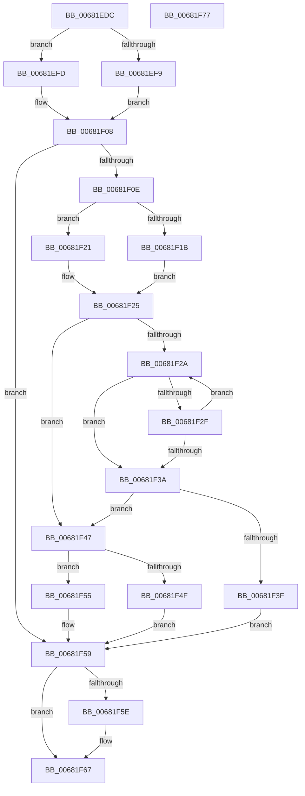

# MiUnlinkSubsectionWaitBlock

- RVA: `0x00681EDC`–`0x00681F78` (길이 `156` bytes)
- VA: `0x0000000140681EDC`
- 실행 섹션: `.text`
- PDB 이름 있음: `예`; PDB Function 태그: `아니요`
- unwind 정보 RVA: `0x00060BC4`
- 디코드: `52`개 명령, `156/156` bytes 표시
- 미해석 바이트: `0` (있으면 어셈블리에 `.byte`로 보존)

> 이 문서는 커널 이미지의 기계어와 PDB 기호를 분석해 생성했습니다. 4번과 5번은 함수 원형과 자료형을 바이너리 사용 방식에서 추정한 C 해석이며 원본 소스 복구 결과는 아닙니다.

## 1. Dependencies

- 직접 호출 지점: **2**; 고유 호출 대상: **2**
- 직접 호출자로 확인된 함수: **2**
- RIP 상대 이미지 참조: **0**

### Outgoing calls
- `0x00681F01` → [ExAcquireSpinLockExclusive](../24/ExAcquireSpinLockExclusive_function_00248690.md) (function, `0x00248690`)
- `0x00681F62` → [MiReleaseSpinLockExclusive](../24/MiReleaseSpinLockExclusive_function_002482C0.md) (function, `0x002482C0`)

### Direct callers
- [MiChangingSubsectionProtos](MiChangingSubsectionProtos_function_0068057C.md) at `0x006805D8`
- [MiAllocateFileExtents](../../page/AB/MiAllocateFileExtents_function_00ABDF54.md) at `0x00ABE190`
- [MiAllocateFileExtents](../../page/AB/MiAllocateFileExtents_function_00ABDF54.md) at `0x00ABE4AA`
- [MiAllocateFileExtents](../../page/AB/MiAllocateFileExtents_function_00ABDF54.md) at `0x00ABE4E9`

### Static image references
- 디코드된 RIP-relative 메모리 참조가 없습니다.

## 2. Other-region calls and transfers

- 다른 실행 섹션으로 향하는 call: **0**
- 별도 외부 분기/꼬리 이동을 확인하지 못했습니다.

## 3. Assembly (complete function range)

```asm
00681EDC  48 89 5C 24 08                  mov qword ptr [rsp + 8], rbx
00681EE1  48 89 74 24 10                  mov qword ptr [rsp + 0x10], rsi
00681EE6  57                              push rdi
00681EE7  48 83 EC 20                     sub rsp, 0x20
00681EEB  48 8B 19                        mov rbx, qword ptr [rcx]
00681EEE  48 8B F2                        mov rsi, rdx
00681EF1  48 8B F9                        mov rdi, rcx
00681EF4  45 85 C0                        test r8d, r8d
00681EF7  74 04                           je 0x140681efd
00681EF9  B2 11                           mov dl, 0x11
00681EFB  EB 0B                           jmp 0x140681f08
00681EFD  48 8D 4B 48                     lea rcx, [rbx + 0x48]
00681F01  E8 8A 67 BC FF                  call 0x140248690
00681F06  8A D0                           mov dl, al
00681F08  83 7E 0C 00                     cmp dword ptr [rsi + 0xc], 0
00681F0C  75 4B                           jne 0x140681f59
00681F0E  44 8B 4B 38                     mov r9d, dword ptr [rbx + 0x38]
00681F12  45 33 C0                        xor r8d, r8d
00681F15  41 83 E1 20                     and r9d, 0x20
00681F19  74 06                           je 0x140681f21
00681F1B  48 8B 4B 50                     mov rcx, qword ptr [rbx + 0x50]
00681F1F  EB 04                           jmp 0x140681f25
00681F21  48 8B 4F 18                     mov rcx, qword ptr [rdi + 0x18]
00681F25  48 85 C9                        test rcx, rcx
00681F28  74 1D                           je 0x140681f47
00681F2A  48 3B CE                        cmp rcx, rsi
00681F2D  74 0B                           je 0x140681f3a
00681F2F  4C 8B C1                        mov r8, rcx
00681F32  48 8B 09                        mov rcx, qword ptr [rcx]
00681F35  48 85 C9                        test rcx, rcx
00681F38  75 F0                           jne 0x140681f2a
00681F3A  4D 85 C0                        test r8, r8
00681F3D  74 08                           je 0x140681f47
00681F3F  48 8B 01                        mov rax, qword ptr [rcx]
00681F42  49 89 00                        mov qword ptr [r8], rax
00681F45  EB 12                           jmp 0x140681f59
00681F47  48 8B 01                        mov rax, qword ptr [rcx]
00681F4A  45 85 C9                        test r9d, r9d
00681F4D  74 06                           je 0x140681f55
00681F4F  48 89 43 50                     mov qword ptr [rbx + 0x50], rax
00681F53  EB 04                           jmp 0x140681f59
00681F55  48 89 47 18                     mov qword ptr [rdi + 0x18], rax
00681F59  80 FA 11                        cmp dl, 0x11
00681F5C  74 09                           je 0x140681f67
00681F5E  48 8D 4B 48                     lea rcx, [rbx + 0x48]
00681F62  E8 59 63 BC FF                  call 0x1402482c0
00681F67  48 8B 5C 24 30                  mov rbx, qword ptr [rsp + 0x30]
00681F6C  48 8B 74 24 38                  mov rsi, qword ptr [rsp + 0x38]
00681F71  48 83 C4 20                     add rsp, 0x20
00681F75  5F                              pop rdi
00681F76  C3                              ret
00681F77  CC                              int3
```

## 4. C-style interpretation (structured pseudocode)

```c
__int64 __fastcall MiUnlinkSubsectionWaitBlock(__int64 a1, __int64 a2, int a3)
{
    __int64 result;
    __int64 v_rsp;
    unsigned __int64 v_stack_p10;
    unsigned __int64 v_stack_p8;

    v_stack_p8 = v_rbx;
    v_stack_p10 = v_rsi;
    v_rsp = (v_rsp) - (32);
    if (a3 == 0) goto loc_00681EFD;
    goto loc_00681F08;
loc_00681EFD:
    result = ExAcquireSpinLockExclusive(*(unsigned __int64 *)(a1) + 72, 17, a3, a4);
loc_00681F08:
    if ((*(unsigned int *)(a2 + 12)) != 0) goto loc_00681F59;
    a3 = 0;
    a4 = (unsigned int)(((unsigned int)(*(unsigned int *)(*(unsigned __int64 *)(a1) + 56))) & (32));
    if (condition_is_equal) goto loc_00681F21;
    goto loc_00681F25;
loc_00681F21:
loc_00681F25:
    if (*(unsigned __int64 *)(a1 + 24) == 0) goto loc_00681F47;
loc_00681F2A:
    if ((*(unsigned __int64 *)(a1 + 24)) == a2) goto loc_00681F3A;
    if (*(unsigned __int64 *)(*(unsigned __int64 *)(a1 + 24)) != 0) goto loc_00681F2A;
loc_00681F3A:
    if (*(unsigned __int64 *)(a1 + 24) == 0) goto loc_00681F47;
    *(unsigned __int64 *)(*(unsigned __int64 *)(a1 + 24)) = *(unsigned __int64 *)(*(unsigned __int64 *)(*(unsigned __int64 *)(a1 + 24)));
    goto loc_00681F59;
loc_00681F47:
    if ((unsigned int)(a4) == 0) goto loc_00681F55;
    *(unsigned __int64 *)(*(unsigned __int64 *)(a1) + 80) = *(unsigned __int64 *)(*(unsigned __int64 *)(*(unsigned __int64 *)(a1 + 24)));
    goto loc_00681F59;
loc_00681F55:
    *(unsigned __int64 *)(a1 + 24) = *(unsigned __int64 *)(*(unsigned __int64 *)(*(unsigned __int64 *)(a1 + 24)));
loc_00681F59:
    result = *(unsigned __int64 *)(*(unsigned __int64 *)(*(unsigned __int64 *)(a1 + 24)));
    if (((unsigned __int8)((unsigned __int8)(result))) != 17) {
        a1 = *(unsigned __int64 *)(a1) + 72;
        result = MiReleaseSpinLockExclusive(a1, (unsigned __int8)(result), *(unsigned __int64 *)(a1 + 24), a4);
    }
    v_rsp = (v_rsp) + (32);
    return result;
}
```

## 5. (Beta) C Style

```c
int64_t MiUnlinkSubsectionWaitBlock(void *Arg1, void *Arg2, int32_t Arg3)
{
    uint8_t *arg1 = (uint8_t *)Arg1;
    uint8_t *arg2 = (uint8_t *)Arg2;

    int64_t result;
    int64_t local_rsp;
    uint64_t v_stack_p10;
    uint64_t v_stack_p8;

    v_stack_p8 = local_rbx;
    v_stack_p10 = local_rsi;
    local_rsp = (local_rsp) - (32);
    if (Arg3 == 0) goto loc_00681EFD;
    goto loc_00681F08;
loc_00681EFD:
    result = ExAcquireSpinLockExclusive(*(uint64_t *)(arg1) + 72, 17, Arg3, a4);
loc_00681F08:
    if ((*(uint32_t *)(arg2 + 0xC)) != 0) goto loc_00681F59;
    Arg3 = 0;
    a4 = (uint32_t)(((uint32_t)(*(uint32_t *)(*(uint64_t *)(arg1) + 0x38))) & (32));
    if (condition_is_equal) goto loc_00681F21;
    goto loc_00681F25;
loc_00681F21:
loc_00681F25:
    if (*(uint64_t *)(arg1 + 0x18) == 0) goto loc_00681F47;
loc_00681F2A:
    if ((*(uint64_t *)(arg1 + 0x18)) == Arg2) goto loc_00681F3A;
    if (*(uint64_t *)(*(uint64_t *)(arg1 + 0x18)) != 0) goto loc_00681F2A;
loc_00681F3A:
    if (*(uint64_t *)(arg1 + 0x18) == 0) goto loc_00681F47;
    *(uint64_t *)(*(uint64_t *)(arg1 + 0x18)) = *(uint64_t *)(*(uint64_t *)(*(uint64_t *)(arg1 + 0x18)));
    goto loc_00681F59;
loc_00681F47:
    if ((uint32_t)(a4) == 0) goto loc_00681F55;
    *(uint64_t *)(*(uint64_t *)(arg1) + 0x50) = *(uint64_t *)(*(uint64_t *)(*(uint64_t *)(arg1 + 0x18)));
    goto loc_00681F59;
loc_00681F55:
    *(uint64_t *)(arg1 + 0x18) = *(uint64_t *)(*(uint64_t *)(*(uint64_t *)(arg1 + 0x18)));
loc_00681F59:
    result = *(uint64_t *)(*(uint64_t *)(*(uint64_t *)(arg1 + 0x18)));
    if (((uint8_t)((uint8_t)(result))) != 17) {
        Arg1 = *(uint64_t *)(arg1) + 72;
        result = MiReleaseSpinLockExclusive(Arg1, (uint8_t)(result), *(uint64_t *)(arg1 + 0x18), a4);
    }
    local_rsp = (local_rsp) + (32);
    return result;
}
```

### 관측된 메모리 오프셋

구조체 형식이 확인되지 않은 접근은 인자 기준의 오프셋으로만 기록했습니다.

| 기준 인자 | 오프셋 표현 | 폭 (bit) | 접근 |
|---|---:|---:|---|
| `Arg1` | `+ 0x0` | `64` | `R` |
| `Arg1` | `+ 0x18` | `64` | `R` |
| `Arg1` | `+ 0x18` | `64` | `W` |
| `Arg2` | `+ 0xC` | `32` | `R` |

## 6. Execution-region graph

[열기: 2D/3D 그래프와 함수 탐색 컨트롤 패널](../../../control-panel.html?section=text&rva=0x00681EDC&view=graph)

- 2D 그래프는 위에서 아래로 흐르고, 3D 그래프는 빈 공간을 드래그해 회전합니다. Shift+드래그는 이동, 휠은 확대·축소, 함수 노드 선택은 대상 보고서 이동입니다.

### Static fallback


