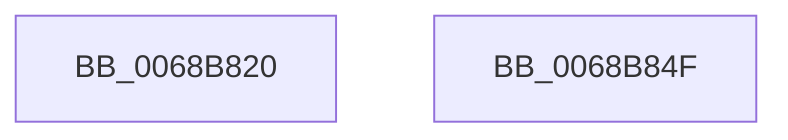

# MiUnlockAllMemoryLists

- RVA: `0x0068B820`–`0x0068B850` (길이 `48` bytes)
- VA: `0x000000014068B820`
- 실행 섹션: `.text`
- PDB 이름 있음: `예`; PDB Function 태그: `아니요`
- unwind 정보 RVA: `0x0005C788`
- 디코드: `11`개 명령, `48/48` bytes 표시
- 미해석 바이트: `0` (있으면 어셈블리에 `.byte`로 보존)

> 이 문서는 커널 이미지의 기계어와 PDB 기호를 분석해 생성했습니다. 4번과 5번은 함수 원형과 자료형을 바이너리 사용 방식에서 추정한 C 해석이며 원본 소스 복구 결과는 아닙니다.

## 1. Dependencies

- 직접 호출 지점: **3**; 고유 호출 대상: **2**
- 직접 호출자로 확인된 함수: **1**
- RIP 상대 이미지 참조: **3**

### Outgoing calls
- `0x0068B82B` → [ExReleaseSpinLockExclusiveFromDpcLevel](../24/ExReleaseSpinLockExclusiveFromDpcLevel_function_002497E0.md) (function, `0x002497E0`)
- `0x0068B837` → [ExReleaseSpinLockExclusiveFromDpcLevel](../24/ExReleaseSpinLockExclusiveFromDpcLevel_function_002497E0.md) (function, `0x002497E0`)
- `0x0068B845` → [MiIterateOverPartitions](../47/MiIterateOverPartitions_function_0047FC14.md) (function, `0x0047FC14`)

### Direct callers
- [MmDuplicateMemory](../../pagelk/B7/MmDuplicateMemory_function_00B74158.md) at `0x00B74492`

### Static image references
- `0x0068B824` → RVA `0x00E2FF20` (`.data`; read)
- `0x0068B830` → RVA `0x00E2FF30` (`.data`; read)
- `0x0068B83E` → RVA `0x004BB470` (`MiLockMemoryLists`; read)

## 2. Other-region calls and transfers

- 다른 실행 섹션으로 향하는 call: **0**
- 별도 외부 분기/꼬리 이동을 확인하지 못했습니다.

## 3. Assembly (complete function range)

```asm
0068B820  48 83 EC 28                     sub rsp, 0x28
0068B824  48 8D 0D F5 46 7A 00            lea rcx, [rip + 0x7a46f5]
0068B82B  E8 B0 DF BB FF                  call 0x1402497e0
0068B830  48 8D 0D F9 46 7A 00            lea rcx, [rip + 0x7a46f9]
0068B837  E8 A4 DF BB FF                  call 0x1402497e0
0068B83C  33 D2                           xor edx, edx
0068B83E  48 8D 0D 2B FC E2 FF            lea rcx, [rip - 0x1d03d5]
0068B845  E8 CA 43 DF FF                  call 0x14047fc14
0068B84A  48 83 C4 28                     add rsp, 0x28
0068B84E  C3                              ret
0068B84F  CC                              int3
```

## 4. C-style interpretation (structured pseudocode)

```c
__int64 __fastcall MiUnlockAllMemoryLists(__int64 a1, int a2)
{
    __int64 result;
    __int64 v_rsp;

    v_rsp = (v_rsp) - (40);
    result = ExReleaseSpinLockExclusiveFromDpcLevel(v_rip + 8013557, a2, a3, a4);
    result = ExReleaseSpinLockExclusiveFromDpcLevel(v_rip + 8013561, a2, a3, a4);
    a2 = 0;
    result = MiIterateOverPartitions(v_rip - 1901525, a2, a3, a4);
    v_rsp = (v_rsp) + (40);
    return result;
}
```

## 5. (Beta) C Style

```c
int64_t MiUnlockAllMemoryLists(int64_t Arg1, int32_t Arg2)
{
    int64_t result;
    int64_t local_rsp;

    local_rsp = (local_rsp) - (40);
    result = ExReleaseSpinLockExclusiveFromDpcLevel(v_rip + 8013557, Arg2, a3, a4);
    result = ExReleaseSpinLockExclusiveFromDpcLevel(v_rip + 8013561, Arg2, a3, a4);
    Arg2 = 0;
    result = MiIterateOverPartitions(v_rip - 1901525, Arg2, a3, a4);
    local_rsp = (local_rsp) + (40);
    return result;
}
```

## 6. Execution-region graph

[열기: 2D/3D 그래프와 함수 탐색 컨트롤 패널](../../../control-panel.html?section=text&rva=0x0068B820&view=graph)

- 2D 그래프는 위에서 아래로 흐르고, 3D 그래프는 빈 공간을 드래그해 회전합니다. Shift+드래그는 이동, 휠은 확대·축소, 함수 노드 선택은 대상 보고서 이동입니다.

### Static fallback


