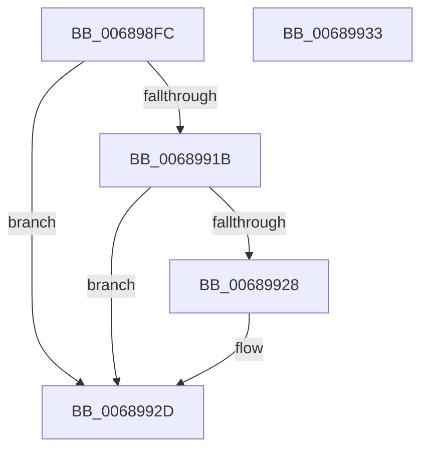

# MiUnlockAwePagesExclusive

- RVA: `0x006898FC`–`0x00689934` (길이 `56` bytes)
- VA: `0x00000001406898FC`
- 실행 섹션: `.text`
- PDB 이름 있음: `예`; PDB Function 태그: `아니요`
- unwind 정보 RVA: `0x0005CF00`
- 디코드: `18`개 명령, `56/56` bytes 표시
- 미해석 바이트: `0` (있으면 어셈블리에 `.byte`로 보존)

> 이 문서는 커널 이미지의 기계어와 PDB 기호를 분석해 생성했습니다. 4번과 5번은 함수 원형과 자료형을 바이너리 사용 방식에서 추정한 C 해석이며 원본 소스 복구 결과는 아닙니다.

## 1. Dependencies

- 직접 호출 지점: **2**; 고유 호출 대상: **2**
- 직접 호출자로 확인된 함수: **3**
- RIP 상대 이미지 참조: **0**

### Outgoing calls
- `0x0068990B` → [ExReleaseAutoExpandPushLockExclusive](../26/ExReleaseAutoExpandPushLockExclusive_function_00264DE0.md) (function, `0x00264DE0`)
- `0x00689928` → [KiCheckForKernelApcDelivery](../2E/KiCheckForKernelApcDelivery_function_002E2C80.md) (function, `0x002E2C80`)

### Direct callers
- [MiBuildPhysicalPageFreeChain](MiBuildPhysicalPageFreeChain_function_00687C80.md) at `0x00687F65`
- [MiDeleteAweInfoPages](../../page/80/MiDeleteAweInfoPages_function_0080AA40.md) at `0x0080ACDE`
- [MiResizeAweBitMap](../../page/80/MiResizeAweBitMap_function_0080AD00.md) at `0x0080ADF7`
- [MiResizeAweBitMap](../../page/80/MiResizeAweBitMap_function_0080AD00.md) at `0x0080AE39`

### Static image references
- 디코드된 RIP-relative 메모리 참조가 없습니다.

## 2. Other-region calls and transfers

- 다른 실행 섹션으로 향하는 call: **0**
- 별도 외부 분기/꼬리 이동을 확인하지 못했습니다.

## 3. Assembly (complete function range)

```asm
006898FC  40 53                           push rbx
006898FE  48 83 EC 20                     sub rsp, 0x20
00689902  48 8B DA                        mov rbx, rdx
00689905  48 83 C1 40                     add rcx, 0x40
00689909  33 D2                           xor edx, edx
0068990B  E8 D0 B4 BD FF                  call 0x140264de0
00689910  90                              nop
00689911  66 83 83 E6 01 00 00 01         add word ptr [rbx + 0x1e6], 1
00689919  75 12                           jne 0x14068992d
0068991B  48 8D 83 98 00 00 00            lea rax, [rbx + 0x98]
00689922  90                              nop
00689923  48 39 00                        cmp qword ptr [rax], rax
00689926  74 05                           je 0x14068992d
00689928  E8 53 93 C5 FF                  call 0x1402e2c80
0068992D  48 83 C4 20                     add rsp, 0x20
00689931  5B                              pop rbx
00689932  C3                              ret
00689933  CC                              int3
```

## 4. C-style interpretation (structured pseudocode)

```c
__int64 __fastcall MiUnlockAwePagesExclusive(__int64 a1, __int64 a2)
{
    __int64 result;
    __int64 v_rsp;

    v_rsp = (v_rsp) - (32);
    a1 = (a1) + (64);
    a2 = 0;
    result = ExReleaseAutoExpandPushLockExclusive(a1, a2, a3, a4);
    if (condition_is_not_equal) goto loc_0068992D;
    result = a2 + 152;
    if ((*(unsigned __int64 *)(a2 + 152)) != (a2 + 152)) {
        result = KiCheckForKernelApcDelivery(a1, a2, a3, a4);
    }
    v_rsp = (v_rsp) + (32);
    return result;
}
```

## 5. (Beta) C Style

```c
int64_t MiUnlockAwePagesExclusive(int64_t Arg1, void *Arg2)
{
    uint8_t *arg2 = (uint8_t *)Arg2;

    int64_t result;
    int64_t local_rsp;

    local_rsp = (local_rsp) - (32);
    Arg1 = (Arg1) + (64);
    Arg2 = 0;
    result = ExReleaseAutoExpandPushLockExclusive(Arg1, Arg2, a3, a4);
    if (condition_is_not_equal) goto loc_0068992D;
    result = Arg2 + 152;
    if ((*(uint64_t *)(arg2 + 0x98)) != (Arg2 + 152)) {
        result = KiCheckForKernelApcDelivery(Arg1, Arg2, a3, a4);
    }
    local_rsp = (local_rsp) + (32);
    return result;
}
```

### 관측된 메모리 오프셋

구조체 형식이 확인되지 않은 접근은 인자 기준의 오프셋으로만 기록했습니다.

| 기준 인자 | 오프셋 표현 | 폭 (bit) | 접근 |
|---|---:|---:|---|
| `Arg2` | `+ 0x0` | `64` | `R` |
| `Arg2` | `+ 0x98` | `64` | `R` |
| `Arg2` | `+ 0x1E6` | `16` | `R/W` |

## 6. Execution-region graph

[열기: 2D/3D 그래프와 함수 탐색 컨트롤 패널](../../../control-panel.html?section=text&rva=0x006898FC&view=graph)

- 2D 그래프는 위에서 아래로 흐르고, 3D 그래프는 빈 공간을 드래그해 회전합니다. Shift+드래그는 이동, 휠은 확대·축소, 함수 노드 선택은 대상 보고서 이동입니다.

### Static fallback


